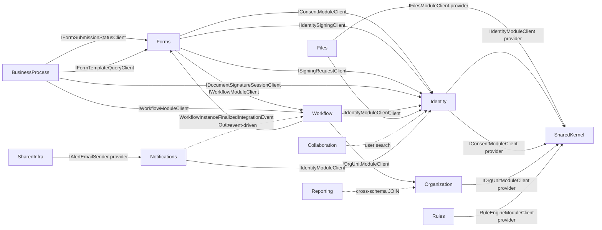
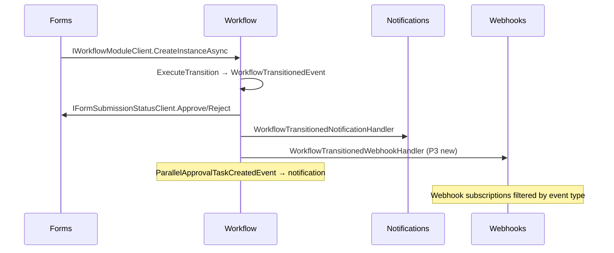

# AqtCoreFW — Full Dependency Map

**Last updated:** 2026-08-05 (FORMS CROSS-FIELD CASCADING DATA-SOURCE v1 slice, branch `feat/forms-cascading-datasource`: child field's option-list filtered by 1-N PARENT fields' selected values. Schema `DataSourceJson.dependencies:[{dependsOnFieldKey, filterParamName}]` (empty/absent = old static path, backward-safe discriminator). Scope v1 = AUTHED-only, TOP-LEVEL fields, External-static + keyed-Enum. BE: `IDataSourceResolver.ResolveAsync` gains optional `parentValues` param (3 impls: Enum/Internal/External; Internal accepts-ignores per red-team H1); `GetFormFieldOptionsQuery` +optional `ParentValues`; endpoint `GET .../fields/{fieldId}/options` gains `[FromQuery] Dictionary<string,string> p` (`?p[filterParamName]=value`), stays class-scope `[Authorize]`. NEW `CascadeDependencyValidator` (Forms.Domain/Entities) — Kahn topo-sort cycle + self-dep + dangling-ref detection at `FormTemplate.Publish/Republish`, + `EnsureNotDependedOn` reject-delete guard in `DeactivateField`; error codes GOV_FRM_040-043. `ExternalDataSourceResolver`: parent values appended to ApiUrl via `Uri.GetComponents`+`Uri.EscapeDataString` (NOT UriBuilder.Query — avoids escape-mangling); cache-key now includes parent values (byte-identical to legacy when no parents). `EnumDataSourceResolver`: config-driven `parentFilterMap` (parentValue→allowed enum values), multi-parent = intersection, fail-safe-empty when unmapped. FE: `useFieldOptions(templateId, fieldId, parentValues?, enabled?)` (parentValues in query-key → auto-refetch on parent change); `RefFieldSelect` watches parents, gates fetch until all-parents-set, clears stale child value on parent change; Builder `CascadeDependenciesEditor` + `EnumParentFilterMapEditor` (keyed-Enum map authoring) + soft client cycle-warn; new pure helpers `cascade-dependencies.ts` + `cascade-builder.ts`. DEFERRED (red-team → backlog row `FORMS-CASCADE-PUBLIC-EXTERNAL-INROW`): anonymous-public cascade (C1), external-Vault-auth (H2), Internal-multi-param (H1), in-row TableField cascade (M1). Tests: BE 23 new (Domain 7 + Infra 13 + App 3), FE 30+ new; full BE 617/617, FE forms 195+/195+, review 8.5/10. No migration, no entity/DbSet change, no new cross-module client.) **2026-08-04** (FORMS ORPHAN-WORKFLOW-LINK RETRY: Phase 04 Hangfire recurring job `FormWorkflowLinkRetryJob` (Forms.Infrastructure/Jobs, 5-min cron `*/5`, idempotent resolve-before-create, cross-tenant, RLS-pinned per row via `ICrossModuleUnitOfWork`, exponential backoff 5m→6h, max 10 attempts, shelve to Dead); Phase 05 NEW admin API `WorkflowLinkPendingController` at `api/v1/forms/workflow-link-pending` (3 endpoints: GET paged list, POST {id}/retry, POST {id}/shelve), gated by NEW permission `FORMS.WFLINK.MANAGE` (seeded Admin+SystemAdmin); Phase 06 FE admin page `/admin/pending-workflow-links` (route + feature dir + i18n + sidebar entry, consumes Phase 05 endpoints); DTO `PendingWorkflowLinkListItemDto` gained `TemplateName` field (coalesced via `COALESCE(NULLIF(t.NameVi,''), t.Name)`). Reuses existing `IWorkflowModuleClient.TryResolveInstanceForEntityAsync` — no new cross-module client method. Zero schema change (entity + indexes pre-existed Phase 03). Phase 07 backfill SHIPPED: `scripts/backfill/forms-workflow-link-pending-backfill.sql` (idempotent ops backfill, seeds one retry-armed Pending row per historical orphan submission since 2026-05-21, explicit column list, NOT EXISTS guard on unique key `(SubmissionId, TenantId)`, `LastFailureCode='BACKFILL_ORPHAN'`, `NextRetryAt` armed to now) + `docs/runbooks/forms-workflow-link-retry-backfill-runbook.md` (VI ops runbook: dry-run, execute, verify, rollback guidance) + `tests/integration/AqtCoreFW.Forms.Integration.Tests/FormWorkflowLinkBackfillScriptTests.cs` (integration idempotency test vs real SQL, column-shape drift guard). Phase 04+05+06+07 COMPLETE.) | **2026-07-23** (LAUNCH-DEFERRED-MODULES-OFF-MECHANISM, option B: `Features:{Ai|Collaboration|BusinessProcess|Reporting|Rules}:Enabled` config-flag OFF mechanism for the 5 v1.1-deferred modules — new host `DeferredModuleFlags` gate removes an OFF module at DI registration, ApplicationPartManager controller discovery, `StartupMigrationSets` migration set, and Collaboration ChatHub mapping; Reporting's recurring cleanup job also `RecurringJob.RemoveIfExists` on the OFF branch. NEW host endpoint `GET /api/v1/system/module-flags` (`ModuleFlagsController`) + NEW FE `ModuleFlagGate`/`withModuleFlag` route wrapper + menu post-filter. See §4 new row + §5 new row + §5b new note below for detail.) **2026-07-14 (ISO-AUDIT-MODULECLIENT-SECURITYHEALTH-REFACTOR: identity's 2 SecurityHealth handlers — `GetAuditIntegrityStatusQuery`/`GetAuditRetentionStatusQuery` — no longer read `[audit]` directly; now delegate to `IAuditEvidenceClient` (Audit.Contracts), which gains `GetIntegrityStatusAsync`+`GetRetentionPolicyStatusAsync`; NEW cross-module edge `Identity.Application` → `Audit.Contracts` (ProjectReference, contracts-only, mirrors the existing `Reporting.Application` edge); identity now holds no `[audit]`-capable DB credential; audit-keyed reader allowlist 12→10; ADR-012 standing-exception #5 removed. No migration, no entity change, no public HTTP contract change.). **2026-07-09** (PUBLIC-FORMS-LEAST-PRIV-ANON-READ: `FormTemplate` entity NEW `IsPublic` bool column (default false, migration backfill Active→IsPublic=1); asymmetric RLS FILTER/BLOCK policy carve-out per flag (`fn_forms_FormTemplates_TenantFilter` adds `OR (IsPublic=1 AND SESSION_CONTEXT('public_forms_bypass')='true')`); new `IReadDbConnection.QueryFirstOrDefaultWithPublicFormsBypassAsync` (Dapper, bypass context, dedicated conn) for by-Code template lookup; new `IFormTemplateRepository.GetPublicWithFieldsAsync` (EF, tenant-pinned) for second-step read; 3 public handlers updated (GetPublicFormQuery, SubmitPublicFormCommand, GetPublicSignatureDocHashQuery) with `AND IsPublic=1` by-Code guard + bypass-read routing. Contract additive (no breaking change, backward compatible via migration). **2026-07-08** (AUTH-SUBMIT-NO-CONSENTGIVEN FIX: `SubmitFormRequest` DTO contract additive — `bool ConsentGiven` field added between `Data` and `Signature`, wired into `SubmitFormCommand` build; no migration). **2026-07-01** (Plan 260623-1950 Phase 6 COMPLETE + image-upload follow-up COMPLETE — all 4 slices A+B+C+D SHIPPED with signature-cert multi-provider enrollment, admin approval, self-service CCCD binding, + remote PAdES visible-stamp placement. **2026-07-01 PM self-service image-upload modal shipped:** NEW FE modal `web/src/features/profile/signatures/signature-image-upload-modal.tsx` (dual-path file upload + canvas draw) + SignatureWidget promoted to `web/src/shared/components/` + `SignatureProfileDto` DTO extensions `hasFullImage`/`hasInitialImage` (Application-only, no migration) exposed via `SignatureOverviewQuery`/`ListMySignatureProfilesQuery`. Unblocks end-to-end visible signing (image is hard prerequisite for `PadesTransactionInitiator`). **Phase 6 Slice B (commit 39346800):** self-service set-CCCD via `PUT /api/v1/me/signing-national-id` (12-digit validation, active-enrollment lock, idempotent, encrypted, binding enforced downstream via SignerBindingGuard + PadesCompletionService C5 re-check). **Phase 6 Slices A+C+D:** P6A user-profile signature-management tab + enrollment list (1225/1225 GREEN); P6C admin-dashboard paginated pending-enrollment queue with approve/reject actions (1229/1229 GREEN); P6D remote-PAdES signing with visible-stamp placement UI + placement JSON contract + multi-page BE support. P6D NEW FE modules: `features/digital-signature/placement/`, `features/files/sign-uploaded-file-pades-modal.tsx` (production modal: PDF preview + overlay + profile dropdown + visualType radio + gate Approved enrollment → placement JSON → remote sign → poll). P6D NEW BE: `SignatureAppearance.Page` (1-based, default 1), `PdfDocumentModel.PageObjectNumber(int)` (flat-tree resolver), `PdfIncrementalSignatureWriter` targets appearance.Page, `PadesTransactionInitiator` passes placement.Page. Placement contract: `{page: int, x/y/w/h: float, profilePublicId: Guid, visualType: string}`. Full suite 1225/1225 + 1229/1229 + arch 149/149; all committed + PUSHED origin/main. Phase 5 Slice 2 "PAdES Visible Stamp Wired for Remote Single-Signer" — NEW `IUserSignatureImageStore.GetAsync` cross-module port (Identity → Files), NEW `ISignatureStampRasterizer` (Identity.Infrastructure QuestPDF rasterizer), NEW components `SignaturePlacement` + `SignatureStampRasterizer` + `QuestPdfExporter.EnsureInitialized()`, PAdES writer appearance compose-at-initiate wired into `PadesTransactionInitiator` (tenant+signer-scoped, fail-closed); flatten deferred (no permissive PDF lib under constraints); 43 PAdES regression tests GREEN; arch 149/149. P4 Slice 3 "Self-Service Multi-Provider Signature Enrollment" — 3 slices SHIPPED: Slice 1 `21cc6172` self-service signature-profile CRUD (CreateSignatureProfileCommand, UpdateSignatureProfileCommand, MarkDefaultSignatureProfileCommand, DeleteSignatureProfileCommand, ListMySignatureProfilesQuery) + UserSignatureProfileController; Slice 2 `5c37b6c7` multi-provider enrollment challenge (`IssueEnrollmentNonceCommand`, `EnrollMySignatureCertCommand` ByKind, `SignerEnrollmentNonce` entity + repo + RLS migration, `VgcaCertSubjectParser` relocated Domain) + `UserSignatureEnrollmentController`; Slice 3 `7292f703` read aggregate (`SignatureOverviewQuery`, `SignatureOverviewDto`, `SignatureEnrollmentStatusDto`) + `UserSignatureOverviewController`. All JPEG identity JWT-pinned anti-IDOR. Identity.Application 363, Architecture 149, reviewer APPROVE ×3) | (Phase 2c-A Forms PDF signing — NEW `ISigningRequestClient` consumer in Forms.Application; `GenerateAndInitiateSubmissionSigningCommandHandler` generates PDF via `ISubmissionPdfComposer`, stages to signing-original bucket via host-level `ISigningOriginalBucketUploader` adapter, calls orchestrator, links `SigningRequestId`; new `POST /api/v1/forms/submissions/{id}/sign-document` endpoint [RequiresMfa]; `FormSubmissionDto` + `GetFormSubmissionQueryHandler` gain additive `Guid? SigningRequestId` field) | (Files stage-for-signing — NEW `POST /api/v1/files/{id}/stage-for-signing` copies Files bucket PDF into signing-original bucket; `StageFileForSigningCommand` + handler + validator + 12 unit tests; FilesController +`[RequiresMfa]` action; dependency-map updated) | **Version:** WF parallel-runtime P5-FOLLOWUP H1 (branch-join reconciler — dormant prod backstop). **P5-FOLLOWUP H1 (2026-06-08, NEW recurring Hangfire job — additive, intra-Workflow only, no entity/contract/migration/FE):** `BranchJoinReconcilerJob` (Workflow.Infrastructure/Jobs) finishes parallel-branch joins whose condition is satisfied but whose instance never advanced (crash-after-resolve / genuine transient conflict surfaced by `BranchJoinCompletionService` winner-election step 2). Thin finder-delegator: raw-SQL candidate scan (narrow predicate — `InProgress` + instance parked at branching state) → per-candidate DI scope → `CheckJoinCondition` recheck → delegate to `IBranchJoinCompletionService.CompleteJoinAsync` (owns RowVersion winner-election + continuation fail-CLOSED + staging; the job never reimplements completion). Empty/handler-less continuation = permanent config strand (`NoHandlerResolved`/GOV_WFL_014) → throttled-warn ≤1×/strand/1h via `IMemoryCache` (Size=1, no persistence/migration), NOT retried as transient. Registered `Program.cs` every 5min beside `BranchTimeoutCheckerJob`; ships DORMANT (0 parallel defs live → scan returns 0 rows). Cross-tenant background scan safe via `BackgroundJobTenantContext` (no HttpContext → SystemAdmin, TenantId=null → tenant query-filter pass-through). Tests `WorkflowBranchJoinReconcilerTests` (4: stranded-recovered / permanent-not-advanced+throttled / incomplete-untouched / healthy-no-op). Full Workflow integration 103/103 green; code-review APPROVE_WITH_CONCERNS 0C/0H. WF parallel-runtime P5 (first e2e fork test + child-status FK engine fix). **P5 (2026-06-08, first end-to-end parallel-fork integration test + the engine bug it surfaced — BE-only, additive FK migration):** New `WorkflowParallelBranchRuntimeTests` drives the full HTTP lifecycle (activate → create instance → Submit fork → 2 pooled children + candidate-index → claim → resolve×2 → AND-join → continuation task claimable → Close → final) plus negatives (resolve-before-claim 403, ordinary-transition-while-InProgress 403, activate-unpooled-child 422). It uncovered that branch-child `WorkflowTask`s were persisting `BranchChildStatusId = 0` (no EF relationship → no IDENTITY-FK fixup; `ParallelBranchService` wrote the pre-save `0`), breaking `GetByBranchChildStatusIdAsync` → claim→resolve→join non-functional (mocked unit tests missed it). Fix = real FK relationship + nav `WorkflowTask.BranchChildStatus` + a `CreateForBranchChild(long, WorkflowBranchChildStatus, …)` overload that sets the nav; migration `20260608031148_LinkWorkflowTaskToBranchChildStatus` (additive `AddForeignKey`). Also fixed a P4 regression: the fork-entry fail-CLOSED gate had silently broken 3 harness-#2 `BranchFanOut` happy-path tests (children created with no pool) — `InlineWorkflowDefinitionFactory` children now carry a ByPermission pool; the rollback test (was passing vacuously) now asserts the GOV_WFL_015 seam. Carry-fwd: H1 reconciler, H2 concurrency scenarios (2-sibling join, SLA-job-vs-join), RT2/RT13 negatives, the `RateLimiting:Enabled=false` test-harness disable not taking effect under dense write-ops. **P4 (2026-06-07, parallel-branch runtime ENGINE — no migration / no entity / no contract / no FE / no cross-module change; intra-Workflow only):** Makes a parallel fork actually RUN. (1) `ExecuteTransitionCommandHandler` fork-entry: when the transition target is a branching state, the WF_NO_HANDLER pre-check is replaced by a per-child pool resolve (`IWorkflowHandlerResolver.ResolveAssignmentAsync`) — fail-CLOSED if ANY child pool is empty AND has no default assignee (RT4, avoids AND-join deadlock); resolved pools hoisted + handed to `IParallelBranchService.InitiateBranchingAsync` (signature gains `IReadOnlyDictionary<long,HandlerResolution> childPools` + `Guid createdBy`) which now writes `WorkflowTaskCandidateIndex` + `CandidateRefsJson` per child task (pool-priority over `DefaultAssigneeId`) so children are claimable/inbox-visible. Plus a fork-EXIT guard: any `ExecuteTransition` is rejected while the instance has an `InProgress` `WorkflowInstanceBranchStatus` (single-active-branch invariant). (2) NEW intra-module service `IBranchJoinCompletionService` / `BranchJoinCompletionService` (Application.Services, DI in `WorkflowApplicationModule`) owns join completion: continuation pre-check (read-only fail-CLOSED) → atomic `{ MarkResolved + ApplyParallelJoinTransition + stage continuation task }` in one SaveChanges (Slice-7 tx envelope), branch `RowVersion` = winner-election token (loser → clean no-op). The 3 callers `ResolveBranchChildCommandHandler` / `CompleteTaskCommandHandler` / `CancelTaskCommandHandler` now ROUTE through it (the 2 auto-resolve callers previously lacked the continuation pre-check + swallowed failures — now contract-b: task action succeeds, join-failure loud-logged for an async reconciler). `ParallelBranchService.ResolveBranchChildAsync` no longer marks the branch resolved (it still commits the child for sibling visibility). `WorkflowInstanceBranchStatus` gained a `Statuses` constants nested class (consumed by `ParallelBranchRepository` / `WorkflowInstanceRepository` / `BranchTimeoutCheckerJob` InProgress filters). Carry-fwd P5: e2e fork test + concurrency scenarios + reconciler (`BranchTimeoutCheckerJob` ext). **v2.137p157 (2026-06-06, BP multi-run DossierId):** Fixes a 500 on the 2nd `POST /business-processes/{id}/runs` for the same BP. Root cause: unique active-entity index `UX_WorkflowInstances_Active_Entity` (EntityType,EntityId,TenantId WHERE CompletedAt IS NULL) + FE sending `entityId=bpId` permitted only one active run per BP. Fix = nullable per-run `WorkflowInstance.DossierId` (Guid v7, minted unconditionally in `StartBusinessProcessRunCommandHandler` — no `"BusinessProcess"` literal); index filter narrowed to `[CompletedAt] IS NULL AND [DossierId] IS NULL` (Option B': non-BP rows leave DossierId NULL → still indexed = one-active-per-entity preserved byte-identical; BP runs carry a non-null DossierId → excluded → N concurrent runs). Migration `20260606083540_AddWorkflowInstanceDossierIdAndScopeActiveIndex` (Up: add column + drop/recreate index; **Down: fail-loud** — THROWs if any (EntityType,EntityId,TenantId) has >1 active run rather than a raw 1505; no data destroyed). Contract (additive-nullable, backward-compat): `CreateWorkflowInstanceRequest` gains `Guid? DossierId`; `IWorkflowModuleClient.CreateInstanceByInternalIdAsync` gains trailing `Guid? dossierId = null` (BP handler is its only prod caller). Layer-1 defense: `WorkflowInstanceRepository.SaveChangesAsync` now also catches `DbUpdateException` wrapping SqlException 2601/2627 → `Result.Fail` new code `GOV_WFL_020` (HTTP 409) — never fires on the BP path (BP rows excluded), guards the non-BP/Generic create race. FE: `new-bp-run-wizard.tsx` sends per-attempt `X-Request-Token` on StartRun (hand-wired `useStartBpRun` mutation, Orval hook has no per-call header) → existing `AntiDoubleSubmitMiddleware` 409s an accidental re-fire (409 → friendly toast). entityId stays = bpId (FE display-name contract unchanged). Tests: 10 real-SQL integration PASS (BP double-run distinct DossierId; DB-level B' both directions; Layer-1 GOV_WFL_020 via EF path; migration coexist; Down fail-loud guard) + preflight index constants synced to B'; AC6 middleware test descoped (harness lacks AntiDoubleSubmit/Redis wiring — FE shipped + tsc/lint verified). **v2.137p155 (2026-06-04, parallel-branch authoring):** Definition-time authoring of parallel branches (fork → N children → continuation join) added to the Workflow Visual Designer. **Wire contract (additive-nullable, backward-compat):** `PUT /api/v1/workflow/definitions/{id}/graph` request gains `branches[]` (name-keyed: `branchingStateName`/`continuationStateName`/child `targetStateName`/resolution `resultingStateName` + `branchType` And/Or/NOfM, `requiredCount?`, `allowCancelOnAnyReject`, `timeoutMinutes`, `positionX/Y?`, `children[].resolutions[]`); `GET definition` `WorkflowDefinitionDto` gains `branches[]` (long state ids out). Branches persist **name-keyed folded into `ReplaceGraphAsync`'s replace-all inside the SAME `TransactionScope`** — branch state-FKs are bare bigint (no DB FK to WorkflowStates) + replace-all regenerates state IDENTITY each save, so name-keying defeats dangling references; manual branch DELETE precedes state DELETE, children/resolutions cascade via FK. NEW EF migration `20260604083725_AddParallelBranchGatewayPosition` = +2 nullable `float` cols (`PositionX/PositionY`) on `WorkflowParallelBranches` (single draggable fork gateway; null ⇒ FE auto-derives). `IWorkflowGraphValidator.ValidateForSaveAsync` signature gains `branchSpecs` + rules RB1-RB4 (name existence, NOfM RequiredCount∈[1,childCount], one fork per branching state, branching≠continuation+≥1 child); handler `BuildBranchSpecs` adds structural 422 guards incl. dedup for the child-name + resolution-type unique indexes (avoids DbUpdateException→500). `GetWorkflowDefinitionQueryHandler` adds Dapper `AttachBranchesAsync` (3-query read-back). Orphan `CreateParallelBranchCommand*` (+handler+validator) marked `[Obsolete]` dormant (not dispatched). NO new endpoint / no new cross-module client / no new authz surface (rides existing `Workflow.Def.Manage` + handler tenant guard). FE: `workflow-types.ts` `branches` on SaveGraphRequest + WorkflowDefinitionDto (GET ids, save names) + `BranchType`/`BranchResolutionType` unions; new gateway node + branch-editor components on the designer; i18n vi+en. Tests: Workflow.Application 616/616, integration `SaveDefinitionGraphBranchHttpTests` 7/7 (Testcontainers SQL), FE 43/43. Code-review APPROVE_WITH_CONCERNS (H1/M1 dup-index→500 fixed pre-merge). **v2.137p142 (2026-06-02, P7b):** NEW `DemoReportingSeeder` (Reporting.Infrastructure/`Seeding/DemoReportingSeeder.cs`, IHostedService+IIntegrationTestSeeder) — module-resident self-contained (no cross-module FK). Per `TenantSeedProfiles` entry (BTC+BNV): one `ReportDefinition` + one `ReportWidget` + one `DashboardLayout` (grid JSON references the assigned widget.Id), plus ONE GLOBAL `QueryCatalogEntry` seeded once (no tenant key). Definitions only — no `ReportExecution` runtime rows. **Three tenant-scope shapes:** `ReportDefinition.TenantId` = `string?` slug (NOT ITenantScoped; query handler compares `tenantContext.TenantId?.ToString()` per `ReportDefinitionRepository.cs:18` → seed `profile.TenantId.ToString()`; DB unique `(Name,TenantId)` WHERE `[TenantId] IS NOT NULL`); `ReportWidget`+`DashboardLayout` Guid ITenantScoped (EF global filter, bypassed via `SystemSeederTenantContext`); `QueryCatalogEntry` no tenant key (global, unique `Code`). **Naming asymmetry:** widget unique `(Name,TenantId)` → name tenant-agnostic; dashboard unique `(Name,OwnerId)` + OwnerId=Guid.Empty → name MUST be tenant-distinct (`…(demo) — {profile.Name}`) to avoid collision. Two-phase txn-wrapped save (phase-1 report+widget → SaveChanges → widget.Id; phase-2 dashboard grid JSON refs widget.Id; `BeginTransactionAsync`/`Commit` so phase-2 fault rolls report back — single anchor probe = report def, sufficient under tx atomicity). Self-contained literal SQL `SELECT CAST(0 AS bigint) … WHERE @TenantId IS NOT NULL` (all 3 executors bind @TenantId server-side → renders; no schema dep, Cases deleted PR#71; CrossSchemaSqlScanner cannot trip — no FROM/JOIN). Gated `Reporting:DemoReportingSeed` (OFF; ON Development + reset-all). Marker `[DemoReportingSeeder] All tenants complete`. No migration / no entity change / no new contract or endpoint. DI: gated `AddHostedService` in `AddReportingInfrastructure` (module). `SeederMarkerContractTests` anchor list extended with `Reporting.Infrastructure` (PR#71 `ReportDefinitionSeeder` = comment-only tombstone, no class). **Phase 7 COMPLETE — Integration (7c) + Rules (7a) + Reporting (7b) all shipped; P3b FE geo-migration remains a separate gated follow-up.** **v2.137p141 (2026-06-02, P7a):** NEW `DemoRulesSeeder` (Rules.Infrastructure/`Seeding/DemoRulesSeeder.cs`, IHostedService+IIntegrationTestSeeder) — module-resident self-contained (no cross-module FK). Seeds one Draft `RuleSet` + 2 expression `Rule`s + 1 `DecisionTable` per `TenantSeedProfiles` entry (BTC+BNV). Left Draft (`RuleSet.Activate` raises a domain event → seeder never activates; no `RuleVersion`/`RuleTestCase`). Gated `Rules:DemoRulesSeed` (OFF; ON Development + reset-all). Idempotent `(TenantId, Name)` — RuleSet has NO unique (TenantId,Name) index + no Code, so a convention probe (serial startup, dev-only → no migration). Mixed save: phase-1 RuleSet + 2 Rules in one SaveChanges (Rules fixed up via mapped `RuleSet.Rules` nav `RuleSetConfiguration.cs:27`), phase-2 DecisionTable keyed by assigned RuleSet.Id (no nav, loose RuleSetId column). Transaction-wrapped. No tenant guard (RuleSet.TenantId unenforced stamp). Marker `[DemoRulesSeeder] All tenants complete`. No migration / no entity change / no new contract or endpoint. DI: gated `AddHostedService` in `RulesInfrastructureRegistration` (module). `SeederMarkerContractTests` anchor list extended with `Rules.Infrastructure`. **P7 still PARTIAL — Reporting (7b) pending.** **v2.137p140 (2026-06-02, P7c):** NEW `DemoIntegrationSeeder` (Integration.Infrastructure/`Seeding/DemoIntegrationSeeder.cs`, IHostedService+IIntegrationTestSeeder) — module-resident (self-contained, no cross-module FK, unlike P6 host seeder). Seeds one Active `Partner` + one Draft `Contract` per `TenantSeedProfiles` entry (BTC+BNV); NO `MessageLog` (runtime entity). Gated `Integration:DemoIntegrationSeed` (OFF; ON Development + reset-all). Idempotent `(TenantId, Code="demo-partner")` (unique index `PartnerConfiguration.cs:30` filtered `[IsDeleted]=0` load-bearing). Transaction-wrapped 2-phase save (Partner → Contract, split because Contract has no nav-collection on Partner → genuine two-phase, carries DB-assigned partner.Id). No tenant guard (Partner.TenantId unenforced stamp). Marker `[DemoIntegrationSeeder] All tenants complete`. No migration / no entity change / no new contract or endpoint → entity-graph + client tables below unchanged. DI: gated `AddHostedService` in `IntegrationInfrastructureRegistration` (module, not host). **Also closed a `SeederMarkerContractTests` drift-guard gap: its assembly anchor list now includes `Workflow.Infrastructure` + `Forms.Infrastructure` + `Integration.Infrastructure` (previously the P4/P5/P7 module demo seeders weren't scanned; P6 was, via the host assembly).** **P7 PARTIAL — Rules (7a) + Reporting (7b) seeders still pending.** **v2.137p139 (2026-06-02, P6):** NEW `DemoBusinessProcessSeeder` (**host-resident** `src/host/AqtCoreFW.Api/DemoBusinessProcessSeeder.cs`, IHostedService+IIntegrationTestSeeder) — the FIRST cross-module demo seeder. Seeds one Draft `BusinessProcessDefinition` per `TenantSeedProfiles` entry (BTC+BNV) pairing the P4 demo workflow def (`DemoWorkflowSeeder.DemoDefinitionKey`) + P5 demo intake form (`DemoFormTemplateSeeder.DemoTemplateCode`): intake pin (`IntakeFormTemplateId`+version, GOV_BP_010) + 1 `BusinessProcessStateForm` (Draft state) + 1 `BusinessProcessTransitionForm` (Submit transition). Left Draft (operator activates → R1-R4). Gated `BusinessProcess:DemoBusinessProcessSeed` (OFF; ON Development + reset-all). Idempotent `(TenantId, Code="demo-business-process")` (unique index `BusinessProcessDefinitionConfiguration.cs:36` load-bearing). Fail-loud on any missing dep (workflow def/state/transition/template/version → throw). Transaction-wrapped 2-phase save (root → form-map children, split because children carry DB-assigned bp.Id). Marker `[DemoBusinessProcessSeeder] All tenants complete`. No migration / no entity change. **ARCHITECTURE: host placement (not BusinessProcess.Infrastructure) — `ModuleIsolationTests.NoModule_Should_DirectlyReference_AnotherModule` forbids module→module refs; cross-module clients (`IWorkflowModuleClient`/`IFormTemplateQueryClient`) expose only PublicId-keyed resolve, seeder holds natural keys. Host composition root = sanctioned cross-module-seed home (mirrors `E2ETestDataSeeder`), reads 3 DbContexts via `SystemSeederTenantContext`+`IgnoreQueryFilters` (db_owner RLS-bypass at startup). DI: gated `AddHostedService` in `Program.cs` after BusinessProcess module reg (after Forms+Workflow → deps committed first).** Follow-up `SEED-TXN-WRAP-P4-P5` (propagate txn wrap to P4/P5). **v2.137p138 (2026-06-02, P5):** NEW `DemoFormTemplateSeeder` (Forms.Infrastructure/`Seeding/DemoFormTemplateSeeder.cs`, IHostedService+IIntegrationTestSeeder) — seeds one published intake `FormTemplate` per `TenantSeedProfiles` entry (BTC+BNV), `StorageMode.Json` (Publish→Active), 7 fields/7 distinct types incl. `muc_do_uu_tien` EnumRef dropdown + 3 static `FormFieldOption` (served ahead of DataSourceJson per `GetFormFieldOptionsQueryHandler`). Gated `Forms:DemoFormTemplateSeed` (OFF; ON Development + reset-all). Idempotent `(TenantId, Code="demo-intake-form")` (unique index load-bearing). 2-phase save (template+fields+options EF FK-fixup via mapped `Options` nav `FormFieldConfiguration:69` → `PublishAndSnapshot`+`FormTemplateVersion`). Marker `[DemoFormTemplateSeeder] All tenants complete`. No tenant guard / no migration (FormTemplate.TenantId unenforced stamp). Cross-tenant seed only on db_owner (forms RLS; fail-loud else). DI in `FormsInfrastructureModule` (gated AddHostedService, appended after FormMaterializationService). Known gap: snapshot omits `FormFieldOption` (`BP-FORM-OPTIONS-SNAPSHOT`). **v2.137p137 (2026-06-02, P4):** NEW `DemoWorkflowSeeder` (Workflow.Infrastructure/`Seeding/DemoWorkflowSeeder.cs`, IHostedService+IIntegrationTestSeeder) — seeds one generic 6-state def per `TenantSeedProfiles` entry in Draft, each transition carrying a `WorkflowTransitionAssignment` + `ByRole` clause keyed by per-tenant role CODE (`profile.RolePrefix+suffix`). Gated `Workflow:DemoWorkflowSeed` (OFF; ON Development + reset-all). Idempotent `(TenantId, DefinitionKey="demo-generic-process")`. Marker `[DemoWorkflowSeeder] All tenants complete`. No tenant guard (WorkflowDefinition.TenantId = unenforced stamp, no FK). `SystemSeederTenantContext` PROMOTED `Organization.Infrastructure.Seeding`(internal) → `SharedKernel.Application.Seeding`(public) — shared by OrgTree/TenantAssignment/DemoWorkflow seeders. IHostedService order unchanged; DemoWorkflowSeeder independent (no P3 dep). **v2.137p133 (P2.3c tenant-agnostic seeder live swap + legacy BTC seeders retired). v2.137p131 (2026-05-31 LOCAL, P2.3a Tenant Role Seeding + Schema Refactor):** NEW `TenantRoleSeeder` (Identity module, IHostedService, `Seeding/TenantRoleSeeder.cs`) — tenant-agnostic seeder seeds 17 government-hierarchy business roles per tenant (loops via `TenantSeedProfiles.All` → generates BTC_ + BNV_ prefixed codes). Gated `Identity:TenantRoleSeed` (default OFF; enabled in Development + reset-all.ps1). Runs after TenantSeeder/TenantBackfillSeeder, before TenantUserSeeder. Requires tenant row to exist (skips idempotently if missing). Inserts roles directly via IdentityDbContext — **bypasses RoleManager's global-name-uniqueness check** (now per-tenant; see schema note below). Idempotent per `(Code, TenantId)`. Completion marker (polled by reset-all.ps1): `[TenantRoleSeeder] All tenants complete`. **SCHEMA CHANGE:** AspNetRoles role-name uniqueness refactored from GLOBAL unique on `NormalizedName` (index `RoleNameIndex`) → unique on `(TenantId, NormalizedName)` via migration `20260531053657 ScopeRoleNameToTenant`. New index `IX_AspNetRoles_TenantId_NormalizedName` (filtered `NormalizedName IS NOT NULL`). This permits two tenants to share a role display name (e.g., "Bộ trưởng"). Null-tenant (system-wide) roles remain singular per name (SQL treats NULLs as equal in unique index). Existing `(Code, TenantId)` unique index unchanged. **Caveat:** Free-text admin `AssignRole` + `RoleManager.CreateAsync` still apply GLOBAL role-name semantics in code (DB now permits per-tenant duplicates) — business-role admin resolution should move to RoleId when that UX lands. **v2.137p102 entity-graph delta:** NEW `FormSubmissionWorkflowLinkPendingAttempt` entity (Forms.Domain, long-Id internal-only, AuditableEntity + ITenantScoped, lifecycle Pending→Retrying→Succeeded/Shelved); NEW enum `WorkflowLinkPendingStatus` (0/1/2/3); NEW event `FormSubmissionWorkflowLinkPendingEvent` (IInternalDomainEvent record, emitted on form→workflow transition failure). EF config: UX unique `(SubmissionId, TenantId)` + retry-job index `(TenantId, Status, NextRetryAt)` + admin index `(TenantId, FormTemplateId, Status)`. Migration `20260522144724` additive. **v2.137p93 entity-graph delta:** `WorkflowTask` gains one-way `Instance` navigation to `WorkflowInstance` (HasOne.WithMany shadow inverse + HasForeignKey on existing `WorkflowInstanceId` + `OnDelete.Restrict`); migration `20260522063712_AddWorkflowTaskInstanceNavProp` adds `FK_WorkflowTasks_WorkflowInstances_WorkflowInstanceId` (additive, reversible). `IWorkflowTaskFactory.StageFirstOrNextTask` gains `(WorkflowInstance, …)` overload alongside the existing `(long instanceInternalId, …)` for ExecuteTransition/branch fan-out. `CreateWorkflowInstanceCommandHandler` + `InProcessWorkflowModuleClient.CreateInstanceAsync` drop owned/ambient `TransactionScope` + 2-step save → single SaveChanges via EF IDENTITY propagation (S7 invariant fully restored). + v2.137p92 (Phase 4-A-A IDOR Closure + Sibling Controllers) + v2.137p91 (Phase 5b Instance-Creation First-Task Wiring LOCAL) + v2.137p90 (Phase 5c Design-Time Validation MERGED PR #112) + v2.137p89 (Phase 5a WorkflowTaskFactory) + v2.137p88 (Phase 4-C Inbox) + v2.137p87 (Phase 4-B) + v2.137p86 (Phase 4A) + v2.137p85 (DCAND-a) + v2.137p84 (PR #106 Phase 3 atomic). **v2.137p91 (2026-05-22 LOCAL, Phase 5b Instance-Creation First-Task Wiring):** New `IWorkflowInstanceRepository.Stage(WorkflowInstance)` primitive mirrors `IWorkflowTaskRepository.Stage` — enrolls entity in EF ChangeTracker (EntityState.Added) without saving. Caller flushes via SaveChangesAsync. Wired into 2 handlers: `CreateWorkflowInstanceCommandHandler` (mediator) + `InProcessWorkflowModuleClient.CreateInstanceAsync` (BP/Forms cross-module entry). First-task atomicity: instance + WorkflowTask staged + 2-step SaveChanges under transaction (IDENTITY key propagation workaround). Empty-pool initial states fail with GOV_WFL_014 (ValidationError → 422). Final states degenerate (instance-only). NEW `WorkflowInstanceResult` discriminator (IsSuccess, ErrorCode, ErrorMessage) + Fail factory in SharedKernel.Contracts.Clients. 3 callers migrated: StartBusinessProcessRunCommandHandler, SubmitFormCommandHandler, SubmitPublicFormCommandHandler (all check IsSuccess before consuming InstanceId). Fixed `WorkflowErrors.NoHandlerResolved` dual-metadata (4-B-A invariant: sets both "ErrorCode" + "WorkflowErrorCode" = GOV_WFL_014). Tests: Workflow.App 533/533, Workflow.Infra 72/72, BP.App 94/94, Forms.App 179/179, Arch 101/101, I1-I4 integration 2/2. Code-review 9.2/10 APPROVE-WITH-NITS. Carry-fwd P6: 2-step SaveChanges pattern documented (IDENTITY nav-prop limitation).

**COLLAB-READ-RECEIPTS (2026-06-23):** Collaboration per-message read receipts ("seen by") — **no cross-module contract change** (reuses the existing `Collaboration -.-> Identity` user-lookup edge via `IIdentityModuleClient.GetUserInfoByIdsAsync`; cross-module graph unchanged). Intra-module additions only: NEW `IMessageReadStateRepository` (wires the previously-dead `MessageReadState` entity), NEW intra-module event `MessageReadEvent` → `MessageReadSignalRHandler` (SignalR `ReceiveReadReceipt` broadcast), NEW `GET /api/v1/messages/{id}/read-receipts` (membership+tenant gated), `MarkAsReadCommandHandler` now persists a receipt on first read. FE: `web/src/features/collaboration` `useMessageReadReceipts` hook + "seen by" on the newest message + SignalR invalidation. No migration (table predated as dead schema). FU `COLLAB-MESSAGEREADSTATE-FK-RLS` (missing FK + RLS/ADR-009 decision). **WF-CLONE-VER (2026-06-10, `375d682f`):** Workflow definition version-lifecycle fix (no migration, no API/contract change). 2 new intra-module repo methods on `IWorkflowDefinitionRepository`: `GetMaxVersionByKeyAsync` (`IgnoreQueryFilters`, counts soft-deleted, tenant-scoped — clone next-version source-of-truth, clears the unfiltered (Tenant,Key,Version) unique index) + `GetHighestSurvivingByKeyAsync` (tracked, default filter — delete IsLatest-handoff target). `WorkflowDefinition.Clone(gen, createdBy)` → `Clone(gen, createdBy, int nextVersion)`; new `MarkLatest`. Delete handler promotes surviving newest version to `IsLatest` in a `TransactionScope`. Clone/delete endpoints + responses UNCHANGED. **v2.137p90 (2026-05-21 MERGED, Phase 5c Design-Time Validation):** New `IWorkflowGraphValidator` service validates definition graph (R1-R4 rules: reachability, assignment presence, clause refs, reject NotSupported). New `IWorkflowModuleClient.ValidateDefinitionGraphAsync` method enables BP Activate path to validate pinned workflow (cross-module contract without direct Application dep). New error code `GOV_WFL_019 GraphValidationFailed` (422, dual-metadata). New domain mutator `WorkflowTransitionAssignmentClause.SetCanonicalRefsJson` (canonical-at-write PermCodes normalization Trim+uppercase). New repo methods `GetForValidationAsync` (TRACKING-load) + `SaveChangesAsync`. Wired into 3 handlers: SaveDefinitionGraph, ToggleDefinitionActive (activate branch), ActivateBusinessProcess (via client). Tests: 510/510 Application, 101/101 Architecture. Code-review 9.6/10 APPROVE. PR #112 merge-commit `3d27c258`. **v2.137p88 (2026-05-21, Phase 4-C Inbox EXISTS-over-nav-prop SHIPPED LOCAL):** `GET /api/v1/workflow/tasks/inbox` queries caller's task inbox via EXISTS-over-WorkflowTaskCandidateIndex nav-prop (realizes DCAND-a FK payoff). Returns paged WorkflowTaskInboxDto collection. New error codes: `GOV_WFL_017` TaskFinalState (422, Done/Cancelled task), `GOV_WFL_018` NotImplementedMode (422, unimplemented resolver mode). Deterministic concurrent-race unit test F7 via `WinnerFirstInterceptor` (H1 4-B carry-fwd). Exception discrimination F8: 3 facts proving Done/Cancelled→GOV_WFL_017 vs Active already-claimed→GOV_WFL_016. `UpdateWithClaimGuardAsync` catch block re-queries task + switch on Status. Defensive `.IgnoreQueryFilters()` on re-query (M1 4-B carry-fwd). Tests: Workflow.Infrastructure 62/62, Workflow.Application 493/493. Code-review 9.0/10 APPROVE-WITH-NITS 0Crit/0High/3Med/0Low. Phase 4 complete 3/3 (100%). **v2.137p87 (2026-05-21, Phase 4-B Claim+Unclaim+Concurrent-Race SHIPPED LOCAL):** `POST /api/v1/workflow/tasks/{id}/claim` + `POST /api/v1/workflow/tasks/{id}/unclaim` self-assign + concurrent-race pool-safety. New `WorkflowErrorCodes.AlreadyClaimed = "GOV_WFL_016"` (409); domain `Claim()`/`Unclaim()` guard double-check (domain + rowversion + pool-eligibility check → 403 before mutation). New `IWorkflowTaskRepository.IsPoolEligibleAsync(taskId, tenantId, ct)` (predicate: PrincipalType=Permission ∩ TenantId ∩ permissionCodes.Contains(PrincipalRefId)); `UpdateWithClaimGuardAsync(…)` catches DbUpdateConcurrencyException at Infrastructure boundary. Concurrent-race F3 mechanism non-deterministic (either domain InvalidOp or RowVersion exception translates 409 + GOV_WFL_016); both paths yield identical user-facing contract. Idempotent Unclaim skips audit write (F5 pattern). Commit `6eeaa057`, 6 TDD facts (F1/F2: pool-guard 403, F3/F4: concurrent 409, F5: unclaim idempotency, F6: anon 401 baseline). Code-review APPROVE-WITH-NITS 9.2/10 0Crit/1High(advisory-comment)/3Med/3Low. Phase 4 progress 2/3 slices. **v2.137p86 (2026-05-21, Phase 4-A Reassign+Assign IDOR hotfix SHIPPED LOCAL):** `POST /api/v1/workflow/tasks/{id}/reassign` + `POST /api/v1/workflow/tasks/{id}/assign` policy-gated with `Workflow.Assign.Manage` (PermCodes.Workflow.Assign.Manage); live IDOR closed at controller layer. Stomp-guard (`wasAlreadyClaimed` snapshot) branches audit type: `TaskAssignmentType.Reassign` (unclaimed) vs new `TaskAssignmentType.ReassignAdmin = 7` (admin-claimed tasks). Mandatory `Reason` field for admin-stomp, validates with 422 `ValidationError` on whitespace-only. Commit `6b1cec95`, 5 tests integration (F1: 2-level 401/403 proof, F2/F3: DB query audit-type assertion, F4: Reason field ID); phase 4 progress 1/3 slices. **v2.137p85 (2026-05-21, DCAND-a SHIPPED LOCAL):** Explicit HasOne FK + migration on WorkflowTaskCandidateIndex → WorkflowTask; enables Phase 4 idiomatic EXISTS-over-nav-prop queries (replaces JSON-read fallback). Commit `3dcac33c`, 5 new TDD facts (FK enforcement, orphan protection, up-down idempotency). Tests: Workflow.Infrastructure 62/62 (+5). **v2.137p84-p70 SUMMARY (2026-05-21):** Process-Handler-Resolution Phase 1+2+2b+3 ATOMIC-AT-MERGE (34 commits, PR #106 MERGED `83ca100b`). Model-B outgoing-driven resolver (WorkflowTransitionAssignment entity separate, not EF-owned). WorkflowTask = source-of-truth. RequiredPermissionCode RPC removed entirely (wire-strip S8a, column-drop S8b IRREVERSIBLE `20260520074505_DropWorkflowTransitionRequiredPermissionCode`, backup table `[workflow].[WorkflowTransitionRequiredPermissionCodeBackup]` from S2 prep migration 20260519102348). Atomic ETR (single outer SaveChanges). Defer-save split (validation→persist, cooperative rollback). Override gate (4-gate: null→AllowAssignorOverride→∈Pool→live IsActive/!IsLockedOut via IIdentityModuleClient.GetUserActiveStatusAsync). Pool-safety steal-fix (EscalationCheckJob). Task-creation seam (NextHandlerUserId 3-layer DTO thread). A7 wire-format spec-lock. Tests: G1 22/22 coarse-policy FLOOR, G2 101/101 architecture, G3 33p/1f (pre-existing), G4 1/1, G5 9/9 + BP.Application 92/92 (+2 A5 facts). **Previous v2.137p75 SUMMARY (2026-05-19):** Process-Handler-Resolution P3 Session-3 Slices 1-4 code-side RPC removal (now merged in PR #106). **v2.137p74 SUMMARY (2026-05-19):** Process-Handler-Resolution P3 Session-2 additive RPC→assignment migration 20260519102348_RequiredPermissionCodeToAssignmentPrep. **v2.137 SUMMARY (2026-05-10):** QĐ 742 Phase-07 Wave-1 shipped. Oracle 19c development in [AqtCoreFW_Oracle](https://github.com/thiennd212/AqtCoreFW_Oracle) repository (v2.156). This map tracks SQL Server only.
**Purpose:** Impact analysis, wiki reference, onboarding. When modifying any module/entity/endpoint, check this map for upstream/downstream effects.

> **Oracle developers:** See [AqtCoreFW_Oracle](https://github.com/thiennd212/AqtCoreFW_Oracle) repo — separate dependency map maintained there. Entity/endpoint mappings and cross-module clients are analogous between SQL Server and Oracle implementations.

---

## 1. Cross-Module Dependency Graph



**Legend:** Solid = direct client call | Dashed = event/implicit dependency | **Note:** BusinessProcess = P3 SCAFFOLDED v2.137p27 (Domain + Infrastructure + RLS migration shipped; IWorkflowModuleClient + IFormSubmissionStatusClient land in P4 slice 2B; IFormTemplateQueryClient added v2.137p63 for form-template PublicId resolution). **P7 Admin UI** extends same feature folder @ `web/src/api/generated/business-processes/` (Orval hooks); routes: `/admin/business-processes`, `/admin/business-processes/new`, `/admin/business-processes/:id`. **2026-07-17 (`P1-STABLE-OBSERVABILITY-HYGIENE` EMAIL half):** `SharedInfra -->|IAlertEmailSender provider| Notifications` is a reversed edge shape vs the rest of the graph — the shared `AqtCoreFW.Infrastructure`'s `AlertEvaluationJob` is the **consumer**, `Notifications.Infrastructure`'s `AlertEmailSenderAdapter` is the **provider**; the ProjectReference direction is shared→`Notification.Contracts` (a zero-dep leaf), not shared→`Notifications.Application`. **2026-07-17 (`NOTIFICATIONS-RECIPIENT-IS-GUID-NOT-ADDRESS` EMAIL half):** `Notifications -->|IIdentityModuleClient| Identity` is a NEW edge — `Notifications.Application`'s `SendNotificationCommandHandler` calls `IIdentityModuleClient.GetUserInfoByIdsAsync` to resolve the recipient's real (decrypted) email before an SMTP send, replacing a raw Guid that previously crashed `MailboxAddress.Parse`. `AqtCoreFW.Notifications.Application.csproj` gained a `ProjectReference` to `AqtCoreFW.Identity.Contracts` (zero-dep leaf, no cycle — same pattern as the `Forms`/`OrgUnit.Contracts` edges). Called only on the `"email"` channel branch; the `"inapp"` path gains no lookup. **2026-07-21 (`NOTIFICATIONS-SMS-RECIPIENT-IS-GUID-NOT-PHONE`):** same edge gains a second method, `GetUserPhoneNumbersByIdsAsync`, called from the `"sms"` branch to fix the identical Guid-as-target defect on the SMS side — no new ProjectReference, no new edge, `tenantId` required (not optional like the email lookup) because `identity.AspNetUsers` has no RLS policy. See Client Interface Registry + Contract Assemblies below.

### Client Interface Registry

| Interface | Provider Module | Consumer Modules | Method |
|-----------|----------------|-----------------|--------|
| IWorkflowModuleClient | Workflow | Forms, BusinessProcess (BP MVP P4 + P5c) | **Phase-04 Base (4 methods):** CreateInstanceAsync, CreateInstanceByDefinitionKeyAsync, ExecuteTransitionAsync, TryResolveInstanceForEntityAsync. ~~QueryAllowedTransitionsAsync~~ **REMOVED v2.137p75 (S3)** — permission-code-based allowed-transitions API dropped; replaced by assignment-based resolver (Slice 5). **v2.137p27e NEW (GetTenantForInstanceAsync):** Returns tenant of WorkflowInstance by PublicId for cross-tenant guard in BP-Run writes (Forms.IFormSubmissionRunClient.CreateForBpRunAsync, R14). **v2.137p27f NEW (2 methods, BP MVP P4 Slice 2C):** CreateInstanceByInternalIdAsync(long workflowDefinitionInternalId, Guid tenantId, …) → CreateInstanceResult with InitialStateInternalId; ResolveTransitionIdAsync(Guid instancePublicId, string actionName, Guid tenantId, ct) → TransitionLookup?(long TransitionId, long FromStateId)? for runtime transition routing. **v2.137p33 NEW (2 methods):** GetDefinitionStructureAsync(long workflowDefinitionInternalId, Guid tenantId, ct) → WorkflowDefinitionStructure(StateIds: long[], TransitionIds: long[]) for form-map definition (BP MVP P7 Admin UI form-field-to-state mapping); **TryGetDefinitionPublicIdAsync(long workflowDefinitionInternalId, Guid tenantId, ct) → Guid?** for inverse PublicId lookup (P7-FU1.2 form-map designer picker labeling). **v2.137p82 (S10a) DDTO-DEFAULT:** ExecuteTransitionRequest DTO enriched with new optional `Guid? NextHandlerUserId` LAST positional param for assignor-override 3-layer thread (wire-format: Workflow HTTP DTO + SharedKernel.Contracts wire-format DTO + ExecuteBusinessProcessTransitionCommand BP handler). Backward-compatible (null default). Cross-module call site added: Workflow → Identity at ExecuteTransitionCommandHandler override gate (`IIdentityModuleClient.GetUserActiveStatusAsync` live IsActive/!IsLockedOut check). **v2.137p83 (S10b) THREAD VERIFIED:** ExecuteBusinessProcessTransitionCommandHandler → ExecuteTransitionRequest → WorkflowTaskRepository.Stage override gate now test-covered via BP runtime path (ExecuteBusinessProcessTransitionCommandHandlerTests A5-B1/B2 NextHandlerUserId override scenarios with anti-tautology preconditions). **v2.137p90 (P5c) DESIGN-TIME VALIDATION NEW:** ValidateDefinitionGraphAsync(long workflowDefinitionInternalId, CancellationToken) → Task<Result<WorkflowGraphValidationReport>>. Validates definition graph rules R1-R4 (reachability, assignment presence, clause refs, reject NotSupported modes) at publish/activate gates. Consumed by ActivateBusinessProcessCommandHandler (P5c) to prevent BP activation with invalid workflow. Enables BP module to validate pinned workflow without direct Application-layer dependency (SharedKernel contract only). **v2.137p91 (P5b) INSTANCE-CREATION RESULT DISCRIMINATOR:** `WorkflowInstanceResult` extended with `IsSuccess` flag + `ErrorCode` + `ErrorMessage` + `Fail(string, string)` factory. Used by CreateInstanceAsync return type (forms caller context) to signal pool-resolution failure (GOV_WFL_014) vs success. Consumed by 3 callers: StartBusinessProcessRunCommandHandler, SubmitFormCommandHandler, SubmitPublicFormCommandHandler (all check IsSuccess before accessing InstanceId). Backward-compatible (existing Success-path contract unchanged). Total 9 methods (CreateInstanceAsync signature stable; return type only discriminator-enriched). |
| ICrossModuleUnitOfWork | SharedKernel (Infrastructure) | BusinessProcess (BP transition handlers), Forms (Slice 1B-1), Audit (Slice 1B-2), SubmitPublicFormCommandHandler (2026-07-07 fix) | **v2.137+ NEW.** Infrastructure service for coordinating cross-module atomic writes. Eliminates distributed-transaction (DTC) promotion on .NET 10/Linux. Interface: `BeginAsync(CancellationToken)` (tenant comes from the ctor-injected ambient `ITenantContext`), `BeginAsync(Guid tenantOverride, CancellationToken)` (**NEW 2026-07-07:** tenant-agnostic write path — pins SESSION_CONTEXT to server-resolved tenant instead of ambient context; consumed by `SubmitPublicFormCommandHandler` for anonymous public-form submissions), `CommitAsync(ct)`, `RollbackAsync(ct)`, `IsActive` property, `Connection` (SqlConnection), `Transaction` (SqlTransaction). Scoped lifetime — one per request. Consumed by: `StartBusinessProcessRunCommandHandler`, `ExecuteBusinessProcessTransitionCommandHandler`, `SubmitFormCommandHandler`/`SubmitPublicFormCommandHandler` (Slice 1B-1, `fd2cb118` — wraps submission + `FormSubmissionAcknowledgedIntegrationEvent` outbox enqueue; `SubmitPublicFormCommandHandler` calls `BeginAsync(row.TenantId, ct)` after resolving template tenant), `AuditService.LogInternalAsync` (Slice 1B-2 — wraps the audit-row write + `AuditLogAppendedIntegrationEvent` outbox enqueue; nesting-aware `ownsUow`, dormant today since every current caller owns its own cycle). On Begin: sets `sp_set_session_context N'TenantId'` once (RLS) — **only on the FIRST cycle of a scope**; a request whose handler already opened+committed its own cycle (e.g. SubmitForm) then triggers a SECOND sequential cycle when AuditBehavior calls AuditService afterward — `BeginAsync` (H2 fix, Slice 1B-2) detects the still-open connection from a prior completed cycle in the same scope and REUSES it (fresh transaction only), instead of opening — and leaking — a second physical connection. **Tenant-override variant** (2026-07-07): when `tenantOverride` is supplied, calls `SetTenantSessionContextAsync(tenantOverride)` post-transaction-begin to pin RLS context to the override tenant; null-override path is byte-identical to prior H2 behavior (reuse-branch — only pins when override is non-null). All participating DbContexts enlist via `SetDbConnection() + UseTransaction()` (auto-performed by repos/clients on detection). All Dapper reads via `DapperReadDbConnection` use shared connection when UoW active. MARS (MultipleActiveResultSets=true) **required** on connection string — shared connection interleaves reads + writes. See system-architecture.md §Cross-Module Unit-of-Work Pattern for full design + usage. |
| — | — | — | **Tenant-Agnostic Commands (2026-07-07):** `SubmitPublicFormCommand` implements `ITenantAgnosticCommand` to opt out of `TenantAwareBehavior` ambient-tenant gate (anonymous public-form submissions resolve tenant server-side from the template row, not from the principal). Handler pins SESSION_CONTEXT to resolved tenant via new `ICrossModuleUnitOfWork.BeginAsync(Guid tenantOverride, CancellationToken)` overload before any RLS-filtered write. Mirrors existing pattern: `ProcessDocFlowDownloadCommand`, `CompleteMysignCallbackCommand`, `CompleteDocFlowUploadCommand` (anonymous signing commands). |
| IFormSubmissionStatusClient | Forms | Workflow | Approve/RejectSubmissionAsync |
| IFormSubmissionRunClient | Forms | BusinessProcess (BP MVP P2/P4/P6) | GetLatestForRunAsync, GetLatestStateFormAsync, CreateForBpRunAsync, GetAllForRunAsync, **GetFullSubmissionAsync (NEW v2.137p28, P6)**. **v2.137p25 (P2):** Initial impl + R14 cross-tenant guard. **v2.137p27f (P4 Slice 2C, +3 call-sites):** CreateForBpRunAsync now called from: StartBpRunCommandHandler (R15 run creation) + ExecuteBpTransitionCommandHandler (R16 form submission during transition) + SubmitStateFormCommandHandler (R17 explicit state form collection). **v2.137p28 (P6):** GetFullSubmissionAsync(submissionPublicId, tenantId, ct) returns full data dict — Json mode parses SubmissionData column, Table mode delegates to IFormDataStorageFactory.Create(Table).ReadAsync (TableField nested rows NOT attached — single-value lookup per FieldKey). Defense-in-depth TenantId filter; null on cross-tenant. Read via Dapper; write delegates to SubmitFormCommand via IMediator; tenant isolation verified pre-write via IWorkflowModuleClient.GetTenantForInstanceAsync. **v2.137p28b (P6-FU2):** Json branch now normalizes JsonElement→native CLR via JsonValueNormalizer (Forms.Application/Services/) before returning — value types are uniform across both backends (String→string, Number→long/decimal/double, True/False→bool, Null→null, Array→List, Object→Dictionary recursive). **INVALIDATES D9** from P6 plan ("no coercion"). Coercion ladder mirrors FormDataPreprocessor write-path for financial-data round-trip precision. **04e (2026-06-13, FE DigitalSignature + form-submit contract):** Submit contract for both authenticated endpoints (`POST /api/v1/forms/{formPublicId}/submissions`) and public (`POST /api/v1/public/forms/{code}/submit`) now accept **optional** `signature` object (backward-compatible additive): `{ signatureBase64, signerCertBase64?, format, hashAlg, encode, providerKey }` (wire-format `SignaturePayloadRequest` DTO). New optional `signature` field in the form-submission DTO layers (web/src/features/forms/form-submit-modal.tsx via `extractSignaturePayload` helper). Verify handler (`SubmitFormCommandHandler`, `SubmitPublicFormCommandHandler`) validates incoming signature against form's DigitalSignature field definition (if present + enabled); hard-block 400 on invalid signature (never persists invalid submission). Signature evidence stored in FormSubmission's new evidence columns (Mode-1/Mode-2 blob storage, see 04b). **04g (2026-06-13, BP-run signature passthrough):** CreateForBpRunAsync signature gains optional trailing `BpRunSignaturePayload? signature = null` parameter (backward-compatible additive). InProcess impl maps `BpRunSignaturePayload` (Mode/HashAlg/Encode/Format/ProviderKey + byte[] proof) to Forms-layer `SignaturePayload` and forwards into `SubmitFormCommand` verify-at-ingest gate. Wiring: all three CreateForBpRunAsync call-sites — StartBusinessProcessRunCommandHandler (intake) + SubmitBusinessProcessStateFormCommandHandler (state form) + ExecuteBusinessProcessTransitionCommandHandler (bundled transition form) — accept optional signature param (forwarded via command), BusinessProcessesController StartRun/SubmitStateForm/ExecuteTransition routes decode optional `BpRunSignaturePayloadRequest` wire-format (malformed base64 → 4xx). FE BP-run wizard + state-form tabs + transition-confirm modal resolve provider + thread proof bundle. |
| IFormTemplateQueryClient | Forms | BusinessProcess (BP MVP P4 Slice 2B + P6 + P3 DEBUG + P1 INTEGRITY GUARD) | GetVersionSchemaByInternalIdAsync(long internalId, int versionNumber, Guid tenantId, CancellationToken), **GetVersionSchemaByPublicIdAsync (NEW v2.137p28, P6)**, **ResolveTemplatePublicIdsAsync (NEW v2.137p63, DEBUG)**. P4 Slice 2B v2.137p27e: internal-id variant for BP-internal `BusinessProcessDefinition.IntakeFormTemplateId` bigint FK lookups. **v2.137p28 (P6):** GetVersionSchemaByPublicIdAsync(Guid formTemplatePublicId, int versionNumber, Guid tenantId, ct) — PublicId-keyed variant for BP MVP P6 prefill resolver where FE never sees the bigint internal PK. Read-only Dapper query on FormTemplateVersions + FormTemplates; defense-in-depth TenantId guard on both sides (null return on not-found or cross-tenant). **v2.137p63 (DEBUG FIX):** ResolveTemplatePublicIdsAsync(IReadOnlyCollection<long> internalIds, Guid tenantId, ct) → Dictionary<long, Guid> (batch resolve internal formTemplateId → Guid PublicId for BusinessProcessStateFormDto/TransitionFormDto population). Dapper IN-expansion; used by GetBusinessProcessByIdQueryHandler to resolve form templates server-side instead of broken FE client-side Number(Guid) lookup. **v2.137p68 (INTEGRITY GUARD):** GetVersionSchemaByInternalIdAsync now consumed at Create/Activate handler boundaries (BusinessProcess.Application) to validate intake form snapshot exists before persisting BP config — fail-fast prevents runtime 500 at submission; captures null-version NRE guard (GOV_BP_010). |
| IAlertEmailSender | Notifications (`AlertEmailSenderAdapter`, `Notifications.Infrastructure/Email/`) | shared `AqtCoreFW.Infrastructure` (`AlertEvaluationJob`, Alerting) | **NEW 2026-07-17 (`P1-STABLE-OBSERVABILITY-HYGIENE` EMAIL half).** `SendAsync(string toAddress, string subject, string body, CancellationToken ct = default)`. Reversed-direction seam vs the module-client norm: the **shared/infra** layer is the consumer, a **module** is the provider — chosen because `AlertRule.NotifyTarget` is a bare email-address string with no `TenantId` (system-wide rule), so it cannot satisfy `INotificationModuleClient`'s `SendNotificationRequest` (`RecipientUserId`(Guid)+`TenantId`(Guid) required). Lives in `AqtCoreFW.Notification.Contracts` (namespace `AqtCoreFW.SharedKernel.Contracts.Clients`, zero ProjectReferences) so `AqtCoreFW.Infrastructure.csproj` can add a ProjectReference to it without depending on `Notifications.Application`/`.Infrastructure` — mirrors the existing `OrgUnit.Contracts` leaf-edge pattern (`Infrastructure.csproj:40-42`). `AlertEmailSenderAdapter` delegates to the module's own `IEmailSender`/`MailKitEmailSender`, address passed through unmodified. Registered in `NotificationsInfrastructureRegistration.cs`. |
| IFormPrefillContextClient | BusinessProcess (impl) — contract in `SharedKernel.Contracts/Clients` | BusinessProcess.Presentation (controller) | **BP MVP P6 v2.137p28 NEW.** Single method `GetPrefillContextAsync(workflowInstanceId, targetFormTemplatePublicId, targetFormTemplateVersion, tenantId, ct)` returning `IReadOnlyDictionary<string, object?>?`. null = WorkflowInstance not found OR cross-tenant (caller maps to 404 NotFoundError per Pattern-A D8 precedent). Empty dict = run exists but no prefill resolved. Resolver orchestration: (1) tenant guard via `IWorkflowModuleClient.GetTenantForInstanceAsync`; (2) target snapshot via `IFormTemplateQueryClient.GetVersionSchemaByPublicIdAsync`; (3) `IFormSubmissionRunClient.GetLatestForRunAsync` for source-submission lookup; (4) per-unique-source `GetFullSubmissionAsync` (R3 dedup); (5) per-field resolution. Per-field unresolvable values LogWarning + omitted (D4 partial-fail tolerance). Contract is FluentResults-free (pure C# interface — caller wraps null into `Result.Fail(NotFoundError)` for HTTP). **v2.137p28b (P6-FU2):** Value types now uniform native CLR across both source storage backends (Json + Table) — supersedes D9 pass-through assumption from P6 plan; normalization happens at the IFormSubmissionRunClient.GetFullSubmissionAsync boundary, not in this resolver. |
| IWorkflowModuleClient.GetTenantForInstanceAsync | Workflow | Forms (BP-Run R14 guard) | Returns tenant of WorkflowInstance by PublicId or null. BP MVP P2 v2.137p25. Internal-only — caller compares against expected tenant. |
| IIdentityModuleClient | Identity | Audit, Workflow (v2.131p4: ListFilesQueryHandler enriches UploadedByName; v2.137p70 P2: WorkflowHandlerResolver live-status check + v2.137p82 S10a ExecuteTransitionCommand override gate; **v2.137p110 NEW Phase 01:** ClaimTaskCommandHandler + GetInboxQueryHandler Role-pool predicate merge; **v2.137p112 NEW Phase 02:** WorkflowGraphValidator Save-validation hop + WorkflowHandlerResolver ByGroup predicate-pool producer), Files, Collaboration, **Identity.ListDelegations** (v2.132p2: handler self-consumes for DelegatorName/DelegateName enrichment — mirrors Files precedent; **2026-06-10:** ListDelegationsQuery DTO now exposes `Status` field (enum-name string: PendingApproval/Active/Expired/Revoked); activeOnly filter = Status=Active only; FE adds status badge + Approve action (delegator/SystemAdmin); **revoke now requires delegator or Admin/SystemAdmin** — was unguarded (broken-access-control fix), +`403` on POST `/revoke` & DELETE, `RevokeDelegationCommandHandler` gains a `UserManager` dep; **List now scoped** — `ListDelegationsQuery` carries `ActorId`+`IsPrivileged`, non-admin sees only own (delegator/delegate), admin tenant-bound via `EXISTS(AspNetUsers …)` on either party (no TenantId column on UserDelegations; +`IsDeleted=0`) — closes cross-tenant disclosure)), others | FindByEmailAsync, GetUserInfoByIdsAsync, GetEffectivePermissionCodesAsync (v2.126: GetWorkflowInstanceQueryHandler depends on this for actor enrichment: FromStateName/ToStateName/ActorName/ActionLabel), **GetUserActiveStatusAsync (v2.137p70 NEW P2):** Returns `UserActiveStatusDto { IsActive, IsLockedOut }` for live-status verification (RT2-4 runtime handler-assignment decision point; consumed by P3 resolver execution + S10a override gate live-status check; no cache, always fresh). **v2.137p82 (S10a) CONSUMED:** ExecuteTransitionCommandHandler override gate calls GetUserActiveStatusAsync(candidateUserId, tenantId, ct) to verify live assignment before stage+assign (DLIVE-b 4-gate boundary). **v2.137p83 (S10b) THREAD VERIFIED:** ExecuteBusinessProcessTransitionCommandHandler → ExecuteTransitionRequest → override gate path test-covered via BP runtime (ExecuteBusinessProcessTransitionCommandHandlerTests A5-B1/B2). **v2.137p110 NEW Phase 01:** `GetUserRoleCodesAsync(userId, tenantId, ct) → Task<IReadOnlySet<string>>` (renamed from `GetUserRoleNamesAsync` in v2.137p136 for consistency — matches role Code not Name; mirrors Permission/Group/OrgUnit contract). Live Dapper query for direct AspNetUserRoles (excludes group-inherited roles, privilege-escalation defense). Canonical UPPER+TRIM on role code; filters `IsActive=true` + tenant scope (global TenantId=NULL). Closes RT2-15 Phase 03 B1 critical read-side gap (T3-WF-CANDIDATEINDEX-READSIDE-EXTENSION P0). **v2.137p112 NEW Phase 02:** (a) `ResolveActiveUserGroupsByCodesAsync(codes, tenantId, ct) → Task<IReadOnlySet<string>>` — Save-time existence check returns canonical codes that resolve to active UserGroups. Validator R-extended: set-difference between input and resolved → unknown codes surface as GraphValidationFailed (422, UnknownGroupCodes metadata). (b) `ResolveActiveUsersInGroupsAsync(groupCodes, tenantId, ct) → Task<IReadOnlyList<Guid>>` — runtime resolver: 3-table JOIN (UserGroupMemberships ∩ UserGroups ∩ AspNetUsers) filters IsActive=true + tenant scope. Predicate-pool producer mirrors ByRole pattern (mode 4); pools Mode.ByGroup candidates without eager user materialization (read-side extension deferred). Both methods include `Guid tenantId` explicit param + SQL `(TenantId = @TenantId OR TenantId IS NULL)` predicate (cross-tenant data leak security fix C1). Closes RT2-15 Phase 02 ByGroup MVP. **v2.137p113 NEW EXT-GROUP:** `GetUserGroupCodesAsync(userId, tenantId, ct) → Task<IReadOnlySet<string>>` — mirror of `GetUserRoleCodesAsync` (v2.137p136-renamed) for ByGroup read-side. Direct-membership only (UserGroupMembership join, no group-inheritance equivalent). Canonical UPPER+TRIM; filters group IsActive + user IsActive + tenant scope (global TenantId=NULL escape hatch). Consumed by `ClaimTaskCommandHandler` + `GetInboxQueryHandler` for ByGroup pool predicate merge. Closes 260524-F producer-without-reader gate-chain for ByGroup (mirror of ByRole twin v2.137p110). |
| IConsentModuleClient | Identity | Forms | RecordConsentAsync |
| IIdentitySigningClient | Identity | Forms (verify-at-ingest) | **04a (2026-06-13, QĐ-742 Forms DigitalSignature) NEW.** Single method `VerifySignatureAsync(SignatureVerifyRequest, ct) → SignatureVerifyResult`. Cross-module digital-signature verification facade — kept SEPARATE from `IIdentityModuleClient` so the signing concern can extract to its own NuGet/service boundary independently. Contract surface = primitives + DTOs only (no Identity.Domain enum leak: `SignatureFormat` crosses as string "Raw"/"Pkcs7"/"XmlDsig"/"Jws"; unknown → verify fails, no enum-parse crash). Request: `Payload` (signed bytes — content for Pkcs7, precomputed-hash input for Raw), `Signature`, `SignerCertDer?` (required Raw, null Pkcs7), `Format`, `HashAlg`, `Encode` ("RSA"/"EC"), `ProviderKey?` (null → tenant's configured provider), `TenantId` (supplies OCSP mode). Result: `IsValid` (missing/unregistered provider or unknown format → false, NOT exception — callers hard-block uniformly), `FailureReason?`, `SignerSubject?`, `SignerSerial?`, `SignerCertDer?`, `ChainEvidenceJson?` (deterministic chain+OCSP serialization via fixed `ChainEvidenceDto`/`ChainCertEvidenceDto` — stable property order for offline audit diffing), `VerifiedAt`. **Monolith:** `InProcessIdentitySigningClient` (resolves tenant config + provider, runs local PKIX verify). **Microservice:** gRPC client when Identity extracted. Consumed by `SubmitFormCommandHandler` + `SubmitPublicFormCommandHandler` verify-at-ingest gate (see Forms.FormSubmission evidence columns + 04e/04g submit contract on `IFormSubmissionRunClient`). |
| ISigningRequestClient | Identity (InProcessSigningRequestClient, Identity.Infrastructure) | Forms (GenerateAndInitiateSubmissionSigningCommandHandler) | **Phase 2c-A (2026-06-17) NEW.** Single method `RequestSignatureAsync(SigningRequestClientInput, ct) → SigningRequestOutcome`. Cross-module signing-initiation facade — allows Forms to trigger a durable USB DocFlow signing request through the Identity orchestrator without referencing Identity.Application or Identity.Infrastructure. Contract DTOs live in `AqtCoreFW.Identity.Contracts` (SharedKernel.Contracts.Clients namespace): `SigningRequestClientInput` (TenantId, ArtifactKind string, ArtifactRef, ProviderKey, AssignedSignerId, InitiatedBy, Placement?, DocFlow: DocFlowSignClientParameters?, SignerSequenceNumber). `SigningRequestOutcome` discriminated record (IsSuccess, RequestPublicId, ClientHandoff dict, ErrorCode?, ErrorMessage?). Error code → HTTP map: SIGNING_NOT_FOUND→404; SIGNING_VALIDATION_FAILED→422; SIGNING_ROUTE_UNSUPPORTED/SIGNING_SEQUENCE_*/SIGNING_NO_EXECUTION_SURFACE/SIGNING_INVALID_ARTIFACT_KIND/SIGNING_INVALID_SIGN_TYPE→400; SIGNING_FAILED→500. Monolith: `InProcessSigningRequestClient` (thin façade over `ISignatureOrchestrator.RequestSignatureAsync`, maps Contracts↔Application types). Consumed by: `GenerateAndInitiateSubmissionSigningCommandHandler` — generates submission PDF, stages to signing-original bucket (`ISigningOriginalBucketUploader` host adapter), then calls this client. New endpoint: `POST /api/v1/forms/submissions/{publicId}/sign-document` [RequiresMfa][EnableRateLimiting("write-ops")]. FormSubmissionDto gains additive `Guid? SigningRequestId` field (null = no signing initiated; non-null = FE polls `GET /api/signing/request/{requestId}/status`). |
| IDocumentSignatureSessionClient | Identity (InProcessDocumentSignatureSessionClient, Identity.Infrastructure) | BusinessProcess (BP sign-gate in ExecuteBusinessProcessTransitionCommandHandler) | **Slice 2b-2 (2026-06-16) NEW.** Multi-signer signing gate for BP transition steps (M-of-N threshold). Methods: `OpenSessionAsync` (get-or-create, race-safe via UX_DocumentSignatureSession unique constraint), `GetGateStateAsync` (satisfied/pending + per-slot snapshot), `MarkSignerCompletedAsync`, `MarkSignerPendingVerifyAsync`, `GetNextSignerAsync`. All FluentResults-free discriminated outcomes. Backed by `DocumentSignatureSessions` + `DocumentSignatureSessionSigners` tables ([identity] schema). PendingVerify blocks gate unconditionally (locked decision #7). Tenant isolation: explicit TenantId filter on every query — RLS bypassed under db_owner. H1 unique constraint: `UX_SigningDocFlowRecord_TenantId_DocId_SequenceNumber` prevents TOCTOU duplicate-init. |
| IFilesModuleClient | Files | _(no active consumer post-Cases removal)_ | IsFileAvailableAsync, GetFileReferenceAsync |
| IOrgUnitModuleClient | Organization | **Identity.DataScopeService** (v2.132p10: ExpandSubtreeAsync), **Workflow (v2.137p114: RT2-15 Phase 04 ByOrgUnit producer + read-side)** | GetOrgUnitsByIdsAsync, GetRootOrgUnitForTenantAsync, GetRootOrgUnitsForTenantsAsync (v2.132p5: cross-schema JOIN elimination methods; TenantId scoping, filtered ParentId IS NULL AND Level=1 AND IsDeleted=0), **ExpandSubtreeAsync(rootId, tenantId, ct)** (v2.132p10 NEW: tenant-scoped recursive CTE expand via Dapper; replaces prior IReadDbConnection raw CTE in DataScopeService). **v2.137p114 NEW Phase 04:** (a) `ResolveActiveUsersInOrgUnitsAsync(codes, tenantId, ct) → Task<IReadOnlyList<Guid>>` — runtime producer for ByOrgUnit predicate-pool (mode 5). Temporal filter: IsActive=1 ∧ ValidFrom≤@Now ∧ (ValidTo IS NULL ∨ ValidTo>@Now). Flat (no descendants). DISTINCT UserId. Mirror of `IIdentityModuleClient.ResolveActiveUsersInGroupsAsync`. (b) `GetUserOrgUnitCodesAsync(userId, tenantId, ct) → Task<IReadOnlySet<string>>` — reader for claim/inbox pool predicate. Canonical UPPER(LTRIM(RTRIM(Code))); temporal filter same as (a). Consumed by `ClaimTaskCommandHandler` + `GetInboxQueryHandler` for 4th OR-arm predicate. Closes RT2-15 Phase 04 producer + read-side arc. Both methods **INVARIANT 260525-E:** tenantId mandatory non-nullable (cross-module security boundary). **2026-06-03:** `ListTenantRootsAsync` Identity consumer (`ListTenantsQueryHandler`) REMOVED — tenant selector now uses `tenant.Name` directly; `Identity.Application` no longer references `OrgUnit.Contracts` (only `DataScopeService` in `Identity.Infrastructure` remains an Identity consumer, via `ExpandSubtreeAsync`). `ListTenantRootsAsync` then REMOVED entirely from the `IOrgUnitModuleClient` contract + `InProcessOrgUnitModuleClient` impl (was caller-less repo-wide). **2026-07-10:** Reporting removed from this consumer list (stale) — its cross-schema OrgUnit queries were replaced by `IAuditEvidenceClient`+`IIdentityAuditClient` (v2.132p5/p10, see rows below); grep `OrgUnit` in `src/modules/reporting` = 0. |
| IAuditEvidenceClient | Audit | Reporting, Identity.Application | GetComplianceEvidenceAsync (v2.132p10 NEW: Dapper call on `[audit].*`; replaces 3 audit.* cross-schema queries in GetComplianceEvidenceQueryHandler); GetIntegrityStatusAsync + GetRetentionPolicyStatusAsync (2026-07-14 NEW, `ISO-AUDIT-MODULECLIENT-SECURITYHEALTH-REFACTOR`: identity's 2 SecurityHealth handlers route through this client instead of a keyed `[audit]` Dapper reader — identity now holds no `[audit]`-capable credential) |
| IIdentityAuditClient | Identity | Reporting | GetAccessReviewStatusAsync (v2.132p5 NEW: Dapper call on `[identity].AccessReviews`; replaces cross-schema JOIN in GetComplianceEvidenceQueryHandler) |
| IRuleEngineModuleClient | Rules | _(none — deferred; see §Rules note)_ | EvaluateAsync |

**Cross-Schema Implicit Dependency (Query-Level Tenant Binding) — 2026-06-11:**
Audit module query handlers now apply query-level tenant isolation via EXISTS predicates on `[identity].AspNetUsers` (no formal client interface). Handlers affected: `GetLoginAuditQueryHandler` (audit.LoginAttempts → identity.AspNetUsers). **ROOT CAUSE:** LoginAttempt table lacks a TenantId column and is not covered by Phase-06 RLS policies (immutable audit log, append-only entity). Non-SystemAdmin callers bound to users within their tenant via SQL EXISTS; SystemAdmin sees all. Similarly, ExternalIdentities and UserDelegations (both lack TenantId + RLS) now apply query-level scoping — mirrors the UserDelegation precedent established 2026-06-10. **TECH-DEBT:** This pattern violates the architectural trend toward explicit module clients (e.g., IAuditEvidenceClient). **Future mitigation:** Extract a module-level `IIdentityModuleClient.ResolveUserTenantAsync(userId) → Guid?` method to replace direct EXISTS queries; requires IIdentityModuleClient consumer registration in Audit.Application (currently only Reporting consumes identity clients). Documented here as established practice, not deferred (cross-tenant authorization protection takes priority over module coupling).|

### API Surface & DTO Tier Semantics (Phase-04b 2026-05-04)

**Phase-04b propagated Phase-04a entity tier semantics through REST API routes and DTOs.** Semantic mapping below clarifies external (API) vs internal (database) identifier usage:

| Tier | PK Type | Public ID | Route Pattern | DTO `Id` Field | Repository Method | Notes |
|------|---------|-----------|---------------|-----------------|-------------------|-------|
| **T1** | `bigint` | — (none) | `{id:long}` (internal PK) | `long Id` | `GetByIdAsync(long id)` | Lookup tables, reference data, internal policies. Examples: AlertRule, MfaPolicy, CredentialPolicy, ExternalIdentity, JitProviderConfig, MfaEmergencyDisableRequest, AttributeRule, PolicyRule, SodConflictRule, UserDataScopeOverride. **Breaking change (Phase-04b):** Routes flipped `{id:guid}` → `{id:long}` to expose internal bigint identity (template-repo OK per policy). |
| **T2** | `bigint Id` + `Guid PublicId` AK | `PublicId` (user-facing) | `{publicId:guid}` (external PublicId) | `Guid Id` (mapped from `PublicId`) | `GetByPublicIdAsync(Guid id)` | Business aggregates, user-centric entities. Examples: Tenant, WorkflowDefinition, FormTemplate, FileRecord, FormSubmission, Message, RuleSet, ReportDefinition, NotificationTemplate (`/api/v1/admin/notification-templates/{publicId:guid}`), etc. **Semantic:** Route param + DTO field both expose Guid PublicId; internal bigint Id hidden. Idempotency key = PublicId. FE bookmarks/shares = PublicId (stable across db rotations). |
| **T3** | `bigint InternalId` + `Guid MessageId` AK | `MessageId` (external) | Dapper projection only (no REST routes) | `Guid Id` (projected from `MessageId`, not `InternalId`) | N/A (append-only, no repository) | Audit logs, event snapshots. Examples: AuditLogEntry, LoginAttempt, NotificationLog, MessageLog. **Semantic:** Plain-class no-inheritance. External consumers see only Guid MessageId for idempotency. Internal bigint hidden (audit-purpose only). |
| **Framework-Preserved** | `Guid` | — (none) | `{id:guid}` | `Guid Id` | `GetByIdAsync(Guid id)` | ApplicationUser, ApplicationRole (ASP.NET Identity + OpenIddict lock-in). See §Identity "Framework-Preserved" for rationale. |

**DTO Mapping Rule:** AutoMapper `CreateMap<{Entity}, {Dto}>()` uses `.ForMember(d => d.Id, opt => opt.MapFrom(s => s.PublicId))` for T2 entities, `.ForMember(d => d.Id, opt => opt.MapFrom(s => s.InternalId))` for T3 projection. T1 maps directly `Id → Id` (no public alias).

**Command Handler Contracts:** Create/Update commands accept `Guid PublicId` field (T2) or no ID (factory-driven). Handlers return Guid (T2) or long (T1) as per tier. FE API client auto-generated via Orval reflects these contracts.

**v2.137-ORVAL-REGEN (2026-05-08) — FE Contract Regen Complete:** OpenAPI title `"AqtCoreFW API v1"` (API capitalization) triggered Orval schema namespace → `aqtCoreFWAPIV1` (uppercase). Windows NTFS case-insensitive git index masked rename; Linux deployment failed TS2307 (78 files). Regen fixed: 7 generated tag files modified (contracts, form-submissions, form-templates, form-templates-ext, message-logs, notification-templates-admin, partners), hand-written imports corrected, stale `mfa/mfa.ts` deleted. **v2.136-WF-FU (2026-05-05) — DTO Type Change:** `WorkflowDefinitionSummaryDto.CreatedAt` `DateTimeOffset` → `DateTime` (datetime2(3) mismatch). Reflected in v2.137 regen.

---

### Contract Assemblies (v2.132p8)

**v2.132p8 NEW:** Per-module contract csproj architecture. Each module now has a dedicated `.Contracts` assembly under `src/shared/` containing its public client interfaces, DTOs, and integration events. Shared kernel contracts remain in `AqtCoreFW.SharedKernel.Contracts` (lean: IFeatureFlagService, IServiceIdentityProvider, WorkflowErrorCodes, Rtbf, Events). Namespaces UNCHANGED during split (still `AqtCoreFW.SharedKernel.Contracts.Clients`) — assembly rebrand only, minimizes using-directive churn. Future microservice extraction: each contract assembly becomes independent NuGet package.

| Contract Assembly | Location | Interfaces | Purpose |
|-------------------|----------|-----------|---------|
| `AqtCoreFW.Chat.Contracts` | `src/shared/AqtCoreFW.Chat.Contracts/` | IChatModuleClient | Chat module public API (in-process provider) |
| `AqtCoreFW.Consent.Contracts` | `src/shared/AqtCoreFW.Consent.Contracts/` | IConsentModuleClient | Consent module public API (Identity provider) |
| `AqtCoreFW.Files.Contracts` | `src/shared/AqtCoreFW.Files.Contracts/` | IFilesModuleClient | Files module public API (in-process provider) |
| `AqtCoreFW.Forms.Contracts` | `src/shared/AqtCoreFW.Forms.Contracts/` | IFormSubmissionStatusClient, IFormTemplateQueryClient, **BpRunSignaturePayload** (DTO) | Forms module public API (Workflow + BusinessProcess consumers; v2.137p27e: IFormTemplateQueryClient for schema query). **2026-06-13 NEW:** BpRunSignaturePayload (namespace AqtCoreFW.SharedKernel.Contracts.Clients) — transport-neutral digital-signature proof bundle (byte[] Signature, byte[]? SignerCertDer, HashAlgorithm, SignatureFormat, SignatureEncoding, string ProviderKey) for cross-module BP→Forms signature passthrough. Thread: StartBusinessProcessRunCommand + SubmitBusinessProcessStateFormCommand → IFormSubmissionRunClient.CreateForBpRunAsync (optional param). |
| `AqtCoreFW.BusinessProcess.Contracts` | `src/shared/AqtCoreFW.BusinessProcess.Contracts/` | IBusinessProcessQueryClient | BusinessProcess module public API (Forms + Workflow consumers for delete/deactivate guards; v2.137p32: Phase A FU2+FU3; v2.137p33: Phase B FU1 form-map designer — PUT endpoint with ETag concurrency + rowVersion base64-encoded Guid in DTO) |
| `AqtCoreFW.Audit.Contracts` | `src/shared/AqtCoreFW.Audit.Contracts/` | IAuditEvidenceClient | Audit module public API (v2.132p10 NEW: Reporting consumer — GetComplianceEvidenceAsync; 2026-07-14 NEW: Identity.Application consumer — GetIntegrityStatusAsync + GetRetentionPolicyStatusAsync, `ISO-AUDIT-MODULECLIENT-SECURITYHEALTH-REFACTOR`) |
| `AqtCoreFW.Identity.Contracts` | `src/shared/AqtCoreFW.Identity.Contracts/` | IIdentityModuleClient, IIdentityAuditClient | Identity module public API (in-process provider) + audit client (Reporting consumer). **2026-07-17 NEW consumer:** `Notifications.Application` (`SendNotificationCommandHandler`) — `GetUserInfoByIdsAsync` resolves `RecipientUserId` → decrypted `Email` for the SMTP send path (`NOTIFICATIONS-RECIPIENT-IS-GUID-NOT-ADDRESS` EMAIL half). **2026-07-21 NEW method** (same edge, no new consumer): `GetUserPhoneNumbersByIdsAsync(userIds, tenantId, ct)` — `tenantId` REQUIRED (unlike the optional filter on sibling lookups; `identity.AspNetUsers` carries no RLS policy, so this predicate is the only tenant isolation on the read). Deliberately not a field on `UserInfoDto`, which feeds 25 display-name enrichment call sites incl. SignalR broadcasts — the phone number is Confidential PII (QĐ 742 §66) and stays out of every caller with no use for it. Consumed by `SendNotificationCommandHandler.ResolveRecipientPhoneAsync` for the SMS send path (`NOTIFICATIONS-SMS-RECIPIENT-IS-GUID-NOT-PHONE`, sibling of the EMAIL half above). |
| `AqtCoreFW.Notification.Contracts` | `src/shared/AqtCoreFW.Notification.Contracts/` | INotificationModuleClient, **IAlertEmailSender (NEW 2026-07-17)** | Notification module public API (event-driven from Forms + Workflow). **2026-07-17 (`P1-STABLE-OBSERVABILITY-HYGIENE` EMAIL half):** IAlertEmailSender added — address-based email seam, consumed by shared `AqtCoreFW.Infrastructure`'s `AlertEvaluationJob` (reversed direction: shared consumes, Notifications provides). Still zero ProjectReferences (leaf), so the new `AqtCoreFW.Infrastructure` → `Notification.Contracts` edge introduces no cycle. |
| `AqtCoreFW.OrgUnit.Contracts` | `src/shared/AqtCoreFW.OrgUnit.Contracts/` | IOrgUnitModuleClient | Organization module public API (Identity.DataScopeService + Identity.UpdateUserCommandHandler tenant-ownership guard consumers; v2.132p10: ExpandSubtreeAsync tenant-scoped expand) |
| `AqtCoreFW.RuleEngine.Contracts` | `src/shared/AqtCoreFW.RuleEngine.Contracts/` | IRuleEngineModuleClient | Rules module public API (deferred consumer, YAGNI) |
| `AqtCoreFW.Workflow.Contracts` | `src/shared/AqtCoreFW.Workflow.Contracts/` | IWorkflowModuleClient, IEntityStatusEnumContributor (in Validation/) | Workflow module public API (Forms consumer, event-driven). v2.132p11: IEntityStatusEnumContributor extracted from Workflow.Application (ARCH-1 fix — now available for any future module contributors). |

**Architecture.Tests cross-module contract references (2026-07-15):** `AqtCoreFW.Architecture.Tests.csproj` now carries a `ProjectReference` to all 12 `*.Contracts` assemblies listed above (plus `SharedKernel.Contracts`) so `CrossModuleClientContractSerializationSafetyTests` can reflect over every `I*Client` interface and assert remote-serialization-safe signatures (completeness-matrix cell #3 slice-1A, `MSVC-CELL3-CONTRACT-SERIALIZATION-GUARD`). No new contract assembly added — reference-only wiring for the guard. **Doc-drift noted (not fixed this slice):** `IRuleEngineModuleClient.cs:5-6` XML-doc still says "Microservice: GrpcRuleEngineModuleClient" — stale since roadmap decision #9 (2026-07-13) set cross-service transport to HTTP, not gRPC.

**OrgUnit client transport toggle (2026-07-16, `MSVC-CELL3-SLICE1B-REMOTE-CLIENT-VERTICAL`):** `IOrgUnitModuleClient` (Organization module) now has 2 selectable implementations via new config `OrgUnitModuleClient:Transport` — `InProcessOrgUnitModuleClient` (default, unchanged) or new `HttpOrgUnitModuleClient` (`src/shared/AqtCoreFW.Infrastructure/Clients/`, HTTP/JSON over the phase-01 wire contract). Wired by `OrganizationInfrastructureRegistration.AddOrgUnitModuleClient`. Default DI stays InProcess = zero runtime change; the `Workflow -->|IOrgUnitModuleClient| Organization` edge in §1 and the `IOrgUnitModuleClient` roster in the table above are unaffected — same interface, same consumers. No provider endpoint exists yet (follow-up `MSVC-CELL3-SLICE1B-PROVIDER-ENDPOINT`, physical-extraction-gated).

### Shared Domain Helpers & Patterns

**v2.137p68 NEW (2026-05-18):** FormTemplate Publish+Snapshot paired pattern extracted to domain factory. Ensures data integrity: Active templates always have snapshot.

**v2.137p71 NEW P2 (2026-05-19):** Workflow.Application handler resolver service layer (Model B, outgoing-driven, pure Workflow module). Service-only; execution + authorization wired P3. Resolver evaluates assignment rules against WorkflowTask pools; serializer H7-canonical for clause refs.

| Factory/Service | Location | Consumers | Purpose |
|---------|----------|-----------|---------|
| `FormTemplateVersionFactory.PublishAndSnapshot` | `AqtCoreFW.Forms.Domain/Factories/FormTemplateVersionFactory.cs` | `PublishFormTemplateCommandHandler`, `E2ETestDataSeeder` | Two-phase atomic operation: (1) template.Publish() (sets IsActive=true, VersionNumber++); (2) Creates + persists FormTemplateVersion snapshot of Published state. Decouples Publish intent from snapshot creation — prevents "Active-without-snapshot" data corruption (root cause GOV_SYS_001: BP intake state form assumes version exists; null-version access = 500). EF IDENTITY resolution happens between phases (Publish saves first, VersionNumber auto-assigned, then snapshot links via VersionNumber FK). |
| `IWorkflowHandlerResolver` + `WorkflowHandlerResolver` | `AqtCoreFW.Workflow.Application/Services/` | P3 resolver execution (deferred) | **v2.137p109 (RT2-15 Phase 03, B1 partial):** WRITE-PATH ByRole LIVE: mode 4 (ByRole) producer added — parse RoleNames from clause refs JSON → foreach RoleName: `CandidatePredicate(CandidatePrincipalType.Role, roleName)` added to candidate pool (mirrors ByPermission pattern). **CRITICAL READ-SIDE GAP:** WorkflowTaskRepository claim/inbox queries (lines 120, 202) hardcode `PrincipalType == Permission` → Role-pooled tasks **unclaimable + inbox-invisible** until Phase 04 ships `T3-WF-CANDIDATEINDEX-READSIDE-EXTENSION` (P0). Production warning: MUST NOT seed ByRole until P0 closes. **v2.137p108 (RT2-15 Phase 01, Q1):** NOW ASYNC: `ResolveAsync(WorkflowResolutionContext, CancellationToken) → Task<HandlerResolution>`. Resolver-purity intentionally broken: depends on `IWorkflowTaskRepository` (ctor injection) to resolve `PreviousHandler` clause mode. `WorkflowResolutionContext` gains `WorkflowInstanceId` field (long, default 0L) for optional producer logic. Producer wires: if instance.Id > 0, lookup `GetLastCompletedTaskAsync` + contribute `CompletedBy` to pool; else empty pool (fail-CLOSED 422). Supports MVP 4 clause modes (SpecificUser, Initiator, ByPermission, ByRole v2.137p109); ByGroup/ByOrgUnit marked not-supported (Phase 02 deferred). 6 production callsites cascaded to `await ResolveAsync(...)` (CreateInstance, ExecuteTransition×2, ResolveBranchChild, GetAvailableTransitions, InProcessWorkflowModuleClient). Returns `HandlerResolution { CandidateRefs, Mode }`. P3 wires live-status gate via `IIdentityModuleClient.GetUserActiveStatusAsync` (RT2-4). |
| `IWorkflowTaskFactory` + `WorkflowTaskFactory` | `AqtCoreFW.Workflow.Application/Services/` **(v2.137p89)** | ExecuteTransitionCommandHandler (Phase 5a refactor); CreateWorkflowInstanceCommandHandler + StartBusinessProcessRunCommandHandler (Phase 5b pending) | DRY consolidation: centralized task-creation service `StageFirstOrNextTask(instanceInternalId, title, tenantId, createdBy, overrideAssignee, resolution) → WorkflowTask`. Single-SaveChanges invariant — stages WorkflowTask but never persists; caller responsible for SaveChangesAsync. Intra-module service; no cross-module contract change. |
| `CandidatePrincipalSerializer` | `AqtCoreFW.Workflow.Application/Services/` | `WorkflowHandlerResolver`, P3 assignment claim/unclaim | H7 single canonical serializer: serializes/deserializes clause RefsJson (PrincipalType enum + PrincipalRefId Guid). Decouples format from domain. |
| `PiiLogMasking` | `AqtCoreFW.SharedKernel/Compliance/` **(2026-07-22, `NOTIFICATIONS-EMAIL-ADDRESS-LOGGED-IN-FULL`)** | `MailKitEmailSender`, `WebhookSmsProvider`, `SendPasswordResetEmailHandler`, `AccountAutoDisabledNotificationConsumer` (all Notifications module) | Canonical call-site PII log masking: `MaskEmail` (first local char + full domain, `u***@gov.vn`) + `MaskPhone` (last-4). Exists because Serilog's `SecretMaskingDestructuringPolicy` cannot mask a scalar message-template argument (name-matching regex + complex-object-only `TryDestructure`) — masking must happen where the log call is made. Retired 2 prior per-provider private copies (`MailKitEmailSender.MaskEmail`, `WebhookSmsProvider.MaskPhoneNumber`). Repo-wide question of call-site-guard vs a Serilog enricher remains open. |

### FE Shared Components & Hooks

**v2.137p66 NEW (2026-05-18):** ReactFlow canvas reveal guard hook extracted to shared Workflow module. Consumed by multiple BP/Workflow features to work around react-flow v12 ResizeObserver timing defect in dynamic (hidden-ancestor) layouts.

| Hook | Location | Consumers | Purpose |
|------|----------|-----------|---------|
| `useReactFlowRevealGuard` | `web/src/features/workflow/components/use-reactflow-reveal-guard.ts` | `bp-workflow-flow-readonly.tsx` (BP edit readonly canvas, `refitOnRearm:true` default), `react-flow-canvas.tsx` (Workflow designer, `refitOnRearm:false` to preserve user viewport) | Bounded rAF poll loop (500ms budget, ~31 iterations max) calling forced store `updateNodeInternals(Map, {triggerFitView})` until `nodesInitialized` flag flips or budget exhausted. Workaround for per-node ResizeObserver callback never firing initial measurements in react-flow v12 when canvas mounted in hidden ancestor (antd Card/Col/Tabs reveal timing). Option `refitOnRearm=true` (default) auto-fits viewport on each update; `false` preserves user zoom/pan (M1 designer regression mitigation). Hook re-arms on `nodes` change. Shipped v2.137p66 SPIKE RESOLVED. |
| `useWorkflowPermCodes` (hook) | `web/src/features/workflow/hooks/use-perm-codes.ts` | `transition-assignment-editor.tsx` (ByPermission clause selector) | Wraps orval-generated `useGetApiV1SecurityPermCodes<string[]>` with envelope-already-unwrapped generic override (api-client interceptor strips envelope before orval per precedent `business-process-admin-api.ts`). Returns `{ codes: string[], isLoading, isError }`. `staleTime: Infinity` — codes only mutate at deploy. |
| `WorkflowUserMultiSelect` (component, not hook) | `web/src/features/workflow/components/workflow-user-multi-select.tsx` | `transition-assignment-editor.tsx` (SpecificUser clause editor) | Controlled-component wrapper around `collaboration/user-search-api`'s `useUserSearch`. AntD `Select mode="multiple" showSearch` + internal debounce 300ms + min-char gate ≥2 + `filterOption=false` (server-side filter). Props: `value: string[]`, `onChange: (next: string[]) => void`, `placeholder`, `disabled`. |

### FE Feature Cross-Surface Navigation Links

**v2.137p67 NEW (2026-05-18):** Admin detail page surfaces discoverability bridge to runtime feature.

| Source Surface | Destination Route | Purpose |
|---|---|---|
| `/admin/business-processes/{id}` (BP detail page header) | `/business-process-runs/new` (start-run wizard) | Primary "Bắt đầu chạy" CTA visible when BP activated + user has BUSINESSPROCESS.BP.VIEW perm + not in edit mode. Closes discoverability gap: no obvious path from admin page to using an activated BP (only other entry is orphaned-from-admin sidebar menu). Routes: `business-process-detail-page.tsx` → `new-bp-run-wizard.tsx` (runtime). |
| `/admin/workflows/{definitionId}/designer` (transition drawer header) | Modal: Workflow Transition Assignment (Phase 06c MVP) | Phân quyền hành động Collapse panel — Opens assignment editor for selected transition. SpecificUser/Initiator/ByPermission 3 MVP modes. AllowAssignorOverride checkbox. Modal consumes `useWorkflowPermCodes` (hook) + `WorkflowUserMultiSelect` (component). Save syncs `transitions[].assignment` via AntD `Form.Item name='assignment' valuePropName='value'` (NOT react-hook-form — designer uses AntD Form). Component: `transition-assignment-editor.tsx`. |

### FE↔BE Contract: Workflow Task Endpoints (Phase 4-C)

**v2.137p88 NEW (2026-05-21):** Inbox query endpoint for caller's task assignments.

| Method | Route | Purpose | Query Params | Response |
|--------|-------|---------|--------------|----------|
| GET | `/api/v1/workflow/tasks/inbox` | Fetch caller's task inbox via EXISTS-over-WorkflowTaskCandidateIndex nav-prop | `page?` (default 1), `pageSize?` (default 20) | `PagedResult<WorkflowTaskInboxDto>` — taskId, state, transitionCount, createdAt, slaHours, currentAssigneeId, isRecallable |

**2026-05-29 ENHANCED:** `GET /api/v1/workflow/tasks/by-instance/{instanceId}` now returns `WorkflowInstanceTaskDto[]` (was `WorkflowTaskDto[]`) — adds `assigneeName` (resolved via `IIdentityModuleClient.GetUserInfoByIdsAsync`) + `candidates: WorkflowTaskCandidateDto[]` (decoded from `CandidateRefsJson`; `principalType` 0=Permission/1=Role/2=Group/3=OrgUnit + `principalRefId`). Consumed by the BP-run detail page (`bp-run-detail-page.tsx` → `next-handler-card.tsx`) for the "Người xử lý tiếp theo" section; candidate refs are resolved to labels CLIENT-SIDE via `useRoles`/`useUserGroups`/`useWorkflowOrgUnits`/`usePermissions` (no cross-module label endpoint). Same page renders processing history via `TransitionTimeline` from the existing `GET /workflow/instances/{id}` (`WorkflowInstanceDto.history`, already enriched with actor/state/action labels). Gated `[Authorize(Policy = BUSINESSPROCESS.BP.VIEW)]`.

**2026-05-30 FIX (transition-authz parity):** `ResolverAuthz.IsActorAuthorized` was permission-code-only — it silently denied ByRole/ByGroup/ByOrgUnit transitions to users who held the role/group/org-unit (pool task was inbox-visible + claimable but NOT actionable → stuck). Now matches each candidate predicate by its `PrincipalType` against the actor's `{permissionCodes, roleNames, groupCodes, orgUnitCodes}` — the SAME four sets the inbox/claim path loads (`GetInboxQueryHandler` / `IsPoolEligibleAsync`), via new `ActorPrincipalsLoader`. Call sites updated: `GetAvailableTransitionsQueryHandler` + `ExecuteTransitionCommandHandler` (actor + override-target paths) — both now inject `IOrgUnitModuleClient`. No new cross-module method (reuses `GetUserRoleNamesAsync`/`GetUserGroupCodesAsync`/`GetUserOrgUnitCodesAsync`). Invariant restored: **inbox-visible + claimable ⟹ actionable.** FE: a "Nhận việc" (claim) button on the next-handler card calls `POST /workflow/tasks/{id}/claim` (`useClaimTask`) for eligible users; claim is optional ownership (not required to act after this fix).

**2026-05-30 ENHANCED:** same endpoint's `WorkflowInstanceTaskDto` now also carries, for active pool tasks, `eligibleUsers: WorkflowEligibleUserDto[]` (capped at 20, {userId, fullName}) + `eligibleUserCount` (total distinct) + `hasUnresolvedPermissionCandidate` (bool). The handler expands Role/Group/OrgUnit candidates → users via `IIdentityModuleClient.ResolveActiveUsersInRolesAsync` (NEW — direct AspNetUserRoles, mirrors forward ByRole claim semantics) + existing `ResolveActiveUsersInGroupsAsync` + `IOrgUnitModuleClient.ResolveActiveUsersInOrgUnitsAsync`, union (Intersect not produced). Permission candidates are NOT expanded → flagged so the FE does not present the count as complete. **NEW cross-module contract:** `IIdentityModuleClient.ResolveActiveUsersInRolesAsync(roleNames, tenantId, ct)`.

### FE↔BE Contract: Security API Endpoints (Phase 06a, 2026-05-23)

**v2.137p104+ NEW (2026-05-23):** Permission codes reference endpoint for workflow definition editor ByPermission clause UI.

| Method | Route | Purpose | Auth | Response |
|--------|-------|---------|------|----------|
| GET | `/api/v1/security/perm-codes` | Fetch all system permission codes for ByPermission selector (Workflow definition clause editor) | `[Authorize]` (authenticated users only, no policy) | `Array<PermCodeDto>` — code (string), displayName (Vi), category (enum: Workflow/Forms/Identity/Security/etc) |

**Consumer:** FE `useWorkflowPermCodes` hook (Workflow designer ByPermission clause editor). No pagination; full list cached client-side (PermCodes.All ~129 codes as of v2.137p92).

### FE↔BE Contract: Deferred-Module Flags (LAUNCH-DEFERRED-MODULES-OFF-MECHANISM, 2026-07-23)

Read-only view of the 5 deferred-module config flags so the FE can hide routes/menus for modules OFF in this deployment. Deploy-time config, not per-user state.

| Method | Route | Purpose | Auth | Response |
|--------|-------|---------|------|----------|
| GET | `/api/v1/system/module-flags` | Enabled/disabled per deferred module | `[Authorize]` (authenticated, no policy) | `ModuleFlagsDto` — `{ ai, collaboration, businessProcess, reporting, rules }` (bool, camelCase) |

**BE:** host-local `ModuleFlagsController` (`src/host/AqtCoreFW.Api/Controllers/ModuleFlagsController.cs`) — lives in the host, not a module Presentation assembly, so it keeps answering when the modules it describes are turned off. Reads `DeferredModuleFlags.IsEnabled` per module.

**FE:** `web/src/features/auth/module-flags-api.ts` (`useModuleFlags` hook, TanStack Query, `staleTime: Infinity`, **fail-open** on loading/error — the real gate is the BE 404, not this hook) → `web/src/features/auth/module-flag-gate.tsx` (`ModuleFlagGate` component + `withModuleFlag` HOC wrapping 13 route files, incl. `/copilot`) → `web/src/layouts/module-flag-menu-filter.ts` (`filterItemsByModuleFlags`, route-prefix post-filter applied over both menu sources — API-driven `menuTree` and the hardcoded fallback). `app-layout.tsx` additionally gates the CopilotSidebar/ToggleButton on `flags.ai`.

### FE↔BE Contract: Workflow Graph Validation Error Envelope (v2.137p117-p120)

**v2.137p117 (BE) + v2.137p118 (FE) + v2.137p120 (BP parity) NEW:** Default-deny opt-in structured violation metadata on 422 graph-validation errors. When Workflow `POST /api/v1/workflow/definitions/{id}/save` / `{instanceId}/activate` or BusinessProcess `POST /api/v1/business-processes/{id}/activate` returns HTTP 422 for graph validation, the error envelope carries structured per-rule violation details.

**Wire shape (HTTP 422 response):**
```json
{
  "errors": [
    {
      "code": "GOV_WFL_019",
      "message": "Graph validation failed. See metadata.violations for per-rule details.",
      "detailVi": "…",
      "metadata": {
        "violations": [
          {
            "rule": "ByGroupClauseModeReferencesValidGroup",
            "stateName": "StateA",
            "transitionActionName": "Proceed",
            "detail": "Group clause references non-existent groups",
            "metadata": {
              "UnknownGroupCodes": ["GROUP_X", "GROUP_Y"]
            }
          }
        ]
      }
    }
  ]
}
```

**Key invariants:**
- Outer violation properties: camelCase (rule, stateName, transitionActionName, detail, metadata)
- Inner `metadata` dictionary keys: PascalCase (e.g. UnknownGroupCodes) — no global `DictionaryKeyPolicy` applied at JSON serialization layer
- BE opt-in: only errors with explicit `WithMetadata("PublicMetadata", x)` surface violations; others strip all metadata
- Type invariant (enforced): the `PublicMetadata` value MUST be cast inline to `IReadOnlyDictionary<string, object?>` — `IReadOnlyDictionary` is invariant in TValue, so a bare `Dictionary` or `<string, object>` (non-null) fails the `ApiResponse.Fail` `is`-pattern match silently → null metadata on the wire. Guarded solution-wide by `SourceLevelRulesTests.Rule_PublicMetadata_WithMetadata_Value_MustCast_To_IReadOnlyDictionary`
- FE parser: `web/src/core/api/api-error.ts:extractViolations()` defensive shape-check + wire-path navigation
- FE render: `useVisualDesignerHandlers.ts:handleSave` catch renders multi-line Vietnamese toast (8s duration) via `formatGraphViolations()` helper + 3 i18n keys (saveFailed, unknownGroupCodes, moreViolations)

**Contract locks:** Locked by integration test suite `WorkflowByGroupProducerAndSaveValidationTests.cs` I4/I5 (wire assertion + JSON path assertion). FE test coverage: 6 parser/formatter facts in `api-error.test.ts`.

**Carry-fwd:**
- ~~BP-Activate handler parity~~ — DONE (v2.137p120): `ActivateBusinessProcessCommandHandler` now projects graph-validation violations via PublicMetadata envelope; FE canvas renders state-node highlights + multi-line violation toast via identical `business-process-detail-page.tsx` handleActivate + `api-error.ts` extractViolations path.
- ~~Optional Architecture.Tests rule on PublicMetadata type-safety~~ — DONE (v2.137p119): `SourceLevelRulesTests.Rule_PublicMetadata_…` source-scans all `src/` call-sites for the inline `IReadOnlyDictionary<string, object?>` cast; forward-guards the BP-Activate parity path (fulfilled in v2.137p120).

### Integration Events Registry (SharedKernel.Contracts.Events)

**v2.132p7 NEW:** Event-driven extraction prep. Forms + Audit modules now publish integration events via `IMessageBus` (MassTransit adapter). Consumers registered auto-via `x.AddConsumers(typeof(...).Assembly)` in host `Program.cs`. **Slice 1B-1 (`fd2cb118`) / Slice 1B-2 UPDATE:** both events below now implement `IExternalDomainEvent` and route through the persistent Outbox (`IOutboxWriter` riding `ICrossModuleUnitOfWork` — see Client Interface Registry above) instead of a direct fire-and-log `messageBus.PublishAsync` — at-least-once delivery, and the write + enqueue commit/roll back atomically.

| Event | Publisher | Consumer(s) | Payload | Pattern | Notes |
|-------|-----------|------------|---------|---------|-------|
| `FormSubmissionAcknowledgedIntegrationEvent` | Forms.Application.Commands.SubmitFormCommandHandler, SubmitPublicFormCommandHandler | Notifications.Application.EventHandlers.FormSubmissionAcknowledgedConsumer | `SubmissionId` (Guid), `FormTemplateId` (Guid), `TenantId` (Guid), `SubmittedBy` (Guid), `MessageId` (Guid, event's own V7 id), `OccurredAt` (DateTimeOffset) | Outbox (`forms` schema), at-least-once — Slice 1B-1 | **v2.132p7:** Notification consumer enriches email template; anonymous submitters (SubmittedBy=Guid.Empty) skipped (public form pattern). Mirrors CaseTransitionedNotificationConsumer pattern. **Slice 1B-1 (2026-07-06, `fd2cb118`):** enqueued via `IOutboxWriter` inside the SAME transaction as the submission write — a rolled-back submission never emits the event. |
| `AuditLogAppendedIntegrationEvent` | Audit.Infrastructure.Services.AuditService.LogInternalAsync → AuditEntryPersister.PersistAsync (dual-write; sync repository.AddAsync remains authoritative) | Audit.Application.EventHandlers.AuditLogAppendedConsumer | `AuditEntryId` (Guid), `TenantId` (Guid?), `ActorUserId` (Guid?), `Action` (string), `ModuleName` (string), `ResourceType` (string), `ResourceId` (string?), `MessageId` (Guid, event's own V7 id — distinct from AuditEntryId), `OccurredAt` (DateTimeOffset) | Outbox (`audit` schema), at-least-once — Slice 1B-2 | **v2.132p7:** Consumer is noop (validation-only per design Q3 2026-04-26). Sync path remains authoritative. Prep for future microservice extraction when Audit becomes standalone service. **Slice 1B-2 (2026-07-06):** enqueued via `IOutboxWriter` inside the SAME transaction as the audit-row append (AuditLogEntry is not an `IAggregateRoot`, so `OutboxInterceptor` never captures it — `IOutboxWriter` is the module-agnostic escape hatch). New `audit.OutboxMessages` table (migration `AddAuditOutboxMessages`) — `AuditDbContext` doesn't inherit `ModuleDbContext` so it wires `ConfigureOutbox("audit")` directly. HMAC chain enqueue (`jobEnqueuer.EnqueueHmacChain`) moved to AFTER commit — it must never race the batch signer against an uncommitted row. **2026-07-15 (cell #7 slice-2):** the row+outbox write itself was extracted into a shared `AuditEntryPersister`, used verbatim by this sync path AND the new `AuditIngestionRetryJob` (§5) — a synchronous persist failure here is no longer dropped; it's handed to that durable retry job instead. |
| `AccountAutoDisabledIntegrationEvent` | Identity.Infrastructure.Authentication.LockoutEscalationService.OnLockoutAsync (v2.133p20 QĐ 742 Phase-02) | Notifications.Application.EventHandlers.AccountAutoDisabledNotificationConsumer | `UserId` (Guid), `UserName` (string), `Email` (string), `TenantId` (Guid), `DisabledAt` (DateTime) | Fire-and-log via `IMessageBus.PublishAsync` (direct-publish, no outbox) | **v2.133p20:** Compliance signal for 3-strike account auto-disable (lockout escalation). Consumer sends warning email. Carries PII (Email + UserName) per QĐ 742 notification requirement; event encrypted at rest if RabbitMQ shared. Published only on escalation (not per-failed-login). Consumers: AuthServer (via Notifications.Application assembly added to AddConsumers) + API host. **Slice 1C (2026-07-07):** AccountAutoDisabledNotificationConsumer wired claim-first idempotency (dedup key = composite UserId:DisabledAtUtc.Ticks). |
| `WorkflowInstanceFinalizedIntegrationEvent` | Workflow.Domain.Events — raised by WorkflowInstance.ExecuteTransitionCommand + SlaBreachCheckerJob when transitioning to final state | Forms.Application.EventHandlers.WorkflowFinalizedFormSubmissionConsumer | `InstancePublicId` (Guid AK), `TenantId` (Guid), `FinalStateName` (string), `TransitionedAt` (DateTimeOffset) | Outbox (`workflow` schema), at-least-once — 2026-07-08 | **2026-07-08 (Sóng-0 Phase-2 R1):** IExternalDomainEvent + ITenantScopedIntegrationEvent. Routes WorkflowInstance→FormSubmission status-write (Approve/Reject on completion) through durable Outbox instead of in-process handler (eliminates silent status divergence on cross-module write failure). Consumer `WorkflowFinalizedFormSubmissionConsumer` (MassTransit, idempotent by effect; status writes naturally idempotent) maps final-state-name → approve/reject via `IFormSubmissionStatusClient` at-least-once with retry. Enqueued atomically via `IOutboxWriter` inside same SaveChanges as workflow transition — rolled-back transition never emits event. Replaced pre-existing in-process `WorkflowTransitionedFormSubmissionHandler` (now removed). Enables microservices extraction (Workflow→Forms now async-only). No migration required (workflow.OutboxMessages + outbox schema pre-existing). |

### Consumer Idempotency Ledger (Slice 1C, 2026-07-07)

**Motivation:** OutboxDispatcher can republish events after a crash between publish and mark-processed (no stable transport MessageId pinning for MassTransit inbox dedup; plus broker redelivery). Consumers need atomic no-double-effect guarantee (at-most-once on crash between claim and effect).

**Architecture:**
- **NEW `IProcessedMessageStore` interface** (SharedKernel.Application/Messaging) — single method `TryClaimAsync(consumerName: string, dedupKey: string, cancellationToken) → Task<bool>`. Claim a stable per-message key; returns false on duplicate (idempotent; caught via UNIQUE(ConsumerName, DedupKey) index).
- **NEW `ProcessedMessageStore` impl** (Infrastructure.Messaging) — EF-backed on `MessagingDbContext`. INSERT claim record; catches SqlException 2601/2627 (constraint violation) and remaps to idempotent bool return. No retry on constraint failure (duplicate = natural idempotency, not transient error).
- **NEW table `messaging.processed_messages`** (MessagingDbContext, no RLS — cross-cutting delivery concern like dead_letters). Columns: `ConsumerName`, `DedupKey`, `ProcessedAt`, `IsProcessed` (soft-delete). EF migration `AddProcessedMessagesIdempotencyLedger`. Unique index `UX_ProcessedMessages_ConsumerName_DedupKey` (UNIQUE, not filtered).
- **NEW `ProcessedMessageCleanupJob`** (Infrastructure.Messaging/Jobs, IHostedService) — hourly soft-delete of rows where `ProcessedAt < UtcNow - 30 days`. Bounds table growth; configurable retention window.
- **3 Consumers Wired (Claim-First Pattern):**
  - `FormSubmissionAcknowledgedConsumer` (Notifications.Application) — dedup key = `SubmissionId.ToString()`. Atomic no-double-effect on ACK email send.
  - `AuditLogAppendedConsumer` (Audit.Application) — dedup key = `AuditEntryId.ToString()`. NOOP consumer today (validation-only); ledger claims prepared for future read-side projection writer activation.
  - `AccountAutoDisabledNotificationConsumer` (Notifications.Application) — dedup key = composite `UserId.ToString() + ":" + DisabledAtUtc.Ticks.ToString()`. Atomic no-double-effect on lockout warning email.
- **Semantics:** Consumer claims the key BEFORE its effect (email send, projection write, etc.). False return → skip (duplicate). Crash between claim ∧ effect drops that one effect (at-most-once). Accepted trade-off: FormSubmission ACK is low-materiality; AccountAutoDisabled already at-most-once by contract (direct-publish, no outbox); AuditLogAppended remains NOOP.
- **Future Caveat (Audit Activation):** When AuditLogAppendedConsumer activates as the read-side projection writer, keys claimed during NOOP era (within 30-day ledger retention window at activation time) will be skipped without projecting. **Activation MUST seed the projection from a full backfill**, not rely on the consumer catching-up.

**Registration:** `ProcessedMessageStore` registered in `MessagingInfrastructureRegistration` (provider module). `ProcessedMessageCleanupJob` gated (`Messaging:ProcessedMessageCleanup` = ON by default).

### Consumer Tenant Scoping (Slice 1D, 2026-07-07)

**Problem:** MassTransit consumers run in background scope (no HttpContext) → tenant-scoped EF writes (RLS FILTER/BLOCK) run with SESSION_CONTEXT unset. Currently works ONLY because runtime login = sa/db_owner bypasses RLS; least-priv login will fail.

**Solution:** Derive tenant from `ITenantScopedIntegrationEvent` payload → pin to background consume scope via AsyncLocal.

**Architecture:**
- **NEW `ITenantScopedIntegrationEvent` marker** (SharedKernel.Domain.Events) — contract: `Guid? TenantId { get; }`. Two events implement: `FormSubmissionAcknowledgedIntegrationEvent`, `AuditLogAppendedIntegrationEvent` (from Slice 1B onward, both carry TenantId).
- **NEW `AmbientTenantScope` (AsyncLocal wrapper)** + `ScopedTenantContext` (impl ITenantContext, IsSystemAdmin=false) @ Identity.Infrastructure.Security — enable background scope to access ambient tenant via async context (similar to HttpContext.Items in HTTP scope).
- **NEW `TenantScopeConsumeFilter<T>` (IConsumeFilter)** @ Infrastructure.Messaging — MassTransit filter, extract `TenantId` from `ITenantScopedIntegrationEvent` payload, push to `AmbientTenantScope` before handle, pop after. Wired via `UseConsumeFilter` on bus configuration (both InMemory + RabbitMQ transports).
- **Additive `ITenantContext` resolution (3-branch factory)** @ InfrastructureRegistration.cs:
  1. HttpContext-scoped (request principal) — unchanged.
  2. AmbientTenantScope (if pushed by consumer filter) — NEW.
  3. BackgroundJobTenantContext (Hangfire jobs) — existing.
  Falls through in order; HttpContext + Hangfire paths unaffected.
- **PII IDs-only guard expansion:** `EventSchemaDiscoveryTests` now scans `SharedKernel.Contracts` events + handles nullable `TenantId?` unwrap.

**Registration:** `AmbientTenantScope` registered as scoped singleton (async context bridge). `TenantScopeConsumeFilter<T>` auto-wired via generic `IConsumeFilter<T>` discovery. Filter applies to 4 consumers: `FormSubmissionAcknowledgedConsumer`, `AuditLogAppendedConsumer`, `AccountAutoDisabledNotificationConsumer`, `WorkflowFinalizedFormSubmissionConsumer` (all carry `TenantId` payload).

**Verify:** SESSION_CONTEXT read-back (integration test, real SQL) + bus-harness filter wiring (unit). Caveat: RLS-block enforcement remains sa-bypassed until non-db_owner test harness exists.

### AuthServer Host DI Registration (v2.137-P7 FE-DTO-VALIDATION 2026-05-08)

**Pattern Recurrence:** AuthServer manually registers specific modules (Audit, Notifications) but can miss transitive dependencies. Example history:
- **v2.133p3 (2026-04-28):** IMessageBus registration missing → `/connect/authorize` threw InvalidOperationException.
- **v2.137-P7 (2026-05-08):** IGuidGenerator missing → `/connect/token` ROPC grant threw InvalidOperationException. Root cause: AuditService ctor requires `IGuidGenerator`; AuthServer manually registered Audit (Program.cs:170) but not transitive SharedKernel dependency.
- **Slice 1B-2 (2026-07-06), caught pre-ship by `AuthServerStartupValidationTests`:** AuditService ctor gained `ICrossModuleUnitOfWork` + `IOutboxWriter` (routes `AuditLogAppendedIntegrationEvent` through the Outbox atomically). Neither is registered by AuthServer's manual Audit block (it explicitly skips `AddInfrastructure()`, which is where both — and their `DatabaseOptions` binding — normally come from) — would have been a 3rd occurrence of this exact failure mode on the very next login. Fixed in the same commit: AuthServer Program.cs now also registers `Configure<DatabaseOptions>` (connection string only), `ICrossModuleUnitOfWork`, `IOutboxWriter`, and `AddOutboxSchema("audit")`.
- **2026-07-17, caught by the smoke gate (SMOKE-FIXTURE-ENV-VAR-RACE-HARDENING), 4th occurrence:** commit `fa0faff2` (2026-07-16, MSVC cell #7 slice-2) added `AuditEntryPersister` as an `AuditService` ctor dependency. AuthServer's manual Audit block wasn't updated — DI activation failure on the first audited login (`AuthorizationController`/`ExternalLoginController`/`MfaChallengeController`). Masked for a day because the multi-host smoke suite was already red from 2 unrelated test-infra bugs, so it never reached a real login path. Fixed: `builder.Services.AddScoped<AuditEntryPersister>();` added to AuthServer Program.cs's manual audit block. This is a real prod bug (not test-infra) — `AuthServerStartupValidationTests`' controller-enumeration guard (v2.137-AUTHSERVER-DI-ARCH, below) should be checked/extended to cover `AuditEntryPersister` so a 5th occurrence fails pre-ship rather than at runtime.

**Fix Protocol (v2.137-P7):**
- AuthServer Program.cs registers: `builder.Services.AddMessageBus(...)` (v2.133p3 fix) + `builder.Services.AddSharedKernelGuidGenerator()` (v2.137 fix) + `ICrossModuleUnitOfWork`/`IOutboxWriter`/`DatabaseOptions`/`AddOutboxSchema("audit")` (Slice 1B-2 fix).

**v2.137-AUTHSERVER-DI-ARCH (2026-05-08) — Transitive DI Validation Guard SHIPPED:**
- **Architecture test guard** validates AuthServer host registers all transitive deps of manually-registered modules (prevent 3rd occurrence). NEW `AuthServerHostFixture` (WebApplicationFactory<Program> + Testcontainers MsSql) + `AuthServerStartupValidationTests` (2 tests: explicit service chain + controller-enumeration via ActivatorUtilities). Test-2 enumerates all public ControllerBase types, instantiates each to catch 3-deep transitive gaps (controller → service → service → missing dep). Negative validation: removed IGuidGenerator → test identified 3 affected controllers (Authorization/ExternalLogin/MfaChallenge) + root cause. AuthServer.Tests 27→29/29 PASS, Architecture 26/26 PASS. Code-review PASS. Branch `fix/authserver-di-arch-guard` ready. 3 P3 follow-ups: API host guard (~2h), SmokeTests relocation (~30m), generic helper extraction (~1h).

**Registered Modules (AuthServer):**
- Audit.Infrastructure (via `AddAuditService`) — transitive: IAuditLogger, IGuidGenerator, ICrossModuleUnitOfWork, IOutboxWriter, DatabaseOptions (Slice 1B-2), AuditEntryPersister (2026-07-17 fix, see pattern history above). IMessageBus is registered too, but is no longer an AuditService dependency as of Slice 1B-2 — kept for `LockoutEscalationService` (`AccountAutoDisabledIntegrationEvent`) and the shared `AuditLogAppendedConsumer` endpoint registration.
- Notifications.Infrastructure (via `AddConsumers`) — transitive: IMessageBus
- SharedKernel (via `AddSharedKernelServices`) — provides IGuidGenerator, IServiceIdentityProvider, PermCodes (2026-07-08: split into 21 per-module partial-class files `PermCodes.<Module>.cs` + aggregate `PermCodes.cs` catalog; Sóng-0 Phase-3 vocabulary-ownership seam), etc.

**OIDC-SPA-CLIENT-REDIRECT-URIS-HARDCODED (2026-07-28) — SPA client redirect URIs are now a deploy-time contract:**
- **`SpaClientRedirectUris.Resolve(IConfiguration, configKey, developmentFallback, isDevelopment)`** — `src/host/AqtCoreFW.AuthServer/SpaClientRedirectUris.cs` (new, ~121 LOC). Called twice by `OpenIddictDataSeeder.SeedApplicationsAsync` before it deletes/recreates the `aqtcorefw-spa-dev` client.
- **Config keys (NEW, required outside Development):** `Auth:SpaClient:RedirectUris`, `Auth:SpaClient:PostLogoutRedirectUris` — string arrays of absolute URIs. Helm binds via indexed env `Auth__SpaClient__RedirectUris__0`, `__1`, … Development falls back to the localhost set; **any other environment throws at startup when they are missing or blank.** The seeder is ungated (`Program.cs:487`), so this affects every host that runs it.
- **Consumers of the seeded client (unchanged, no edits needed):** `web/src/features/auth/auth-config.ts` (`client_id`), `web/src/core/env-validation.ts`, `web/e2e/*.spec.ts`, `web/.env.example`, `scripts/1_run-local-dev.{sh,ps1}`, `infra/docker/smoke-test.sh`. The client id `aqtcorefw-spa-dev` did not change — only where its URIs come from.
- **Helm:** `infra/helm/authserver/values-local.yaml` supplies the `*.localtest.me` set; base `values.yaml` deliberately supplies none (documented there) so a prod deploy without an overlay fails at boot rather than at login. No staging/prod overlay exists yet — backlog `AUTHSERVER-PROD-VALUES-SPA-REDIRECT-URIS`.
- **⚠️ Post-logout ordering contract:** list each origin **slashless first**, then slash-terminated. `new Uri("http://h:p")` equals `new Uri("http://h:p/")` → the descriptor's `ISet<Uri>` keeps only the first-inserted spelling → OpenIddict persists its `OriginalString` un-normalized → logout matching is `StringComparison.Ordinal` against the SPA's `window.location.origin` (slashless). Reversed order = 400 invalid_request on every logout while login still works.
- **`scripts/3_setup-tunnel-urls.py` no longer edits C# source** — it writes these config keys into `appsettings.Development.json`, and `--restore` DELETES the section (the committed dev config must stay free of `Auth:SpaClient`, or the Startup smoke test silently stops covering the fallback branch).
- **Tests:** `SpaClientRedirectUriResolverTests` (9, unit — both branches, blank-entry handling, relative-URI rejection, key-mixup guard, post-logout slashless-first invariant) + 1 `[Fact]` in `AuthServerStartupValidationTests` crossing the real resolver→descriptor→OpenIddict-store path. Both mutation-verified.

**v2.137-BE-LOGIN-TIMING-SIDE-CHANNEL (2026-05-08) — Timing-Channel Mitigation Service:**
- **`IPasswordVerifyTimingDecoy.Consume(string)`** — NEW scoped service (AuthServer/Services/PasswordVerifyTimingDecoy.cs ~40 LOC). Defense-in-depth anti-enumeration. Dummy PBKDF2 verify on user-not-found login branches (browser L272, ROPC L138) to equalize CPU cost vs user-found wrong-password path, closing OWASP A07 timing-channel vector.
- **Dependencies:** `IPasswordHasher<ApplicationUser>` (injected, same hasher as identity layer).
- **Implementation:** Lazy<string> decoy hash cached at process level (static field), computed once at startup. Post-Build warmup: `Program.cs` resolves service in scope, calls `Consume(string.Empty)` to pre-compute hash, amortizing ~100-300ms startup cost over process lifetime.
- **Injection:** AuthorizationController ctor adds `IPasswordVerifyTimingDecoy passwordVerifyTimingDecoy` parameter. Invoked on both user-not-found branches (browser/ROPC) before audit logging to preserve message-based timing equivalence.
- **Registration:** `builder.Services.AddScoped<IPasswordVerifyTimingDecoy, PasswordVerifyTimingDecoy>()` in AuthServer Program.cs.
- **Tests:** 5 new unit tests (PasswordVerifyTimingDecoyTests.cs — invocation contract 3, null normalization 1, real PBKDF2 parseability 1). AuthServer.Tests 27/27 PASS. Code-review 8.7/10 APPROVE_WITH_CONCERNS.

### Internal Service Interfaces (T4-05 Phase 01 + v2.133p23 ABAC Namespace Refactor + Phase-04b IGuidGenerator)

| Interface | Provider Module | Consumer Modules/Handlers | Method | Status |
|-----------|----------------|---------------------------|--------|--------|
| IGuidGenerator | SharedKernel (registered via `SharedKernelServiceCollectionExtensions.AddSharedKernelGuidGenerator()` called inside `InfrastructureRegistration.AddInfrastructure()`) | T2 entity Create handlers (Tenant, UserDelegation, ConsentRecord, AccessReviewRecord, UserGroup, AppMenu, RuleSet, Rule, WorkflowDefinition, FormTemplate, FormSection, FileRecord, FormSubmission, Message, ReportDefinition, etc.) + seeders (OrgTreeSeeder, etc.) | NewIdMonotonic() (post-SaveChanges call returns monotonic bigint; pre-SaveChanges returns random Guid) | **Phase-04b (2026-05-04):** Registered in `AddInfrastructure` (was missing, B6c fix). Test fixtures override post-Add via NSubstitute `Substitute.For<IGuidGenerator>()` or PinnedGuidGenerator for deterministic seeds. See `tests/unit/AqtCoreFW.Workflow.Infrastructure.Tests/Helpers/TestGuidGenerator.cs` — process-global counter pattern for shared SqlServerFixture (idempotent seed retries). **FIX (v2.136-RT-3/4/5):** Removed FormField from this list — it's T1 entity with DB IDENTITY-assigned Id, not T2. Removed `ValueGeneratedNever()` override from FormFieldConfiguration (seeder regression). |
| IAbacCacheInvalidator | Identity (provider) → **SharedKernel.Authorization (v2.133p23)** | ManageAttributeRule handlers (Create/Update/Delete) | InvalidateAsync(tenantId, attributeValue, ct) | **Moved to SharedKernel v2.133p23** |
| AbacCacheKeys | Identity (utility) → **SharedKernel.Authorization (v2.133p23)** | ABAC cache subscribers, rule readers | — | **Moved to SharedKernel v2.133p23** |

**T4-05 Phase 01 (2026-04-19):** IAbacCacheInvalidator drives Two-Tier L1+L2 cache invalidation + cross-pod Redis pub/sub (channel `abac-invalidate`). AbacCacheKeys static helper provides single source of truth for key format (`sys:abac:rules:department:{value}` or `t:{tenantId}:abac:rules:department:{value}`). AbacCacheSubscriber (IHostedService) listens channel on startup with 5-attempt exponential backoff (5s→60s). AttributeRuleRepository filters by TenantId on read (GetByAttributeAsync, GetByIdAsync) + DeleteAsync delegates through GetByIdAsync to enforce tenant isolation (B.1 security fix closes cross-tenant read leak).

**v2.133p23 (2026-05-02) ABAC Namespace Refactor:** IAbacCacheInvalidator + AbacCacheKeys moved from `Identity.Application.Authorization` → new `AqtCoreFW.SharedKernel.Authorization` namespace (systemic module isolation fix — 9 module Presentation layers previously referenced Identity.Application for auth contracts). File move included in commit cc8940ca; consumer namespace rewires (3 command handlers + AbacCacheInvalidator infrastructure + AttributeRuleReaderAdapter + ModuleRegistration + 4 test files) follow-up uncommitted in working tree (planned v2.133p24).

### Cross-Module Error Codes (SharedKernel.Contracts.Clients)

**D2 (2026-04-17):** Error codes consumed by cross-module clients now include `StateConflict` from Workflow module (GOV_WFL_013, HTTP 409). When `IWorkflowModuleClient.ExecuteTransitionAsync` encounters a simultaneous state race detected by EF concurrency token on `WorkflowInstance.CurrentStateId`, it returns `StateConflict` error. Cases module's `CaseTransitionHelpers.MapTransitionError` has a dedicated `StateConflict` switch arm returning `ConflictError` with Vietnamese message "Hồ sơ đã được cập nhật đồng thời bởi người khác. Vui lòng tải lại và thử lại." (HTTP 409) — distinct from `InvalidTransition` (different UX message: "Hành động không hợp lệ với trạng thái hiện tại"). Cross-module metadata propagation relies on `WorkflowErrors.StateConflict()` factory attaching `.WithMetadata("WorkflowErrorCode", GOV_WFL_013)` so `InProcessWorkflowModuleClient.ExtractWorkflowErrorCode` can surface the code.

**v2.137p87-p88 Workflow Task Assignment Error Codes (2026-05-21):** Phase 4-B+4-C expand error code surface:
- **GOV_WFL_016 AlreadyClaimed (409):** Claim/Unclaim on task with AssigneeId.HasValue OR concurrent claim rowversion mismatch (Phase 4-B).
- **GOV_WFL_017 TaskFinalState (422):** Claim/Unclaim on task with Status=Done or Cancelled (supersedes generic 409 collision, Phase 4-C M1 carry-fwd discrimination).
- **GOV_WFL_018 NotImplementedMode (422):** Resolver mode Role/Group/OrgUnit/Intersect not yet implemented (Phase 4-C stub response).

**v2.137p90 Workflow Design-Time Validation Error Code (2026-05-21):** Phase 5c adds:
- **GOV_WFL_019 GraphValidationFailed (422):** Definition graph violates R1-R4 validation rules at Publish/Activate (reachability, assignment presence, clause refs, reject NotSupported modes). Factory returns with structured per-rule violation details for FE inline-highlighting of definition editor.

**Pattern:** All cross-module error codes defined in `SharedKernel.Contracts.Clients.{ModuleX}ErrorCodes`; factory methods in `{ModuleX}.Domain.Errors` annotate with metadata for extractor pattern. See `docs/code-standards.md` § Cross-Module Error Code Factory Pattern.

### API Error Envelope Contract (v2.137p117, 2026-05-26)

**T3-API-ENVELOPE Slice B — Structured Error Metadata Wire Format:**

`ApiError` record (RFC 9457 Problem Details + GOV extensions) now includes an optional `Metadata: IReadOnlyDictionary<string, object?>?` field for structured per-error payload.

**DEFAULT-DENY Opt-In Pattern:**
- Producers (error factories in module Domain.Errors) set metadata under the reserved `"PublicMetadata"` key (type: `IReadOnlyDictionary<string, object?>`)
- `ApiResponse.Fail(errors)` factory extracts ONLY the `"PublicMetadata"` key from FluentResults metadata into the wire `ApiError.Metadata`
- All internal keys (`ErrorCode`, `GraphErrors`, `WorkflowErrorCode`, etc.) are stripped at the HTTP boundary
- `Metadata` field omitted from JSON when null (backward-compatible, additive)

**Example: GraphValidationFailed (v2.137p90 refined in v2.137p117):**
```csharp
// Producer (WorkflowErrors.GraphValidationFailed):
error.WithMetadata("PublicMetadata", new Dictionary<string, object?>
{
    ["violations"] = violations.Select(v => new
    {
        v.Rule,
        v.StateName,
        v.TransitionActionName,
        v.Detail,
        v.Metadata,  // violation-level metadata
    }).ToList(),
});

// Wire format (HTTP 422):
{
  "success": false,
  "errors": [
    {
      "code": "GOV_WFL_019",
      "message": "Workflow graph validation failed: 2 violation(s). See metadata.violations for per-rule details.",
      "metadata": {
        "violations": [
          { "rule": "R1", "stateName": "Draft", "transitionActionName": "submit", "detail": "...", "metadata": {...} },
          { "rule": "R4", "stateName": "Review", "transitionActionName": null, "detail": "Unknown group code: Q5", "metadata": {"unknownCodes": ["Q5"]} }
        ]
      }
    }
  ]
}
```

**FE Consumer Pattern:** Check `response.errors[0].metadata?.violations?.length > 0` to detect validation failures; iterate violations array for per-rule FE feedback (inline form field highlighting, etc.).

**Security:** The opt-in pattern prevents accidental leakage of internal metadata (stack traces, raw query text, private business logic) to the wire. Producers must explicitly set `"PublicMetadata"` to surface information.

---

## 2. Module → DbContext → Entities

### Identity (schema: `identity`)
**DbContext:** IdentityDbContext
**Permission Tiers:** MASTER.*, PLATFORM.* (Phase-00 C2: PLATFORM.WORKFLOW_TAXONOMY.MANAGE, SystemAdmin-only, first PLATFORM tier); legacy admin-only + RBAC via RolePermission

**Phase-04b Entity Tier Propagation (2026-05-04):**
- **T2 Entities (6):** Tenant, UserDelegation, ConsentRecord, AccessReviewRecord, UserGroup, AppMenu
  - Controllers: `[HttpGet("{publicId:guid}")]` route param
  - DTOs: `Guid Id` field mapped FROM `entity.PublicId` via AutoMapper
  - Repository: `GetByPublicIdAsync(Guid id)` + new `GetByIdInternalAsync(long id)` overload (for admin-only debugging)
  - Domain methods: `Withdraw()`, `Approve()`, `Revoke()`, `GrantConsent()` mutations (no direct property mutation in handlers)
  - Handlers: `IGuidGenerator` injected; factory methods called with `guidGen.NewIdMonotonic()` post-SaveChanges for PublicId generation

- **T1 Entities (9):** CredentialPolicy, ExternalIdentity, IpFilterRule, JitProviderConfig, MfaEmergencyDisableRequest, AttributeRule, PolicyRule, SodConflictRule, UserDataScopeOverride
  - Controllers: **BREAKING CHANGE** `[HttpGet("{id:long}")]` — route param semantic = internal long Id (was `{id:guid}` pre-Phase-04b)
  - DTOs: `long Id` end-to-end (was `Guid` pre-Phase-04b)
  - Repository: `GetByIdAsync(long id)` only (no PublicId alternative)
  - Handlers: commands/DTOs accept/return `long Id` directly
  - Admin routes (e.g., CredentialPolicy admin endpoints): use long route param
- **Phase-07 Group A T1→T2 retier (2026-05-06, branch `feature/phase-07-fe-contract-validation`):** MfaPolicy moved from T1 to T2 — now `IPublicIdentified`, `Guid PublicId` AK, route `{publicId:guid}`, DTO `Guid Id`. Identity migration regen: `20260506031659_InitialCreateFoundationV1`. FE contract restored to `id: string<uuid>`.

**Domain Method Usage (Phase-04b B2):**
8 handlers refactored to use domain methods instead of direct property mutation:
- `WithdrawConsentCommandHandler`: `record.Withdraw()` instead of `record._status = ...`
- `ApproveDelegationCommandHandler`: `record.Approve()`
- `RevokeDelegationCommandHandler`: `record.Revoke()`
- `GrantConsentCommandHandler`: `record.GrantConsent()`
- `DecideAccessReviewCommandHandler`: domain method call
- `DelegateRoleCommandHandler`: domain method call
- `ManagePolicyRuleCommandHandler` (3 variations): domain method calls

Root cause: Entity layer exposed factory/method pattern (Phase-04a); handler layer inherited old code path (direct property mutation). Phase-04b unified to DDD invariant enforcement.

**Note (2026-05-02/2026-05-04):** **Authorization contracts moved to SharedKernel (v2.133p23):** 9 cross-cutting contracts moved from `Identity.Application.Authorization` → new `AqtCoreFW.SharedKernel.Authorization` namespace: **7 core auth contracts** (`PermCodes`, `Policies`, `RequiresMfaAttribute`, `PermissionRequirement`, `ResourceOperationRequirement`, `ClassificationAccessRequirement`, `DepartmentAccessRequirement` marker) + **2 ABAC cache contracts** (`AbacCacheKeys`, `IAbacCacheInvalidator`). `DepartmentAccessRequirement` handler + `IAttributeRuleReader` remain at Identity.Application.Authorization (domain entity dependency). 9 modules' Presentation layers no longer reference Identity.Application (Audit, Files, Forms, MasterData, Notifications, Organization, Reporting, SystemParams, Workflow). ModuleIsolationTests now **24/24 PASS** (was 22/24). File moves included in commit cc8940ca; namespace + consumer rewires uncommitted in working tree (planned v2.133p24). Prior (2026-05-01): 11 `CASES.*` permission codes removed with Cases module. Phase-02 current: 114 permission codes. **Phase-03 Slice B (2026-05-01) ADD:** 4 new permission codes → total 118. New codes: `SECURITY.MFA_POLICY.VIEW`, `SECURITY.MFA_POLICY.MANAGE`, `SECURITY.MFA_EMERGENCY.REQUEST`, `SECURITY.MFA_EMERGENCY.APPROVE` (all in `PermCodes.Security` static class).

**v2.127 SoD Warn+Audit Refactor:**
- `Identity.Sod.ViewAuditLog`, `Identity.Sod.ExportAuditLog` — new permission codes seeded to Admin role
- `SodEnforcementLevel` enum → `SodSeverity` (Low=1, Medium=2, High=3; int values preserved for reversibility)
- `SodConflictRule.EnforcementLevel` → `Severity` entity field. (Audit 2026-07-10: the planned `LegacyEnforcementLevel` shadow column was never implemented — `git log -S` = 0 adds; compat was an API-DTO computed property + request fallback, both removed 2026-07-10. Retention window long elapsed.)

**v2.128p1 SystemAdmin Tenant Visibility (2026-04-23):**
- `ListTenantsQueryHandler.Handle()` — SQL refactor: UNION tenant list from (1) root-level OrgUnits (ParentId IS NULL AND Level=1) from [organization].OrgUnits, and (2) distinct tenants in [identity].AspNetUsers. **Root cause:** Previous query returned only AspNetUsers tenants, missing data-only tenants like BoTaiChinh (1,139 OrgUnits, 0 users). SystemAdmin tenant selector dropdown now shows all tenants (data-only + user-populated). LEFT JOIN UserCount per tenant (0 for data-only). Impact: admin context switching resolves TenantId → now includes all seeded tenants.
- `SodRulesAdminController` Create/Update + `SodRuleDto` — the deprecated `enforcementLevel` V4 compat shim (alias of `Severity`, added v2.127) was **removed 2026-07-10** (deprecation window elapsed; HEAD v2.156). Request + response DTOs expose `severity` only; write path is `request.Severity ?? "Low"` (no legacy fallback). Legacy clients still sending `enforcementLevel` are silently ignored (no `UnmappedMemberHandling.Disallow`), never 400. FE generated schema self-cleans on next orval regen (`DELEG-ORVAL-REGEN`).

**v2.137p133 (2026-06-01) — Tenant-Agnostic User + Assignment Seeding (P2 Final Slice):**
- RETIRED: `BtcIdentitySeeder`, `BtcAssignmentSeeder` (legacy BTC-only seeders deleted; P2.3b was parallel-change, P2.3c went live).
- **NEW** `TenantUserSeeder` (IHostedService, Identity.Infrastructure/Seeding/, 3 partials: main + `.Users.cs` + `.UserRoles.cs`) — tenant-agnostic seeder loops `TenantSeedProfiles.All` (BTC + BNV), seeds 3-pass user population per tenant (Pass 1: 1 lead/OrgUnit · Pass 2: level-weighted fill · Pass 3: dev-reserve L2-pinned) + position-derived user→role bindings via Dapper cross-module read of org trees. Config: `Identity:TenantUserSeed` (default OFF; ON in Development + reset-all). Completion marker: `[TenantUserSeeder] All tenants complete`. Per-tenant RNG/faker re-seeded INSIDE call (reproducible per-tenant regardless of run order). Tests: 6/6 real-SQL (4-level + 2-level BNV · idempotency · no email collision · user-role binding · faker reproducibility).
- **NEW** `TenantAssignmentSeeder` (IHostedService, Organization.Infrastructure/Seeding/) — tenant-agnostic seeder loops `TenantSeedProfiles.All`, seeds `UserOrgUnitAssignment` + `StaffPositionHistory` atomic per-tenant. Cross-module Dapper read from `identity.AspNetUsers` by `profile.UserCodePrefix`. Reuses `BtcOrphanPurger.PurgeAsync` (tenant-scoped orphan self-heal → handles TenantUserSeeder's per-boot drift-wipe GUID churn). Level-agnostic (works on BTC 4-level + BNV 2-level). Per-tenant race tolerance: emits `[TenantAssignmentSeeder] All tenants complete` (success) or `[TenantAssignmentSeeder] incomplete` (retry marker if ANY tenant skipped). Config: `Organization:TenantAssignmentSeed` (default OFF; ON in Development + reset-all). Tests: 6/6 real-SQL. Static core testable: `SeedAssignmentsForProfileAsync` returns (Assignments, Histories, UsersPresent).
- **Kept from prior phase (refactored, v2.137p135):** `SeedOrphanPurger` (renamed from `BtcOrphanPurger`), `SystemSeederTenantContext` (renamed from `BtcSeederTenantContext`), `OrgSeedHelpers` (renamed from `BtcSeedHelpers`), `TenantSeedProfiles.BoTaiChinh` (subsumed `BtcSeedConstants`), `VnFakerData`, JSON resources.
- Dependencies: `Bogus 35.6.1` (CPM); IHostedService ordering: TenantSeeder (Identity) → OrgTreeSeeder (Organization) → TenantUserSeeder (Identity) → TenantAssignmentSeeder (Organization). RLS multi-tenant isolation per-tenant on reads.
- **Live swap:** DI registration swapped (BtcIdentitySeeder + BtcAssignmentSeeder removed; TenantUserSeeder + TenantAssignmentSeeder added gated); appsettings.Development swapped config keys; reset-all.ps1 updated env + poll markers; SeederMarkerContractTests + CrossSchemaSqlScanner updated.

**v2.137p110 Organizational Seeding — OrgTreeSeeder (tenant-agnostic, multi-tenant):**
- `OrgTreeSeeder` (IHostedService, Organization.Infrastructure/Seeding/) — tenant-agnostic idempotent seeder orchestrating org trees for multiple tenants via `TenantSeedProfiles.All` (BTC + BNV). Resolves each tenant's tree plan via `OrgTreePlans`, seeds level-ascending from embedded JSON (`Seeding/Resources/*.json`), idempotent per-Code (skip existing nodes, no duplicates). **BTC tree:** 1 root + 35 L2 + 109 L3 + L4 multi-partition (Tax/Customs/Statistics) + KBNN treasury ward-placeholders (L4, Dapper over `masterdata.Wards`). **BNV tree:** 1 root + 22 L2 (no L3+). Total ~1161 units (BTC ~1139 + BNV ~22). Config: `Organization:OrgTreeSeed` (Enabled, MaxLevel ceiling, SkipTreasuryWardPlaceholders). **Dependency:** Requires proactive `TenantSeeder` (Identity:TenantSeed) to create tenant rows FIRST — OrgTreeSeeder checks `identity.Tenants` and skips (warn, no throw) any tenant whose row is absent. Registration/run order: Identity module → Organization module. Completion marker (polled by reset-all.ps1): `[OrgTreeSeeder] All tenants complete` (logged once at end of StartAsync).
- **Kept from prior BTC phase (refactored, v2.137p135):** `OrgSeedHelpers` (renamed from `BtcSeedHelpers`), `SystemSeederTenantContext` (renamed from `BtcSeederTenantContext`; used for tenant-existence guard), `TenantSeedProfiles.BoTaiChinh.TenantId` (deterministic BTC GUID = `a1b2c3d4-0000-0000-0000-00000000b7c1`, subsumed `BtcSeedConstants`), `JsonSeedDataLoader`, `OrgUnitSeedDto`, JSON resource files.
- **Deleted:** `BtcOrgUnitSeeder` (6 partials), `BtcSeedOptions`.
- Cross-module: Organization → Identity (tenant-existence guard via `identity.Tenants` table) + MasterData (Dapper raw read on `masterdata.Wards` for KBNN placeholders; reads `ProvinceLegacyMapping` for 63→34 province consolidation).
- `ProvinceLegacyMapping` entity — maps old 63-province codes to new 34-province codes (QD 19/2025). Includes migrations: `AddProvinceLegacyMappings` + `DeactivateLegacyMockProvinces`.

**v2.137p131–p133 (2026-05-31–06-01) — Tenant Role + User + Assignment Seeding (P2 Complete):**
- `TenantRoleSeeder` (IHostedService, Identity.Infrastructure/Seeding/TenantRoleSeeder.cs) — tenant-agnostic seeder seeds 17 government-hierarchy business roles per tenant. Loops via `TenantSeedProfiles.All` (BTC + BNV), generating role codes with tenant prefixes (BTC_ + BNV_). Gated `Identity:TenantRoleSeed` (default OFF; enabled in Development). **Dependency:** Requires proactive tenant rows from `TenantSeeder` (skips idempotently if tenant row absent). **Execution order:** After TenantSeeder/TenantBackfillSeeder, BEFORE TenantUserSeeder. Inserts roles directly via IdentityDbContext **bypassing RoleManager** (which enforces global role-name uniqueness; DB now enforces per-tenant uniqueness via `IX_AspNetRoles_TenantId_NormalizedName`). Idempotent per `(Code, TenantId)`. Completion marker (polled by reset-all.ps1): `[TenantRoleSeeder] All tenants complete`. Tests: 1 integration `[Fact]` (`TenantRoleSeederTests`) covering two-tenant shared-name creation + idempotency + Vietnamese-name round-trip; verified real-SQL via Testcontainers. **P2.3c (v2.137p133):** TenantRoleSeeder now upstream to TenantUserSeeder (which binds users to roles).
- `TenantUserSeeder` (IHostedService, Identity.Infrastructure/Seeding/TenantUserSeeder.cs, 3 partials) — seeds users + user-role bindings per tenant (P2.3b parallel-change, P2.3c live). See **v2.137p133** bullet above.
- `TenantAssignmentSeeder` (IHostedService, Organization.Infrastructure/Seeding/TenantAssignmentSeeder.cs) — seeds assignments + histories per tenant (P2.3b parallel-change, P2.3c live). See **v2.137p133** bullet above.

| Entity | FK References | Notes |
|--------|---------------|-------|
| ApplicationUser | — | ASP.NET Identity base; **v2.133p20 QĐ 742 Phase-02 ADD:** `MustChangePassword` (bool, default 0 — compliance gate §1.3.a), `ConsecutiveLockoutCount` (int, default 0 — escalation counter), `LastLockoutAt` (DateTime?, nullable — window anchor), `AutoDisabledAt` (DateTime?, nullable — compliance signal §1.4.d). Middleware + services: `FirstLoginPasswordChangeMiddleware` (440 auth pipeline), `LockoutEscalationService` (3-strike window, configurable via CredentialPolicy), `TenantAwareUserManager` (QD742-FU2 2026-05-08 — overrides `AccessFailedAsync` to honor per-tenant `CredentialPolicy.MaxFailedAttempts/LockoutMinutes`; framework `IdentityOptions.Lockout` is fallback). FE: `change-password-page.tsx` (forced change route), interceptor on api-client detects `X-Must-Change-Password` header. **2026-06-12 Signing CCCD Mapping ADD:** `SigningNationalId` (string?, nvarchar(1024) encrypted via `EncryptedStringConverter`, same `v{N}:` pattern as PhoneNumber/TotpSecret/Email — Confidential PII, 12-digit CCCD used as remote-signing user_id for Viettel Mysign). Migration `20260612150000_AddSigningNationalIdToApplicationUser`. `SignPayloadCommandHandler` resolves signer CCCD via `UserManager.FindByIdAsync(cmd.UserId).SigningNationalId` → passes to provider as `SignRequest.UserId` (internal Guid stays audit actor); null CCCD → provider falls back to configured DefaultUserId. API: `POST /api/v1/admin/users` (RegisterUser) + `PUT /api/v1/admin/users/{id}` (UpdateUser) accept optional `signingNationalId` (12-digit FluentValidation `^\d{12}$`). `GET /api/v1/admin/users/{id}` returns `signingNationalId` **only to** `IDENTITY.USER.UPDATE` callers (field-gated; nulled for User.View-only). List endpoints never populate it. FE: `web/src/features/users/` form modal gained CCCD field (create+edit); edit prefills from GetById detail (not list row), blocks save while detail loads/errors to prevent clobbering. Types: `UserDto`/`CreateUserRequest`/`UpdateUserRequest` gained `signingNationalId?`. |
| ApplicationRole | — | ASP.NET Identity base. **v2.137p131 SCHEMA REFACTOR:** Role-name uniqueness changed from GLOBAL unique on `NormalizedName` (legacy `RoleNameIndex`) → per-tenant unique on `(TenantId, NormalizedName)` via migration `20260531053657 ScopeRoleNameToTenant`. New index `IX_AspNetRoles_TenantId_NormalizedName` (filtered NormalizedName IS NOT NULL). Permits two tenants to share a role display name (e.g., "Bộ trưởng"). Null-tenant system roles remain singular. Inserted via `TenantRoleSeeder` (bypasses RoleManager global-name check). Existing `(Code, TenantId)` unique index unchanged. |
| Permission | — | PermCode constants |
| RolePermission | RoleId → Role, PermissionId → Permission | |
| UserDelegation | UserId → User, DelegatedToUserId → User | Self-ref. **T2 entity (no TenantId column, NOT covered by Phase-06 RLS policies).** `ListDelegationsQuery` + `RevokeDelegationCommandHandler` (2026-06-10): query-level tenant scoping + authorization fix. List: non-SystemAdmin callers see only own (DelegatorId=@me OR DelegateId=@me), SystemAdmin see tenant-bound (both parties exist in AspNetUsers per tenant via EXISTS); soft-deleted excluded (IsDeleted=0). Revoke: now requires delegator OR (Admin/SystemAdmin) — was unguarded (broken-access-control fix), returns 403 on unauthorized. Closes two security gaps (cross-tenant read leak + unauthorized revoke). |
| AccessReviewRecord | UserId → User | |
| ConsentRecord | UserId → User | PDPL |
| Tenant | — | **v2.133p5 NEW:** Root aggregate; soft-delete via `Status` enum; Id (PK), Name, Code (unique immutable), ContactEmail, Status (Active/Suspended/Archived), RowVersion, CreatedAt/ModifiedAt/CreatedBy/ModifiedBy. Backfill migration seeds from `DISTINCT TenantId` in AspNetUsers ∪ OrgUnits. TenantId on AspNetUsers/OrgUnits stays loose Guid (no FK retrofit). Scope: SystemAdmin CRUD, multi-tenant selector enrichment. Permission codes: `IDENTITY.TENANT.{VIEW,MANAGE}` |
| AttributeRule | TenantId → Tenant (nullable), Resource + Action + AttributeKey + AttributeValue (strings) | ABAC; no FK to Role |

**v2.133p6 RBAC API-driven Permission Refactor:**
- **AuthServer JWT change:** No longer emits `permission` claim (token size 3-4KB→1KB). Token now contains only `sub`, `email`, `name`, `role`, `tenant_id`.
- **NEW endpoint:** `GET /api/v1/me/permissions` (Identity.MeController) — returns `{ roles: string[], permissions: string[] }` (effective permission codes computed from db query, fresh per request, no stale token window).
- **Permission seeder pattern:** Switched to **delta-merge** (idempotent per-row upsert) — adding new permission code to `E2ETestDataSeeder.Permissions` auto-seeds on next app boot (no manual db INSERT).
- **Menus seeder integration:** Tenants admin menu row seeds with `IDENTITY.TENANT.VIEW` permission code in `MenuRolePermission` join (menu visibility auto-maps to permission).
- **Removed dependency:** AuthServer no longer depends `IEffectivePermissionService` or `IConnectionMultiplexer` (Redis).

**v2.133p22+ JWT MFA Claims (Phase-03 + Phase-04 Phase-01):**
- **`mfa_at` (Unix timestamp)** — added v2.133p22 Phase-03; represents last successful MFA verification. Used by FE to detect stale MFA (within MFA freshness window per `MfaPolicy.FreshnessDays`).
- **`mfa_required` (Boolean)** — v2.133p22 Phase-03; true if user under mandatory MFA policy with grace expired. Signals FE to show MFA challenge UI.
- **`mfa_enrolment_required` (Boolean, v2.133p22+ Phase-04 Phase-01/Phase-02)** — emitted when mandatory MFA policy + grace expired + user TotpEnrolledAt null + config `Mfa:RedirectOnEnrolmentRequired=true`. **Phase-01 (BE):** AuthServer `CreateIdentity` evaluates via `IMfaEnrolmentEvaluator` predicate; only on auth-code grant (not refresh). ROPC channel uses hard `Forbid("mfa_enrol_required")` instead (CLI-appropriate). Destinations: access_token + id_token. **Phase-02 (FE):** AuthProvider `onUserLoaded` handler (auth-provider.tsx lines 92–104) detects truthy claim (accepts both JSON boolean `true` + legacy string `"true"` for resilience) and invokes `window.location.replace('/account/mfa?reason=mfa-enrolment-required')`. Loop guard via `pathname.startsWith('/account/mfa')` prevents redirect loops. Defense-in-depth: existing `X-Mfa-Required` header path in api-client.ts (lines 175–179) retained as fallback for stale-session / BE flag-off scenarios. Test coverage: `auth-provider-mfa-redirect.test.tsx` (6 vitest cases covering boolean/string claim types + loop guard + header fallback precedence).
- **`mfa.enrolment.required` runtime kill-switch (v2.133p24, 2026-05-02)** — DB-backed `SystemParameter` row (Bool, default `false`, tenant override supported via `TenantId` column). New AuthServer service `IMfaEnrolmentSettings` (`MfaEnrolmentSettings.cs`) reads the flag via thin direct EF query (no cache, sub-ms). Gates **two** behaviors in `AuthorizationController`: (a) suppresses `mfa_enrolment_required` claim emit on cookie/refresh paths when `false`; (b) stamps fresh `mfa_at = now` (3 SignIn callsites) so `[RequiresMfa]` step-up checks succeed for non-enrolled users. **ROPC enrolment hard-block (Branch B `mfa_enrol_required`) deliberately ignores this flag** — compliance hard-guarantee for CLI/test tooling. Resolution order: tenant-specific row > global default > hardcoded `false`. Admin UI: existing `/admin/system-params` Params tab supports inline edit. **New cross-module dep:** `AqtCoreFW.AuthServer` → `AqtCoreFW.SystemParams.Application` + `AqtCoreFW.SystemParams.Infrastructure` (DbContext only — full `AddSystemParams` skipped because AuthServer host has no Redis). `NullTenantContext` registered in AuthServer to satisfy `SystemParamsDbContext` ctor.
| UserGroup | TenantId | |
| UserGroupMembership | GroupId → UserGroup, UserId → User | |
| GroupRoleAssignment | GroupId → UserGroup, RoleId → Role | |
| DataScopeType | — | |
| RoleDataScope | RoleId → Role, DataScopeTypeId → DataScopeType | |
| UserDataScopeOverride | UserId → User, RoleId → Role | |
| PolicyRule | — | |
| SodConflictRule | RoleId1 → Role, RoleId2 → Role | Self-ref; Severity enum (v2.127); LegacyEnforcementLevel shadow column |
| AppMenu | ParentMenuId → AppMenu | Self-ref tree; **v2.127p6:** Description column added for menu item tooltips (up to 500 chars) |
| MenuRolePermission | MenuId → AppMenu, RoleId → Role | |
| ExternalIdentity | UserId → User | Federated. **T1 entity (no TenantId column, NOT covered by Phase-06 RLS policies).** `ListExternalIdentitiesQueryHandler` + `GetExternalIdentityByIdQueryHandler` (2026-06-11): query-level tenant binding via EXISTS predicate on `[identity].AspNetUsers` — non-SystemAdmin callers scoped to `AspNetUsers.TenantId = @CallerTenantId`; GetById returns NotFound (not 403) on cross-tenant. Closes security gap (cross-tenant read leak). **Write paths (Create/Update/Delete) tenant-bound (2026-06-11):** commands thread `CallerTenantId`+`IsPrivileged` from `tenantContext`; handlers resolve the owning user's tenant (Update/Delete inject `UserManager`) and return NotFound on cross-tenant for non-SystemAdmin; closes cross-tenant write/tampering leak (account-takeover via Create). **Note:** ExternalIdentities' EXISTS is intra-schema (`identity`→`[identity].AspNetUsers`), so — unlike `LoginAttempt`'s audit→identity edge — it is NOT a cross-schema reference, not flagged by `CrossSchemaSqlScanner`, and needs no module-client extraction (no module boundary is crossed). **Soft-delete unique-index filtering (2026-06-11):** The two unique indexes `(UserId,Provider)` and `(Provider,ExternalId)` are now **PARTIAL**, filtered on `WHERE [IsDeleted]=0` (migration `20260611170000_FilterExternalIdentityUniqueIndexesOnSoftDelete`). This enables re-linking the same provider/external-id after an unlink — a soft-deleted row no longer occupies the unique slot. The soft-delete handling (read-side) is via the inherited global query filter (`EntityTypeConfigurationBase.ConfigureSoftDelete`) on `ExternalIdentityConfiguration`, i.e., all repo reads (GetById, dup-check, JIT lookup) already exclude deleted rows (no logic change). |
| CredentialPolicy | — | **v2.133p20 QĐ 742 Phase-02 ADD:** `ShowRemainingAttempts` (bool — login response disclosure policy), `LockoutWindowHours` (int — escalation window, default 24h), `RequiresMfa` (bool — phase-03 indicator). Admin CRUD: `credential-policies-page.tsx` (FE) + `CredentialPoliciesController` (BE). |
| MfaPolicy | — (global, role-keyed) | **v2.133p22 QĐ 742 Phase-03 Slice A/B:** Role-based MFA policy (mandatory + grace days + allowed factors). **Global** — no `TenantId` column, no query filter; per-tenant override deferred (no business case yet, see ADR-007 Consequences). CRUD via `MfaPoliciesAdminController` (`/api/v1/admin/security/mfa-policies`). Handlers: `GetMfaPoliciesQuery`, `CreateMfaPolicyCommand`, `UpdateMfaPolicyCommand`. **Phase-04 Phase-01 NEW:** `IMfaEnrolmentEvaluator` (interface, scoped DI) — pure compliance predicate. **Phase-07 Group A (2026-05-06):** T1→T2 retier. Now `IPublicIdentified` + `Guid PublicId` AK. Route flipped `{id:long}` → `{publicId:guid}`. DTO `Id` now `Guid` (mapped from PublicId). Repository adds `GetByPublicIdAsync(Guid)`. Migration: `20260506031659_InitialCreateFoundationV1`. FE contract: `id: string<uuid>` (was `int64`). |
| MfaEmergencyDisableRequest | TargetUserId (no FK — loose ref to AspNetUsers), RequestedBy, ActionedBy (loose Guids) | **v2.133p22 QĐ 742 Phase-03 Slice B:** 2-admin approval flow for emergency MFA disable. Status enum: Pending/Approved/Rejected/Expired. ExpiresAt = CreatedAt + 24h. Commands: `RequestEmergencyDisableCommand`, `ApproveEmergencyDisableCommand`. **Approve dual-clears per ADR-007** (RemoveAuthenticationToken + SetTwoFactorEnabled=false + null custom columns). Controller: `MfaEmergencyAdminController` (`/api/v1/admin/security/mfa-emergency-disable`). Index: IX_MfaEmergencyDisableRequests_TargetUserId_Status. |
| ApplicationUser MFA fields | — (TotpSecret encrypted via EncryptedStringConverter) | **v2.133p22 QĐ 742 Phase-03 + ADR-007:** TotpSecret + TotpEnrolledAt + RecoveryCodesHash + MfaGraceUntil. **Dual-storage contract:** AspNetUserTokens (LoginProvider=`[AspNetUserStore]`, Name=`AuthenticatorKey`) is the **primary** validate-path store; ApplicationUser.TotpSecret is the encrypted **backup** column. `MfaService.CompleteTotpEnrolAsync` writes both; `ApproveEmergencyDisableCommand` clears both. Regression guard: `MfaFlowTests.EnrolThenValidate_RealFlow_BothStorageBackendsAgree`. |
| JitProviderConfig | — | SSO |
| SodViolationLog | TenantId, SodRuleId → SodConflictRule | v2.127 audit log: 8 fields, `Justification` ≤2000 chars, index (TenantId, DetectedAt DESC) |
| IpFilterRule | — | **QĐ 742 Phase-05 ADD (2026-05-10):** T1 entity. `TenantId (Guid?, null=global)`, `Cidr (nvarchar(50))`, `Description`, `IsEnabled (bit)`, `IsBlock (bit, true=deny/false=allow-override)`. Migration `20260510160000_AddIpFilterRule`. Controller: `IpRulesAdminController` (`/api/v1/admin/security/ip-rules`, `{id:long}`). Handlers: `ListIpRulesQuery`, `GetIpRuleQuery`, `CreateIpRuleCommand`, `UpdateIpRuleCommand`, `DeleteIpRuleCommand`. Perms: `SECURITY.IP_RULE.VIEW` (Admin+), `SECURITY.IP_RULE.MANAGE` (SystemAdmin only). Indexes: IX_IpFilterRule_TenantId_IsEnabled (middleware load), IX_IpFilterRule_Cidr (dup-check). **Cross-module abstraction:** `IIpRuleSetLoader` defined in `AqtCoreFW.Infrastructure.Middleware` (shared); implemented by `IpRuleSetLoader` in `Identity.Infrastructure.Services`; resolved via `IServiceScopeFactory` in `IpFilterMiddleware`. `IpRuleSet` stores `string[] BlockCidrs/AllowCidrs` (JSON-safe for distributed cache). Cache key `"system:ip-rules"`, 5-min TTL, invalidated on each mutation. |

**SecurityHealthAdminController (QĐ 742 Phase-05, 2026-05-10):** NEW read-only aggregator for D7 compliance health metrics. Route prefix `/api/v1/admin/security/health`. 6 query handlers (no entity):
- `GetPasswordPolicyHealthQuery` — active password policy status + compliance %
- `GetMfaHealthQuery` — MFA enrollment rates + grace period summary
- `GetLockoutHealthQuery` — failed-login patterns + escalation triggers
- `GetTenantSessionsHealthQuery` — active sessions per tenant + anomalies
- `GetAuditLogHealthQuery` — audit volume + retention compliance
- `GetSecurityMetricsQuery` — threat aggregation (blocked IPs, suspicious patterns, sod violations)

Permission: `SECURITY.HEALTH.VIEW` (SystemAdmin only; tenant Admins cannot access). Pure read-side (no commands/mutations). Scope: global system health (not tenant-scoped).

**QĐ 742 Phase-05b Digital Signature §5.1 — COMPLETE W1–W9 + W6-callback (shipped 2026-05-10/11):** Full VN CA integration + Viettel Mysign async=3 callback mode. Evidence: `docs/compliance/qd-742-cap-4/muc-5-bao-mat/5-1-evidence.md`. Add-provider runbook: `docs/compliance/qd-742-cap-4/phase-05b/add-new-provider.md`.

**Signing Module (Phase-05b W0-W9):**
- **TenantSignatureConfig** (T2, Identity module) — Per-tenant provider + settings. `TenantId (Guid, FK)`, `PublicId (Guid, AK)`, `ProviderKey (string ≤64)`, `ProviderSettings (JSON)`, `RowVersion`, `CreatedAt/UpdatedAt`. CRUD: `GET /api/v1/admin/signing/tenant-config/{tenantId}`, `POST /api/v1/admin/signing/tenant-config`. Perms: `SECURITY.SIGNING.{VIEW,MANAGE}` (Phase-05b, W1). Validator: deprecated VNPT SmartCA key rejected at Application layer (D19).
- **SigningDocFlowRecord** (T2, Identity module) — Tier-3 doc-flow session metadata. `DocId (Guid, FK to FileRecord)`, `SignType (enum: Issued|Approved|Income|Comment|Appendix|Copy|Files)`, `HandlerUrl`, `JwtToken`, `DocNumber`, `IssuedDate`, `Status (Pending|Completed|Failed)`, `SignedStorageKey` (result PDF location), `ExpiresAt`, `CreatedAt`. W3 (doc-flow signing). Index: IX_SigningDocFlowRecord_DocId, IX_SigningDocFlowRecord_ExpiresAt (cleanup job). **2026-06-15 (Phase 0):** + `RowVersion` (optimistic-concurrency guards Downloaded/Completed transitions) + tenant RLS policy.
- **SigningDocFlowNonce** (T3, Identity module) — JWT download/upload nonce tracking. `SigningDocFlowRecordId (FK)`, `NonceHash (string, SHA256)`, `UsedAt (DateTime?)`, `ExpiresAt`. 2-use slot per JWT (1 download + 1 upload). W3. **2026-06-15 (Phase 0):** + `RowVersion` (makes nonce consume atomic — anti-replay/double-spend) + `CHECK(UseCount<=MaxUses)` + tenant RLS policy.
- **SignerCertEnrollment** (T2, Identity module, **NEW 2026-06-15 Phase 0**; **2026-06-25 Phase 3 binding tightening**; **2026-07-01 Phase 1 CCCD decouple**) — Per-signer enrolled signing certificate = forge-resistant binding key for the cert==assigned-signer invariant. `Id (long, PK)`, `TenantId (Guid)`, `UserId (Guid, signer)`, `SerialNumber (≤128)`, `Issuer (≤512)`, `Thumbprint (≤128)`, `Subject (≤512, nullable)`, `IsActive`, `ApprovalStatus (CertApprovalStatus: Pending|Approved|Rejected)`, `ApprovedBy (Guid?, admin who approved)`, `ApprovedAt (DateTime?, approval timestamp)`, `RejectionReason (string?, nullable)`, `PublicId (Guid, AK for admin mutation M1)`, `Kind (EnrollmentKind: RemoteViettelMysign=1|UsbTokenVgca=2)`, `SubjectType (CertSubjectType: Personal=0|Organization=1, default 0)`, `DisplayName (nvarchar(256)?, nullable — user-controlled name for org certs; derived from cert subject O= field if not set)`, `EnrolledAt`, audit cols. Filtered-unique `(TenantId,UserId,SerialNumber,Issuer)` WHERE active+live; index `(TenantId,UserId,IsActive)`. Tenant RLS. DbSet `IdentityDbContext.SignerCertEnrollments`. Migration `20260701073754_AddCertSubjectTypeAndDisplayName`. **CCCD binding (2026-07-01 decouple):** CCCD (`ApplicationUser.SigningNationalId`) is now **provider-scoped**, not a universal cert-binding invariant: Remote Mysign **requires** CCCD present (functional: used as `SignRequest.UserId` for provider account routing); USB/VGCA **accepts** certs with no CCCD (org + no-user-CCCD personal certs). **Hard-reject (token-delegation guard):** Personal cert whose CCCD is present AND ≠ user's own (credential-binding mismatch; not legitimate). Enforcement: `VgcaCertSubjectParser.Classify` derives SubjectType at enroll time; `SignerBindingGuard` bootstrap tier fail-closes for missing/mismatched CCCD only when required (zero-enrollment users; org certs never reach bootstrap, routed through enrollment). Read by `SignerBindingGuard` (H1: enrolled-tier NOW requires `IsActive && ApprovalStatus == Approved`, was IsActive-only; Pending cert no longer binds; bootstrap only when zero enrollment rows via `HasAnyEnrollmentAsync` which scans all-status rows); written by admin enroll API (Phase 0) + self-service enroll via `/api/v1/me/signature-cert/enroll` (Phase 2, always Pending until admin approves via Phase 3 endpoint). **Phase 3 (2026-06-25):** added admin approval surface `ListPendingAsync(tenantId, skip, take)` repo method + 3 admin endpoints (`GET /pending`, `POST /{publicId}/approve`, `POST /{publicId}/reject`) + `PadesCompletionService` C5 re-check (verifies signer still has active+Approved enrollment before storing signed PDF; revoke/reject during async window → Fail). DTOs `SignatureEnrollmentStatusDto` + `PendingEnrollmentDto` expose `subjectType` (camelCase enum string "Personal"/"Organization") + `displayName` (nullable).
- **SignerEnrollmentNonce** (T2, Identity module, **NEW 2026-06-25 Phase 2 Slice 2**) — Single-use possession-proof challenge for multi-provider cert enrollment. `Id (Guid, PK)`, `TenantId (Guid, FK)`, `UserId (Guid, signer)`, `Challenge (varbinary(64), random nonce)`, `ExpiresAt`, `ConsumedAt (nullable)`. TTL 300s; tenant+user bound; single-use (`ConsumedAt` guard prevents re-use). Filtered-unique `(TenantId, UserId)` WHERE `ConsumedAt IS NULL` (one active per user-tenant pair). Indexes: `IX_SignerEnrollmentNonces_TenantId_UserId`, `IX_SignerEnrollmentNonces_ExpiresAt` (cleanup job). Tenant RLS. DbSet `IdentityDbContext.SignerEnrollmentNonces`. Migration `20260625033442_AddSignerEnrollmentNonce`. Repository `ISignerEnrollmentNonceRepository` (create, consume, cleanup methods).
- **UserSignatureProfile** (T2, Identity module, **NEW 2026-06-25 Phase 2 Slice 1, extended 2026-07-01 with image tracking, extended 2026-07-03 with stamp visibility toggles**) — Per-user self-managed signing profile (display name, image, default flag, stamp line visibility). `Id (long, PK)`, `PublicId (Guid, AK — anti-IDOR)`, `TenantId (Guid)`, `UserId (Guid, signer)`, `DisplayName (string ≤128)`, `IsDefault (bit)`, `SignerCertEnrollmentId (long?, FK → SignerCertEnrollments, NoAction)`, `FullSignatureKey (string ≤512, nullable — MinIO/Files image storage key)`, `InitialSignatureKey (string ≤512, nullable)`, `ShowSerial (bit, default 1)`, `ShowIssuer (bit, default 1)`, `RowVersion (rowversion, optimistic concurrency)`, `IsDeleted (soft-delete)`, audit cols. Filtered-unique on default `(TenantId, UserId, IsDefault)` WHERE `IsDefault=1 AND IsDeleted=0` (index `UX_UserSignatureProfile_Tenant_User_Default`; one default per user-tenant). Index `IX_UserSignatureProfile_TenantId_UserId`. Tenant RLS + soft-delete query filter. DbSet `IdentityDbContext.UserSignatureProfiles` (table `UserSignatureProfiles`). Migrations: `20260624043619_AddUserSignatureProfile` (base entity) + `20260702153217_AddSignatureProfileStampVisibilityToggles` (ShowSerial/ShowIssuer 2-bit cols). CRUD commands: CreateSignatureProfileCommand, UpdateSignatureProfileCommand, MarkDefaultSignatureProfileCommand, DeleteSignatureProfileCommand. Query: ListMySignatureProfilesQuery. Anti-IDOR: all callers pin `UserId` from JWT token. **2026-07-01 DTO EXTENSIONS (Application-only, no migration):** `SignatureProfileDto` now carries `hasFullImage` + `hasInitialImage` (bool, per-slot image presence). Exposed via `SignatureOverviewQuery` (aggregate status) + `ListMySignatureProfilesQuery` for FE per-slot status badges. Prerequisite for visible-stamp pipeline (`SIGNING_PADES_PROFILE_IMAGE_MISSING` gate at initiate time). **2026-07-03 DTO EXTENSIONS:** `SignatureProfileDto` gains `showSerial` + `showIssuer` (bool, per-profile stamp line visibility toggles; default true on create). Exposed via Create/Update command DTOs + controller request records + FE profile-form modal (2 Switch controls) + i18n.
- **SigningRequest** (T2, Identity module, **NEW 2026-06-16 Phase 1**) — Provider-agnostic signing-workflow seam aggregate. `Id (long PK)`, `PublicId (Guid AK, poll handle)`, `TenantId`, `ArtifactKind (enum DetachedData|FormPdf|UploadedPdf, server-derived)`, `ArtifactRef (≤512)`, `ProviderKey (≤128)`, `AssignedSignerId`, `Placement (≤2048, null)`, `UnderlyingKind (enum None|DocFlow|PendingTransaction)`, `UnderlyingRecordId (≤128, null until linked)`, `FailureReason (≤1024, creation-failure only)`, audit cols. **2026-06-18 Phase A ADD:** `SourceFileId (Guid?, nullable)` — reference to `FileRecord.PublicId` for `ArtifactKind=UploadedPdf` requests; enables file-scoped signing-step queries and download resolution. Filtered index `IX_SigningRequest_TenantId_SourceFileId WHERE [SourceFileId] IS NOT NULL` (tenants often have no uploaded-file signings; sparse index saves space). Migration `20260618034503_SigningRequestSourceFile`. **No stored status column** — lifecycle is a read-time projection from the underlying record (kills H2 dual-write race; mapping in `SigningRequestStatusProjector`). EF config `SigningRequestConfiguration` (`EntityTypeConfigurationBase<T>`). Indexes: AK_SigningRequest_PublicId, IX_SigningRequest_TenantId_AssignedSignerId + new IX_SigningRequest_TenantId_SourceFileId + base tenant/soft-delete. Tenant RLS. DbSet `IdentityDbContext.SigningRequests`. Migrations `20260616122042_AddSigningRequest` (+Designer) + `20260616122222_AddSigningRequestRlsPolicies` (+Designer) + `20260618034503_SigningRequestSourceFile`. Routed/projected by `ISignatureOrchestrator` (`SignatureOrchestrator` + `SigningStrategyRouter`); strategies (DocFlow/Detached/PAdES) are scaffolds until Phases 2/3/5. `cert==signer` enforced via `ISignerBindingGuard.VerifyAsync`, called by signing strategies/`SignPayloadCommand` at INITIATE.
- **SigningPendingTransaction** (T3, Identity module) — Async-poll/callback state buffer (Viettel modes 2+3). `TransactionId (string, PK)`, `TenantId`, `UserId`, `Provider`, `Status (string: Pending/4000/6000/Completed/Failed)`, `Signature (bytes?, null until completed)`, `CertificateSerialNumber`, `FailureReason`, `CreatedAt`, `ExpiresAt` (24h TTL). Handlers: `GetSigningPendingTransactionQuery`, mark-as-failed on tenant provider switch. Cleanup: 24h + 1h grace DELETE job. W5+W6 (async-poll + async-callback). Index: IX_SigningPendingTransaction_TransactionId (lookup), IX_SigningPendingTransaction_TenantId_Status (poll queries), IX_SigningPendingTransaction_ExpiresAt (cleanup).
- **MysignInboundToken** (T3, Identity module, W6 only) — Short-lived inbound bearer tokens issued by `/api/signing/mysign-callback/auth` when Mysign authenticates. `Token (string, PK)`, `IssuedAt`, `ExpiresAt`. Cache-backed (IMemoryCache) + DB dual-write for audit. W6 async-callback.

**Cross-Module SigningRequest Read Contract — NEW 2026-06-18 Phase A (View/Download Signed PDFs):**
- **`ISigningRequestClient.GetStepsForFileAsync(tenantId, sourceFileId)`** — fetch signing steps bound to an uploaded file. Returns `List<SigningStepDto>` (tenantId-scoped). Impl: `SigningStepQueryService` (Identity.Infrastructure) projects from `SigningRequest` rows WHERE `SourceFileId = @fileId` + joins underlying record (DocFlow/PendingTx) for completion status. One row per genuine attempt: every Completed request surfaces (a file signed N times = N rows, all sequence 1); a non-Completed attempt shows only when its sequence has no Completed sibling. Used by Files `/api/v1/files/{id}/signing-steps` to populate history drawer.
- **`ISigningRequestClient.GetStepsForRequestPublicIdAsync(tenantId, requestPublicId)`** — fetch a single request's signing steps (stub, for Forms/BP consistency). Returns `List<SigningStepDto>` (1-3 rows typical, incremental HMAC-chain sequence). Impl: same projector, WHERE `PublicId = @requestId`.
- **`ISigningRequestClient.ResolveSignedStepForFileAsync(tenantId, sourceFileId, sequence)`** — server-side blob-key resolution for a specific signed version. Returns `SignedStepResolution { StorageKey, HasSignedPdf }`. Deterministic mapping (latest `Status=Completed` document in the underlying DocFlow record). Used by Files FE to stream signed PDF without exposing storage internals. 404 NotFound on missing file/step/permission.
- **`ISigningRequestClient.ResolveSignedStepForFileByRequestAsync(tenantId, sourceFileId, requestPublicId)`** — per-attempt blob-key resolution keyed by the SigningRequest PublicId (not sequence), so each independent sign of a file (all sequence 1) resolves to its own blob. Guards both tenant AND sourceFileId in the predicate (cross-tenant / cross-file → NOT_FOUND). Used by Files `/api/v1/files/{id}/signed?requestId=`; the `sequence` param remains a legacy fallback.
- **`ISigningRequestClient.ResolveSignedStepForRequestAsync(tenantId, requestPublicId, sequence)`** — as above, keyed by request ID (Forms/BP paths).
- **`ISigningRequestClient.GetSignedFileIdsAsync(tenantId, fileIds)`** — batch lookup of which files have completed signings. Returns `Dictionary<Guid, bool>` (fileId → isDigitallySigned). Impl: single query `SELECT SourceFileId FROM SigningRequest WHERE TenantId=@t AND SourceFileId IN (@ids) AND status=Completed`. Used by Files list endpoint to populate `isDigitallySigned` column (1 query, no N+1). DTO carrier: `SigningStepDto` (signingRequestId, sequenceNumber, status, signerUserId?, signerName?, completedAt?, hasSignedPdf) + `SignedStepResolution` (storageKey, hasSignedPdf). `signingRequestId` (= SigningRequest PublicId) is the per-attempt key the Files FE uses for rowKey + blob addressing. Contracts-owned DTOs; InProcess adapter in Identity.Infrastructure.
- **`ISignedDocumentDownloader` (NEW host-resident port)** — adapter pattern for FE signed-PDF streaming. Impl: `SignedDocumentDownloaderAdapter` (host Api) → `IFileStorageService` (same bucket, MinIO). Decouples Forms/Files from storage coupling; Forms module receives blob via interface only.

**Signing API Endpoints (Phase-05b W1-W9 + Phase A):**
| Endpoint | Method | Auth | MFA | Rate Limit | Purpose | Wave |
|----------|--------|------|-----|-----------|---------|------|
| `/api/v1/digital-signature/sign` | POST | ✓ | ✓ | write-ops | Initiate signing (Tier-1 or async modes) | W1-W6 |
| `/api/v1/digital-signature/verify` | POST | ✓ | — | write-ops | Verify Tier-1 raw signature | W1 |
| `/api/v1/digital-signature/verify-xml` | POST | ✓ | — | write-ops | Verify Tier-2 XMLDSig | W2 |
| `/api/v1/digital-signature/verify-jws` | POST | ✓ | — | write-ops | Verify Tier-2 JWS (compat route) | W2 |
| `/api/v1/digital-signature/confirm` | POST | ✓ | — | write-ops | Poll async-mode result (modes 2+3) | W5+W6 |
| `/api/signing/docflow/initiate` | POST | ✓ | ✓ | write-ops | Start Tier-3 doc-flow session | W3 |
| `/api/signing/file` | GET | token (JWT) | — | — | VGCA downloads PDF (token param). **2026-06-15 (Phase 0):** JWT now carries `tenant_id`; handler asserts `record/nonce.TenantId == jwt.tenant` + sets SESSION_CONTEXT from JWT (RLS) before I/O. | W3 |
| `/api/signing/file` | POST | multipart + JWT | — | — | VGCA uploads signed PDF. **2026-06-15 (Phase 0):** tenant assert (as GET) + server-side `%PDF` magic-byte sniff (rejects non-PDF; full crypto/cert verify deferred to Phase-6 sandbox). | W3 |
| `/api/signing/mysign-callback/auth` | POST | [AllowAnonymous] (credentials in body) | — | — | Mysign pre-request auth | W6 |
| `/api/signing/mysign-callback/result` | POST | Bearer (inbound token) | — | — | Mysign result callback webhook | W6 |
| `/api/v1/admin/signing/tenant-config/{tenantId}` | GET | admin | — | — | Read tenant provider config | W1 |
| `/api/v1/admin/signing/tenant-config` | POST | admin, MANAGE | — | — | Update tenant provider | W1 |
| `/api/v1/admin/signing/abort-pending-transactions` | POST | admin, MANAGE | — | — | Cancel pending async txs on provider switch | W1 |
| `/api/v1/digital-signature/provider-info` | GET | auth (no MFA) | — | — | Get tenant's configured provider capabilities (non-admin fill flow) | 04e |
| `/api/v1/files/{id}/signing-steps` | GET | ✓ | — | — | Fetch signing steps for an uploaded file (tenantId-scoped). Returns envelope `{data: [{sequenceNumber, status, signerUserId?, signerName?, completedAt?, hasSignedPdf}]}`. 404 cross-tenant. | Phase A |
| `/api/v1/files/{id}/signed` | GET | ✓ | — | read-ops | Stream signed PDF for a specific step (query param `sequence=N`). Returns HTTP 200 with `application/pdf` Content-Type + `Content-Range` for range requests. 404 if step not found/not Completed. Requires read permission on file. **FE caveat:** "chưa xác minh chữ ký điện tử" (verification deferred; signature inside PDF, cert binding verify Phase 6). | Phase A |
| `/api/v1/forms/submissions/{publicId}/signing-steps` | GET | ✓ + Policy `Forms.Submit.View` | — | — | Fetch signing steps for a form submission. Returns envelope `{data: […]}` as Files endpoint. 404 cross-tenant. | Phase A |
| `/api/v1/forms/submissions/{publicId}/signed` | GET | ✓ + Policy `Forms.Submit.Export` | — | — | Stream signed PDF for form submission (query param `sequence=N`). Returns HTTP 200 PDF stream + ranges. 404 if step/submission not found. | Phase A |
| `/api/v1/digital-signature/enrollments` | POST | admin (SystemAdmin) + MFA | ✓ | — | Enrol a signing cert (serial+issuer/thumbprint) for a signer | Phase 0 |
| `/api/v1/digital-signature/enrollments/{userId}` | GET | admin (SystemAdmin) + MFA | ✓ | — | List a signer's cert enrollments (active + revoked) | Phase 0 |
| `/api/v1/me/signature-profiles` | GET | ✓ (auth) | — | — | List caller's signature profiles (self-service CRUD, anti-IDOR JWT pinned) | Phase 2 Slice 1 |
| `/api/v1/me/signature-profiles` | POST | ✓ + write-ops | — | write-ops | Create signature profile (profileName, isDefault, imageBase64?) | Phase 2 Slice 1 |
| `/api/v1/me/signature-profiles/{id}` | PUT | ✓ + write-ops | — | write-ops | Update profile (profileName, imageBase64?) | Phase 2 Slice 1 |
| `/api/v1/me/signature-profiles/{id}/default` | POST | ✓ + write-ops | — | write-ops | Mark as default profile | Phase 2 Slice 1 |
| `/api/v1/me/signature-profiles/{id}` | DELETE | ✓ + write-ops | — | write-ops | Delete profile (soft-delete IsActive=false) | Phase 2 Slice 1 |
| `/api/v1/me/signature-profiles/{publicId}/images` | POST | ✓ + write-ops | ✓ | write-ops | Upload signature profile image (multipart PNG/JPEG). Caller-scoped anti-IDOR, targeted-slot write (deletes prior blob on overwrite). Uses `IUserSignatureImageStore` (host adapter to Files bucket `user-signatures`). Returns updated profile DTO. 400 invalid format; 404 profile not found; 413 file too large. | Phase 4 Part A |
| `/api/v1/me/signature-profiles/{publicId}/images/{visualType}` | GET | ✓ | — | — | **2026-07-03 NEW:** Stream caller's signature profile image by visual type (visualType = "initial" or "full" matching dual-slot design). Returns binary image data (Content-Type application/octet-stream + Content-Disposition header). Owner-scoped anti-IDOR (403 if caller does not own profile); 404 if profile not found or slot empty/no image stored. Handler: `GetMySignatureImageQuery` (Application/Signing/Profiles). | 2026-07-03 |
| `/api/v1/me/signing-national-id` | PUT | ✓ + write-ops | — | write-ops | **Phase 6 Slice B NEW:** Set caller's 12-digit CCCD for remote signing (reverses Phase 2 admin-only design). Validates `^\d{12}$` FluentValidation. Guards: active-enrollment lock (409 SIGNING_NATIONAL_ID_LOCKED_BY_ENROLLMENT if user has Pending/Approved cert enrollment; Rejected/Revoked don't block). Idempotent same-value 204. Tenant-scoped (command asserts `cmd.TenantId == jwt.tenant`). Encrypted via `EncryptedStringConverter`. Binding enforced downstream via `SignerBindingGuard` + `PadesCompletionService` re-check (blocks late revocation). Command: `SetMySigningNationalIdCommand` + validator. | Phase 6 Slice B |
| `/api/v1/me/signature-cert/challenge` | POST | ✓ + write-ops | — | write-ops | Issue enrollment nonce (returns Challenge byte[]) for cert possession proof | Phase 2 Slice 2 |
| `/api/v1/me/signature-cert/enroll` | POST | ✓ + write-ops | — | write-ops | Enrol cert via challenge (USB raw verify OR Remote Mysign sync-OTP per EnrollmentKind). Writes ApprovalStatus=Pending (never auto-approve self-service) | Phase 2 Slice 2 |
| `/api/v1/me/signature-overview` | GET | ✓ | — | — | Fetch profile list + enrollment list + aggregate status (NationalIdEstablished, HasApprovedEnrollment) | Phase 2 Slice 3 |
| `/api/v1/admin/signer-cert-enrollments/pending` | GET | admin, MANAGE + MFA | — | — | List pending signer cert enrollments for approval (paginated M4: skip, take). Returns `{totalCount, items:[{publicId, signerUserId, signerName?, thumbprint, serialNumber, issuer, enrolledAt}]}`. Tenant-scoped via ITenantContext. Policy `PermCodes.Signature.Enrollment.Approve` (least-privilege dedicated permission, 2026-07-01). | Phase 3 Slice 1 |
| `/api/v1/admin/signer-cert-enrollments/{publicId}/approve` | POST | admin, MANAGE + MFA | — | — | Approve a pending signer cert enrollment (terminal transition, idempotent M1 by PublicId). Resolves cert tier binding. Returns updated `SignerCertEnrollmentDto`. 404 not found; 409 already terminal. Policy `PermCodes.Signature.Enrollment.Approve` (least-privilege dedicated permission, 2026-07-01). [AuditCategory ConfigChange]. | Phase 3 Slice 1 |
| `/api/v1/admin/signer-cert-enrollments/{publicId}/reject` | POST | admin, MANAGE + MFA | — | — | Reject a pending signer cert enrollment (terminal transition, soft-deactivate IsActive=false). Breaks cert binding. Returns updated dto. 404 not found; 409 already terminal. Policy `PermCodes.Signature.Enrollment.Approve` (least-privilege dedicated permission, 2026-07-01). [AuditCategory ConfigChange]. | Phase 3 Slice 1 |
| `/api/signing/request` | POST | ✓ | ✓ | write-ops | Initiate provider-agnostic signing (artifactKind×provider route). Body: `{artifactKind, artifactRef, providerKey, sourceFileId? (required for UploadedPdf), placement?, docFlow?}`. **Phase 6 Slice D NEW:** placement field (optional string): JSON `{page: int (1-based, default 1), x: float, y: float, w: float, h: float (all PDF-points, bottom-left origin), profilePublicId: Guid (signer's UserSignatureProfile.PublicId, fail-closed 403 on missing), visualType: string (case-insensitive "initial"→paraph slot, else full)} `. w≤0 OR h≤0 = invisible stamp. Fail-closed 400 SIGNING_PADES_PROFILE_IMAGE_MISSING on missing profile image (M2 pending image-upload UI). Multi-page PDF: resolver via `PdfDocumentModel.PageObjectNumber(int)` (flat-tree only, nested tree fail-closed 422). Returns `{requestId, clientHandoff}`. 400/422/404 typed errors. | 2a+Phase A+P6D |
| `/api/signing/request/{publicId}/status` | GET | ✓ | — | — | Poll signing request status (read-time projection; no stored status). Returns `{publicId, status, artifactKind, providerKey, failureReason}`. 404 cross-tenant. | 2a |
| `/api/v1/files/{id}/stage-for-signing` | POST | ✓ + MFA | ✓ | write-ops | Copy tenant-owned PDF from Files bucket (`aqtcorefw-files`) → signing-original bucket (`signing-original`) under a freshly minted `{tenantId}/{docId}.pdf` key. Returns `{docId, originalStorageKey}`. Required because the DocFlow download reads from `signing-original`; without this copy the signing round-trip 404s. 404 if file not found/not Available; 422 if not PDF. | 2c-C |
| `/api/v1/forms/{formTemplatePublicId}/signature-doc-hash` | POST | ✓ | — | write-ops | Fetch deterministic document-hash for Mode-2 signing. **2026-06-13:** authorization widened (new `Policies.SignatureDocHashAccess` OR-policy) to accept `FORMS.SUBMIT.CREATE` OR `BUSINESSPROCESS.BP.VIEW` — enables BP-run fillers to fetch doc-hash for state-form signing. | 04e+04g |
| `/api/v1/public/forms/{code}/signature-doc-hash` | POST | [AllowAnonymous] | — | write-ops | Fetch document-hash for Mode-2 public-form signing | 04e |
| `/api/v1/forms/templates/{publicId}/evaluate-formulas` | POST | ✓ | — | authenticated | Batch compute Formula field values (authed fill). Body `{values: Dict<string,object?>}` → response `{results: Dict<fieldKey, computedValue>}`. Loads active Formula fields + expressions from persisted template; evaluates via `IFormulaEvaluationService` (sandbox, 2A). Tenant-scoped via JWT, read-only (no side effects). 404 unknown template; 422 no Formula fields found (graceful; FE still binds). | Phase-4A |
| `/api/v1/public/forms/{code}/evaluate-formulas` | POST | [AllowAnonymous] | — | formula-evaluate | Batch compute Formula field values (public fill). Body `{data: Dict<string,object?>}` → same response shape. TenantId server-derived from public form code; no client tenant param. Reuses shared `FormulaBatchEvaluator`+sandbox. Rate-limited by `formula-evaluate` policy (dev 300/prod 30 per IP/min); 429 on quota. 404 unknown form code; 422 no Formula fields. | Phase-4A |

**Integration Events (Phase-05b):**
| Event | Publisher | Consumer(s) | Payload | W |
|-------|-----------|------------|---------|---|
| `SignatureCompletedIntegrationEvent` | MysignCallbackResultController (async=3 callback) | Workflow (auto-advance instance), Notifications (send confirmation) | `TenantId`, `UserId`, `TransactionId`, `WorkflowInstanceId`, `SignedAt` | W6 |

**Architecture/Compliance Guards (Phase-05b):**
- `SignatureProviderCapabilityArchTests` — each provider declares consistent capabilities; Tier-1 require `RawSign`; Tier-2 require `XmlDsig|JsonSign`; Tier-3 require `DocFlow`
- `MysignCallbackAuthArchTests` — constant-time credential comparison (CryptographicOperations.FixedTimeEquals)
- `ProviderExtensibilityTests` — D6 gate: verify new provider auto-discoverable via DI keyed registration (no central registry modification needed)
- `DigitalSignatureProviderE2ETests` (28 cases) — FE↔BE contract round-trips (Tier-1 raw + JWS + XML)

**Vault Paths (Phase-05b + Phase-06):**
- `aqt/encryption/docflow-jwt-sign` — JWT signing key (doc-flow 5-min token)
- `aqt/signing/viettel-mysign/client-secret` — Viettel API credentials
- `aqt/encryption/ca-roots` — NEAC root cert store (deferred seeding post-Phase-05b)
- `aqt/audit/hmac-v{N}` — Audit module HMAC-SHA256 chain key (base64 32B). Consumer: `IAuditHmacKeyResolver` / `VaultAuditHmacKeyResolver` (Api host only — AuthServer is Hangfire-client-only). Format/seed: `infra/docker/vault-init.sh` + deployment-guide §5. Architecture guard: `SecretConfigBypassGuardTests` (forbids `IConfiguration["...Hmac/Pepper/EncryptionKey/FieldKey/SecretKey..."]` reads outside the allowlist). Plan: `plans/260513-1805-audit-hmac-vault-seeder-sweep/`. Shipped v2.137p12–p14 (2026-05-13).

**W6-callback (Viettel Mysign async=3 — 2026-05-11):**
- **New entities (Identity schema):** `SigningPendingTransaction` (string PK=TransactionId nvarchar(128), TenantId, UserId, RequestId, DocumentId?, InitiatedAt, ExpiresAt, Status enum `{Initiated=0,Completed=1,Failed=2,Expired=3}`, Signature varbinary(8000)?, FailureReason?, CompletedAt?, RowVersion rowversion). `MysignInboundToken` (string PK=TokenHash nvarchar(128) — SHA-256 hex of raw token, IssuedAt, ExpiresAt, LastUsedAt?, IsRevoked). EF configs: `SigningPendingTransactionConfiguration` + `MysignInboundTokenConfiguration`. Migration: `20260511150000_AddMysignCallbackTables`.
- **DbSets added:** `IdentityDbContext.SigningPendingTransactions` + `.MysignInboundTokens`.
- **New service:** `IMysignInboundTokenService` / `MysignInboundTokenService` (Identity.Infrastructure). Issues/validates 32-byte base64 inbound tokens; stores SHA-256 hash only. Registered Scoped in `InfrastructureRegistration`.
- **Provider changes:** `ViettelMysignProvider.SignAsync` AsyncCallback branch now persists `SigningPendingTransaction` (tenantId from `ExtraParameters["tenantId"]`). `ConfirmAsync` DB-first: checks `SigningPendingTransactions` table before polling.
- **Controllers (Identity.Presentation, phase-06 Clean-Architecture remediation 2026-06-22):** `MysignCallbackAuthController` (`POST /api/signing/mysign-callback/auth` — `[AllowAnonymous]`; validates clientId/clientSecret via `CryptographicOperations.FixedTimeEquals`; 503 guard if credentials empty; issues inbound token). `MysignCallbackResultController` (`POST /api/signing/mysign-callback/result` — `[AllowAnonymous]`; validates inbound Bearer token inline; idempotent: unknown txId or non-Initiated status → 200 silent ack; dispatches `CompleteMysignCallbackCommand` via `ISender` for audit + RLS tenant-isolation).
- **Background job:** `PendingTransactionCleanupJob` (IHostedService, PeriodicTimer 30min; sweeps Initiated+expired rows; NOT registered in Testing env; `internal RunOnceAsync(ct)` for testability). **2026-07-02 refactor:** now uses `TenantScopedSweep` helper for per-tenant iteration with `DocFlowTenantSession.PinAsync` setting SESSION_CONTEXT ('TenantId'), enabling RLS enforcement under least-privilege logins.
- **Background job:** `EnrollmentNonceCleanupJob` (IHostedService, PeriodicTimer 60min; `ExecuteDeleteAsync` sweeps `ConsumedAt IS NOT NULL OR ExpiresAt < now`; no grace period—spent nonce never re-auth; NOT registered in Testing env; mirrors `PendingTransactionCleanupJob` pattern; registered in `IdentityInfrastructureRegistration` `!Testing` block; 3 integration TC: consumed→deleted, expired→deleted, active→retained). **2026-07-02 refactor:** now uses `TenantScopedSweep` helper for per-tenant iteration with session context pinning.
- **Background job helper (2026-07-02):** `TenantScopedSweep` (Identity.Infrastructure/BackgroundJobs/TenantScopedSweep.cs) — enumerates all tenant PublicIds from the NON-RLS `Tenants` registry; invokes a per-tenant cleanup callback with `DocFlowTenantSession.PinAsync` pinning the session context. Poison-tenant isolation via try/catch. Both cleanup jobs refactored to use this helper, adding explicit `TenantId == tenantId` predicates. No schema changes; RLS policies retained.

**Phase 5 P4-3 — PAdES async-poll initiation seam (2026-06-19, branch `feat/signing-pades-embedded-spike-p1-3`, NOT pushed):** Wired the embedded-PAdES assembler into the orchestrator for remote Viettel Mysign. `PadesAssemblerSigningStrategy` now implements `ISigningExecutionStrategy` (lifts `SIGNING_NO_EXECUTION_SURFACE` for `PDF × ServerSide|RawSign`) — a thin delegator to NEW `IPadesTransactionInitiator`/`PadesTransactionInitiator`. Flow (no OTP block): resolve signer CCCD via `UserManager` → read original (`ISigningOriginalPdfReader`) → login/cert-info → ECDSA fail-loud → **S2 `SignerBindingGuard` before signHash** → prepare+stage placeholder → **signHash async=2** (death-trap #1: submits `SHA-256(DER(signedAttributes))`) → `SigningPendingTransaction.Initiate`+`AttachPadesResumeState` (F1 resume state) → pollable. **New cross-module port:** `ISigningPlaceholderPdfWriter` (Identity.Application, write-side twin of `ISigningOriginalPdfReader`) → host adapter `SigningPlaceholderPdfWriterAdapter` binds `IFileStorageService` bucket **`signing-pades`** (staging placeholder; P4-4 reads back + writes signed). **New input:** `RequestSignatureInput.Pades` (`PadesSignParameters{OriginalStorageKey, DocumentName?}`); `POST /api/v1/signing/request` body gained optional `pades:{originalStorageKey, documentName?}`. **New SharedKernel error:** `ServiceUnavailableError`→**HTTP 503** (`ApiControllerBase` mapping); Mysign provider failures typed — login/signHash 5xx/network→503, cert-info→400, never opaque 500 (review HIGH-1). Multi-signer seq>1 fail-closed (`SIGNING_PADES_MULTISIGNER_UNSUPPORTED`). **Completion path = P4-4 (unshipped)** → txn stays Initiated until then. **Verified:** Identity.Infrastructure 305/305 (+13), Application Signing 39/39, Architecture 110/110, compile 0E/0W. Review REQUEST_CHANGES→HIGH-1+MED-1 fixed inline (+3 failure-path tests).

**Phase 5 P4-5 — live-E2E FE wiring + signed-PDF download (2026-06-19, branch `feat/signing-pades-embedded-spike-p1-3`, NOT pushed):** Wires the FE to drive the remote-PAdES path through the REAL production API + adds the download endpoint. **New API:** `GET /api/v1/signing/request/{publicId}/signed-pdf` → `File(application/pdf)` for a Completed PendingTransaction-backed PAdES request; orchestrator `ISignatureOrchestrator.GetSignedPdfAsync` (tenant-scoped both hops — SigningRequest + PendingTransaction match `TenantId` explicitly, db_owner-safe; key resolved server-side; non-PAdES/not-ready→typed 400, cross-tenant→404). `SignatureOrchestrator` ctor +`ISigningPlaceholderPdfReader`. **Body additive:** `CreateSigningRequestRequest.Pades`/`RequestSignatureInput.Pades` already added in P4-3; FE `CreateSigningRequestBody.pades?` now mirrors it. **FE:** `downloadSignedPdf` (blob) + `useSignUploadedFilePades` (stage→createSigningRequest(pades, provider=`remote-viettel-mysign`), no USB plugin) + dev-gated `PadesOrchestratorCard` (upload→scan→sign→poll→download; `import.meta.env.DEV`-gated since it calls prod endpoints). **Verify:** orchestrator 11/11 (+4 GetSignedPdf: completed→bytes·cross-tenant→404·not-ready→400·non-PAdES→400)·FE tsc0/eslint0/vitest 176/176 (+2 wire-contract)·compile 0E/0W. Review APPROVE_WITH_NITS (IDOR/tenant + status-gating verified clean; dev-gate + stale-rerun (L2) + Expired-spin (L3) fixed inline; M1 blob-error-normalize + L4 endpoint-integration → backlog). **Remaining:** live-OTP run (USER) — demo page PAdES orchestrator card.

**Phase 5 P4-4 — PAdES async-poll completion path (2026-06-19, branch `feat/signing-pades-embedded-spike-p1-3`, NOT pushed):** Finalizes the `Initiated` PAdES transactions P4-3 leaves. NEW `PadesCompletionPollJob` (`IHostedService`, 60s `PeriodicTimer`, gated out of Testing env, mirrors `PendingTransactionCleanupJob`) sweeps `Status==Initiated && PadesPlaceholderStorageKey!=null`, per-row save-isolated. NEW `IPadesCompletionService`/`PadesCompletionService` (DbContext-free, caller owns save): re-login by signer CCCD → `ViettelMysignStatusPollClient.GetStatusAsync` → `MysignStatusMapper` → non-terminal skip / terminal-fail `txn.Fail` / **terminal-success: reconstruct CMS from PERSISTED resume state** (`Asn1Set.GetInstance` re-parse of `PadesSignedAttributesDer` + cert from `PadesSignerCertDer` + polled raw sig → `AssembleDetachedCms` → `EmbedCms` splice into placeholder) → store signed PDF (`signing-pades`, `{tenant}/{TransactionId}.signed.pdf` — **deterministic key as of Phase 8**) → `txn.CompletePades`. **No re-signHash** (F1). **NEW cross-module read-port** `ISigningPlaceholderPdfReader` (Identity.Application, read twin of writer) → host adapter `SigningPlaceholderPdfReaderAdapter` (bucket `signing-pades`). **Idempotent/replayable**: terminal-row guard skips re-poll/re-store; RowVersion makes concurrent sweeps single-winner. **HA-safe (Phase 8 resolution):** Deterministic blob-key based on TransactionId ensures `PadesPdfAssembler.Assemble` (pure function of persisted resume state + polled signature) produces byte-identical output across replicas → two concurrent poll workers both write SAME key + SAME bytes → collapse to one object (no stranded orphan). No schema change; no row-claim columns added. **Verified:** Identity.Infrastructure 331/331, Architecture 149/149, 0E/0W. Flagship test reconstructs a real PAdES from persisted state + asserts embedded CMS `CmsSignedData.Verify` over ByteRange. Review APPROVE_WITH_NITS (0 HIGH; P4-4 MED-1 multi-pod orphan-blob → Phase 8 RESOLVED via deterministic key). **Status projection unchanged** — `SigningRequestStatusProjector.FromPendingTransaction(Completed)` already wired.

**Phase 2a — USB DocFlow Bridge: Route & Execute SigningRequest on VGCa USB (2026-06-16):** Wired the Phase-1 `SigningRequest` scaffold to actual execution via shipped VGCA USB DocFlow. BE Identity module (signature orchestrator routing + execution) + FE digital-signature API hooks. **New public API:** `POST /api/signing/request` (provider-agnostic signing initiate: body `{artifactKind, artifactRef, providerKey, placement?, docFlow?}`, returns `{requestId: GUID, clientHandoff: Record<string,string>}` DocFlow JWT handoff keys; Auth + RequiresMfa; errors: 400/422/404). `GET /api/signing/request/{publicId}/status` (read-time projection, no stored status column; returns `{publicId, status, artifactKind, providerKey, failureReason}`; 404 NotFoundError on cross-tenant). **Internal seam:** `ISigningExecutionStrategy` (new: separate from routing-only `ISigningStrategy` — unimplemented strategies ship no throw-stub). `SignatureOrchestrator.RequestSignatureAsync` now returns `Result<RequestSignatureResult>` (was `Task<Guid>`). `DocFlowSigningStrategy` executes via `InitiateDocFlowCommand` (reuses tenant-prefix guard + audit). Additive contract: `DocFlowResult` + `InitiateDocFlowResultDto` gained optional `long? RecordId` (allows join underlying signing record in projection). **FE consumer:** `signature-api.ts` new hooks `createSigningRequest`, `getSigningRequestStatus`, `useSigningRequestStatus` (poll). Types in `signature-types.ts`. **Verified:** build 0E (full stack) · BE integration 0W/0E · FE tsc 0E · code-review DONE_WITH_CONCERNS (0 Crit/High; tenant-isolation explicit in projection).

**Phase 0 — Signing-core Security Remediation (2026-06-15, GATING — commits `be7c0264`/`7cd044bc`/`013b074e`, not pushed):** fixed 3 verified defects in the shipped signing-core. Plan: `plans/260615-1804-document-signing-foundation/phase-00-security-remediation.md`. Journal: `docs/journals/journal-260615-2030-signing-phase0-security-remediation.md`.
- **H3 atomic nonce:** `RowVersion` on `SigningDocFlowNonce` + `SigningDocFlowRecord` (`IsRowVersion`+`IsConcurrencyToken`, mirrors `SigningPendingTransaction`); `FileUploadHandlerController` maps `DbUpdateConcurrencyException`→401; `CHECK(UseCount<=MaxUses)`. Migration `20260615183000_AddSigningDocFlowRowVersion` (+Designer). Closes replay/double-spend.
- **C2 DocFlow tenant-isolation:** `DocFlowJwtService` JWT gained a `tenant_id` claim; `IDocFlowJwtService.IssueJwt`/`TryValidate` signatures gained `tenantId` (internal contract). `FileUploadHandlerController` asserts `record/nonce.TenantId == jwt.tenant` + sets SESSION_CONTEXT from the JWT (RLS engages on the `[AllowAnonymous]` path) + server-side `%PDF` sniff. `InitiateDocFlowCommandValidator` pins `OriginalStorageKey` to the caller's tenant prefix. RLS migration `20260615184000_AddSigningDocFlowRlsPolicies` (FILTER+BLOCK on both docflow tables). Full crypto/cert PDF verify deferred to Phase-6 sandbox.
- **C1 cert==assigned-signer (anti-impersonation):** NEW `SignerCertEnrollment` store + `ISignerBindingGuard`/`SignerBindingGuard` (verdict, never throws: enrolled serial+issuer/thumbprint → CCCD-from-subject bootstrap via `VgcaCertSubjectParser` → else fail-closed; tenant-scoped). Migration `20260615185000_AddSignerCertEnrollment` (+Designer +RLS). Remote (`SignPayloadCommandHandler` + `ConfirmSignatureCommandHandler`) removed the default-account fallback for user-attributed signing (fail-closed on missing national id) + binds the returned cert.
- **Cross-module (Forms→Identity):** `IIdentitySigningClient.SignatureVerifyRequest` gained optional `SignerUserId`; `InProcessIdentitySigningClient` now runs the binding guard after a successful crypto verify (mismatch → `IsValid=false`, atomic verify+bind). `SubmitFormCommandHandler` passes `SignerUserId = SubmittedBy`; the anonymous `SubmitPublicFormCommandHandler` omits it (no assigned signer). **Operational:** authed form + remote signing now fail-closed unless the signer has an enrolled cert OR a matching `SigningNationalId`.
- **New API:** `POST /api/v1/digital-signature/enrollments` + `GET .../enrollments/{userId}` (SystemAdmin+MFA). New DbSet `IdentityDbContext.SignerCertEnrollments`. RLS census 41→43.
- **Follow-ups:** orphan-blob sweep · least-priv DocFlow SESSION_CONTEXT hardening · enroll user-exists check · Forms digsig integration coverage · full crypto/cert PDF verify (Phase 6) · anon-signing binding.
- **Options added to `ViettelMysignOptions`:** `CallbackInboundClientId`, `CallbackInboundClientSecret`, `CallbackTokenTtlSeconds=3600`, `PendingTxTtlHours=24`, `PendingTxCleanupGraceMinutes=60`. Keys under `Signing:Providers:ViettelMysign:*`.
- **Tests:** 6 W6 integration tests in `ViettelMysignAsyncCallbackTests.cs`. Architecture tests: 87/87 PASS (MigrationConsistencyTests, Designer matches snapshot). Identity.Integration: 175/175 PASS.

**W1 (domain interfaces):** NEW domain abstractions in `Identity.Domain.Services` (pure interfaces + records, no impl). Files: `IDigitalSignatureProvider.cs` (64 LOC) + `ISignatureProviderResolver.cs` (7 LOC). Build 0E/0W. Code-review 9.7/10.
- `IDigitalSignatureProvider` — capability-aware signing/verifying (methods: `SignAsync(SignRequest, CT) → SignResult`, `VerifyAsync(VerifyRequest, CT) → VerifyResult`, property: `Capabilities` (flags enum), `ProviderKey` (string)). **Capabilities flags:** `ServerSideSigning=1`, `ClientSideSigning=2`, `LongTermValidation=4`, `BatchSigning=8`, `OcspStapling=16`, `RequiresLocalAgent=32`. Usage: W6 `/sign` handler checks `Capabilities.HasFlag(ServerSideSigning)` before calling `SignAsync`; VGCA declares `ClientSideSigning | RequiresLocalAgent`, server-side `SignAsync` throws `NotSupportedException` (FE calls USB bridge directly).
- `ISignatureProviderResolver` — DI-driven enumeration (methods: `Resolve(key: string) → IDigitalSignatureProvider`, `GetAvailableProviders() → IReadOnlyList<IDigitalSignatureProvider>`). Constructor takes `(IServiceProvider sp, IEnumerable<IDigitalSignatureProvider> allProviders)` — D6 extensibility: zero core change for new providers.
- **Records:** `SignRequest` (payload bytes, hash algo, extra params dict for vendor specifics), `SignResult` (success flag, signature bytes?, cert, failure reason), `VerifyRequest` (payload + signature + OCSP mode), `VerifyResult` (isValid + chain + OCSP result), `CertificateInfo` (subject, issuer, thumbprint, valid-from-to), `ChainValidationResult` (isValid + chain path + OCSP details).

**W2 (entity):** `TenantSignatureConfig` entity + EF config + SQL migration `20260510_AddTenantSignatureConfig`. Fields: TenantId (unique index), ProviderKey, ApiCredentialsRef (nullable), AllowedCaRootThumbprints (nullable), OcspMode (enum: Soft/Hard), IsEnabled. Inherits `AuditableEntity`.

**W3 (chain validator):** `VnCaRootStore` — trust anchors for VNPT/VGCA/National CA roots. `CertificateChainValidator` — BouncyCastle-backed; validates chain + OCSP per `OcspMode`.

**W4 (VGCA provider):** `UsbTokenSignatureProvider` (key: `"usb-vgca"`) — VGCA USB Token WSS bridge `wss://127.0.0.1:8987/`. Capabilities: `ClientSideSigning | RequiresLocalAgent`. Server-side `SignAsync` → `NotSupportedException`. `VerifyAsync` validates submitted CMS SignedData.

**W5 (VNPT provider):** `RemoteSigningProvider` (key: `"remote-vnpt-smartca"`) — VNPT SmartCA REST API (sp769 spec). Capabilities: `ServerSideSigning | OcspStapling`. WireMock unit tests only (no live API in CI).

**W6 (wiring):** `SignatureProviderResolver` — keyed DI lookup + DI-enumeration for `GetAvailableProviders()`. Dual DI registration in `InfrastructureRegistration`: `AddKeyedScoped<..., T>(key)` + `AddScoped<..., T>()` (unkeyed) for both providers. 5 CQRS handlers: `SignPayloadCommandHandler`, `VerifySignatureCommandHandler`, `GetTenantSignatureConfigQueryHandler`, `UpsertTenantSignatureConfigCommandHandler`, `GetAvailableSignatureProvidersQueryHandler`. 2 controllers: `SignatureConfigAdminController` (`[RequiresMfa]` + `SECURITY.SIGNATURE_CONFIG.VIEW/.MANAGE`) + `DigitalSignatureController` (`[RequiresMfa]`). Permissions: `PermCodes.Security.SignatureConfig.View` + `.Manage`. **2026-06-12 Per-User CCCD Mapping:** `SignPayloadCommandHandler` now resolves signer's CCCD via `UserManager.FindByIdAsync(cmd.UserId) → SigningNationalId` and passes it to provider as `SignRequest.UserId` (internal Guid stays audit actor; null CCCD → provider falls back to DefaultUserId). **2026-07-02 Enrollment Possession-Proof Binding-Guard Bypass:** `SignPayloadCommand` gained a `SkipBindingGuard` flag (bool, default false). When true, `SignPayloadCommandHandler` bypasses the `ISignerBindingGuard` anti-impersonation check (used by `EnrollMySignatureCertCommand.ProveRemotePossessionAsync` to sign the enrollment challenge without requiring a pre-existing Approved enrollment). Normal signing keeps the guard enabled; enrollment possession-proof establishes the binding, so the guard's pre-enrollment-check requirement would create a circular dependency.

**W7 (FE):** Admin config page (tenant signature config CRUD) + user-facing sign/verify UI. Routes: `admin/security/signature-config`, `digital-signature/sign`, `digital-signature/verify`.

**W8 (D6 gate + tests):** `SignatureProviderResolver` refactored — removed `KnownKeys` static array; constructor now takes `IEnumerable<IDigitalSignatureProvider>`. `ProviderExtensibilityTests` (6 facts): third-party provider resolvable + auto-discovered with zero core changes. `Qd742Phase05bSigningComplianceTests` (18 arch facts): entity/interface/controller/permission/D6-literal-scan gates. `SignatureConfigApiTests` (15 HTTP boundary) + `DigitalSignatureApiTests` (13 HTTP boundary). Build 0E/0W; Architecture 87/87 PASS; Identity.Integration 164/164 PASS.

**W3 (Tier-3 doc-flow PDF signing — 2026-05-11):**
- **Entities (Identity schema):** `SigningDocFlowRecord` (AuditableEntity, long Id; fields: TenantId, DocId, SignType enum {Issued/Approved/Income/Comment/Appendix/Copy/Files}, Status enum {Initiated/Downloaded/Completed/Failed/Expired}, OriginalStorageKey, SignedStorageKey?, JwtNonce FK, InitiatedBy, InitiatedAt, CompletedAt?, FailureReason?). `SigningDocFlowNonce` (standalone POCO, Guid PK=Nonce; fields: TenantId, DocFlowRecordId FK, UseCount, MaxUses=2, ExpiresAt).
- **EF configs:** `SigningDocFlowRecordConfiguration` + `SigningDocFlowNonceConfiguration` (standalone `IEntityTypeConfiguration<T>` — not `EntityTypeConfigurationBase<T>` — because PKs differ from bigint convention). Migration: `AddSigningDocFlowTables` (DEFERRED — requires `dotnet ef migrations add` with CLI; not hand-written).
- **DbSets added:** `IdentityDbContext.SigningDocFlowRecords` + `.SigningDocFlowNonces`.
- **JWT service:** `DocFlowJwtOptions` (SigningKey, IssuerName, TtlSeconds=300) bound from `Signing:DocFlowJwt`. `IDocFlowJwtService` / `DocFlowJwtService` — HS256 `IssueJwt(userId, docId, nonce)` + `TryValidate(jwt, out userId, out docId, out nonce, out error)`. Registered as Singleton.
- **Workflow service:** `DocumentSigningWorkflow` implements `IDocumentSigningWorkflow` (7 methods). All delegate to `InitiateSignAsync(signType, docId, metadata, ct)` which persists record + nonce + issues JWT. Registered as Scoped.
- **Command:** `InitiateDocFlowCommand` + `InitiateDocFlowCommandValidator` + `InitiateDocFlowCommandHandler`. Returns `InitiateDocFlowResultDto(HandlerUrl, Jwt, DocId)`.
- **Controllers (Identity.Presentation, phase-06 Clean-Architecture remediation 2026-06-22):**
  - `DocFlowInitiateController` — `POST /api/signing/docflow/initiate`. `[Authorize]` + `[RequiresMfa]`. Dispatches `InitiateDocFlowCommand` via `ISender` (audit + validation pipeline).
  - `FileUploadHandlerController` — `[AllowAnonymous]` + custom JWT gate via `IDocFlowJwtService` (interface moved to Identity.Application per C2). Tenant-isolation via `CompletedDocFlowUploadCommand` handler (RLS `SESSION_CONTEXT` pinned from JWT before DB operations). Idempotent nonce-based POST + RowVersion concurrency.
- **Capability flag:** `UsbTokenSignatureProvider.Capabilities` updated — added `| SignatureProviderCapabilities.DocFlow` (512).
- **FE:** `signature-types.ts` — added `DocFlowSignType`, `DocFlowMetadata`, `DocFlowInitiateRequest`, `DocFlowInitiateResponse`, `DocFlowAdapterResult`; extended `CapabilityName` with `RawSign|XmlDsig|JsonSign|DocFlow`. `signature-api.ts` — added `initiateDocFlow(docId, signType, metadata)`. `registry.ts` — added 7 optional doc-flow methods to `SignatureAdapter`. `providers/vgca-docflow-methods.ts` — NEW module with `signIssued/signApproved/signIncome/comment/signAppendix/signCopy/signFiles` + `_invokeDocFlow` helper. `providers/vgca-usb-adapter.ts` — imports and registers all 7 methods.
- **Tests:** `DocFlowHandlerTests.cs` (5 tests: happy initiate + 4 negative: expired JWT, exhausted nonce, cross-tenant, tampered key). Migration gate: DEFERRED (Bash/CLI unavailable in session).
- **Config:** `appsettings.Development.json` + `appsettings.json` — `Signing:DocFlowJwt:{ SigningKey, IssuerName, TtlSeconds }` section added.

**Phase-06 — Presentation-Layer & Host-Controller Clean-Architecture Remediation (2026-06-22, commits 21d19811/dc71fe69/4f106c63/e130d08b/fb053d6c/c72fa579):** Restored the Clean-Architecture dependency rule across all HTTP surfaces: controllers are thin (no Infrastructure refs), Presentation depends only on Application+SharedKernel, host Api is a pure composition root. Closes confirmed audit-pipeline bypass on the highest-risk signing-completion endpoints.

**Relocated controllers (moved from host Api → Identity.Presentation):**
- `SigningRequestController` — `POST /api/v1/signing/request`. Thin: dispatches `RequestSignatureCommand` (NEW, wraps the `ISignatureOrchestrator` call for audit + validation).
- `SignatureConfigAdminController` — tenant signature provider config CRUD. Thin: dispatches commands (preexisting `IBaseCommand` handlers already audit-covered).
- `AccountMfaController` — MFA enrollment/verification. Thin: MFA *writes* now dispatch audit-covered commands (`UnenrolTotpCommand`, `RegenerateRecoveryCodesCommand`, `CompleteTotpEnrolCommand`; removed service-locator `UserManager` injection from the controller layer).
- `DocFlowInitiateController` + `FileUploadHandlerController` — from W3 DocFlow bridge, now thin. `DocFlowInitiateController` dispatches `InitiateDocFlowCommand`; `FileUploadHandlerController` dispatches `CompletedDocFlowUploadCommand` + `ProcessDocFlowDownloadCommand` (both NEW, handle RLS tenant-isolation via ITenantContext + SP_SET_SESSION_CONTEXT before DB operations).
- `MysignCallbackResultController` — async-callback ingress, now thin. Dispatches `CompleteMysignCallbackCommand` (NEW handler in Identity.Infrastructure, runs under `ITenantAgnosticCommand` with optional `tenantIdOverride` to `IAuditLogger` so audit lands on the signing tenant's HMAC chain).

**New audited Application commands (Identity.Application/Signing + Identity.Application/Mfa, all `IBaseCommand`):**
- `RequestSignatureCommand` — wraps `ISignatureOrchestrator.RequestSignatureAsync` (was injected directly into controller, bypassing audit).
- `CompleteMysignCallbackCommand` — Mysign callback ingress (handler in Identity.Infrastructure).
- `ProcessDocFlowDownloadCommand` — DocFlow file-download (handler in Identity.Infrastructure, reads persisted nonce/record, re-pins tenant via `IDocFlowJwtService.TryValidate`, triggers `sp_set_session_context`).
- `CompleteDocFlowUploadCommand` — DocFlow file-upload completion (handler in Identity.Infrastructure, persists record/nonce, re-pins tenant, triggers `sp_set_session_context`).
- `UnenrolTotpCommand`, `RegenerateRecoveryCodesCommand`, `CompleteTotpEnrolCommand` — MFA operations (handlers in Identity.Infrastructure).

**Interface relocations (impl stays in Infrastructure, interface moves to Application):**
- `IMysignInboundTokenService` — added `AuthenticateCallbackAsync(credentials)` method for the callback-auth controller. Interface moved to Identity.Application/Services; impl `MysignInboundTokenService` stays in Identity.Infrastructure (Scoped, DI unchanged).
- `IDocFlowJwtService` — issue/validate JWT for DocFlow M2M auth. Interface moved to Identity.Application/Services; impl stays in Infrastructure.
- `IAdministrativeUnitService` — org-unit read-cache Singleton. Interface moved to MasterData.Application/Services; impl + Singleton cache registration stay in MasterData.Infrastructure (read-only cross-module client unchanged per ISP — no Application writes).

**New cross-module port (Architecture D6, host-level adapter):**
- `ISigningDocFlowBlobStore` (Identity.Application/Ports) — read/write blobs for DocFlow signing flows (original + signed PDFs). Host adapter `SigningDocFlowBlobStoreAdapter` (src/host/AqtCoreFW.Api/CrossModule) binds to `IFileStorageService` (Files.Domain) → buckets `signing-original` + `signing-docflow`. Mirrors the existing `SigningOriginalPdfReaderAdapter` pattern; keeps Identity independent of Files per `ModuleIsolationTests`.
- `IUserSignatureImageStore` (Identity.Application/Signing/Ports) — validate + store user signature profile images (PNG/JPEG only). Host adapter `UserSignatureImageStoreAdapter` (src/host/AqtCoreFW.Api/CrossModule) binds to `IFileSecurityService` (validate extension) + `IFileStorageService` (write) + **NEW (2026-07-02):** `IVirusScanner` (Files.Domain.Services, ClamAV deep-scan) + `IFeatureFlagService` (SharedKernel.Contracts, gate on `feature:files.virus-scan`) → bucket `user-signatures`. Validates magic-byte narrowing (PNG/JPEG), **then synchronous ClamAV deep-scan** (gated on same flag as async Files quarantine pipeline; fail-closed 503 on scan error, 422 on infection). Images persist per-slot (targeted write, delete prior on overwrite). **Phase-4+ architecture:** cross-module port (host adapter) not SharedKernel; Phase-4 M1 conscious-skip (no ClamAV) closed 2026-07-02.

**New Identity.Application domain services (Phase 4+):**
- `ISignatureStampComposer` (Identity.Application/Signing/Services) — compose visual signature stamps from sanitized text fields + pass-through image bytes. Returns `ComposedStamp` (rasterized stamp content). No raster rendering dependency (C2 pivot: defer raster to PAdES library). DI: IdentityInfrastructureRegistration; Scoped. Impl: `SignatureStampComposer`.
- `SigningProviderAllowlistGuard` (Identity.Application/Signing, NEW 2026-07-04) — fail-closed early authorization guard applied in `SignatureOrchestrator.RequestSignatureAsync` (both HTTP + Forms client paths, single chokepoint). Verifies assigned signer holds ≥1 Approved+Active enrollment matching the requested provider's `EnrollmentKind`. Denies 403 ForbiddenError if mismatch; 0-enrollment signers defer to late binding guard (backward-compat). Dependency: `IProviderEnrollmentKindMap` (infrastructure port), `IAuditLogger`, `IPolicyEvaluator`, `ISignerCertEnrollmentRepository`. Returns `ForbiddenError` or `void` (pass-through). Integrates with audit pipeline: every deny → writes `audit.SigningEvents` row (action `SIGNING_PROVIDER_ALLOWLIST_DENIED`). DI: IdentityApplicationRegistration; Scoped.
- `SigningMetrics` (Identity.Application/Telemetry, NEW 2026-07-04) — OpenTelemetry meter host + counter instrumentation. Meter `AqtCoreFW.Identity`, counter `signing_provider_allowlist_denied_total{provider, tenant, reason}` (long, recorded on guard deny). Attributes: `provider` (string), `tenant` (string), `reason` (string = "enrollment_kind_mismatch" | "provider_not_registered" | "no_active_enrollment"). Singleton. DI: OpenTelemetryConfiguration. Consumed by: `SigningProviderAllowlistGuard`.
- `AlertingMetrics` (shared `AqtCoreFW.Infrastructure`/Alerting, NEW 2026-07-21, `source` tag added same day) — OpenTelemetry meter host for the alert evaluator's OWN failures, so an alerting system that cannot deliver or cannot evaluate stops being silent. Meter `AqtCoreFW.Alerting`. Counters: `alerting_notification_failed_total{channel, reason, source}` (channel = "email" | "webhook"; reason = "unconfigured" | "delivery_failed" | "http_error") and `alerting_evaluation_failed_total{reason, source}` (reason = "query_failed" | "no_data" | "rule_error"). `source` = "scheduled" (the recurring `ExecuteAsync` job) | "test" (an admin's `POST /admin/alerts/{id}/test` press via `TestRuleAsync`) — added so a human pressing "test" on a knowingly-broken rule cannot page ops about the scheduled evaluator; both Prometheus alert expressions and the seeded self-monitor rule below filter to `source="scheduled"`. Tag sets are closed literals — deliberately NOT tagged with `AlertRule.Name` (operator-supplied, unbounded) or `NotifyTarget` (an email address, i.e. PII in a scraped label). Static, DI: OpenTelemetryConfiguration `AddMeter`. Consumed by: `AlertEvaluationJob` (7 increment sites: 6 scheduled-path failure branches + `TestRuleAsync`'s dispatch/query paths). **Name coupling — treat the exported name as a contract:** `AlertRuleDevSeeder` seeds a rule whose `MetricName` is the literal `sum(increase(alerting_evaluation_failed_total{source="scheduled"}[5m]))`, so renaming the counter or the `source` label makes that rule query a non-existent series forever, silently. Pinned by `AlertRuleDevSeederTests`.

**Metrics scrape endpoints (API host) — two, and both must be scraped (2026-07-21):**
- `/metrics` — prometheus-net (`UsePrometheusMetrics` + `MapMetrics`, `Program.cs`). Serves the HTTP request metrics `http_requests_received_total` / `http_request_duration_seconds_bucket`, which `infra/prometheus/recording-rules.yml` and both Grafana dashboards query **by name** — renaming or removing this endpoint breaks the SLO recording rules and the dashboards derived from them.
- `/metrics-otel` — OpenTelemetry Prometheus exporter (`MapOtelMetricsEndpoint`, added 2026-07-21 with package `OpenTelemetry.Exporter.Prometheus.AspNetCore`, on `AqtCoreFW.Infrastructure`). Serves every `AddMeter`-registered module Meter (`AqtCoreFW.Audit` / `.Identity` / `.Workflow` / `.BusinessProcess` / `.Collaboration` / `.Alerting`) plus the ASP.NET Core, HttpClient and runtime instrumentation. **Before this existed the module Meters reached the OTLP collector only**, so no module counter was visible to anything querying Prometheus — including `AlertEvaluationJob`, which is exactly how it alerts. Separate route because both are terminal handlers writing a full exposition body; sharing one path would let whichever registered first answer every scrape while the other's series vanish silently. `infra/helm/.../servicemonitor.yaml` scrapes both; dropping either endpoint loses half the metrics with no error. Note the two pipelines both emit HTTP request timings under different names (`http_request_duration_seconds_bucket` vs OTel semconv `http_server_request_duration_seconds_bucket`) — no collision, but a duplicate collection worth narrowing with a view if it ever costs more than it is worth.

**Name-coupled consumers of the exported metric names (renaming any of these silently breaks a consumer — there is no compile-time or startup check):**
- `AlertRuleDevSeeder` (`src/shared/AqtCoreFW.Infrastructure/Alerting/`) — seeds a rule whose `MetricName` is the literal PromQL `sum(increase(alerting_evaluation_failed_total[5m]))`. Dev-seed only, gated off by default.
- `infra/helm/aqtcorefw/templates/prometheusrule.yaml` (NEW 2026-07-21) — Prometheus Operator `PrometheusRule`, the **prod-side** alerting path (`metrics.prometheusRule.enabled`, `false` in every values file including prod — see deployment-guide.md §9). Consumes `alerting_evaluation_failed_total{source="scheduled"}` and `alerting_notification_failed_total{source="scheduled"}` by name **and** `source` label (narrowed same day so admin test presses via `POST /admin/alerts/{id}/test` cannot trip these — see changelog `ALERTING-TESTRULE-REPORTS-202-ON-FAILED-DELIVERY`), and additionally couples to the **Service name** via `up{service="<fullname>"}` — renaming the Service breaks `AqtCoreFWDown`. Exists because the in-app `AlertEvaluationJob` evaluates rules *by querying Prometheus*, so it cannot detect a Prometheus outage: every rule's query fails at once, all read as non-breaching, and the alerting system goes silent without a breach. Rules are behaviour-tested by `infra/prometheus/alert-rules-test.yml` (promtool, run against a genuine `helm template` render — see that file's header for the exact command and why the release name is pinned). **`promtool` not installed locally as of 2026-07-21 — fixture files are maintained for consistency but not executed.**
- `infra/prometheus/recording-rules.yml` + `infra/grafana/*.json` — consume the prometheus-net names off `/metrics`.

**New Identity.Infrastructure mapping services (Phase 4+):**
- `IProviderEnrollmentKindMap` (Identity.Application/Signing, interface contract, NEW 2026-07-04) — resolve providerKey → `EnrollmentKind` lookup table. Method: `EnrollmentKind? TryResolve(string providerKey)`. Impl: `ProviderEnrollmentKindMap` (Identity.Infrastructure/Services/Signing/ProviderEnrollmentKindMap.cs). Table: `["usb-vgca"] = EnrollmentKind.UsbTokenVgca`, `["remote-viettel-mysign"] = EnrollmentKind.RemoteViettelMysign` (constants live in Infrastructure per D6 compliance — vendor keys excluded from Domain/Application). Singleton. DI: IdentityInfrastructureRegistration. Used by: `SigningProviderAllowlistGuard`. **Drift guard:** `ProviderEnrollmentKindMapDriftArchTests` (Architecture test suite) enumerates every `SignatureProvider` registration (via reflection) and asserts each registered key is present in the map — fail-closed catch for mapping gaps.

**New SharedKernel primitives:**
- `ITenantAgnosticCommand` marker (SharedKernel.Application) — opt-in bypass of `TenantAwareBehavior` for anonymous system commands (Mysign callback, DocFlow file ops) whose tenant is derived from a persisted entity (JWT/transaction record).
- `IAuditLogger.LogCommandAsync` gained optional `tenantIdOverride: Guid?` — allows an anonymous-tenant-derived command to attribute its audit row to the signing tenant's HMAC chain instead of the null chain.

**Audit-pipeline closures (ADR-004):**
- `RequestSignature` write — now dispatches `RequestSignatureCommand` → `AuditBehavior` emits audit row.
- `CompleteMysignCallback` write — now dispatches `CompleteMysignCallbackCommand` → audit row emitted (exactly once per signing event under idempotent nonce + RowVersion).
- DocFlow file operations (download + upload completion) — dispatch commands → audit rows emitted, tenant-scoped via `tenantIdOverride`.
- MFA enrollment/unenrol/recovery-code-regen writes — now dispatch audit-covered commands.

**Arch guards (all 3 now have EMPTY allowlists — no documented exceptions):**
- G1: `ControllersDoNotDependOnInfrastructure` — no `ControllerBase` refs `DbContext` or `*.Infrastructure` types (Domain.Repositories allowed per ISP + the codebase pattern).
- G2: `PresentationDependsOnlyOnApplication` — no `*.Presentation` refs `*.Infrastructure` (both Identity and MasterData now clean per interface relocations).
- G3: `HostContainsNoSingleModuleController` — host Api contains zero single-module business controllers (admin/shared-infra controllers + `SecurityController` + host-level cross-module adapters only).

**Verification:** SmokeTests 18/18 boot · Identity.Integration 300/300 (login + MFA + signing completion) · ContractEndpointsTests 4/4 · SigningDocFlow RLS 3/3 · Architecture 145/145 (3 new guards + closure assertions, all allowlists empty) · 0 public-contract change (routes/status/shape identical).

**D6 extensibility contract:** New VN CA provider = `IDigitalSignatureProvider` impl + 2 DI lines in `InfrastructureRegistration`. Zero changes to resolver, handlers, or controllers. CI gate: source literal scan (D17.2) — banned literals (`"remote-vnpt"`, `"usb-vgca"`) in Domain/Application/InfrastructureCore/ApiControllerCore layers. Add-provider runbook: `docs/compliance/qd-742-cap-4/phase-05b/add-new-provider.md`.

### Workflow (schema: `workflow`)
**DbContext:** WorkflowDbContext

**Phase-02 Cases Workflow Finalize v2 (2026-04-22) + v2.137p152 Fix (2026-06-03):**
- `WorkflowDefinition.EntityType` — NOT NULL string field (default `"Generic"` as of v2.137p152; was legacy `"Case"` from PR #71 module deletion) with EF migration. Drives state-name validation via `IEntityStatusEnumRegistry` contract. Migration `20260603151754_ChangeWorkflowDefinitionEntityTypeDefaultToGeneric` fixes the default; non-destructive, reversible.
- `IEntityStatusEnumRegistry` (new, SharedKernel-like pattern, singleton DI) + `IEntityStatusEnumContributor` interface — registry system allowing modules to contribute entity-specific enum validators. Pluggable: future modules can contribute their own status enums. **v2.137p152:** `GenericEntityStatusEnumContributor.GetStateNames()` aligned to canonical 10-code set per `WorkflowTaxonomyCodes.WorkflowStates` (Draft, Submitted, UnderReview, Assigned, Approved, Rejected, Returned, ReturnedForRevision, Closed, Cancelled) — was non-canonical 6-code list using "InReview".
- `CreateWorkflowDefinitionCommandValidator` (new) + extended `SaveDefinitionGraphCommandValidator` — validate States[].Name, Transitions[].FromStateName, Transitions[].ToStateName against allowed enum names (case-sensitive `StringComparer.Ordinal`). Errors: structured payload `{ field, errorMessage }`.
- `WorkflowDefinitionsController` RBAC hardened: class-level `[Authorize(Policy = PermCodes.Workflow.Def.View)]` added; method-level `Manage` on writes remains (native AND stack = both claims required for writes).
- 9 commands converted `IRequest → ICommand<T>` to opt into `AuditBehavior<TRequest,TResponse>` MediatR pipeline (auto-logs via `IAuditLogger.LogCommandAsync`). Commands: CreateWorkflowDefinition, SaveDefinitionGraph, PublishDefinition, CreateWorkflowState, SaveWorkflowState, CreateTransition, SaveTransition, DuplicateDefinition, DeleteDefinition.
- **(D1 QĐ 742 §3.1.b, 2026-05-01):** `IAuditLogger.LogCommandAsync` gained optional `Type? commandType` param (BC-safe). `AuditBehavior` now passes `typeof(TRequest)` to enable audit category mapping via `AuditCategoryMapper.Map` (145 IBaseCommand types decorated via `[AuditCategory(...)]`). CI guard: `AuditCategoryAttributeCoverageTests` enforces 100% decoration.
- Tests: 434 Workflow.Application + 67 Workflow.Infrastructure + 27 integration (RBAC 10 + validation 3); Build 0W/0E.

| Entity | FK References | Notes |
|--------|---------------|-------|
| WorkflowDefinition | — | Root aggregate; v2.127p2: +EntityType field |
| WorkflowState | DefinitionId → Definition | |
| WorkflowTransition | DefinitionId, FromStateId, ToStateId → State | |
| WorkflowInstance | DefinitionId, CurrentStateId → State | TenantId scoped; **D2 (2026-04-17):** `CurrentStateId` marked as `IsConcurrencyToken()` for EF-native simultaneous-race detection. **v2.137p157:** + nullable `DossierId Guid?` (per-run identity; non-BP rows leave it NULL → stay in the unique active-entity index = one-active-per-entity; BP runs mint a fresh Guid v7 in `StartBusinessProcessRunCommandHandler` → non-null → excluded from the index → N concurrent runs). |
| WorkflowInstanceHistory | InstanceId, FromStateId, ToStateId | |
| WorkflowTask | InstanceId, BranchChildStatusId? → WorkflowBranchChildStatus | TenantId scoped; **v2.137pXX (P1 2026-05-19):** +RowVersion (concurrency token), +CandidateRefsJson (snapshot), +ClaimedAt; domain methods Claim/Unclaim/SetCandidate. **P5 (2026-06-08):** `BranchChildStatusId?` is now a real FK + nav `BranchChildStatus` (HasOne/WithMany, OnDelete NoAction; migration `20260608031148_LinkWorkflowTaskToBranchChildStatus`, additive). Fork staging (`ParallelBranchService.InitiateBranchingAsync`) sets the NAV (new `CreateForBranchChild(long, WorkflowBranchChildStatus, …)` overload) so EF propagates the child-status's generated Id in the single SaveChanges — was persisting `0` (no relationship → no fixup), which broke `GetByBranchChildStatusIdAsync` → claim→resolve→join. Mirrors the `WorkflowTask.Instance` IDENTITY-FK precedent. |
| EscalationRule | DefinitionId | |
| WorkflowNotificationConfig | DefinitionId | |
| WorkflowAssignmentRule | DefinitionId | |
| WorkflowParallelBranch | DefinitionId | AND/OR/N-of-M; +PositionX/Y (fork gateway, v2.137p155) |
| WorkflowBranchChild | BranchId → ParallelBranch | +1-to-1 nullable nav `Assignment` (v2.137p159) |
| WorkflowBranchChildAssignment | BranchChildId → WorkflowBranchChild (FK cascade, unique 1-per-child) | **(2026-06-06, WF-PARALLEL-RUNTIME-ENABLEMENT P1):** Per-branch-child handler-assignment rule = parallel-fork analogue of `WorkflowTransitionAssignment` (NEW dedicated tables, NOT reuse — additive migration `20260606135304`, zero transition-hot-path regression). `CombineMode` {Union,Intersect}, `AllowAssignorOverride` bool. Config-scope, NOT RLS-tenant-scoped (inherits def tenancy). Save via `ReplaceGraphAsync` child loop (placeholder-0 aggregate-nav); read via Dapper GET `AttachBranchesAsync` + runtime `GetBranchByStateIdAsync` (`.AsSplitQuery()`). DTO reuses `WorkflowTransitionAssignmentDto`. **FE authoring (2026-06-06 P2):** `ChildRow` (`branch-editor-child-row.tsx`) reuses `TransitionAssignmentEditor` with `allowedModes=['ByPermission','ByRole']` (read-side-complete modes only — ByGroup/ByOrgUnit pools unclaimable → AND-join deadlock); `branchToInput` forwards `child.assignment`; FE types `WorkflowBranchChildDto`/`GraphBranchChildInput` carry `assignment` (additive). Resolver overload `ResolveAssignmentAsync(clauses,ctx)` EXISTS (RT5 done P1) but UNCONSUMED — no runtime fork fan-out caller until Phase 4. **Validation (2026-06-06 P3):** `WorkflowGraphValidator` is now branch-aware. Save RB5 restricts branch-child clause modes to ByPermission+ByRole (rejects ByGroup/ByOrgUnit/SpecificUser/Initiator/PreviousHandler+Intersect) and canonicalizes in place → clauses now persist CANONICAL (no longer verbatim). Both `ValidateForSaveAsync` and `ValidateForActivateAsync` R1 exempt branching + fork-only child-target states (RT10: child-target exempt only when not also a normal-transition ToState); Activate RB5 requires every child to carry a claimable pool. Activate loads branches via new `IWorkflowDefinitionRepository.GetParallelBranchesForValidationAsync` (NoTracking, AsSplitQuery); both Activate callers (`ToggleDefinitionActiveCommandHandler`, `InProcessWorkflowModuleClient`) thread it. **CARRY-FWD:** Phase 4 fork-entry (NOH-entry branch-aware + fan-out candidate-index) — resolver overload + canonical-at-rest + activatable parallel defs now all in place. |
| WorkflowBranchChildAssignmentClause | AssignmentId → WorkflowBranchChildAssignment (FK cascade) | Child; Mode {SpecificUser,Initiator,PreviousHandler,ByPermission,ByRole,ByGroup,ByOrgUnit} but Save RB5 (P3) admits only ByPermission+ByRole for branch-child pools; RefsJson canonicalized at Save (Trim+ToUpperInvariant) — canonical-at-rest as of 2026-06-06 P3 (see parent row). |
| WorkflowInstanceBranchStatus | InstanceId, ParallelBranchId | RowVersion ✓ |
| WorkflowBranchChildStatus | InstanceBranchStatusId, BranchChildId | RowVersion ✓ |
| WorkflowTransitionAttachment | HistoryId → History | Phase 7C |
| DelegationRule | — | TenantId scoped, soft-delete, overlap validation |
| TaskAssignment | TaskId → WorkflowTask, UserId | History of assignments; **v2.137pXX (P1 2026-05-19):** Type enum += Claim, Unclaim |
| WorkflowVersionMigration | SourceDefinitionId, TargetDefinitionId | 4-eyes approval, Draft→PendingApproval→Approved→InProgress→Completed/Failed/Cancelled |
| WorkflowVersionMigrationItem | MigrationId → VersionMigration, SourceStateId, TargetStateId | State mapping detail |
| WorkflowTransitionAssignment | TransitionId → WorkflowTransition | **P1 (2026-05-19, INERT):** Per-transition handler assignment rule; separate entity (not owned). `CombineMode` {Union, Intersect}, `AllowAssignorOverride` bool. Config-scope, NOT RLS-tenant-scoped. **RT2-8:** inherits definition tenancy (global templates `TenantId=Guid.Empty` supported). **v2.137p104+ (2026-05-23, Phase 02-07 SHIPPED):** SaveDefinitionGraph write-path now persists assignments atomically: `PUT /api/v1/workflow/definitions/{id}/graph` request body gains optional nested `transitions[].assignment` per `GraphTransitionInput` DTO. R2/R3/R4 validation enforced at SaveDefinitionGraph handler (optional assignment = loose mode, required assignment = R2 gate). Phases 02-07: BE contracts (P02), R2/R3/R4 validator (P03), repo ReplaceGraphAsync with INSERT+DELETE cascade (P04), handler MapAssignment DTO thread (P05), SecurityController GET /api/v1/security/perm-codes (P06a), FE useWorkflowPermCodes hook + WorkflowUserMultiSelect (P06b), TransitionAssignmentEditor component + serializer (P06c), E2E integration tests + H1 merge gate (P07). 5 facts confirmed: DELETE-on-re-save idempotent (Q2), forward-only no-backfill (Q5), M1 null-guard MapAssignment.Clauses array. |
| WorkflowTransitionAssignmentClause | AssignmentId → Assignment | Child; Mode {SpecificUser, Initiator, PreviousHandler, ByPermission, ByRole, ByGroup, ByOrgUnit}, RefsJson. |
| WorkflowTaskCandidateIndex | TaskId → WorkflowTask (Restrict, explicit FK), TenantId | **P1 (2026-05-19, INERT):** write-once read-model; TenantId-scoped runtime RLS (indexes: `(TenantId,PrincipalType,PrincipalRefId)`, `(TaskId,ClauseId)`). NEW RLS policy `pol_workflow_WorkflowTaskCandidateIndex_Tenant` (RLS count: 40→41). **DCAND-a (2026-05-21):** Explicit HasOne config + migration `20260521033251_AddWorkflowTaskCandidateIndexForeignKey` adds DB-level FK constraint (was missing in initial migration); one-way nav-prop only (no reverse collection on WorkflowTask per rowversion safety). Enables Phase 4 EXISTS-over-nav-prop query pattern. **v2.137p121 (2026-05-27, pool-task-candidate-index-write-fix):** Producer write gap CLOSED. `WorkflowTaskFactory.ApplyCandidateSnapshot` now materializes one row per `CandidatePredicate` via `WorkflowTaskCandidateIndex.CreateForStaging` (nav-prop, not WorkflowTaskId) + `IWorkflowTaskRepository.StageCandidateIndex` — same SaveChanges as the task (S7 invariant). Rows carry the predicate's Type/Ref/Combine + the task's TenantId. Both paths (CreateWorkflowInstance + ExecuteTransition) go through `WorkflowTaskFactory` → both produce rows. Backfill migration `20260527072445_BackfillWorkflowTaskCandidateIndexFromSnapshot` recovers open pool tasks created before fix. |

**v2.137p157 (2026-06-06) — index filter narrowed for BP multi-run:** `UX_WorkflowInstances_Active_Entity` filter is now `[CompletedAt] IS NULL AND [DossierId] IS NULL` (Option B', migration `20260606083540_AddWorkflowInstanceDossierIdAndScopeActiveIndex`). Rows carrying a per-run `DossierId` (BP runs) are exempt → N concurrent runs per definition; non-BP rows (DossierId NULL) keep the one-active-per-entity guard byte-identical. Down() is fail-loud (THROWs on >1 active per key rather than a raw 1505). The synchronous `SaveChangesAsync` now translates a 2601/2627 collision to `GOV_WFL_020` (409) — see Layer-1 note above.

**v2.133p11 (2026-04-29) — OUTBOX-1 Race Collapse:** Unique filtered index `UX_WorkflowInstances_Active_Entity` on `(EntityType, EntityId, TenantId) WHERE CompletedAt IS NULL` (3 files: migration `20260429110600_AddUniqueActiveWorkflowInstanceIndex` + Designer + Snapshot). Consumer: `CreateWorkflowInstanceOnCaseCreatedConsumer` (Workflow.Application/EventHandlers/) added try/catch on `CreateInstanceByDefinitionKeyAsync` with reflection-based `IsDbUpdateUniqueConstraintViolation` helper (catches `DbUpdateException` + `SqlException` Number ∈ {2627, 2601}). Idempotent re-probe on race collapse → return success if instance exists; rethrow on anomaly (re-probe null) or non-unique error. **OCE parity:** Prepended explicit `catch (OperationCanceledException) when (ct.IsCancellationRequested) { throw; }` BEFORE unique-violation filter (defensive against future filter broadening per v2.133p10 AUD-2 pattern). **Integration:** Replaces previous TOCTOU window where two replicas both saw no instance → both called `CreateInstanceByDefinitionKeyAsync` → logged `CaseWorkflowInstanceDuplicate` on collision. Now atomic DB constraint fails, caught + idempotently handled. **Tests:** 9 unit race + 1 OCE + reflection detection (4); **Deferred follow-up:** dedicated `UniqueActiveInstanceIndexTests.cs` integration test (P3, ~0.25d — reflection-against-fake unit + happy-path T2 regression sufficient for ship).

**v2.137p78 / p78.1 (2026-05-20) — Process-Handler-Resolution P3 Slice 7+7.1: Defer-Save Split + M1/M2 Close:** ExecuteTransitionCommandHandler refactors write phase into 2 primitives: (1) `IWorkflowInstanceRepository.UpdateWithStateGuardNoSaveAsync(long instanceId, Guid tenantId, Guid actorId, long? targetStateId, ct) → Task<Result<UpdateWithStateGuardOutput>>` (NEW) — validates state + composes side-effects, no persistence; (2) `SaveChangesAsync(ct) → Task<Result<int>>` (NEW) — single flush persists ChangeTracker (returns affected row count, translates DbUpdateConcurrencyException internally). Third primitive: `ClearChanges() → void` (NEW, ChangeTracker.Clear for stale-entry cleanup post-rollback). GOV_WFL_013 (StateConflict, 409) surface relocates from `Repo:144` inner-save to `ETR` outer-save boundary (cooperative-rollback contract: caller MUST inspect result.IsSuccess BEFORE completing ambient TransactionScope per S6 RT3-FM-F4). M1 Hardened: `ClearChanges()` added to both catch blocks (BranchFanOutException + generic Exception) AND both early-return rollback paths (UpdateWithStateGuardNoSaveAsync IsFailed @ S5 + SaveChangesAsync IsFailed @ S7) — ensures stale entities purged post-rollback before re-attempt; v2.137p78.1 fills gaps. M2 Cooperative-rollback contract: XML `<remarks>` on ETR.Handle + `<seealso>` cross-refs from `IWorkflowTransaction` + `IWorkflowInstanceRepository.HasAmbientTransaction` (plan R5 docs deferred S6, fulfilled S7.1). Dead code: `IParallelBranchService.PersistStagedBranchAsync` removed (staged entities remain EF-tracked; single outer SaveChanges absorbs all post-S6 single-tx model). New factory: `WorkflowErrors.StateConflictAtBoundary() → ValidationError` (sibling to existing StateConflict(Guid id), same GOV_WFL_013 code, caller-side context explicit). Tests: A5 (defer-save concurrency at outer-save) TDD RED→GREEN; G1 22/22 (coarse-policy FLOOR); A3 2/2 (both early-return paths); Application.Tests 482/482 (was 481, +1 A5, -5 ParallelBranchServiceStageOnlyTests); Infrastructure.Tests 57/57 (was 62). Review 9.0/10 Critical0 High0 Medium1(S7)→CLOSED(S7.1) Low1(S7)→CLOSED(S7.1). Slice 7 + p78.1 LOCAL atomic-at-merge.

**v2.137p80 (2026-05-20) — Process-Handler-Resolution P3 Slice 8b: IRREVERSIBLE RequiredPermissionCode Column-Drop:** Single EF migration `20260520074505_DropWorkflowTransitionRequiredPermissionCode` removes `[RequiredPermissionCode]` column from `[workflow].[WorkflowTransitions]`. **IRREVERSIBLE:** Down throws `NotSupportedException` with explicit recovery SQL — backup table `[workflow].[WorkflowTransitionRequiredPermissionCodeBackup]` (populated S2 migration `20260519102348`) remains post-drop as singular manual recovery option. **Tests:** S2 integration (BackfillsNonNullToAssignments, HandlesNullAndDuplicate) + S8a A7 wire-format spec-lock (case-insensitive "requiredpermissioncode" absence) already verify assignment-only path. **Code surface:** Deleted `InlineWorkflowDefinitionFactory.SetRequiredPermissionCodeAsync` (D1, test helper), deleted `RequiredPermissionCodeToAssignmentPrepTests.cs` (D2-a, 184L, 2 facts). Removed 5 stale RPC reference comments from prod sources (WorkflowTransition.cs, WorkflowTransitionConfiguration.cs, GetAvailableTransitionsQuery.cs, ExecuteTransitionCommand.cs, E2ETestDataSeeder.cs). Retained load-bearing comment header on `RequiredPermissionCodeToAssignmentSql.cs` (file consumed S2 migration, no runtime test). **Snapshot:** Regen zero-drift (field already absent S8a). **Phase-3 progress:** 8/11 slices (72.7%) — S1-S8b SHIPPED; remaining S9-S11 (EscalationCheckJob pool-safety, override path 3-layer + orval, atomic-merge + BP/Forms smoke). Slice 8 (RPC removal, originally atomic) split into S8a (reversible code-side strip + wire-lock) + S8b (irreversible column-drop) per safety decision.

**v2.137p77 (2026-05-20) — Process-Handler-Resolution P3 Slice 6: ETR Atomic-Tx Refactor:** ExecuteTransitionCommandHandler single SaveChanges under ambient-enlist tx envelope. Branch fan-out failure now rolls back entire transition (was silent-swallow). **New public error code:** `WorkflowErrorCodes.BranchFanOutFailed = "GOV_WFL_015"` + `WorkflowErrors.BranchFanOutFailed(Guid instancePublicId)` → ValidationError → HTTP 422 (distinct from GOV_WFL_014 workflow-misconfiguration; indicates branch staging failure requiring retry/admin review). **New repository methods:** `IWorkflowInstanceRepository.HasAmbientTransaction() → bool` (checks both `Transaction.Current != null` MSDTC AND `db.Database.CurrentTransaction != null` EF direct), `BeginTransactionAsync(CancellationToken) → IWorkflowTransaction`. **New Application contract:** `IWorkflowTransaction` interface (Application layer) with `CommitAsync`, `RollbackAsync`, `Dispose` — preserves Application↔Infrastructure boundary. Infrastructure impl: `EfWorkflowTransaction` wraps `IDbContextTransaction`. **Behavior change (RT3-FM-F4):** Pre-Slice-6: branch fan-out fail → transition succeeds, children missing → escalation catches. Post-Slice-6: branch fan-out fail → transition rolled back → HTTP 422 GOV_WFL_015. **Caller contract:** BP-path and other callers wrapping ETR in `TransactionScope.Required` MUST inspect `result.IsSuccess` BEFORE `scope.Complete()` for cooperative rollback (deferred M2 XML doc to follow-up). RPC column LIVE (drop deferred P3-S3 M2). Slice 6 + p77.1 test-coverage augment.

**v2.137p76 (2026-05-20) — Process-Handler-Resolution P3 Slice 5: Model-B Resolver Fail-CLOSED Authz Gate:** Fine-grained assignment-rule authorization on 3 handlers (ExecuteTransitionCommandHandler, GetAvailableTransitionsQueryHandler, ResolveBranchChildCommandHandler). Replaces coarse task.Process RPC check (p73) with fail-CLOSED resolver on target state (non-final = 422 GOV_WFL_014 if no handler resolved). **New repo method:** `IWorkflowDefinitionRepository.GetOutgoingWithAssignmentsAsync(long stateId, CancellationToken) → IReadOnlyList<WorkflowTransition>` — 2-query + in-memory left-join on TransitionId; eager-loads clauses (`.Include(Clauses)`); no-tracking; feeds resolver-gate decision. **New error code:** `WorkflowErrorCodes.NoHandlerResolved = "GOV_WFL_014"` + `WorkflowErrors.NoHandlerResolved(long stateId)` → ValidationError → HTTP 422 (distinct from 403 authz). **New service:** `ResolverAuthz` helper (Application/Services/) + DI-registered `WorkflowHandlerResolver`. **Recall carve-out:** Transitions bypass resolver (creator-guard is recall authz, resolver excludes IsRecall=true). RPC column LIVE (drop deferred P3-S3 M2); EF model/DB divergence accepted mid-PR. Slice 5 only introduces resolver gate + new repo contract; handler-integration (assignment claim/unclaim) deferred to Slice 6+.

**v2.137 (2026-05-08) — SaveDefinitionGraph IDENTITY Violation Fix + NewTransitionSpec Pattern:** `PUT /api/v1/workflow/definitions/{id}/graph` HTTP 500 fix. Root cause: `IWorkflowDefinitionRepository.ReplaceGraphAsync` attempted raw-SQL INSERT with hardcoded `Id=0` placeholder, rejected by SQL Server on IDENTITY columns. **Fix:** Two-phase EF tracker save (delete via ExecuteSqlRaw, detach orphans, insert via AddRange/SaveChanges for IDENTITY auto-assignment). **New type:** `NewTransitionSpec` record (Application/Repositories/) — encodes transition source/target as state **names** (not yet-assigned Ids); resolver defers Guid→long FK after state Ids known. Wrapped in `TransactionScope(Serializable, AsFlowOption.Enabled)` for atomicity. Mirrors pattern from `CreateWorkflowDefinitionCommandHandler` (Phase-04b). **Side-effect:** Closes PHASE4B-WF-FU1 transaction guard backlog. **Interface change:** `ReplaceGraphAsync(long definitionId, IReadOnlyList<NewTransitionSpec> transitionSpecs, CT)` replaces previous signature. Integration test: `SaveDefinitionGraphIntegrationTests.cs` 1/1 PASS.

**v2.136 (Phase-04e, 2026-05-05) — GenericEntityStatusEnumContributor Default Registration:** Cases module removal (2026-05-01) deleted the only `IEntityStatusEnumContributor` (`CaseStatusEnumContributor`, states: Created/InProgress/OnHold/Completed/Rejected). `CreateWorkflowDefinitionCommandValidator` threw `InvalidOperationException` when entity type was unknown, blocking all workflow definition creates. Fix: added `GenericEntityStatusEnumContributor` (states: Draft/Submitted/InReview/Approved/Rejected/Cancelled) registered in `WorkflowInfrastructureModule.Register()`. Tests use `EntityType = "Generic"` as default. Production unblocked. Notes: (1) CaseStatusEnumContributor still deleted; Cases module removal was complete (2026-05-01 PR #71). (2) Future workflow-per-module architecture can register module-specific contributors (Signature, Integration, etc.). (3) `IEntityStatusEnumRegistry` contract allows pluggable state enums; any module can contribute via `IEntityStatusEnumContributor`.

**Phase-01 Hosted Services:**
- `CaseProcessDefinitionSeeder` — REMOVED (2026-05-01, Cases module deletion). **v2.118 (PR #39 D5):** `WorkflowTransition.RequiredRoleCode` → `RequiredPermissionCode` (entity rename, EF config, migration `20260418025028`, 3 raw-SQL callsites, seeder kwarg, DTO cascade). **v2.118 (PR #39 D6):** `GetAvailableTransitionsQueryHandler` unified filter to permission-set model via `IIdentityModuleClient.GetEffectivePermissionCodesAsync()` — closes pre-existing UX bug where caller saw "Approve" in available list but got 403 on execute.

### Forms (schema: `forms`)
**DbContext:** FormsDbContext
| Entity | FK References | Notes |
|--------|---------------|-------|
| FormTemplate | ApprovalWorkflowDefinitionId? | Root aggregate. **Phase-07 PR-A (2026-05-07, `0b5da215`):** Retiered T1→T2 — `AuditableEntity, IPublicIdentified`; `Guid PublicId` AK + `long Id` PK. Controllers route `{formPublicId:guid}`, DTO `Guid Id` (mapped from PublicId). Migration regen: `Forms` context. |
| FormTemplateVersion | FormTemplateId → FormTemplate (Cascade) | **BP MVP P1 (2026-05-14):** T1 immutable snapshot. Captured on `PublishFormTemplate` in same UoW (atomic) — `AddVersionAsync` stages, `UpdateAsync` flushes both. Unique `(FormTemplateId, VersionNumber)`. SchemaJson envelope v1. RLS policy applied (migration `20260514102007_AddFormTemplateVersion`). Read endpoints: `GET /api/v1/forms/templates/{publicId}/versions` + `/versions/{versionNumber}`. **P1-FU (v2.137p24, 2026-05-14):** `POST /api/v1/forms/templates/{publicId}/republish` emits fresh snapshot v_n+1 for Active templates that drifted via post-publish `AddField`. Domain method `FormTemplate.Republish(updatedBy)` bumps Version unconditionally (VersionNumber = snapshot label, not change-count). Materialization queue NOT re-triggered for Active Table templates. |
| FormField | TemplateId, ParentFieldId? → self | **T1** (DB IDENTITY-assigned long Id, no PublicId). 33 field types incl. **NEW DigitalSignature (type 8, 2026-06-13):** cryptographic field for authenticated form submission signing (Mode-1: canonical JSON payload signature via Mode-2: server-rendered document-hash signature). Signature validation occurs at form ingest (hard-block on invalid, 400 FormSubmissionError). SignatureMode (CanonicalJson vs ServerDocHash) stored in `FormField.ValidationRulesJson` + mode-safe fallback to Mode-1. PNG signature field (FormFieldType=6) remains unchanged. **v2.136-RT-3/4/5:** Removed `ValueGeneratedNever()` override in FormFieldConfiguration, restoring DB IDENTITY default (was blocking seeder multi-add + form builder). |
| FormFieldOption | FieldId → FormField | |
| FormTemplateSignerRole | FormTemplateId → FormTemplate (Cascade) | **2b-3 (2026-06-17):** T1 child entity defining a named signer role slot on a template for multi-signer workflows. Properties: `RoleKey string(128)` (stable slug, unique within template), `RoleLabelVi string(200)`, `DisplayOrder int`, `IsRequired bool`, `PlacementJson string? (nvarchar(max))` (opaque anchor/coordinate JSON). Added to `FormTemplate` via `SignerRoles` nav + `AddSignerRole(...)` mutator that mirrors `AddField` Active-version-bump rule (signer roles are part of generated-doc definition). Table `forms.FormTemplateSignerRoles`. Migration `20260617070246_form_submission_signer_evidence`. **Write-path API (2026-06-17):** `POST /api/v1/forms/templates/{publicId}/signer-roles` [Forms.Template.Manage] — `AddSignerRoleCommand` dispatched via MediatR; loads template via `IFormTemplateRepository.GetByPublicIdWithSignerRolesAsync`; calls `template.AddSignerRole(...)`; returns `FormTemplateSignerRoleDto {id, roleKey, roleLabelVi, displayOrder, isRequired, placementJson}`. `GET /api/v1/forms/templates/{publicId}/signer-roles` — Dapper read-back via `GetFormTemplateSignerRolesQuery`, no auth required (same as other GET template endpoints). |
| FormSubmission | FormTemplateId → FormTemplate, WorkflowInstanceId? → Workflow.WorkflowInstance (Guid AK ref), WorkflowStateId? → Workflow.WorkflowState (long FK, T1 PK) | **BP MVP P2 (v2.137p25, 2026-05-14):** Added `long? WorkflowStateId` + factory `CreateForBpRun` for BP-Run state-form linkage. Append-only history retention (R1 Option c — query-latest pattern). Filtered covering index `IX_FormSubmissions_LatestStateForm (WorkflowInstanceId, WorkflowStateId, FormTemplateId, SubmittedAt) INCLUDE (Id, Status, SubmittedBy) WHERE both NOT NULL`. Cases removed 2026-05-01; runtime container is `WorkflowInstance`. **WorkflowStateId is long (NOT Guid)** — `WorkflowState : Entity` is T1. **04b (2026-06-13, QĐ-742 verify-at-ingest evidence) +6 scalar columns (SINGLE-SIGNER PATH):** `SignatureVerdict bool?` (null = no sig; true = verified valid), `SignerSubject string?`, `SignerSerial string?`, `SignatureVerifiedAt DateTimeOffset?`, `SignatureChainEvidence string?` (`[DataClassification(Internal)]`), `SignerCertDer byte[]?`. Populated via `RecordSignatureEvidence(...)`. **2b-3 (2026-06-17) MULTI-SIGNER PATH:** scalar columns remain; `SignerEvidences` child collection added (`HasMany→FormSubmissionSignerEvidence`). Submit handlers branch on `template.SignerRoles.Count > 1`: multi-signer → `RecordSignerEvidence(FormSubmissionSignerEvidence)` appends to child collection; single-signer → `RecordSignatureEvidence(...)` scalar path unchanged. |
| FormSubmissionSignerEvidence | FormSubmissionId → FormSubmission (Cascade) | **2b-3 (2026-06-17):** T1 child entity, one row per signer role that completed signing on a multi-signer submission. Mirrors scalar evidence semantics: `SignerRoleKey string(128)`, `SignatureVerdict bool`, `SignerSubject string?(512)`, `SignerSerial string?(128)`, `SignatureVerifiedAt DateTimeOffset`, `SignatureChainEvidence string? (nvarchar(max), Internal)`, `SignerCertDer byte[]? (varbinary(max))`, `SignerUserId Guid?`, `SignedAt DateTimeOffset`. Index `(FormSubmissionId, SignerRoleKey)`. Only populated when `template.SignerRoles.Count > 1`; empty for single-signer submissions (evidence on scalar columns). Table `forms.FormSubmissionSignerEvidences`. Migration `20260617070246_form_submission_signer_evidence`. |
| ViewDefinition | TemplateId → FormTemplate | |
| ViewColumn | ViewDefinitionId → ViewDefinition | |
| ViewFilter | ViewDefinitionId → ViewDefinition | |
| FormSubmissionWorkflowLinkPendingAttempt | SubmissionId → FormSubmission (Guid AK ref) | **P6-DEFER-1 Phase 03 (v2.137p102, 2026-05-22):** Internal-only T1-like entity (long-Id, no PublicId, AuditableEntity + ITenantScoped). Lifecycle: Pending→Retrying→Succeeded/Shelved. Tracks retry state for orphaned submissions when form→workflow transition fails. Factory `CreateFromEvent` + `RefreshFromRetryFailure` support future retry-job framework. Consumed by `FormSubmissionWorkflowLinkPendingEventHandler` (fail-soft UPSERT on `(SubmissionId, TenantId)`). Indexes: UX `(SubmissionId, TenantId)`, retry-job filtered `(TenantId, Status, NextRetryAt) WHERE NextRetryAt IS NOT NULL`, admin `(TenantId, FormTemplateId, Status)`. Migration `20260522144724` additive + reversible. **INVARIANT:** `DateTimeOffset?` NextRetryAt property maps to SQL `datetimeoffset(3)` type, NOT `datetime2(3)` — explicitly configured in `FormSubmissionWorkflowLinkPendingAttemptConfiguration` (base config uses `datetime2(3)` only for `DateTime` audit cols). **RLS Policy (2026-08-04):** migration `20260804030737_AddWorkflowLinkPendingAttemptRls` adds standard FILTER+BLOCK predicate on TenantId. **Write-path fix (2026-08-04):** `FormSubmissionWorkflowLinkPendingEventHandler` now opens its own tenant-pinned unit of work (`ICrossModuleUnitOfWork.BeginAsync(notification.TenantId)`) around read+insert, preventing RLS BLOCK-AFTER-INSERT rejection on anonymous public-form path (null ambient tenant). |

**REST Endpoints (FormTemplatesController):**

**Template Management (Admin):**
- **`GET /api/v1/forms/templates`** — List non-inactive templates (paginated). `[Authorize]`. Query params: `search`, `page`, `pageSize`.
- **`GET /api/v1/forms/templates/{publicId:guid}`** — Get single template with all fields. `[Authorize]`. Returns 200 + `FormTemplateDto` (includes `IsPublic` bool); 404 if not found.
- **`POST /api/v1/forms/templates`** — Create new Draft template. `[Authorize(Policy = PermCodes.Forms.Template.Manage)] [EnableRateLimiting("write-ops")]`. Body: `{ name, nameVi, code, storageMode, requiresConsent, consentText, approvalWorkflowDefinitionId? }`. Returns 200 + `FormTemplateDto`.
- **`PUT /api/v1/forms/templates/{publicId:guid}`** — Update template metadata (name, description, consent, workflow). `[Authorize(Policy = PermCodes.Forms.Template.Manage)] [EnableRateLimiting("write-ops")]`. Returns 200 + `FormTemplateDto`; 404 if not found.
- **`DELETE /api/v1/forms/templates/{publicId:guid}`** — Deactivate (soft-delete) template. `[Authorize(Policy = PermCodes.Forms.Template.Manage)] [EnableRateLimiting("write-ops")]`. Returns 204; 404 if not found.
- **`POST /api/v1/forms/templates/{publicId:guid}/publish`** — Publish Draft template to Active (Json) or Materializing (Table). `[Authorize(Policy = PermCodes.Forms.Template.Manage)] [EnableRateLimiting("write-ops")]`. Returns 204; 404 if not found.
- **`POST /api/v1/forms/templates/{publicId:guid}/republish`** — Re-publish Active template (emit fresh FormTemplateVersion snapshot v_n+1 capturing current schema state). `[Authorize(Policy = PermCodes.Forms.Template.Manage)] [EnableRateLimiting("write-ops")]`. Returns 204; 404 if not found; 422 if preconditions fail.
- **`PATCH /api/v1/forms/templates/{publicId:guid}/public-access`** — Toggle template's anonymous public reachability (IsPublic flag). Admin-only capability. `[Authorize(Policy = PermCodes.Forms.Template.Manage)] [EnableRateLimiting("write-ops")]`. Body: `{ isPublic: bool }`. Returns 204; 404 if not found. (2026-07-09 NEW)
- **`POST /api/v1/forms/templates/{publicId:guid}/duplicate`** — Clone template into new Draft (copies fields, not submissions). `[Authorize(Policy = PermCodes.Forms.Template.Manage)] [EnableRateLimiting("write-ops")]`. Body: `{ name, code }`. Returns 200 + `FormTemplateDto`; 404 if not found; 422 if validation fails.

**Field Management:**
- **`POST /api/v1/forms/templates/{publicId:guid}/fields`** — Add field to Draft or Active template. `[Authorize(Policy = PermCodes.Forms.Template.Manage)] [EnableRateLimiting("write-ops")]`. Body: `AddFormFieldRequest` (includes `labelVi`, `labelEn`, `type`, `required`, `parentFieldId?` for TableField children). Returns 200 + `FormFieldDto`; 404/422 if validation fails.
- **`PUT /api/v1/forms/templates/{publicId:guid}/fields/{fieldId:long}`** — Update field metadata. `[Authorize(Policy = PermCodes.Forms.Template.Manage)] [EnableRateLimiting("write-ops")]`. Returns 200 + `FormFieldDto`; 404/422.
- **`DELETE /api/v1/forms/templates/{publicId:guid}/fields/{fieldId:long}`** — Deactivate field. `[Authorize(Policy = PermCodes.Forms.Template.Manage)] [EnableRateLimiting("write-ops")]`. Returns 204; 404/422.
- **`POST /api/v1/forms/templates/{publicId:guid}/fields/reorder`** — Bulk reorder fields. `[Authorize(Policy = PermCodes.Forms.Template.Manage)] [EnableRateLimiting("write-ops")]`. Body: array of `{ fieldId, displayOrder }`. Returns 204; 422 if validation fails.

**Versioning & Signer Roles:**
- **`GET /api/v1/forms/templates/{publicId:guid}/versions`** — List FormTemplateVersion snapshots (immutable). `[Authorize]`. Returns paged collection of `{ versionNumber, schemaJson, createdAt }`.
- **`GET /api/v1/forms/templates/{publicId:guid}/versions/{versionNumber:int}`** — Get specific FormTemplateVersion snapshot. `[Authorize]`. Returns 200 + snapshot; 404 if version not found.
- **`GET /api/v1/forms/templates/{publicId:guid}/signer-roles`** — List signer role slots (no auth required, same as other GET endpoints). Returns collection of `FormTemplateSignerRoleDto { id, roleKey, roleLabelVi, displayOrder, isRequired, placementJson }`.
- **`POST /api/v1/forms/templates/{publicId:guid}/signer-roles`** — Add signer role slot. `[Authorize(Policy = PermCodes.Forms.Template.Manage)] [EnableRateLimiting("write-ops")]`. Body: `{ roleKey, roleLabelVi, isRequired, placementJson? }`. Returns 200 + `FormTemplateSignerRoleDto`; 404/422.

**Orphan Workflow-Link Admin (2026-08-04, NEW):**
- **`GET /api/v1/forms/workflow-link-pending`** — List orphaned workflow links (paged, all statuses: Pending/Retrying/Succeeded/Shelved). `[Authorize(Policy = PermCodes.Forms.WorkflowLink.Manage)]`. Query params: `page`, `pageSize`. Returns `PendingWorkflowLinkListItemDto[]` with `{ submissionId, formTemplateId, templateName, status, nextRetryAt, attemptCount, lastAttemptAt }` (templateName = coalesced form template's localized name via `COALESCE(NULLIF(t.NameVi,''), t.Name)`).
- **`POST /api/v1/forms/workflow-link-pending/{submissionId:guid}/retry`** — Re-arm a Pending or Shelved link (un-shelves if Shelved, resets `NextRetryAt` to now + 5m). `[Authorize(Policy = PermCodes.Forms.WorkflowLink.Manage)]`. Returns 202 Accepted (idempotent). Job is the sole create path; admin retry just un-blocks the 5-min job cycle.
- **`POST /api/v1/forms/workflow-link-pending/{submissionId:guid}/shelve`** — Terminate a link to Dead status (blocks further job retries). `[Authorize(Policy = PermCodes.Forms.WorkflowLink.Manage)]`. Returns 202 Accepted. Use when submission is truly unrecoverable.

**Background Jobs (Recurring):**
- **`FormWorkflowLinkRetryJob`** (Forms.Infrastructure/Jobs, Hangfire) — 5-min recurring cron `*/5` registered in Program.cs under same Testing flag gate as peer jobs. Rescues orphaned `FormSubmissionWorkflowLinkPendingAttempt` rows in Pending status via cross-tenant scan + RLS-pinned state mutations. **M1 Idempotency:** calls `IWorkflowModuleClient.TryResolveInstanceForEntityAsync` (resolve-before-create) to guard against duplicate workflow instance creation on retry. Exponential backoff (5m → 10m → 20m … 6h); shelves to Dead at `MaxAttempts=10`. Coordinates via `ICrossModuleUnitOfWork.BeginAsync(tenant)` for atomic state mutation + outbox enqueue (Forms→Workflow link event).

### BusinessProcess (schema: `businessprocess`) — P4 COMPLETE + P6 SHIPPED (v2.137p27c-p28, 2026-05-16)
**DbContext:** `BusinessProcessDbContext` (inherits `ModuleDbContext`, schema `businessprocess`, per-schema `__EFMigrationsHistory`)
**Status:** P0+P1+P1-FU+P2+P3+P3-FU2+P3-FU3+P4-Slice1+P4-Slice2A-Read+P4-Slice2A-Write+P4-Slice2B+P4-Slice2C+P6+**P7+P8-FU1** ALL SHIPPED. P3 = Domain + Infrastructure + day-1 RLS. P4-Slice1 = permissions scaffold (3 PermCodes, v2.137p27b). P4-Slice2A-Read = definition read-only API (3 GET endpoints, MemoryCache wrap, v2.137p27c). P4-Slice2A-Write = 4 command handlers + 2 outbox events + 4 controller endpoints + cache invalidation + AuditBehavior verb fix (v2.137p27d). P4-Slice2B = cross-module client interface `IFormTemplateQueryClient.GetVersionSchemaByInternalIdAsync` + InProcess impl + endpoint `GET /{id}/intake-form` (v2.137p27e). P4-Slice2C = 3 runtime POST endpoints (StartRun/TransitionInstance/SubmitStateForm) + 2 `IWorkflowModuleClient` extensions (CreateInstanceByInternalIdAsync, ResolveTransitionIdAsync) + 3 internal read helpers + integration TenantIsolation tests + dependency-map finalize (v2.137p27f). P6 (v2.137p28) = `IFormPrefillContextClient` contract + orchestrator + `PrefillSourceJson` column + schema query by PublicId. P7 (v2.137p31-p34) = Admin UI 2-step wizard + read-only detail + form-map designer picker w/ atomic replace-all ETag. **P8-FU1 (v2.137p37+)** = state-form-map schema endpoint for FE runtime UI field-level rendering (no new clients, reuses existing `IFormTemplateQueryClient`).
**Dependencies:** Forms (`IFormSubmissionRunClient.CreateForBpRunAsync` on 3 sites + **`GetFullSubmissionAsync` v2.137p28 P6**; `IFormTemplateQueryClient.GetVersionSchemaByInternalIdAsync` on schema read + **`GetVersionSchemaByPublicIdAsync` v2.137p28 P6**), Workflow (`IWorkflowModuleClient` 7 total methods: 5 pre-existing + 2 new in v2.137p27f; `GetTenantForInstanceAsync` reused as P6 prefill root tenant guard). P6 adds the BP-owned `IFormPrefillContextClient` contract (impl in BP.Application).

| Entity | FK References (long internal PK) | RLS | Notes |
|--------|----------------------------------|-----|-------|
| `BusinessProcessDefinition` | `WorkflowDefinitionId` → Workflow.WorkflowDefinition; `IntakeFormTemplateId?` + `IntakeFormTemplateVersion?` → Forms.FormTemplate(Version) (pinned pair, both-or-neither factory invariant via GOV_BP_010) | `pol_businessprocess_BusinessProcessDefinitions_Tenant` | Root aggregate. T2 entity. RowVersion concurrency token. Unique `(TenantId, Code)`. `IsActive` toggles runtime availability without delete. |
| `BusinessProcessStateForm` | `BusinessProcessDefinitionId` (ClientCascade via v2.137p107), `WorkflowStateId` → Workflow.WorkflowState, `FormTemplateId` → Forms.FormTemplate, `FormTemplateVersion` (pinned) | `pol_businessprocess_BusinessProcessStateForms_Tenant` | Child of root. Unique `(BpId, WorkflowStateId, FormTemplateId)`. TenantId duplicated for defense-in-depth (Forms P1 pattern). **v2.137p107:** FK DeleteBehavior flipped Cascade→ClientCascade (migration 20260523234630); orphan handling moved to `BusinessProcessRepository.UpdateAsync` boundary (explicit ExecuteDeleteAsync for encapsulated IReadOnlyList<T> navigation surfaces under EF snapshot change detection). |
| `BusinessProcessTransitionForm` | `BusinessProcessDefinitionId` (ClientCascade via v2.137p107), `WorkflowTransitionId` → Workflow.WorkflowTransition, `FormTemplateId` + `FormTemplateVersion` (pinned) | `pol_businessprocess_BusinessProcessTransitionForms_Tenant` | Child of root. Unique `(BpId, WorkflowTransitionId, FormTemplateId)`. TenantId duplicated. **v2.137p107:** Same ClientCascade flip as StateForm; orphan-filter pattern applies symmetrically. |

**RLS:** 3 policies via `RlsMigrationHelper.GenerateRlsPolicyStatements`, embedded in `InitialBusinessProcess` migration (D3 Session-1 lock). Predicate: `[TenantId] = CONVERT(uniqueidentifier, SESSION_CONTEXT(N'TenantId'))` with `db_owner` bypass. Counted in `RlsPolicyPresenceTests.ExpectedPolicies` (40 total — incremented by +1 WorkflowTaskCandidateIndex RLS policy in v2.137pXX P1 handler-resolution domain).

**Outbox:** `businessprocess` schema registered in `OutboxSchemaRegistry` (D5 Session-1) — empty OutboxMessages table created by migration; events land in P4.

**Domain events:** `BusinessProcessCreatedEvent` (raised by factory) — `BusinessProcessDomainEventBase` fills `OccurredAt`, exposes abstract `MessageId`. Payload uses `Guid PublicId` (T2 AK). **NEW (P4-Slice2A-Write, v2.137p27d):** `BusinessProcessActivatedEvent` + `BusinessProcessDeactivatedEvent` (IExternalDomainEvent, Outbox-dispatchable via `IMessageBus.PublishAsync` post-SaveChanges). Carry PublicId+TenantId+ActorId+MessageId. Emitted idempotently from aggregate `Activate(IGuidGenerator)` / `Deactivate(IGuidGenerator)` — no event on no-op (already-active Activate = zero event emission).

**Repository (Pattern A, R13):** Reads inline tenant filter with SystemAdmin bypass; writes throw `GOV_BP_002` on cross-tenant mismatch (no bypass). **v2.137p107 UpdateAsync orphan-filter:** Explicitly collects orphaned children (Unchanged/Deleted state, not in aggregate's current list) and marks for deletion via `ExecuteDeleteAsync` before SaveChanges — handles EF Core snapshot change detection on encapsulated IReadOnlyList<T> navigation surfaces where collection clear+rebuild doesn't auto-mark children as Deleted. Pattern applies to all BusinessProcessRepository writes; wrapped in IDbContextTransaction (S7 invariant).

**REST Endpoints:**

**P4-Slice2A-Read (v2.137p27c, definition reads):**
- **`GET /api/v1/business-processes`** — List all tenant-visible active definitions (cursor-paginated via Dapper, MemoryCache 5-min TTL key `bp:{tenantId}:active`). `[Authorize(Policy = BUSINESSPROCESS.BP.VIEW)]`. Returns `IAsyncEnumerable<BusinessProcessDefinitionDto>`.
- **`GET /api/v1/business-processes/active`** — Alias list endpoint (same query, explicit "active" naming, cached). `[Authorize(Policy = BUSINESSPROCESS.BP.VIEW)]`.
- **`GET /api/v1/business-processes/{id}`** — Get single definition by PublicId. `[Authorize(Policy = BUSINESSPROCESS.BP.VIEW)]`. Throws `KeyNotFoundException` if not found or cross-tenant.

**P4-Slice2A-Write (v2.137p27d, definition writes + cache invalidation):**
- **`POST /api/v1/business-processes`** — Create BP. `[Authorize(Policy = BUSINESSPROCESS.BP.MANAGE)]`. Body: `{ name, code, workflowDefinitionId, intakeFormTemplateId?, intakeFormTemplateVersion? }`. Returns Guid PublicId + 200 (project convention). Invalidates `bp:{tenantId}:active` cache.
- **`PUT /api/v1/business-processes/{id}`** — Update BP metadata (partial: name, description only). `[Authorize(Policy = BUSINESSPROCESS.BP.MANAGE)]`. Invalidates cache.
- **`POST /api/v1/business-processes/{id}/activate`** — Flip `IsActive=true`. `[Authorize(Policy = BUSINESSPROCESS.BP.ACTIVATE)]`. Emits `BusinessProcessActivatedEvent` to Outbox. Invalidates cache.
- **`POST /api/v1/business-processes/{id}/deactivate`** — Flip `IsActive=false`. `[Authorize(Policy = BUSINESSPROCESS.BP.ACTIVATE)]`. Emits `BusinessProcessDeactivatedEvent` to Outbox. Invalidates cache.

**P4-Slice2B (v2.137p27e, schema endpoint):**
- **`GET /api/v1/business-processes/{id}/intake-form`** — Fetch intake form schema for BP (delegates to `IFormTemplateQueryClient.GetVersionSchemaByInternalIdAsync` cached version). `[Authorize(Policy = BUSINESSPROCESS.BP.VIEW)]`. Returns 200 + JSON schema OR 204 NoContent if intake form not configured.

**P4-Slice2C (v2.137p27f, runtime endpoints):**
- **`POST /api/v1/business-processes/{id}/runs`** — Start BP Run (creates WorkflowInstance + intake FormSubmission atomically via `IWorkflowModuleClient.CreateInstanceByInternalIdAsync` + `IFormSubmissionRunClient.CreateForBpRunAsync`; wrapped in TransactionScope ReadCommitted/AsyncFlowEnabled). `[Authorize(Policy = BUSINESSPROCESS.BP.MANAGE)]`. Returns `{ runId: Guid }` (WorkflowInstance PublicId). **v2.137p125:** intake-form submission failures now surface as 422 with per-field errors (was opaque 500) — `CreateForBpRunAsync` returns a transport-neutral `BpRunSubmissionOutcome` instead of throwing; handlers map to ValidationError/NotFound.
- **`POST /api/v1/business-processes/runs/{instId}/transitions`** — Execute transition (resolves action name via `IWorkflowModuleClient.ResolveTransitionIdAsync`, pre-fetches forms via `GetTransitionFormTemplateIdsAsync`, delegates submit to Forms). Discriminated outcome: success/conflict/not-found/validation-error. `[Authorize(Policy = BUSINESSPROCESS.BP.MANAGE)]`. Atomic TransactionScope. **v2.137p125:** when a transition is gated on a required form not yet submitted, the `requiresForms` branch now returns `BpRequiredTransitionForm{ transitionFormTemplateId, formTemplatePublicId, schemaJson }` (published version-snapshot inline, mirrors intake/state-form contract) instead of bare `long[]` ids — FE parses `schemaJson` via `parseSnapshotSchema`; form-submission failures map to 422 field errors.
- **`POST /api/v1/business-processes/runs/{instId}/state-forms/{stateId}`** — Submit forms at state (fetches schema via `IFormTemplateQueryClient.GetVersionSchemaByInternalIdAsync`, delegates via `IFormSubmissionRunClient.CreateForBpRunAsync`). `[Authorize(Policy = BUSINESSPROCESS.BP.MANAGE)]`. Atomic TransactionScope.

**P8-FU1 (v2.137p37+, state-form schema endpoint — FE runtime UI enhancement):**
- **`GET /api/v1/business-processes/{bpId:guid}/state-form-maps/{stateFormMapId:guid}/schema`** — Resolve state-form-map's pinned FormTemplate snapshot for FE field-level rendering. Pattern-A tenant guard pre-DB; Dapper same-schema join on `BusinessProcessStateForms × BusinessProcessDefinitions`; delegates to `IFormTemplateQueryClient.GetVersionSchemaByInternalIdAsync` for snapshot. `[Authorize(Policy = BUSINESSPROCESS.BP.VIEW)]`. Returns 200 + `{ formTemplatePublicId, versionNumber, schemaJson }` OR 404 if BP/map/snapshot missing (cross-tenant treated as not-found). FE consumer: `web/src/features/business-process/form-tabs-container.tsx` (FormTabPanel uses endpoint + `usePrefillContext` + `useSubmitBpStateForm` for editable state-form UI).

**P8-Runtime Submissions Query (v2.137p156, bp-run detail page):**
- **`GET /api/v1/business-processes/runs/{workflowInstanceId:guid}/submissions`** — Fetch latest submitted form data for a BP Run (intake + each state form), assembled with snapshot labels for the run detail page display. Pattern-A tenant guard pre-DB (IWorkflowModuleClient.GetTenantForInstanceAsync). Returns empty list when run unknown/cross-tenant (not leaked). Gated on `BP.View` (operational page permission, never reaches Forms admin endpoints). Query: `GetBpRunSubmissionsQuery` → `GetBpRunSubmissionsQueryHandler` (delegates to `IFormSubmissionRunClient.GetAllForRunAsync` + per-form schema resolution via `IFormTemplateQueryClient`). FE consumer: new `bp-run-submissions-card.tsx` on `/business-process-runs/{runId}` (read-only display).

**Module dependency vector:**
```
BusinessProcess (P4 COMPLETE, v2.137p27f)
  ├─ (depends on) Forms.IFormSubmissionRunClient [GetLatestForRunAsync, CreateForBpRunAsync, GetAllForRunAsync]
  ├─ (depends on) Forms.IFormTemplateQueryClient [GetVersionSchemaByInternalIdAsync] — schema reads on intake + transitions + states + state-form-maps (P8-FU1)
  ├─ (depends on) Workflow.IWorkflowModuleClient [CreateInstanceAsync, CreateInstanceByDefinitionKeyAsync, ExecuteTransitionAsync, TryResolveInstanceForEntityAsync, GetTenantForInstanceAsync, CreateInstanceByInternalIdAsync, ResolveTransitionIdAsync] (7 methods; QueryAllowedTransitionsAsync removed v2.137p75)
  └─ (internal) IBusinessProcessRuntimeQueries [GetRuntimeContextAsync, GetStateFormTemplateIdsAsync, GetTransitionFormTemplateIdsAsync] — Dapper helpers for runtime validation + pre-fetch
```

**Permissions (3 codes, v2.137p27b):** `BusinessProcess.{View, Manage, Activate}` (separate from Workflow + Forms admin CRUD perms). Read/List = `BP.VIEW`; Create/Update/Delete = `BP.MANAGE`; Activate/Deactivate = `BP.ACTIVATE` (isolated for audit separation).

**Cross-module notes:**
- **FormSubmission.WorkflowInstanceId:** New FK (v2.134 P2); enables BP Run context tracking (was FormSubmission.CaseId, removed with Cases module). Pattern: BP admin defines bundle (Definition + StateFormMappings + TransitionFormMappings); runtime spawns WorkflowInstance + intake FormSubmission (linked via WorkflowInstanceId).
- **FormTemplateVersion snapshots:** BP caches `(IntakeFormTemplateId, IntakeFormTemplateVersion)` as pinned pair; invariant GOV_BP_010 enforces both-or-neither. Queries via `IFormTemplateQueryClient.GetVersionSchemaByInternalIdAsync(internalId, version, tenantId)` guarantee immutable snapshot reads (no version drift during run).
- **Workflow state + transition FKs:** BP.StateForm maps `WorkflowStateId` → Workflow.WorkflowState (T1 long PK); BP.TransitionForm maps `WorkflowTransitionId` → Workflow.WorkflowTransition (T1 long PK). State/transition are designer-defined; BP layers form templates on top (optional attachment per state/transition).
- **Runtime lifecycle:** StartRun (POST /{id}/runs) → ExecuteTransition (POST /runs/{instId}/transitions) → SubmitStateForm (POST /runs/{instId}/state-forms/{stateId}). Each step atomic `TransactionScope(ReadCommitted, AsyncFlowEnabled)` (R15/R16/R17). Discriminated outcomes on conflict/not-found.
- **Tenant isolation:** Both `IWorkflowModuleClient.GetTenantForInstanceAsync` + cross-module Dapper read guards (IFormTemplateQueryClient) enforce tenant isolation pre-write. Pattern-A repository guards all writes (throw GOV_BP_002 on cross-tenant).
- **Form prefill:** `IFormPrefillContextClient.GetPrefillContextAsync(workflowInstanceId, targetFormId, tenantId)` — signature v2.134 P6 (was `caseId` → `workflowInstanceId`). BP handlers pre-fetch form context before delegating to Forms module.
- **FE integration:** Pending `/features/businessprocess/` (routes, pages, modals) under `web/src/` (P6/P7/P8 consumer modules).

**Plan reference:** [plans/260420-1957-business-process-definition-mvp/plan.md](../plans/260420-1957-business-process-definition-mvp/plan.md) (P0-P4 shipped v2.137p22-p27f, 2026-05-14 to 2026-05-16, ~12h wallclock; re-scoped 2026-05-02, Cases coupling dropped)

### Audit (schema: `audit`)
**DbContext:** AuditDbContext (append-only)
**Phase-04a B3 Entity Tiering (2026-05-03, commit c4efeec0):** 11 entities refactored per hybrid identifier strategy. T1 (AuditRetentionPolicy, CompliancePolicy — `AuditableEntity` base, Guid PK). T3 plain-class (9 append-only audit logs — AiOutputReview, AiPromptTrace, AuditLogEntry, LoginAttempt, PersonalDataProcessingLog, RtbfRequest, SecurityEventLog, SecurityIncident — `long InternalId` PK + `Guid MessageId` AK, manual EF config, no Entity inheritance per Phase-3 R3 invariant). CompliancePolicyEvaluation.PolicyId: Guid → long FK. AiOutputReview.PromptTraceId: Guid → long FK. 2 integration events renamed (none in audit module). Domain builds ✅ 0E; Infra/App deferred to Phase-4b.

| Entity | FK References | Notes |
|--------|---------------|-------|
| AuditLogEntry | — | **Phase-04a B3:** T3 plain-class form; `long InternalId` PK + `Guid MessageId` AK. HMAC-chained, immutable; **v2.133p19:** M2 migration adds `tr_AuditLog_NoMutate` AFTER UPDATE/DELETE trigger + SESSION_CONTEXT bypass 'archive'/'signature'. **v2.137p2 (2026-05-12):** trigger was dropped by the Phase-06 migration regen and restored by migration `20260512034220_RestoreAuditImmutabilityTriggerAndDefaultRetention`. **v2.137p4 (2026-05-12):** asymmetric RLS SECURITY POLICY added by migration `20260512142044_AddAuditNullableTenantRls` (`pol_audit_AuditLogEntries_Tenant`). FILTER predicate exposes NULL-tenant rows when `audit_admin_bypass='true'` in SESSION_CONTEXT; BLOCK AFTER INSERT allows NULL-tenant INSERTs unconditionally (server-side audit pipeline writes). See `RlsMigrationHelper.GenerateAuditAdminBypassRlsPolicyStatements()`. **v2.137p137+ (2026-06-15, per-tenant HMAC chain):** New `int SequenceId` column (signer-assigned order, 1..N per tenant) + per-tenant `HmacChainService.SignTenantChainAsync(Guid? tenantId)` background job (every 5 min, runs on `audit` Hangfire queue). Each tenant maintains independent chain; entries ordered by SequenceId (not InternalId) for deterministic ordering regardless of INSERT timing. Signing via raw SqlConnection (RLS bypass via `sp_set_session_context`) with session mode `'signature'` (allows immutability trigger to write HMACs). Per-tenant serialization via `sp_getapplock` on resource `audit-hmac:{tenantKey}` (Hangfire `[AutomaticRetry]` on lock-timeout); different tenants run in parallel. **New endpoints/services:** `POST /api/v1/audit/chain/backfill` (SystemAdmin-only, 202 Accepted, async Hangfire backfill job that re-signs every tenant); `IBackgroundAuditJobEnqueuer.EnqueueBackfillChain(Actor actor)` new method; `IHmacChainBackfiller` new interface. **New health check:** `audit-unsigned-backlog` (Unhealthy if unsigned count > MaxUnsignedCount or oldest unsigned age > MaxOldestUnsignedAge; uses elevated `ConnectionStrings:AuditAdmin` connection). **Backward compatible:** existing `HmacSignature` column unchanged; `SequenceId` retained (not dropped); `VerifyAsync(Guid? tenantId)` orders by SequenceId + detects mid-chain holes. |
| LoginAttempt | — | **Phase-04a B3:** T3 plain-class form; `long InternalId` PK + `Guid MessageId` AK. Immutable. **No TenantId column, NOT covered by Phase-06 RLS policies.** `GetLoginAuditQueryHandler` (2026-06-11): query-level tenant binding via `IIdentityModuleClient.GetUserIdsInTenantAsync(Guid tenantId)` (non-SystemAdmin callers scoped to login attempts by users in their tenant; SystemAdmin retains cross-tenant view). Closes security gap (cross-tenant read leak). **Module decoupling (2026-06-11 refactor):** cross-schema EXISTS removed; Audit now contracts `IIdentityModuleClient` (InProcessIdentityModuleClient impl calls `SELECT Id FROM [identity].AspNetUsers WHERE TenantId=@t`, behavior-identical); handler materializes result to JSON, filters via `OPENJSON` (avoids ~2100-param IN-list ceiling for large tenant user sets). Architecture cross-schema test (`ModuleIsolationTests`) now GREEN. **Carry-fwd advisory (filed T4):** `LOGINAUDIT-TENANT-IDS-PERREQ-MATERIALIZE` — non-privileged path materializes ALL tenant user-ids per request (YAGNI caching/TVP now, low-QPS admin path). |
| PersonalDataProcessingLog | — | **Phase-04a B3:** T3 plain-class form; `long InternalId` PK + `Guid MessageId` AK. Immutable |
| SecurityEventLog | — | **Phase-04a B3:** T3 plain-class form; `long InternalId` PK + `Guid MessageId` AK. Immutable. **v2.137p4 (2026-05-12):** asymmetric RLS SECURITY POLICY added by migration `20260512142044_AddAuditNullableTenantRls` (`pol_audit_SecurityEventLogs_Tenant`). Same `audit_admin_bypass` session-context contract as AuditLogEntry. |
| SecurityIncident | — | **Phase-04a B3:** T3 plain-class form; `long InternalId` PK + `Guid MessageId` AK + `UpdateStatus()` mutation method. Mutable |
| RtbfRequest | — | **Phase-04a B3:** T3 plain-class form; `long InternalId` PK + `Guid MessageId` AK + 4-state lifecycle (StartProcessing/Complete/PartiallyComplete/Reject methods). PDPL Right to Be Forgotten. **Phase-07 B4 query fix (2026-05-09, `b6df1840`):** GetRtbfRequestsQueryHandler Dapper enum query — pass `Status.ToString()` (not `(int)Status`) for NVARCHAR(50) `HasConversion<string>()` column; removed CASE-as-int wrapper. Handlers use direct `WHERE Status = @status` filter. |
| AiPromptTrace | — | **Phase-04a B3:** T3 plain-class form; `long InternalId` PK + `Guid MessageId` AK. IAggregateRoot domain-event list DROPPED (no longer entity). AI governance |
| AiOutputReview | — | **Phase-04a B3:** T3 plain-class form; `long InternalId` PK + `Guid MessageId` AK + `Submit()` mutation method (pending→decided state machine). PromptTraceId: Guid → long FK. AI governance |
| CompliancePolicy | — | **Phase-04a B3:** T1 `AuditableEntity` base; Guid PK no PublicId |
| CompliancePolicyEvaluation | — | **Phase-04a B3:** PolicyId: Guid → long FK (T1 rebase). EntityId: stays Guid (polymorphic FK, no single long-target) |
| AuditRetentionPolicy | TenantId → Tenant (nullable) | **Phase-04a B3:** T1 `AuditableEntity` base; Guid PK no PublicId. **v2.133p19 NEW:** Compliance §3.2.b retention config. Id (PK), TenantId (nullable for global default), RetentionDays, Category (enum), Severity (enum), RowVersion, CreatedAt/ModifiedAt. Controller: `AuditRetentionPoliciesController` /api/v1/audit/retention-policies with AUDIT.RETENTION.{VIEW,MANAGE} perms. PurgeJob: Hangfire `0 3 * * *` UTC. **v2.137p2 (2026-05-12):** the global-default row (TenantId NULL, Category NULL, 365d) was dropped by the Phase-06 migration regen and re-seeded idempotently with explicit `Id=1` (IDENTITY_INSERT) by migration `20260512034220_RestoreAuditImmutabilityTriggerAndDefaultRetention`. **Phase-07 Group A (2026-05-06): INTENTIONALLY stays T1.** Admin-only route; `AuditRetentionPolicyDto.id` remains `int64` by design — no external Guid AK needed. This accounts for the 1 remaining drift in post-Group-A OpenAPI diff (`check_drifts.py`). Do NOT retier to T2. |
| ClassificationRule | — | **Phase-04 (2026-05-10):** T1 `AuditableEntity` base; `bigint Id` PK (IDENTITY). entityType (string, e.g., 'ApplicationUser'), fieldName, defaultLevel (enum: Public/Internal/Confidential/Restricted), overriddenLevel (nullable). Tracks data classification rules per mục 4.4. Controller: `DataClassificationController` /api/v1/audit/classifications with AUDIT.CLASSIFICATION.{VIEW,MANAGE} perms. `DataClassificationService` scans `[DataClassification]` attributes via reflection to inventory all Confidential/Restricted fields in domain. Migration: `AddClassificationRules` (20260510031932). |
| ChainWatermark | TenantId → Tenant (nullable) | **2026-07-15 (MSVC-CELL7-TAIL-WATERMARK, completeness-matrix cell #7 slice-1):** new entity, private-setter only — no domain mutator, signer/verifier read/write exclusively via raw SQL (mirrors how `HmacChainService` already treats `AuditLogEntry`). 1 row per tenant (`TenantId` NULL = system/tenant-independent chain); filtered unique index `WHERE TenantId IS NOT NULL` + the existing per-tenant advisory lock (serializes every signing pass) guards the NULL-row single-writer case. Holds `LastSequenceId`+`ChainHead`+`WatermarkHmac`+`UpdatedAtUtc` — the tail-attestation watermark `HmacChainService.VerifyAsync` now reads (via a shared `EvaluateWatermark` helper, both EF+raw-ADO paths) to detect key-less tail-truncation of the per-tenant HMAC chain (closes L2). Upserted at the end of every signing pass (incremental+backfill+0-row heal). Not RLS-gated (metadata table, no tenant-facing reader). Migration `20260715045449_AddAuditChainWatermarks`. |

### Files (schema: `files`)
**DbContext:** FilesDbContext
**Phase-04a B3 Entity Tiering (2026-05-03, commit c4efeec0):** 7 entities refactored (1 OOS). T1 (DocumentTemplate, RetentionPolicy — `AuditableEntity` base, Guid PK). T2 (FileRecord — `AuditableEntity, IPublicIdentified` base; `Guid PublicId` AK; factory accepts `IGuidGenerator gen`; events pass PublicId). T3 plain-class (FileVersion, RecordLifecycle — `long InternalId` PK + `Guid MessageId` AK, manual EF config, no Entity inheritance). FK changes: FileVersion.FileRecordId Guid → long; RecordLifecycle.FileRecordId Guid → long, RetentionPolicyId Guid → long (nullable). **Event param change (AMEND-A9):** FileUploadedEvent, FileQuarantinedEvent — `EventId → MessageId` rename + `FileId FileId` param → `Guid FilePublicId` (consequence of FileRecord.Id rebase). **Factory signature change (AMEND-A9):** RecordLifecycle.Create() dropped `createdBy` param (no SetAuditCreate on plain-class); Archive/ScheduleDestruction dropped `modifiedBy` param. App layer handlers must update callsites (Phase-4b scope). Domain builds ✅ 0E.

| Entity | FK References | Notes |
|--------|---------------|-------|
| FileRecord | CaseId? (Guid, orphaned post-Cases-removal) | **Phase-04a B3:** T2 `AuditableEntity, IPublicIdentified` base; `Guid PublicId` AK; `long Id` (bigint identity) PK. FileId value object (VO struct, OOS), PII encrypted |
| FileVersion | FileRecordId → FileRecord | **Phase-04a B3:** T3 plain-class form; `long InternalId` PK + `Guid MessageId` AK. FileRecordId: Guid → long FK |
| DocumentTemplate | — | **Phase-04a B3:** T1 `AuditableEntity` base; Guid PK no PublicId |
| RetentionPolicy | — | **Phase-04a B3:** T1 `AuditableEntity` base; Guid PK no PublicId |
| RecordLifecycle | FileRecordId → FileRecord, RetentionPolicyId? | **Phase-04a B3:** T3 plain-class form; `long InternalId` PK + `Guid MessageId` AK + lifecycle mutations (Archive/ScheduleDestruction/MarkDestroyed). FileRecordId: Guid → long FK; RetentionPolicyId: Guid → long FK. **Factory signature change:** Create() drops `createdBy` param; Archive/ScheduleDestruction drop `modifiedBy` param. |

### Collaboration (schema: `collab`)
**DbContext:** CollaborationDbContext
**Phase-04a B5 Entity Tiering (2026-05-03, commit 77b8fc7f):** 5 entities refactored per hybrid identifier strategy. T1 (Conversation — `AuditableEntity` base, Guid PK). T2 (Message — `AuditableEntity, IPublicIdentified` base; `Guid PublicId` AK; factory accepts `IGuidGenerator gen`). T3 plain-class (ConversationMember, Thread, MessageReadState — `long InternalId` PK + `Guid MessageId` AK, manual EF config, no Entity inheritance). FK changes: ConversationMember.ConversationId Guid → long; Thread.ConversationId Guid → long; MessageReadState.MessageId Guid → long, ConversationId Guid → long. **Event param change (AMEND-A11):** MessageSentEvent — `EventId → MessageId` rename + `ConversationId` param flipped `Guid → long ConversationInternalId` (internal PK ref; consequence of refactor). **Factory signature change:** Message.Create() must accept `IGuidGenerator gen` param. App layer handlers/commands must update callsites (Phase-4b scope). Domain builds ✅ 0E.

| Entity | FK References | Notes |
|--------|---------------|-------|
| Conversation | — | **Phase-04a B5:** T1 `AuditableEntity` base; Guid PK no PublicId. Root aggregate for chat sessions |
| ConversationMember | ConversationId → Conversation | **Phase-04a B5:** T3 plain-class form; `long InternalId` PK + `Guid MessageId` AK. ConversationId: Guid → long FK |
| Message | ConversationId → Conversation, ReplyToId? → self | **Phase-04a B5:** T2 `AuditableEntity, IPublicIdentified` base; `Guid PublicId` AK; `long Id` (bigint identity) PK. ConversationId: Guid → long FK. ReplyToId: Guid → long (nullable) FK |
| Thread | ConversationId → Conversation | **Phase-04a B5:** T3 plain-class form; `long InternalId` PK + `Guid MessageId` AK. ConversationId: Guid → long FK |
| MessageReadState | MessageId → Message, ConversationId → Conversation | **Phase-04a B5:** T3 plain-class form; `long InternalId` PK + `Guid MessageId` AK. MessageId: Guid → long FK; ConversationId: Guid → long FK |

### Notifications (schema: `notifications`)
**DbContext:** NotificationsDbContext
**Phase-04a B5 Entity Tiering (2026-05-03, commit 77b8fc7f):** 4 entities refactored per hybrid identifier strategy. T1 (NotificationTemplate — initially `AuditableEntity` base, Guid PK; **retiered T2 in Phase-07 PHASE7-FE-DTO-CONTRACT-CLASSIFY**). T2 (Notification — `AuditableEntity, IPublicIdentified` base; `Guid PublicId` AK; factory accepts `IGuidGenerator gen`). T3 plain-class (NotificationPreference, NotificationLog — `long InternalId` PK + `Guid MessageId` AK, manual EF config, no Entity inheritance). FK changes: Notification.TemplateId Guid → long; NotificationLog.NotificationId Guid → long. **Event param change (AMEND-A11):** NotificationSentEvent + NotificationCreatedEvent — `EventId → MessageId` rename. **Factory signature change:** Notification.Create() must accept `IGuidGenerator gen` param. App layer handlers must update callsites (Phase-4b scope). Domain builds ✅ 0E.

**Phase-07 FE-DTO-CONTRACT-CLASSIFY (2026-05-07):** NotificationTemplate retiered T1→T2. `IPublicIdentified` + `Guid PublicId` AK added. Migration `AddNotificationTemplatePublicId`. `SendNotificationCommand.TemplateId` changed `long?→Guid?`; handler resolves via `GetInternalIdByPublicIdAsync`. Architecture suite 26/26 PASS.

| Entity | FK References | Notes |
|--------|---------------|-------|
| Notification | TemplateId → NotificationTemplate | **Phase-04a B5:** T2 `AuditableEntity, IPublicIdentified` base; `Guid PublicId` AK; `long Id` (bigint identity) PK. TemplateId: Guid → long FK |
| NotificationTemplate | — | **Phase-04a B5→Phase-07 FE-DTO-CONTRACT-CLASSIFY:** T2 `AuditableEntity, IPublicIdentified` base; `Guid PublicId` AK (external addressing); `long Id` (bigint identity) PK. Scriban templates. Route: `/api/v1/admin/notification-templates/{publicId:guid}`. Migration: `AddNotificationTemplatePublicId`. |
| NotificationPreference | — | **Phase-04a B5:** T3 plain-class form; `long InternalId` PK + `Guid MessageId` AK. Per-user preference tracking |
| NotificationLog | NotificationId → Notification | **Phase-04a B5:** T3 plain-class form; `long InternalId` PK + `Guid MessageId` AK. NotificationId: Guid → long FK |

**v2.136 (Phase-04e, 2026-05-05) — NotificationDto DTO Shape:** `NotificationDto` converted from positional record to class with `init` setters per memory feedback `feedback-dapper-no-positional-records`. Root cause: Dapper `QueryAsync<T>` materializes positional records via constructor argument-by-position. When DB column types coerce (e.g., `datetime2(3)` reported as `DateTime`, not `DateTimeOffset`), positional record CTor param type mismatch → exception. Nullable field `DateTimeOffset? ReadAt` with non-nullable column `datetime2(3)` caused materialization failure. Fix: class with `init` properties allows Dapper to populate fields by name, bypassing constructor position. Updated 2 test callsites (NotificationsApiContractTests, GetUserNotificationsQueryHandlerTests). Production unblocked.

**Integration Test Pattern (PR #36 fix 2026-04-17, extended PR #38 2026-04-18, centralized D9 PR #40 2026-04-18, Phase-04e v2.136 MFA enhancements 2026-05-05):** 
- **Permission Service Stub:** Centralized in `AqtCoreFW.Tests.Integration/Infrastructure/TestEffectivePermissionService.cs` (new, PR #40 D9) — wired into `ApiFactory.ConfigureTestServices` via `RemoveAll<IEffectivePermissionService>() + AddSingleton<TestEffectivePermissionService>()`. Reads `X-Test-Roles` HTTP header; returns `PermCodes.All` (129 compile-time codes, v2.137p92 +WORKFLOW.INSTANCE.MANAGE) for roles ∈ {Admin, SystemAdmin}, empty set otherwise.
- **Root cause pattern:** Test users (fabricated JWT headers via `TestAuthHandler`) had no Identity DB rows → live permission lookup failed → 403. Stub pattern deployed first in Notifications (PR #36), then Audit/Forms/Organization/Cases (PR #38) — closed 18-19 pre-existing HTTP 403 failures, 33/33 target tests green. D9 centralizes stub to `AqtCoreFW.Tests.Integration` main project for reuse across all integration tests.
- **MFA Claim Enhancement (v2.136, Phase-04e, 2026-05-05):** `TestAuthHandler` now adds default `mfa_at` claim (Unix timestamp, current UTC) to satisfy `[RequiresMfa]` class-level attribute on admin controllers (Phase-03 v2.133p22 addition). Tests requiring MFA step-up behavior can opt-out via `X-Test-MfaFresh: false` HTTP header to bypass the fresh claim and test MFA validation failure paths. Fixes 22-test cluster that regressed post-Phase-03 when authorization layer started enforcing MFA freshness via `MfaRequirementHandler`.
- **Rate Limiter Test Isolation (v2.136, Phase-04e, 2026-05-05):** `ApiFactory` now configures `RateLimiting:Enabled=false` during test startup. TestServer has constant remote IP across all parallel requests, triggering false-positive 429 (Too Many Requests) on `write-ops` partition. Opt-out aligns with existing `RateLimiting:Enabled` config flag (default `true` production, also `false` on Benchmark env).
- **Client setup pattern (D9-FU PR #42 unified root cause):** Test HTTP clients MUST pass `tenantId:` to `CreateAuthenticatedClient` when role is not SystemAdmin default (inherited from `IntegrationTestBase.Client`) because `ApiControllerBase.ResolveTenantId()` throws 401 on missing `tenant_id` JWT claim (F-01 rule). D9-FU fixed 6 adjacent integration test failures via single cause: 5 one-line `tenantId:` additions + 1 broken-premise test deleted (CasesApiTests.CreateCase_MissingTenantId — endpoint ignores body.TenantId per F-01). Result: `src/tests/AqtCoreFW.Tests.Integration` 101/101 pass (6m1s) — 100% green.

### Integration (schema: `integration`)
**DbContext:** IntegrationDbContext
**Phase-04a B5 Entity Tiering (2026-05-03, commit 77b8fc7f):** 3 entities refactored per hybrid identifier strategy. T1 (Partner — `AuditableEntity` base, Guid PK, **AMEND-A11 deviation:** Partner.Create event dispatched with Id=0 pre-SaveChanges; T1 lacks PublicId; Phase-4b must restructure to post-save dispatch pattern). T2 (Contract — `AuditableEntity, IPublicIdentified` base; `Guid PublicId` AK; factory accepts `IGuidGenerator gen`). T3 plain-class (MessageLog — `long InternalId` PK + `Guid MessageId` AK, **AMEND-A11 deviation:** MarkDelivered/MarkFailed/Acknowledge mutators preserved — not append-only-pure; design mirrors outbox precedent; Phase-3 R3 compliance verified). FK changes: Contract.PartnerId Guid → long; MessageLog.ContractId Guid → long. **Event param change (AMEND-A11):** IntegrationDomainEvents (multi-type file) — `EventId → MessageId` rename. **Factory signature changes:** Contract.Create(), MessageLog lifecycle methods accept `IGuidGenerator gen` param. App layer handlers must update callsites including Partner event re-dispatch post-save (Phase-4b scope). Domain builds ✅ 0E.

| Entity | FK References | Notes |
|--------|---------------|-------|
| Partner | — | **Phase-07 PR-B (2026-05-07, `110a14b5`):** Retiered T1→T2 — `AuditableEntity, IPublicIdentified, ITenantScoped`; `Guid PublicId` AK + `long Id` PK; Create event dispatched post-save with PublicId. **PR-C (`b60c6c44`):** `IPartnerRepository.GetByIdAsync(long)` deleted (orphaned post UpdateContract Dapper collapse `5710eb2c`); only `GetByPublicIdAsync(Guid, Guid)` remains. **Phase-07 B4 DTO fix (2026-05-09, `b6df1840`):** PartnerDto.CreatedAt/UpdatedAt: DateTimeOffset → DateTime (EF entity + SQL datetime2 alignment). |
| Contract | PartnerId → Partner | **Phase-04a B5:** T2 `AuditableEntity, IPublicIdentified` base; `Guid PublicId` AK; `long Id` (bigint identity) PK. PartnerId: Guid → long FK. **Phase-07 B4 DTO fix (2026-05-09, `b6df1840`):** ContractDto.CreatedAt/UpdatedAt: DateTimeOffset → DateTime (EF entity + SQL datetime2 alignment). |
| MessageLog | ContractId → Contract | **Phase-04a B5:** T3 plain-class form; `long InternalId` PK + `Guid MessageId` AK. **AMEND-A11 deviation:** MarkDelivered/MarkFailed/Acknowledge mutators preserved (mutable state machine, not append-only-pure). ContractId: Guid → long FK. R3 compliance verified (no MarkDeleted). **Phase-07 B4 DTO fix (2026-05-09, `b6df1840`):** MessageLogDto.CreatedAt/UpdatedAt: DateTimeOffset → DateTime + handlers use `CAST(NULL AS datetime2)` for optional UpdatedAt (Dapper NULL type inference). |

### Reporting (schema: `reporting`)
**DbContext:** ReportingDbContext
**Phase-04a B5 Entity Tiering (2026-05-03, commit 77b8fc7f):** 5 entities refactored per hybrid identifier strategy. T1 (QueryCatalogEntry, DashboardLayout — `AuditableEntity` base, Guid PK). T2 (ReportDefinition, ReportExecution, ReportWidget — `AuditableEntity, IPublicIdentified` base; `Guid PublicId` AK; factories accept `IGuidGenerator gen`). **AMEND-A11 deviation:** ReportDefinition.TenantId stays `string?` (slug, not Guid FK) — reporting module uses cross-schema Dapper queries with tenant slug lookup; no FK rebase needed (differs from standard pattern). FK changes: ReportExecution.DefinitionId Guid → long; ReportWidget.DefinitionId Guid → long. No integration events renamed (reporting module contributes no events). Domain builds ✅ 0E.

| Entity | FK References | Notes |
|--------|---------------|-------|
| ReportDefinition | — | **Phase-04a B5:** T2 `AuditableEntity, IPublicIdentified` base; `Guid PublicId` AK; `long Id` (bigint identity) PK. **AMEND-A11 deviation:** TenantId stays `string?` (slug) not Guid FK — Dapper cross-schema lookup pattern |
| ReportExecution | DefinitionId → ReportDefinition | **Phase-04a B5:** T2 `AuditableEntity, IPublicIdentified` base; `Guid PublicId` AK. DefinitionId: Guid → long FK |
| QueryCatalogEntry | — | **Phase-04a B5:** T1 `AuditableEntity` base; Guid PK no PublicId. AI NLQ pre-approved SQL; seed gated by `AI:Ollama:Enabled` (deferred strategy) |
| ReportWidget | DefinitionId → ReportDefinition | **Phase-04a B5:** T2 `AuditableEntity, IPublicIdentified` base; `Guid PublicId` AK. DefinitionId: Guid → long FK |
| DashboardLayout | — | **Phase-04a B5:** T1 `AuditableEntity` base; Guid PK no PublicId |

### AI (schema: `ai`) — DEFERRED IMPLEMENTATION
**DbContext:** AiDbContext
**Strategy:** Ports + Stubs by default. Real adapters (Ollama/Azure) activate only when `AI:Ollama:Enabled=true`. See `docs/system-architecture.md` → "AI Module — Implementation Strategy (Deferred)".
**Phase-04a B5 Entity Tiering (2026-05-03, commit 77b8fc7f):** 5 entities refactored per hybrid identifier strategy. T1 (AiModelProfile, AiPromptTemplate — `AuditableEntity` base, Guid PK [**SUPERSEDED by Phase-07 Group A below**]). T2 (AiSession — `AuditableEntity, IPublicIdentified` base; `Guid PublicId` AK; factory accepts `IGuidGenerator gen`). T3 plain-class (AiChatMessage, VectorDocument — `long InternalId` PK + `Guid MessageId` AK, manual EF config, no Entity inheritance). FK changes: AiChatMessage.SessionId Guid → long; VectorDocument.SourceDocumentId Guid? stays (cross-module ref to Files.FileRecord public-id, Files Phase-4b cleanup deferred). No integration events renamed (AI module contributes 0 events). Domain builds ✅ 0E.
**Phase-07 Group A AI retier (2026-05-06, branch `feature/phase-07-fe-contract-validation`):** AiModelProfile + AiPromptTemplate re-tiered T1→T2. Both now `IPublicIdentified` + `Guid PublicId` AK (added by `EntityTypeConfigurationBase<T>` reflection). Factory `Create()` takes `IGuidGenerator gen` first param. Repository adds `GetByPublicIdAsync(Guid)`. Controller routes flipped to `{publicId:guid}`. DTOs use `Guid Id` (mapped from PublicId). Migration regen: `20260506040030_InitialCreateFoundationV1` (cumulative — includes AiModelProfiles + AiPromptTemplates PublicId). FE contract: `id: string<uuid>` (was `int64`).

| Entity | FK References | Notes |
|--------|---------------|-------|
| AiSession | — | **Phase-04a B5:** T2 `AuditableEntity, IPublicIdentified` base; `Guid PublicId` AK; `long Id` (bigint identity) PK. Tenant-scoped chat session root |
| AiChatMessage | SessionId → AiSession | **Phase-04a B5:** T3 plain-class form; `long InternalId` PK + `Guid MessageId` AK. SessionId: Guid → long FK. ContentHash only for Confidential+ |
| AiModelProfile | — | **Phase-04a B5:** T1 `AuditableEntity` base; Guid PK. **Phase-07 Group A (2026-05-06):** Retiered T1→T2. Now `AuditableEntity, IPublicIdentified`; `Guid PublicId` AK; `long Id` (bigint identity) PK. Route: `{publicId:guid}`. DTO `Id: Guid`. Repository: `GetByPublicIdAsync(Guid)`. |
| AiPromptTemplate | — | **Phase-04a B5:** T1 `AuditableEntity` base; Guid PK. **Phase-07 Group A (2026-05-06):** Retiered T1→T2. Now `AuditableEntity, IPublicIdentified`; `Guid PublicId` AK; `long Id` (bigint identity) PK. Route: `{publicId:guid}`. DTO `Id: Guid`. Repository: `GetByPublicIdAsync(Guid)`. |
| VectorDocument | — | **Phase-04a B5:** T3 plain-class form; `long InternalId` PK + `Guid MessageId` AK. **AMEND-A11 deviation:** SourceDocumentId stays `Guid?` (cross-module ref to Files.FileRecord public-id, not yet rebased — Files Phase-4b cleanup deferred). Qdrant collection ref (physical isolation: `vectors_{tenantId:N}`) |

**Ports (SharedKernel/AI/):** `IAiRoutingService`, `IAiReportAnalyst`, `IAiDecisionSupport`, `IAiRiskScorer`, `IAiAgent`, `IAiDocumentExtractor`, `IAiAutoFlaggingService`, `IAiStreamingChatService`, `IAiModelProfileProvider`, `IAiPromptTracer`

**Stub adapters (default):** `LocalAiChatServiceStub`, `CloudAiChatServiceStub`, `AiRoutingServiceStub`, `AiReportAnalystStub`, `AiAgentStub`, `AiDocumentExtractorStub`, `AiAutoFlaggingServiceStub`, `RagServiceStub`, `EmbeddingServiceStub`, `DocumentIngestionServiceStub`

**Real adapters (`AI:Ollama:Enabled=true`):** `OllamaChatService`, `OllamaStreamingChatService`, `AzureOpenAiChatService`, `AzureOpenAiStreamingChatService`, `OllamaReActAgent`, `OllamaDocumentExtractor`, `OllamaAutoFlaggingService`, `RagService`, `CachedEmbeddingService` (decorator), `QdrantVectorStore`, `AiModelRouter`

**FE signal:** `web/src/shared/components/deferred-feature-alert.tsx` rendered on `/ai/search` + `/copilot` until concrete business case wires the full pipeline.

**GOV_AI_001:** data sovereignty enforcement — Confidential+ classification never routes to cloud providers even when real adapters active.

### Rules (schema: `rules`)
**DbContext:** RulesDbContext
**External Dependencies:** `IConnectionMultiplexer` (Redis pub/sub for cross-pod cache invalidation — T4-05 Phase 03)

**Status (2026-04-24):** DEFERRED — module production-ready (CQRS + tenant hardening + L1/L2 cache + 12 tests) but **0 active consumer** in monolith (empirical grep `src/modules/forms/` for `IRuleEngineModuleClient` = 0 matches). Forms handles dynamic visibility via inline `VisibilityRulesJson`, not via Rules engine. Pattern matches AI modules deferred-strategy: interface ready, real usage gated by concrete business trigger. **Candidate triggers:** (1) Fee calculation + waiver rules for dịch vụ công, (2) Eligibility pre-check gate before form render, (3) Form auto-approval thresholds. Keep module as-is; wire when feature lands. See memory `project-rules-module-deferred.md`.

**T4-05 FU5 (2026-04-20) — Tenant Isolation Hardening:**
- `RuleSetRepository.GetByIdAsync` inlines tenant filter: `_tenantContext.IsSystemAdmin || r.TenantId == _tenantContext.TenantId` (immune to IgnoreQueryFilters bypass)
- `RuleSetRepository.AddAsync`/`UpdateAsync` enforce strict tenant-match guards with `InvalidOperationException` on mismatch (no admin bypass); structured `LogWarning(currentTenantId, attemptedTenantId, ruleSetId)`
- `CreateRuleSetCommandHandler` (Pattern A pre-factory): validates `request.TenantId vs _tenantContext.TenantId` before `RuleSet.Create()` → `ValidationError` (HTTP 400)
- `UpdateRuleCommandHandler` + `ActivateRuleVersionCommandHandler` (Pattern B belt+suspenders): post-load guard with admin-bypass read-path consistency (inline documented)
- New test project: `AqtCoreFW.Rules.Infrastructure.Tests` (5 repo tests + 3 handler guard tests + 4 integration scenarios, RulesTenantIsolationFixture)
- Pattern B.1 reference: AttributeRuleRepository inline filter (Identity module, v2.121)
- Tests: 12 new (Rules.Infrastructure 5/5, Rules.Application +3 guards, TenantIsolation +4 Rules scenarios); 0 regression

**T4-05 FU5.2 (v2.124, 2026-04-20):** `DecisionTableRepository` tenant parity — inline `IsSystemAdmin || TenantId == current` filter + strict `AddAsync`/`UpdateAsync` guards (no admin bypass). `IDecisionTableRepository.UpdateAsync` added (future-proof). `CreateDecisionTableCommandHandler` Pattern A pre-factory guard. 7 new unit tests (5 repo + 2 handler). Code-review 9.5/10 APPROVED.

**T4-05 FU5.1 (v2.125, 2026-04-20) — Query Handler + Module Client Tenant Cross-Check:** 8 Rules module query handlers (GetRuleSet, ListRuleSets, EvaluateRule, SimulateRule, ExplainRule, GetDecisionTable) + RunTestCaseCommandHandler (post-fetch parent guard) + InProcessRuleEngineModuleClient (throw variant) — all Pattern A pre-factory or post-fetch guard. Inject `ITenantContext` to 8 surfaces; validate request.TenantId or parent entity tenant before processing (non-SystemAdmin). 17 new tests across 8 files (16 original + 1 null-context M2 fix post-review). Code-review 9.3/10 APPROVED_WITH_MINOR (M1 RunTestCaseCommandHandler dead-branch documented, M2 null-context test added post-review, M3 NSubstitute generic fragility noted). No DB migration. Defence-in-depth pattern reuses FU5 RuleSetRepository inline filter as safety net for cross-tenant TestCase attempts.

**Phase-03 Tenant Fallback Fix (2026-04-21):** Two Workflow admin query handlers now include global template fallback: `GetWorkflowDefinitionsQueryHandler` (list) and `GetWorkflowDefinitionQueryHandler` (detail) — both use `(TenantId = @TenantId OR TenantId = @GlobalTenantId)` pattern to allow admin viewing of global workflow templates. Rationale: admin UI lists both tenant-specific AND global templates (e.g. CaseProcess v1 @GlobalTenantId) without requiring separate endpoints. Pattern: when tenant-specific definition miss, system falls back to global (TenantId=Guid.Empty). 4 new regression unit tests (2 per handler). Code review: no issues identified. Cross-reference: `feedback-workflow-definition-tenant-fallback.md` extended with pattern checklist.

**v2.126 Cases→Workflow History Timeline (2026-04-21):** Workflow instance enrichment in GET /cases/{id} response now includes history timeline with read-side hygiene:
- BE: `GetWorkflowInstanceQueryHandler` new dependency on `IIdentityModuleClient` for actor enrichment (FromStateName/ToStateName/ActorName/ActionLabel per transition record)
- FE: new component `web/src/features/cases/case-workflow-history.tsx` consumes `useWorkflowInstance` hook + displays sidebar timeline
- v2.126 release note: cascading assign dropdowns (department → officer) replacing free-text inputs, global delegation flag enabled

**Phase-04a (2026-05-03) — Entity Tiering Refactor:**
- **Entities migrated:** RuleSet (T2 + `Guid PublicId` AK), Rule (T2 + `Guid PublicId` AK), DecisionTable (T1), RuleVersion (T1), RuleTestCase (T1). Total: 5 entities, 2 T2 + 3 T1.
- **FK rebases:** RuleSetId flipped `Guid → long` on all 4 child entities (FK to RuleSet.Id internal PK). TenantId preserved `Guid` (FK exception list).
- **Events renamed:** RulesDomainEventBase.EventId → MessageId; RuleSetActivatedEvent.RuleSetId → RuleSetPublicId; RuleEvaluatedEvent.RuleSetId → RuleSetPublicId (2 event records + 1 base property).
- **Repository update deferred to Phase-4b:** IRuleSetRepository needs GetByPublicIdAsync(Guid) + GetByIdInternalAsync(long); handler factory calls must pass IGuidGenerator gen.
- **Build status:** Rules.Domain ✅; whole-solution 697 errors (Phase-4b handler layer) — no new errors from B5b.

| Entity | FK References | Notes |
|--------|---------------|-------|
| RuleSet | — | Root aggregate; **Phase-04a T2:** `Guid PublicId` AK + `long Id` PK; TenantId Guid (exception list); factory `Create(IGuidGenerator gen, ...)` |
| Rule | RuleSetId → RuleSet (long PK ref) | **Phase-04a T2:** `Guid PublicId` AK; factory `Create(IGuidGenerator gen, ...)` |
| DecisionTable | RuleSetId → RuleSet (long PK ref) | **Phase-04a T1:** collapsed from `AuditableEntity<Guid>` → `AuditableEntity`; Guid.NewGuid() removed |
| RuleVersion | RuleSetId → RuleSet (long PK ref) | **Phase-04a T1:** collapsed from `AuditableEntity<Guid>`; Guid.NewGuid() removed |
| RuleTestCase | RuleSetId → RuleSet (long PK ref) | **Phase-04a T1:** collapsed from `AuditableEntity<Guid>`; Guid.NewGuid() removed |

### Organization (schema: `organization`)
**DbContext:** OrgDbContext (service-based, no CQRS)

**v2.137p110 Organizational Seeding — OrgTreeSeeder (tenant-agnostic):**
- `OrgTreeSeeder` (IHostedService, Organization.Infrastructure/Seeding/) — multi-tenant org seeder. Loops `TenantSeedProfiles.All` (BTC + BNV), resolves each tenant's tree via `OrgTreePlans`, seeds level-ascending from embedded JSON, idempotent per-Code. **BTC:** ~1139 units (L1=1, L2=35, L3=109, L4=994 including treasury ward-placeholders via `masterdata.Wards`). **BNV:** ~22 units (L1=1, L2=22, no L3+). Config: `Organization:OrgTreeSeed` (Enabled, MaxLevel, SkipTreasuryWardPlaceholders). IHostedService wired in `OrgRegistration.cs`, gated `Enabled=true` in appsettings.Development. Idempotent re-run (skip existing). **Dependency:** Requires proactive `TenantSeeder` (Identity:TenantSeed, also `Enabled=true` in Development) to create tenant rows FIRST — OrgTreeSeeder guards existence and SKIPS (warn) absent tenants. Completion marker: `[OrgTreeSeeder] All tenants complete`.
- Kept (refactored, v2.137p135): `TenantSeedProfiles.BoTaiChinh.TenantId` (deterministic BTC GUID=a1b2c3d4-0000-0000-0000-00000000b7c1, subsumed `BtcSeedConstants`), `OrgSeedHelpers` (renamed from `BtcSeedHelpers`), `SystemSeederTenantContext` (renamed from `BtcSeederTenantContext`), JSON resource files.
- Deleted: `BtcOrgUnitSeeder` (6 partials), `BtcSeedOptions`.

| Entity | FK References | Notes |
|--------|---------------|-------|
| OrgUnit | ParentId → self, SuccessorId → self | Tree; **v2.128:** seeded 1139 nodes for BoTaiChinh (L1-L4) |
| UserOrgUnitAssignment | UserId (cross-module), OrgUnitId | |
| StaffPositionHistory | UserId (cross-module), OrgUnitId | |

### MasterData (schema: `masterdata`)
**DbContext:** MasterDataDbContext — CQRS via MediatR
- **Projects (4):** Domain, Application, Infrastructure, Presentation (standard layered Clean Architecture; monolithic `AqtCoreFW.MasterData` project deleted 2026-04-16 — T4-06)
- **Controllers (5):** Phase-00 C1: `DictionaryController` (3). Phase-00 C2: `WorkflowTaxonomyController` (4). Phase-00 C3: `WorkflowTaxonomyAdminController` (new, 12 endpoints for admin CRUD). Total: 19 endpoints
- **Commands (13):** Phase-00 C1: `CreateDictionary`, `UpdateDictionary`, `PublishDictionary`, `CreateDictionaryItem`, `CreateExternalMapping` (5). Phase-00 C2: `Create/Update/Delete/Restore × WorkflowStateTaxonomy` + `Create/Update/Delete/Restore × WorkflowActionTaxonomy` (8). All have FluentValidation validators; handlers in `AqtCoreFW.MasterData.Infrastructure.CommandHandlers` use `DbContext` with RowVersion optimistic concurrency + cache invalidation
- **Queries (7):** Phase-00 C1: `GetDictionaries`, `GetDictionaryItems`, `GetExternalMappings` (3). Phase-00 C2: `GetAllWorkflowStateTaxonomy`, `GetWorkflowStateTaxonomyById`, `GetAllWorkflowActionTaxonomy`, `GetWorkflowActionTaxonomyById` (4). Handlers use Dapper + IDistributedCache with 15min TTL
- **Permissions:** Phase-00 C1: `MASTER.DICTIONARY.*` (CRUD). Phase-00 C2: `MASTER.WORKFLOW_TAXONOMY.VIEW` (new) + `PLATFORM.WORKFLOW_TAXONOMY.MANAGE` (new, SystemAdmin-only, first PLATFORM.* tier in codebase). Phase-00 C3: Both used by WorkflowTaxonomyAdminController
- **Seeder:** `WorkflowTaxonomySeeder` (10+9 baseline codes for states/actions — ReturnedForRevision added Phase-01, R2 idempotent, wired into MasterDataSeeder.StartAsync)
- **Services:** `AdministrativeUnitService` (IMemoryCache hot cache for Province/District/Ward, ~2.2MB NeverRemove)

| Entity | FK References | Notes |
|--------|---------------|-------|
| Province | — | Reference data; **v2.128:** 63→34 consolidation per QD 19/2025 (effective 01/07/2025) |
| ProvinceLegacyMapping | — | **v2.128 new:** Maps old 63-province codes → new 34-province codes (many-to-one); includes identity mappings (unchanged provinces). Enables cross-tenant ward lookups during BTC seed. |
| District | ProvinceCode (logical FK) | |
| Ward | DistrictCode (logical FK) | |
| AdministrativeUnit | ParentCode, SuccessorCode | |
| CaseType | — | |
| JobTitle | — | |
| Dictionary | — | Root |
| DictionaryItem | DictionaryId, ParentId → self | |
| ExternalMapping | DictionaryId | |
| WorkflowStateTaxonomy | — | Phase-00 C1-C4c: authoring aid, gov vocabulary, soft-FK (no runtime JOIN); 10 baseline states (Phase-01: +ReturnedForRevision); fields: Code, NameVi, NameEn, I18nKey?, Icon?, Color?, **Category** (enum), SortOrder, IsActive, DeprecatedReason?, RowVersion |
| WorkflowActionTaxonomy | — | Phase-00 C1-C4c: mirror entity, no Category field; fields: Code, NameVi, NameEn, I18nKey?, Icon?, SortOrder, IsActive, DeprecatedReason?, RowVersion |

**Enums:**
- `WorkflowStateCategory` (Initial, Intermediate, Terminal, Rejected) — categorizes state taxonomy rows for workflow design guidance
- `CertSubjectType` (Personal=0, Organization=1) — classification of a signing certificate subject (2026-07-01): Personal = natural-person cert with CCCD/CMND RDN; Organization = org cert with no national-id RDN. Derived at enrollment time from cert subject DN via `VgcaCertSubjectParser.Classify`. Display-only, never used as binding/access-control gate. Historical rows pre-dating this field default to Personal (0).
- `CertApprovalStatus` (Pending, Approved, Rejected) — enrollment approval lifecycle (Phase 3). Pending = awaiting admin review; Approved = cert is active for signing; Rejected = admin declined, terminal.
- `EnrollmentKind` (RemoteViettelMysign=1, UsbTokenVgca=2) — method of cert possession proof (Phase 2). UsbTokenVgca = local VGCA token with on-device signature verification (raw-verify); RemoteViettelMysign = cloud provider (Viettel Mysign) OTP challenge.

**Soft-FK Strategy (Chunk 1-4c implementation):**
- Workflow module's `WorkflowDefinitionState.Name` and `WorkflowDefinitionTransition.ActionName` reference WorkflowStateTaxonomy/WorkflowActionTaxonomy codes as COPIED STRINGS (no DB FK, no runtime JOINs).
- Phase-01 will seed CaseProcess definition with codes drawn from both taxonomies.
- C1 (complete) Domain + Infrastructure: 2 entities (State, Action taxonomies) + DbSets + migration `AddWorkflowTaxonomy` (schema `masterdata`).
- C2 (complete) Application: `WorkflowTaxonomySeeder` (9+9 baseline codes, R2 idempotent) + 8 Commands + 4 Queries (Dapper, IDistributedCache 15min TTL) + 3 PermCodes.
- C3 (complete) Presentation: CRUD endpoints for admin taxonomy management (`WorkflowTaxonomyAdminController`, 12 endpoints, route `/admin/master-data/workflow-taxonomy`).
- C4a (complete) FE hooks + Select autocomplete wired to state/transition modals — `use-workflow-taxonomies.ts`.
- C4b-1 (complete) States admin CRUD page (Create+Update+Delete/Restore) — `workflow-state-taxonomy-admin-page.tsx` + route `/admin/master-data/workflow-states`.
- C4b-2 (complete) Actions admin CRUD mirror (Create+Update+Delete/Restore) — `workflow-action-taxonomy-admin-page.tsx` + route `/admin/master-data/workflow-actions`.
- C4c (complete) Archive tab + Restore + Deprecate dialog (soft-delete confirmation, 15 new i18n keys) — **entire C4 FE block delivered**.

**Workflow Taxonomy Admin Endpoints (Phase-00 C3, 12 total):**
Route prefix: `api/v1/admin/master-data/workflow-taxonomy`

| Endpoint | Method | Query/Body | Policy | Rate Limit | Notes |
|----------|--------|-----------|--------|-----------|-------|
| /states | GET | page, pageSize, includeInactive, search | MASTER.WORKFLOW_TAXONOMY.VIEW | — | Paginated list |
| /states/{id:guid} | GET | — | MASTER.WORKFLOW_TAXONOMY.VIEW | — | Detail by ID |
| /states | POST | CreateWorkflowStateTaxonomyRequest | PLATFORM.WORKFLOW_TAXONOMY.MANAGE | write-ops | Response: `{ id }` |
| /states/{id:guid} | PUT | UpdateWorkflowStateTaxonomyRequest (RowVersion required) | PLATFORM.WORKFLOW_TAXONOMY.MANAGE | write-ops | Update non-state fields only |
| /states/{id:guid} | DELETE | DeleteTaxonomyRequest (confirmCode, reason) | PLATFORM.WORKFLOW_TAXONOMY.MANAGE | write-ops | Soft-delete; Response: `{ referencedByDefinitionCount: 0 }` |
| /states/{id:guid}/restore | POST | — | PLATFORM.WORKFLOW_TAXONOMY.MANAGE | write-ops | Reactivate soft-deleted state |
| /actions | GET | page, pageSize, includeInactive, search | MASTER.WORKFLOW_TAXONOMY.VIEW | — | Paginated list |
| /actions/{id:guid} | GET | — | MASTER.WORKFLOW_TAXONOMY.VIEW | — | Detail by ID |
| /actions | POST | CreateWorkflowActionTaxonomyRequest | PLATFORM.WORKFLOW_TAXONOMY.MANAGE | write-ops | Response: `{ id }` |
| /actions/{id:guid} | PUT | UpdateWorkflowActionTaxonomyRequest (RowVersion required) | PLATFORM.WORKFLOW_TAXONOMY.MANAGE | write-ops | Update non-state fields only |
| /actions/{id:guid} | DELETE | DeleteTaxonomyRequest (confirmCode, reason) | PLATFORM.WORKFLOW_TAXONOMY.MANAGE | write-ops | Soft-delete; Response: `{ referencedByDefinitionCount: 0 }` |
| /actions/{id:guid}/restore | POST | — | PLATFORM.WORKFLOW_TAXONOMY.MANAGE | write-ops | Reactivate soft-deleted action |

**Error codes:** GOV_DUPLICATE_CODE (409), GOV_CONCURRENCY_CONFLICT (409), GOV_CONFIRM_CODE_MISMATCH (400), GOV_ALREADY_ACTIVE (409), GOV_CODE_COLLISION (409). Integration tests: 12 tests covering CRUD + soft-delete/restore + concurrency validation.

### SystemParams (schema: `config`)
**DbContext:** SystemParamsDbContext (service-based, no CQRS)
**Phase-04a B3 Entity Tiering (2026-05-03, commit c4efeec0):** 2 entities refactored. T1 (SystemAnnouncement, SystemParameter — sealed class, `AuditableEntity` base, Guid PK no PublicId). No FK changes. Domain builds ✅ 0E.

| Entity | FK References | Notes |
|--------|---------------|-------|
| SystemParameter | — | **Phase-04a B3:** T1 sealed class `AuditableEntity` base; Guid PK no PublicId. Key/value config (mfa.enrolment.required, feature flags, etc.). TenantId is `string?` (nvarchar(100)) — NULL = global default visible to all tenants; non-null = per-tenant override. **v2.137p4 (2026-05-12):** symmetric RLS SECURITY POLICY added by migration `20260512152000_AddSystemParamRls` (`pol_config_SystemParameters_Tenant`). Single TVF (fn_config_SystemParameters_TenantFilter, nvarchar(100) param) reused for FILTER + BLOCK-AFTER-INSERT + BLOCK-AFTER-UPDATE. NULL-tenant rows visible to all tenants (read) and writable without session context (seeder pattern). See `RlsMigrationHelper.GenerateSystemParamRlsPolicyStatements()`. |
| SystemAnnouncement | — | **Phase-04a B3:** T1 sealed class `AuditableEntity` base; Guid PK no PublicId |

---

## 3. Command/Query Summary

| Module | Commands | Queries | Controllers | Endpoints | Hubs | Events | Handlers |
|--------|----------|---------|-------------|-----------|------|--------|----------|
| identity | 37 | 20 | 22 | 112 | 0 | 12 | 0 |
| forms | 20 | 14 | 6 | 31 | 0 | 3 | 1 |
| workflow | 31 | 25 | 7 | 55 | 0 | 5 | 6 |
| audit | 10 | 9 | 4 | 13 | 0 | 0 | 1 |
| reporting | 9 | 9 | 3 | 15 | 0 | 0 | 0 |
| files | 8 | 5 | 4 | 13 | 0 | 2 | 0 |
| integration | 8 | 6 | 3 | 14 | 0 | 1 | 0 |
| collaboration | 7 | 4 | 2 | 10 | 1 | 3 | 0 |
| notifications | 7 | 5 | 2 | 10 | 1 | 2 | 2 |
| ai | 6 | 3 | 4 | 13 | 0 | 0 | 0 |
| rules | 5 | 6 | 3 | 11 | 0 | 1 | 0 |
| masterdata | 13 | 7 | 5 | 37 | 0 | 1 | 0 |
| organization | 0 | 0 | 2 | 9 | 0 | 0 | 0 |
| systemparams | 0 | 0 | 3 | 12 | 0 | 0 | 0 |
| **TOTAL** | **161** | **116** | **73** | **379** | **2** | **31** | **9** |

---

## 4. FE Feature → BE Module Mapping

| FE Feature | BE Module(s) | API Prefix | Pages |
|------------|-------------|------------|-------|
| abac-rules | Identity | /admin/abac-rules | 1 |
| access-reviews | Identity | /admin/access-reviews | 1 |
| admin-dashboard | System | /health, /admin/statistics | 1 | v2.137-PB: probe URLs use absolute `${VITE_API_BASE_URL}/...` (split FE/API hosts on dev). Pattern doc: ADR-008 (same-origin alt) |
| ai | AI | /ai/chat | 1 |
| ai-admin | AI | /ai/model-profiles, /ai/prompt-templates | 1 |
| api-keys | Identity | /admin/api-keys | 1 |
| audit | Audit | /audit/* | 1 |
| audit-policy | Identity | /admin/security/policies/audit | 1 | QĐ 742 Phase-05 (2026-05-10): D7 read-only visibility page for audit policy health metrics |
| auth | Identity | /session-config | 1 |
| backup | System | /admin/backup | 1 |
| backup-policy | Identity | /admin/security/policies/backup | 1 | QĐ 742 Phase-05 (2026-05-10): D7 read-only visibility page for backup compliance + retention |
| business-process | BusinessProcess | /api/v1/business-processes | 2 | **BP MVP P8 (2026-05-16) — User Runtime UI SHIPPED.** 10 endpoints: `/list` + `/active` + `/{id}` read-only; `/` + `/{id}` write; `/{id}/{activate,deactivate}`; `/runs/{instId}/{transitions,state-forms/{stateId}}`; `/runs/{instId}/forms/{formId}/prefill-context` + `/runs/new` (intake capture). Routes `/business-process-runs/new` (start run wizard) + `/business-process-runs/{runId}` (runtime detail page). Permissions: `BUSINESSPROCESS.{BP.VIEW, BP.MANAGE, BP.ACTIVATE}`. Orval-generated hooks: `useGetApiV1BusinessProcesses{Param}`, `usePostApiV1BusinessProcesses{Param}`, etc.; single OpenAPI tag `BusinessProcesses`. FE nav entry in sidebar; TanStack Router + Query; 11 new FE files + 4 mods. Known limitations: P8-FU1 (state-form field defer), P8-FU2 (transition multi-form drop), P8-FU3 (15s polling deferred). |
| collaboration | Collaboration | /chat/*, /users/search | 1 |
| consent | Identity | /identity/consents | 1 |
| copilot | AI | /ai/copilot, /ai/model-profiles | 1 |
| credential-policies | Identity | /admin/credential-policies | 1 |
| mfa-admin | Identity | /admin/mfa-policies | 1 | v2.133p22: MFA Policy CRUD admin page; permission guard SECURITY.MFA_POLICY.VIEW |
| mfa-enrolment | Identity | /account/mfa | 1 | v2.133p22: TOTP enrolment wizard (begin → verify → recovery codes + regen); accessible from topbar user menu |
| dashboard | Reporting | /reports/dashboard | 1 |
| data-scopes | Identity | /admin/data-scopes | 1 |
| delegations | Identity | /delegations | 1 |
| external-identities | Identity | /admin/external-identities | 1 |
| digital-signature-placement | Files, Identity | /files/{id}/sign-pades | — | **P6 Slice D (2026-06-30):** Production PAdES remote signing modal with visible-stamp placement picker. FE modules: `web/src/features/digital-signature/placement/` (NEW `placement-geometry.ts` screen-px→PDF-points converter with bottom-left Y-flip + clamp logic, `signature-placement-overlay.tsx` react-pdf page + draggable/resizable rectangle + pointer-event handling), `web/src/features/files/sign-uploaded-file-pades-modal.tsx` (NEW production modal consuming `/me/signature-overview` for profile list + `/signing/request` endpoint). Placement JSON schema in `/api/signing/request` POST body: `{page: int (1-based, default 1 for backward-compat), x/y/w/h: float (PDF-points, bottom-left origin), profilePublicId: Guid, visualType: string (case-insensitive "initial"→paraph slot, else full signature)}`. w≤0 OR h≤0 = invisible stamp. Multi-page PDF: BE resolver `PdfDocumentModel.PageObjectNumber(int)` (flat-tree only, fail-closed 422 on nested tree / out-of-range). Fail-closed 400 `SIGNING_PADES_PROFILE_IMAGE_MISSING` on missing profile image (M2 pending image-upload UI). Lazy-loaded (React.lazy+Suspense) from file-list-page to keep react-pdf out of eager bundle. i18n: page.files.signPades + digitalSignature.placement.* (Vi+En). 0 vitest new (FE modal tested at integration level; placement-geometry + overlay logic testable standalone). |
| files | Files | /files/* | 1 | **2026-06-18 Phase A:** File signing steps + signed-PDF viewer. `/files/{id}` page gains "Đã ký" badge (from `isDigitallySigned` flag) + "Lịch sử ký" drawer (list via `useSigningSteps` hook); click step → opens `SignedPdfViewer` (react-pdf, PDF.js worker bundled locally). Downloads stream via `useSignedDocumentDownload` hook. **2026-06-30 P6 Slice D:** NEW row action "Ký số có đóng dấu (PAdES)" (gate PDF + virusScanStatus=Clean) opens production modal `sign-uploaded-file-pades-modal.tsx`. Modal: PDF preview (react-pdf) + `signature-placement-overlay.tsx` draggable/resizable stamp rect (page-scoped; screen-px→PDF-points via `placement-geometry.ts` converter + bottom-left Y-flip) + signature-profile dropdown + visualType radio (initial=paraph, else full) + Approved-enrollment gate → placement JSON → POST `/api/signing/request` with placement field → poll `/api/signing/request/{publicId}/status` → View signed PDF / Download. i18n: page.files.signPades + digitalSignature.placement.* (Vi+En). **2026-07-02 UX Hardening (6th ship, enrollment-driven):** `/files` list-page sign-button row actions gated by user's enrollment kind + approval status (independent of tenant provider config). USB "Ký số" button enabled iff user has ACTIVE + Approved `UsbTokenVgca` enrollment; PAdES "Ký số có đóng dấu" button enabled iff user has ACTIVE + Approved `RemoteViettelMysign` enrollment (mirrors BE `SignerBindingGuard`). Disabled state shows guidance tooltip. **USB modal (`sign-uploaded-file-modal.tsx`) pins `providerKey='usb-vgca'`** (not tenant-derived). Rationale: BE `/signing/request` resolves provider from client-supplied key (no tenant-config check), so user's enrollment determines what works. **Supersedes Option C** (earlier 2026-07-02 capability-check design). No BE API change. |
| forms | Forms, Workflow | /forms/*, /workflow/definitions | 4 | **2026-06-18 Phase A:** Form submission signing steps + signed-PDF viewer. `FormSubmissionDetail` page gains "Lịch sử ký" drawer + step-click → opens `SignedPdfViewer` (react-pdf). |
| groups | Identity | /admin/groups | 1 |
| inbox | Workflow | /workflow/instances (filtered) | 1 |
| integration | Integration | /integration/* | 3 |
| jit-provider-config | Identity | /admin/jit-provider-configs | 1 |
| jobs | System | /admin/jobs | 1 |
| master-data | MasterData | /masterdata/* | 1 |
| module-flags | System (host) | GET /api/v1/system/module-flags | — | **2026-07-23 NEW** (`LAUNCH-DEFERRED-MODULES-OFF-MECHANISM`). Not a page — a bootstrap-time read consumed by `useModuleFlags` to drive `ModuleFlagGate`/`withModuleFlag` (13 routes) + `module-flag-menu-filter.ts` (sidebar). See §1 FE↔BE contract above. |
| menus | Identity | /menus/*, /admin/integration/partners (alias) | 1 | v2.127p6: admin menu restructured into 6 groups (Gateway Auth / Event Notification / Business Integration) with tooltip descriptions |
| network-policies | Identity | /admin/security/policies/network | 1 | QĐ 742 Phase-05 (2026-05-10): IP whitelist CRUD page (IpFilterRule entity). Columns: IP/CIDR, description, enabled, block/allow toggle. Reuses SecurityHealthAdminController read endpoint for IP rule health status |
| notifications | Notifications | /notifications/*, /admin/notification-templates | 2 |
| organization | Organization | /admin/org/* | 1 |
| policy-rules | Identity | /admin/policy-rules | 1 |
| profile | Identity | /account/* | 1 | **P6 Slice A (2026-06-30):** TAB layout refactored (antd Tabs); existing "Thông tin" tab (user info + change password) preserved; NEW "Chữ ký số" tab = `SignatureManagementTab` component consuming `useGetSignatureOverview`, `useListSignatureProfiles`, `useListEnrollments` from `web/src/features/profile/signatures/signatures-api.ts` + child components (profile CRUD form modal, enrollment list with status badges). BE endpoints: `GET /api/v1/me/signature-overview` (tier + status summary), `GET/POST/PUT/DELETE /api/v1/me/signature-profiles` (CRUD), `GET /api/v1/me/signature-cert-enrollments` (enrollment list). 8 vitest tests. |
| profile-signatures | Identity | /me/signature-* | — | (Sub-feature of profile; tracked here for API contract clarity). 7 new endpoints listed above under `profile`. |
| reports | Reporting | /reports/* | 2 |
| roles | Identity | /admin/roles, /permissions | 1 |
| rtbf | Audit | /admin/rtbf-requests | 1 |
| rules | Rules | /rules/* | 2 |
| sessions | Identity | /admin/sessions | 1 |
| sod-rules | Identity | /admin/sod-rules | 1 | v2.127: violations audit tab (READ policy `IDENTITY.SOD.VIEW_AUDIT_LOG`), export CSV endpoint (EXPORT policy `IDENTITY.SOD.EXPORT_AUDIT_LOG`) |
| security-health | Identity | /admin/security/health/* | 6 | QĐ 742 Phase-05 (2026-05-10): D7 aggregate 6 read-only pages (password-policy, mfa-health, lockout-status, sessions-health, audit-log-health, security-metrics). Permission gate: `SECURITY.HEALTH.VIEW` (SystemAdmin only). Calls SecurityHealthAdminController 6 queries. E2E analytics dashboard pattern (ECharts, 15-min cache refresh, ARIA labels) |
| signature-enrollment-admin | Identity | /admin/signature-enrollments | 1 | **P6 Slice C (2026-06-30):** Admin dashboard for reviewing self-service signing cert enrollments. Paginated pending-enrollment queue (kind/serial/issuer/enrolledAt columns, Approve/Reject actions with Popconfirm + reason-required reject modal, status badges). NEW components: `web/src/features/digital-signature/enrollments/` (signature-enrollment-admin-types.ts, signature-enrollment-admin-api.ts hand-written react-query hooks `useListPendingEnrollments`, `useApproveEnrollment`, `useRejectEnrollment`, reject-enrollment-modal.tsx, signature-enrollment-admin-page.tsx + route wrapper + menu entry). BE endpoints: `GET /api/v1/admin/signer-cert-enrollments/pending?page&pageSize` (PagedResult), `POST .../{{publicId}}/approve` (204), `POST .../{{publicId}}/reject` (204, {reason}). **Design note:** Standalone route (separate from /admin/signature-config) — SignerCertEnrollmentAdminController is JWT-tenant-scoped (H4 from Phase 3, ignores X-Tenant-Id override) whereas config is cross-tenant override-driven; scope isolation preserved by separate routes. 4 vitest tests. **Gate (2026-07-01 update):** `SIGNATURE.ENROLLMENT.APPROVE` (dedicated least-privilege permission) + RequiresMfa. Menu seeded to DB `identity.AppMenus` under Security category (commit `49775a81`). |
| system-params | SystemParams | /admin/system-params, /admin/feature-flags, /admin/announcements | 1 |
| templates | Files | /document-templates/* | 1 |
| tenants | Identity | /admin/tenants | 1 | v2.133p5: admin Tenant CRUD (CREATE/UPDATE/CHANGE_STATUS/DELETE). v2.133p6: wrapped in `<RouteGuard requiredPermissions={['IDENTITY.TENANT.VIEW']}>` (permission-based, not role-based) |
| users | Identity | /admin/users | 1 |
| webhooks | Integration | /admin/webhooks | 1 |
| workflow | Workflow | /workflow/* | 5 | Phase-00 C4a: `use-workflow-taxonomies.ts` hooks + Select wired to state/transition modals. C4b-1: admin CRUD page added (`/admin/master-data/workflow-states`). v2.127p6: Menu entity Description field mirrors workflow taxonomy structure |
| workflow-taxonomy-admin | Workflow, MasterData | /admin/master-data/workflow-{states,actions} | 2 | Phase-00 C4a ✅ (hooks), C4b-1 ✅ (states CRUD), C4b-2 ✅ (actions CRUD), C4c ✅ (Archive/Restore/Deprecate) — **entire C4 FE block complete**. Uses 8 total hooks (4 read/archive + 4 delete/restore mutations) + shared helper `extractTaxonomyErrorCode` + shared dialog `TaxonomyDeprecateDialog` from `use-workflow-taxonomies.ts` |
| workflow-analytics | Workflow | /admin/workflow-analytics | 1 |
| workflow-delegation | Workflow | /admin/workflow-delegation | 1 |
| workflow-instances | Workflow | GET /api/v1/workflow/instances (useWorkflowInstancesInfinite), GET /api/v1/workflow/instances/summary (useWorkflowInstancesSummary), GET /api/v1/workflow/instances/my-processed (dossiers caller has transitioned) | 2 | **v2.137p126 NEW (2026-05-29):** 2-tab page `web/src/routes/inbox-page.tsx` (`/inbox`) merges inbox + processed lists. Tab 1: `useMyInbox()` queries `/workflow/tasks/inbox` (v2.137p88). Tab 2: `useMyProcessedInstances()` queries `/workflow/instances/my-processed` (new); includes keyset cursor pagination. Both hooks + helpers in `web/src/features/inbox/use-inbox-queries.ts`. BP name resolved client-side (FE-only, no BE cross-module). |
| workflow-migration | Workflow | /admin/workflow/migrations | 1 |

---

## 4a. FE Taxonomy Hooks & Mutations — Phase-00 C4a + C4b-1

**Hook File:** `web/src/features/workflow/use-workflow-taxonomies.ts` (TanStack Query)

### Read Hooks (C4a)

| Hook | Query Key | Endpoint | staleTime | Purpose |
|------|-----------|----------|-----------|---------|
| `useWorkflowStateTaxonomies()` | `['workflow-taxonomy','states']` | GET `/admin/master-data/workflow-taxonomy/states` | 5min | Fetch all active state codes for workflow definition editor |
| `useWorkflowActionTaxonomies()` | `['workflow-taxonomy','actions']` | GET `/admin/master-data/workflow-taxonomy/actions` | 5min | Fetch all active action codes for workflow definition editor |

### Mutation Hooks (C4b-1 + C4b-2 + C4c)

| Hook | Method | Endpoint | Policy | Purpose |
|------|--------|----------|--------|---------|
| `useCreateWorkflowStateTaxonomy()` | POST | `/admin/master-data/workflow-taxonomy/states` | PLATFORM.WORKFLOW_TAXONOMY.MANAGE | Create new state taxonomy row; payload: `{ code, nameVi, nameEn, category, sortOrder, i18nKey?, icon?, color? }` |
| `useUpdateWorkflowStateTaxonomy()` | PUT | `/admin/master-data/workflow-taxonomy/states/{id}` | PLATFORM.WORKFLOW_TAXONOMY.MANAGE | Update state (nameVi, nameEn, category, sortOrder, icon, color); body MUST include `rowVersion` for optimistic concurrency |
| `useCreateWorkflowActionTaxonomy()` | POST | `/admin/master-data/workflow-taxonomy/actions` | PLATFORM.WORKFLOW_TAXONOMY.MANAGE | Create new action taxonomy row; payload: `{ code, nameVi, nameEn, sortOrder, i18nKey?, icon? }` — no Category, no Color |
| `useUpdateWorkflowActionTaxonomy()` | PUT | `/admin/master-data/workflow-taxonomy/actions/{id}` | PLATFORM.WORKFLOW_TAXONOMY.MANAGE | Update action (nameVi, nameEn, sortOrder, icon); body MUST include `rowVersion` for optimistic concurrency |
| `useDeleteWorkflowStateTaxonomy()` | DELETE | `/admin/master-data/workflow-taxonomy/states/{id}` | PLATFORM.WORKFLOW_TAXONOMY.MANAGE | Soft-delete (IsActive=false); body: `{ confirmCode, reason }` (confirmCode case-sensitive match, reason ≥10 chars) — **C4c** |
| `useRestoreWorkflowStateTaxonomy()` | POST | `/admin/master-data/workflow-taxonomy/states/{id}/restore` | PLATFORM.WORKFLOW_TAXONOMY.MANAGE | Reactivate soft-deleted state — **C4c** |
| `useDeleteWorkflowActionTaxonomy()` | DELETE | `/admin/master-data/workflow-taxonomy/actions/{id}` | PLATFORM.WORKFLOW_TAXONOMY.MANAGE | Soft-delete (IsActive=false); body: `{ confirmCode, reason }` — **C4c** |
| `useRestoreWorkflowActionTaxonomy()` | POST | `/admin/master-data/workflow-taxonomy/actions/{id}/restore` | PLATFORM.WORKFLOW_TAXONOMY.MANAGE | Reactivate soft-deleted action — **C4c** |

### Archive Query Hooks (C4c)

| Hook | Query Key | Endpoint | Purpose |
|------|-----------|----------|---------|
| `useArchivedWorkflowStateTaxonomies()` | `['workflow-taxonomy','states','archived']` | GET `/admin/master-data/workflow-taxonomy/states?includeInactive=true` | Fetch **deprecated** (inactive) state rows for Archive tab — filters `!isActive` client-side |
| `useArchivedWorkflowActionTaxonomies()` | `['workflow-taxonomy','actions','archived']` | GET `/admin/master-data/workflow-taxonomy/actions?includeInactive=true` | Fetch **deprecated** (inactive) action rows for Archive tab — filters `!isActive` client-side |

**Cache Invalidation Strategy (C4c):**
- Delete/Restore mutations invalidate **both** active + archived query keys per entity type
- `workflowTaxonomyKeys.states` + `workflowTaxonomyArchivedKeys.states` (dual-key pattern for state sync)
- `workflowTaxonomyKeys.actions` + `workflowTaxonomyArchivedKeys.actions` (dual-key pattern for action sync)

**Helpers (Select autocomplete + Shared components):**
- `toTaxonomyOptions(rows)` — Transform DTO array → antd Select options (label: `"Code — NameVi"`, value: `Code`)
- `isCustomCode(code, rows)` — Detect codes not in dictionary → FE yellow warning
- `extractTaxonomyErrorCode(err)` — Extract BE `GOV_*` error code from axios error shape — shared by both pages + dialog **[C4c new]**
- `TaxonomyDeprecateDialog` component — Shared deprecate (soft-delete) modal enforcing confirmCode case-sensitivity + reason ≥10 chars — `taxonomy-deprecate-dialog.tsx` **[C4c new]**

**Types:**
- `WorkflowStateTaxonomyDto` — mirrors BE DTO (id, code, nameVi, nameEn, i18nKey?, icon?, color?, category, sortOrder, isActive, deprecatedReason?, rowVersion)
- `WorkflowActionTaxonomyDto` — same minus `category`
- `WorkflowStateCategory` — `'Initial' | 'Intermediate' | 'Terminal' | 'Rejected'`

**Consumers:**
- **C4a wired:** state/transition definition modals use read hooks
  - `web/src/features/workflow/components/state-editor-modal.tsx` — useWorkflowStateTaxonomies
  - `web/src/features/workflow/components/transition-editor-modal.tsx` — useWorkflowActionTaxonomies
- **C4b-1 admin CRUD states:** `web/src/features/workflow/workflow-state-taxonomy-admin-page.tsx` — uses read + 2 state mutation hooks + **C4c: archive hooks + delete/restore mutations + TaxonomyDeprecateDialog**; Tabs (Active/Archived); Table + Drawer + action buttons; route `/admin/master-data/workflow-states`
- **C4b-2 admin CRUD actions:** `web/src/features/workflow/workflow-action-taxonomy-admin-page.tsx` — uses action read + 2 action mutation hooks + **C4c: archive hooks + delete/restore mutations + TaxonomyDeprecateDialog**; mirror of states page minus Category/Color; Tabs (Active/Archived); Table + Drawer + action buttons; route `/admin/master-data/workflow-actions`
- **C4c shared helpers:** `web/src/features/workflow/workflow-taxonomy-helpers.ts` (new) — exports `extractTaxonomyErrorCode(err)`; consumed by both pages
- **C4c shared dialog:** `web/src/features/workflow/taxonomy-deprecate-dialog.tsx` (new) — exports `TaxonomyDeprecateDialog` component; consumed by both admin pages for Deprecate button action

**i18n:** +12 keys under `workflow.taxonomy.admin.*` for C4c (deprecateTitle, deprecate, deprecateWarning, confirmCodeLabel, confirmCodeMismatch, reasonLabel, reasonTooShort, reasonPlaceholder, etc.) — Vietnamese + English

**Status:** C4a hooks ✅ | C4b-1 admin states ✅ | C4b-2 admin actions ✅ | C4c Archive/Restore/Deprecate ✅ — **entire C4 FE block complete**

---

## 4b. Identity Core API Hooks (Me/Permissions) — v2.133p6

**Hook File:** `web/src/core/api/use-me-permissions-api.ts` (React Query)

### Permissions Read Hook (v2.133p6 NEW)

| Hook | Query Key | Endpoint | staleTime | Purpose |
|------|-----------|----------|-----------|---------|
| `useMyEffectivePermissions()` | `['me','permissions']` | GET `/api/v1/me/permissions` | 10min | Fetch current user's roles + effective permission codes (fresh db query, no stale token window). Returns `{ roles: string[], permissions: string[] }`. Replaces JWT-claim reading pattern (JWT no longer has `permission` claim as of v2.133p6). |

### Usage Pattern

**Before v2.133p6 (JWT-based):**
```typescript
const token = useAuth().token;
const decoded = jwtDecode(token);
const hasPermission = decoded.permission?.includes('IDENTITY.TENANT.VIEW');
```

**After v2.133p6 (API-based):**
```typescript
const { data: { permissions } } = useMyEffectivePermissions();
const hasPermission = permissions.includes('IDENTITY.TENANT.VIEW');
```

### Consumers

- **AdminGuard** (`web/src/core/guards/admin-guard.tsx`) — refactored from `roles.includes('Admin')` to `permissions.length > 0` (permission-based, not role-based)
- **RouteGuard** (`web/src/core/guards/route-guard.tsx`) — `requiredPermissions` prop matched against hook result
- **Sidebar** (`web/src/shared/components/sidebar.tsx`) — menu visibility via `useMyMenus()` (API-driven, no permission check needed in sidebar, menu list pre-filtered by server)
- **Button-level RBAC** — any page checking permission can call hook

### Cache Invalidation

- Invalidated on tenant switch via `shouldInvalidateOnTenantSwitch` predicate (preserved key pattern: `permissions-*` keys NOT invalidated during tenant change, as role/perms are per-user, not per-tenant)
- Manual invalidation: `queryClient.invalidateQueries({ queryKey: ['me','permissions'] })`

---

## 5. Background Jobs (Hangfire)

| Job | Module | Schedule | Purpose |
|-----|--------|----------|---------|
| SlaBreachCheckerJob | Workflow | Every 5min | Check overdue workflow instances |
| EscalationCheckJob | Workflow | Every 15min | Escalate stale single-assigned tasks (pool tasks excluded, RT2-7); log-only aging pass for unclaimed pool tasks ≥ 60 min (RT3-M3, S9 v2.137p81) |
| BranchTimeoutCheckerJob | Workflow | Every 5min | Timeout parallel branches |
| BranchJoinReconcilerJob | Workflow | Every 5min | Reconcile stranded parallel-branch joins (join satisfied but instance not advanced — crash-after-resolve / transient conflict); narrow predicate (InProgress + CheckJoinCondition + parked at branching state); delegates to `IBranchJoinCompletionService` (no reimplementation, RowVersion winner-election); empty-continuation config strands throttled-warn via IMemoryCache (no retry-spam). Dormant until a parallel def goes live. |
| DelegationExpiryJob | Workflow (Identity module) | Every 1h | Auto-expire delegations past validUntil (v2.53 T5-08) |
| VersionMigrationExecutorJob | Workflow | Every 10min | Auto-execute approved version migrations, sp_getapplock concurrency |
| RtbfSlaBreachCheckerJob | Audit | Daily | Check overdue RTBF requests |
| AuditChainSweepJob | Audit | Every 5min | Enqueue signing for backlogged tenant audit chains (SequenceId=0 recovery). Reads all tenant chains (incl. NULL-tenant system chain) via db_owner connection; enqueues incremental sign per backlogged tenant if unsigned backlog exists. Idempotent enqueue-only (no audit entry write, preventing chain-fork); remedies dormant chains that never re-receive appends after initial creation. Startup fire + recurring trigger. Scope: SequenceId=0 stuck-at-initial state only; seq>0/empty-sig corrupted state routed to manual admin backfill if ever produced. `[DisableConcurrentExecution]` (per-tenant applock serializes the actual sign). Added 2026-06-16 to heal `/health/ready` unsigned-backlog check. |
| AuditIngestionRetryJob | Audit | Fire-once on sync audit-write failure (not recurring), `[AutomaticRetry(Attempts = 10)]` | Durable recovery for an audit row whose synchronous persist failed after the business command already committed — closes completeness-matrix cell #7 L1 ingestion-loss (previously swallowed by `AuditBehavior.cs`'s post-commit `catch`). Enqueued by `AuditService.LogInternalAsync` via `IBackgroundAuditJobEnqueuer.EnqueueIngestionRetry(AuditIngestionIntent)` with a frozen, serializable snapshot of the failed entry (the job has no HTTP context/request principal). Rebuilds + re-inserts via the shared `AuditEntryPersister` (Infrastructure — same atomic row+outbox+HMAC-chain-enqueue path the sync writer uses, pins SESSION_CONTEXT to the row's tenant since the job has no ambient tenant), idempotent via insert-then-catch a unique-key violation on `MessageId`. A persistently un-writable intent exhausts the retry cap and lands in Hangfire's Failed state (dead-letter, no custom table). `AuditMetrics` (meter `AqtCoreFW.Audit`) counts `fallback_enqueued`/`recovered`/`lost`. Only a double failure (persist AND enqueue both die) rethrows to `AuditBehavior`, which then logs Critical. Added 2026-07-15. |
| ReportCleanupJob | Reporting | Daily 02:00 UTC | Clean old report executions. Gated by `Features:Reporting:Enabled` (2026-07-23, `LAUNCH-DEFERRED-MODULES-OFF-MECHANISM`) — OFF skips registration AND `RecurringJob.RemoveIfExists("reporting.report-cleanup")`, so toggling Reporting off also removes an already-persisted schedule. See §5b note. |
| ClamAvScanJob | Files | On upload, **`virus-scan` queue** | Virus scan uploaded files (phase 2 of two-phase upload). Enqueued on the dedicated `virus-scan` lane via `IBackgroundJobService.Enqueue(BackgroundJobQueues.VirusScan, …)` — the same constant the Hangfire server lists in `opt.Queues`, so the job is always drained (not the `default` queue). Verdict branch: Clean→Available, Infected→Rejected+delete from storage, scanner Error (clamd unreachable/timeout)→throw→Hangfire retry (file stays Quarantined, never deleted). Gated by `feature:files.virus-scan` (seeded true in Development only). clamd runs as the managed `clamav` compose service (TCP 3310). |
| RetentionPolicyEnforcementJob | Files | Daily | Enforce file retention policies |
| AccessReviewScheduler | Identity | Every 6 months | Schedule periodic access reviews |
| SodAuditLogPurgeJob | Identity | Daily 02:00 UTC | Batched DELETE TOP(10000) `SodViolationLog` rows older than retention cutoff (v2.127) |
| SigningDocFlowOrphanBlobSweepJob | **Host (Api)** — cross-module: Identity records + Files storage | Daily 03:00 UTC, `default` queue | Reclaim orphaned signed-PDF blobs in bucket `signing-docflow` (upload writes the blob before the Completed commit; a lost concurrency race / crash strands an unreferenced blob whose key was never persisted). Lists the bucket, groups by `{tenantId}/` key prefix, pins per-tenant SESSION_CONTEXT before reading referenced `SignedStorageKey`s (so RLS returns the full set under future least-priv), deletes blobs >24h old & unreferenced. Fail-safe: skip tenant on reference-load error AND on zero-referenced-but-has-candidates (guards a silent RLS empty-read from mass-deleting). Uses `IFileStorageService.ListObjectsAsync`. `[DisableConcurrentExecution]`+`[AutomaticRetry(0)]`. |

---

## 5a. Cache Keys Registry

| Key | Scope | TTL | Source | Phase |
|-----|-------|-----|--------|-------|
| `mst:workflow-state-taxonomy:all` | Global | 15min | WorkflowStateTaxonomy query | C2 |
| `mst:workflow-action-taxonomy:all` | Global | 15min | WorkflowActionTaxonomy query | C2 |

**Invalidation:** All taxonomy cache keys cleared on any Create/Update/Delete/Restore command

---

## 5b. Hosted Services (IHostedService)

> **Deferred-module flag gate (2026-07-23, `LAUNCH-DEFERRED-MODULES-OFF-MECHANISM`):** `Features:{Ai|Collaboration|BusinessProcess|Reporting|Rules}:Enabled` (config, default true — missing key = enabled) gates AI/Collaboration/BusinessProcess/Reporting/Rules at the composition root (`DeferredModuleFlags`, `src/host/AqtCoreFW.Api/DeferredModuleFlags.cs`). A module OFF: (1) its `Add{X}Module/Infrastructure/Presentation` registration block is skipped in `Program.cs` — 0 services, 0 hosted services (incl. Rules' `RulesEngineCacheSubscriber`), 0 recurring job; (2) its Presentation assembly is removed from the `ApplicationPartManager` after `AddControllers()` — required because project-referenced Presentation assemblies auto-discover via DependencyContext independent of DI, so without this step a disabled module's endpoints would 500 on handler resolution instead of 404; (3) its DbContext is filtered out of `StartupMigrationSets.EnabledContexts(config)` — a fresh DB never gets its schema; (4) Collaboration OFF also skips `MapHub<ChatHub>("/hubs/chat")`. Reporting OFF additionally calls `RecurringJob.RemoveIfExists("reporting.report-cleanup")` — a schedule persisted by a previously-ON deployment of the SAME job id is otherwise not implicitly removed by skipping registration. AuthServer registers none of the 5 (Identity+Messaging only) — untouched. FE mirror: §1 FE↔BE contract "Deferred-Module Flags" above.

> **Seeder ordering (2026-07-22, `P1-STABLE-SEED-POSTURE`):** the cross-module tenant/org/user seeder cluster is registered by the **API host** (`Program.cs`, not the module registrations) in explicit dependency order — `TenantSeeder → TenantBackfillSeeder → TenantRoleSeeder → OrgTreeSeeder → TenantUserSeeder → TenantAssignmentSeeder` (TenantUserSeeder reads `organization.OrgUnits`; TenantAssignmentSeeder reads `identity.AspNetUsers`; canonical TenantSeeder must beat backfill's derived rows). Options bindings (`Configure<>`) stay module-owned. Order pinned by `SeederStartupOrderGuardTests` (Architecture.Tests). This removed the "dev 2-restart converge" first-boot skip. Demo seeders (Workflow/Forms/Integration/Reporting/Rules) register module-locally BEFORE the cluster and rely on TenantId being an unenforced Guid stamp (no FK to `identity.Tenants`) — adding such an FK would break first boot.

| Service | Module | Trigger | Purpose |
|---------|--------|---------|---------|
| CaseProcessDefinitionSeeder | Workflow | Startup | Seed global CaseProcess workflow definition v1 |
| AbacCacheSubscriber | Identity | Redis channel `abac-invalidate` | Cross-pod L1 cache invalidation for ABAC rules (T4-05 Phase 01) |
| AbacCacheRefreshService | Identity | Periodic 15-min tick | Safety-net sweep of ABAC cache prefixes (`sys:abac:` + `t:*:abac:`) — closes residual subscriber-fail window (T4-05-FU, R6) |
| RulesEngineCacheSubscriber | Rules | Redis channel `rules:cache-invalidate` | Cross-pod L1 cache invalidation for compiled RulesEngine (T4-05 Phase 03) |

---

## 5c. Redis Pub/Sub Channels

| Channel | Payload | Publisher | Subscriber | Purpose |
|---------|---------|-----------|------------|---------|
| `abac-invalidate` | Cache key string (`sys:abac:rules:department:{value}` or `t:{tenantId}:abac:rules:department:{value}`) | AbacCacheInvalidator | AbacCacheSubscriber | Cross-pod ABAC rule cache eviction (T4-05 Phase 01) |
| `rules:cache-invalidate` | Guid string (RuleSetId) | RulesEngineEvaluator.InvalidateCache | RulesEngineCacheSubscriber | Cross-pod compiled RulesEngine cache eviction (T4-05 Phase 03) |

---

## 5d. Tools (Standalone Executables — `src/tools/`)

| Tool | Purpose | Entry | Writes to | Notes |
|------|---------|-------|-----------|-------|
| ~~`CasesBenchSeeder`~~ | **REMOVED (2026-05-01)** — Cases module deleted. Tool no longer exists. | — | — | Historical: seeded 10M Draft Case + paired WorkflowInstance rows. Removed in plan 260501-1152. |

---

## 6. Event-Driven Flows



> **NOTE (2026-05-22, P6-DEFER-1):** NEW `FormSubmissionWorkflowLinkPendingEvent` (IInternalDomainEvent record, Forms.Domain.Events) — fired when form→workflow transition fails (`!wfResult.IsSuccess` branch in SubmitFormCommandHandler + SubmitPublicFormCommandHandler). Consumed by `FormSubmissionWorkflowLinkPendingEventHandler` (Forms.Application) via fail-soft UPSERT idempotency on `(SubmissionId, TenantId)` → persists `FormSubmissionWorkflowLinkPendingAttempt` entity for future retry-job framework + admin orphan-remediation UI (P7-DEFER-1 product-owner gate). Enables recovery path for orphaned submissions when workflow definitions are blocked/archived.

> **NOTE (2026-05-01):** Cases module removed in plan 260501-1152. `CaseTransitionedIntegrationEvent` dispatcher and `CaseTransitionedNotificationConsumer` (Phase-04b) have been deleted. The architectural pattern (MassTransit IConsumer + at-most-once dispatch + Outbox upgrade path) is documented at section 6 cross-module event decoupling below and remains applicable for other event-driven integrations.

---

## 7. Test Infrastructure Map

**Shared Fixtures:** `tests/shared/AqtCoreFW.Tests.SharedFixtures/`
- SqlServerFixture — **Hybrid local SQL + Testcontainers fallback** (migration shipped 2026-04-18)
- WebAppFixture (WebApplicationFactory + TestAuthHandler)
- MessagingFixture (MassTransit InMemoryTestHarness for consumer tests)
- Referenced by all 17 module integration test projects

### Hybrid SQL Fixture (2026-04-18)

| Collection | Database Name | Purpose |
|------------|---------------|---------|
| `SqlServer` | `AqtCoreFW_Test_Main` | Primary module integration tests |
| `MessagingCollection` | `AqtCoreFW_Test_Messaging` | MassTransit/RabbitMQ consumer tests |
| `TenantIsolation` | `AqtCoreFW_Test_TenantIso` | Multi-tenant isolation tests |
| `ConcurrencyCollection` | `AqtCoreFW_Test_Concurrency` | EF concurrency/locking tests |

**Toggle contract:** `TEST_USE_LOCAL_SQL` environment variable
- `true` → Local SQL Server 2022 Docker container `sqlserver` @ `localhost,1433` (from `infra/docker/docker-compose.yml`; see ADR 006), ~12s startup, truncate/reseed isolation
- unset/`false` → Testcontainers fallback, ~41s cold-start, fresh container per collection

**CI policy (2026-04-18):** Integration tests **disabled on CI** per user decision. Developers MUST run locally via `TEST_USE_LOCAL_SQL=true` before opening PR. See `docs/deployment-guide.md` § "Running Integration Tests Locally". Re-enable tracked in `backlogs/backlog.md`.

**xUnit Collection Pattern (v2 limitation workaround):** xUnit v2 discovers `[CollectionDefinition]` attributes only in the **executing assembly**. Each of the 15 module integration test projects contains a `SqlServerCollectionLocal.cs` file that re-declares `[CollectionDefinition("SqlServer")]` locally (empty stub, no inheritance). This enables xUnit to resolve the collection binding when tests run in isolation. Pattern precedent: Workflow + MasterData (Phase-00). Future migration to xUnit v3 `[AssemblyFixture]` attribute will eliminate this boilerplate (PR #35 tracked pattern, shipped 2026-04-17).

**Notifications Integration Tests (M-2, 2026-04-17):**
- `AqtCoreFW.Notifications.Integration.Tests` — covers message consumer integration via MassTransit
- Dependencies: `MassTransit.Testing` namespace (v8.3.6+ via Central Package Management)

| Test Project | Route Tested | Tests |
|-------------|-------------|-------|
| Identity.Integration.Tests | api/v1/users, mfa | 5 |
| Audit.Integration.Tests | api/v1/audit/rtbf | 3 |
| Forms.Integration.Tests | api/v1/forms | 4 |
| Files.Integration.Tests | api/v1/files | 3 |
| Notifications.Integration.Tests | api/v1/notifications | 3 |
| Organization.Integration.Tests | api/v1/org-units | 3 |
| Workflow.Integration.Tests | api/v1/workflow/* | 5 |
| Collaboration.Integration.Tests | api/v1/conversations | 4 |
| Integration.Integration.Tests | api/v1/integration/* | 4 |
| Reporting.Integration.Tests | api/v1/dashboards | 4 |
| Rules.Integration.Tests | api/v1/rules/* | 3 |
| Ai.Integration.Tests | api/v1/ai/* | 3 |
| MasterData.Integration.Tests | api/v1/dictionaries | 3 |
| SystemParams.Integration.Tests | api/v1/feature-flags | 3 |

**Non-module integration tests** (own fixtures, not SharedFixtures):
BackgroundJobs, Cache, Concurrency, Messaging, TenantIsolation

---

## 7a. Migration Regen Procedure (Phase-06 Foundation Reset, v2.135 — 2026-05-05)

**When to use:** clean dev DB rebuild for downstream adopters of the foundation refactor.

```bash
# 1. Stop services on dev ports per memory dev-ports-and-restart-policy
# 2. Drop + recreate AqtCoreFW DB (dev only)
docker exec docker-sqlserver-1 /opt/mssql-tools18/bin/sqlcmd -S localhost -U sa -P '<sa-pwd>' -C \
  -Q "DROP DATABASE IF EXISTS AqtCoreFW; CREATE DATABASE AqtCoreFW;"

# 3. Apply 19 InitialCreateFoundationV1 migrations (idempotent; covers 14 modules + 5 shared infra)
bash infra/scripts/run-migrations.sh Development

# 4. Apply page compression (idempotent; whitelist app schemas, exclude hangfire/OpenIddict)
docker cp infra/scripts/apply-page-compression.sql docker-sqlserver-1:/tmp/
docker exec docker-sqlserver-1 /opt/mssql-tools18/bin/sqlcmd -S localhost -U sa -P '<sa-pwd>' -C \
  -d AqtCoreFW -i /tmp/apply-page-compression.sql

# 5. Verify schema universals (datetime2(3) + composite-clustered hot tables + TenantId NOT NULL + page compression)
dotnet test src/tests/AqtCoreFW.Tests.Integration --filter 'FullyQualifiedName~SchemaUniversalsTests'
```

**Constraints:**
- `dotnet-ef` direct binary required (`dotnet ef` resolves local manifest first; if local restore writes only to NuGet cache, falls through with "tool not available"). `run-migrations.sh` invokes `dotnet-ef`.
- 19 contexts: ApiKey, Identity, Ai, Audit, Files, Forms, MasterData, Notifications, Org, SystemParams, Workflow, Reporting, Webhook, Backup, Alerting, Rules, Collaboration, Integration, Messaging.
- 19 schemas: ai/alerting/audit/backup/collab/config/files/forms/gateway/identity/integration/masterdata/messaging/notifications/organization/reporting/rules/webhooks/workflow.
- Note schema-name aliases: SystemParams uses `config` (not `systemparams`); Collaboration uses `collab` (not `collaboration`); ApiKey uses `gateway`.

**Schema universals invariants (enforced by `SchemaUniversalsTests`):**
- `CreatedAt`/`UpdatedAt` columns: `datetime2(3)` precision. T1/T2 entities: auto-applied via `EntityTypeConfigurationBase<T>`. T3 plain-class entities (no `Entity` base): manual `Property(x => x.CreatedAt).HasColumnType("datetime2(3)")` per config.
- Hot tables (HotTableConfigurationBase): composite clustered `(CreatedAt, Id)` with non-clustered PK on Id. Currently only `WorkflowTask`. T3 plain-class hot tables opt out (use monotonic `InternalId` clustered).
- `ITenantScoped` entities: TenantId NOT NULL.
- App-schema partitions: PAGE compression (post-migration script, NOT EF migration DDL).

**Host startup auto-migrate:** `Program.cs:299-317` invokes `MigrateAsync` on all 19 contexts at API host startup (idempotent, all envs incl. `Testing` Testcontainers).

---

## 8. Architecture Variance Notes

**Service-based modules (no CQRS):** MasterData, Organization, SystemParams
- Simple CRUD, no complex domain logic
- Use service classes directly, not command/query handlers
- Intentional design decision (YAGNI)

**Known tech debt:** Reporting cross-schema JOINs to `[organization]` schema
- Blocks future microservices extraction
- Acceptable for monolith phase

**Concurrency patterns:**
- WorkflowInstance: app-level validation (RowVersion removed)
- WorkflowInstanceBranchStatus: RowVersion active
- WorkflowBranchChildStatus: RowVersion active
- WorkflowDefinition: raw SQL bypass for bulk graph updates

**Cross-module event decoupling via MassTransit (Phase-04b, 2026-04-17 — historical):**
> **NOTE (2026-05-01):** Cases module removed in plan 260501-1152. `CaseTransitionedIntegrationEvent` consumer in Notifications and dispatcher in Cases have been deleted. The architectural pattern (MassTransit IConsumer + at-most-once dispatch + Outbox upgrade path) remains applicable for other event-driven integrations.
- **Was:** Phase-04's `Notifications.Application → Cases.Domain` project reference removed. Notifications subscribed to `CaseTransitionedIntegrationEvent` via MassTransit `IConsumer<T>`.
- **Delivery pattern documented (now deleted):** at-most-once direct `IMessageBus.PublishAsync` after SaveChanges commit. Consumer registration in `AddMessageBus` via `x.AddConsumers(...)` callback.

**T5-16: Workflow cursor pagination (2026-04-15)**
- New endpoints: `GET /api/v1/workflow/instances` (cursor-paginated list), `GET /api/v1/workflow/instances/summary` (KPI)
- Keyset index: `IX_WorkflowInstances_TenantId_StartedAt_Id_Keyset` (raw SQL migration, schema `workflow`)
- Pagination: `StartedAt DESC, Id DESC`; pageSize clamped to [1,100]; `TotalCount=null` in cursor mode [RT-07]
- Cursor codec: base64(utf8(`{startedAt:O}|{id}`)); malformed cursor → 400 `GOV_WORKFLOW_040`
- Handlers: `ListWorkflowInstancesQueryHandler`, `GetWorkflowInstancesSummaryQueryHandler` — placed in Infrastructure (EF Core required); scanned via second `AddMediatR` registration in `WorkflowInfrastructureModule`
- Policy: `WORKFLOW.INSTANCE.VIEW` + rate-limit `read-ops` on both actions
- FE hooks (T5-16 Phase 2): `useWorkflowInstancesInfinite(filter)` — `@tanstack/react-query` `useInfiniteQuery`, queryKey `['workflow','instances','infinite',filter]`, `staleTime: 30s`
- FE hooks (T5-16 Phase 2): `useWorkflowInstancesSummary(filter)` — `useQuery`, queryKey `['workflow','instances','summary',filter]`, `staleTime: 60s`
- Both hooks in `web/src/features/workflow/use-workflow-instances-infinite.ts`; consume `apiClient.get<T>` (hand-written — RT-05)
- Route page: `web/src/routes/admin-workflow-instances-page.tsx` → `/admin/workflow/instances`

**BP-RUN-DOSSIER-LISTS Phase 3 (2026-05-29) — "Hồ sơ tôi đã xử lý" endpoint:**
- New endpoint: `GET /api/v1/workflow/instances/my-processed?cursor=&pageSize=` (WorkflowInstancesController)
- Auth: `BUSINESSPROCESS.BP.VIEW` (PermCodes.BusinessProcess.Bp.View)
- Query: `GetMyProcessedInstancesQuery` in `Workflow.Application/Queries/GetMyProcessedInstances/` — raw SQL via `IReadDbConnection` (Dapper, read-side pattern)
- DTO: `MyProcessedInstanceDto` { WorkflowInstancePublicId, CurrentStateId, CurrentStateName, EntityType, EntityId, StartedAt, CompletedAt?, IsFinal }
- SQL shape: DISTINCT InstanceId from `WorkflowInstanceHistories` WHERE `TransitionedBy=@userId` → JOIN `WorkflowInstances ON TenantId=@tenant` → JOIN `WorkflowStates` for name+isFinal; sort InstanceId DESC; N+1 hasNextPage cursor
- History has no TenantId — tenant gate is exclusively via the WorkflowInstances JOIN (by design)
- Index: `IX_WorkflowInstanceHistories_TransitionedBy_InstanceId` ON `workflow.WorkflowInstanceHistories(TransitionedBy, InstanceId)` — migration `20260529045239_AddWorkflowInstanceHistoryTransitionedByIndex`
- Cursor: base64(utf8(InstanceId long)); page-size clamped [1,100]; malformed cursor → 400 GOV_WORKFLOW_040
- No Workflow→BusinessProcess dependency (EntityType+EntityId returned; FE resolves BP display name from its own data)

---

## 9. Rate Limiting & Benchmark Environment Configuration

**Rate Limiting (ASP.NET Core built-in, Phase 06 infrastructure layer)**
- **File:** `src/shared/AqtCoreFW.Infrastructure/RateLimiting/RateLimiterConfiguration.cs` (196 LOC, added `RateLimiting:Enabled` config flag at line 37)
- **DI wiring:** `InfrastructureRegistration.cs` line 104 — `services.AddGovRateLimiter(configuration)` passes IConfiguration to support opt-out
- **9 policies:**
  - `GlobalLimiter` — partitioned by userId (auth) or IP (anon): 100/min auth (dev: 1000), 20/min anon (dev: 200)
  - `gateway` — 100/min (for YARP reverse-proxy routes, custom name avoids ASP.NET Core reserved "default")
  - `anonymous` — 60/min IP (dev: 600)
  - `authenticated` — 600/min userId
  - `read-ops` — 60/min IP (dev: 600), search/list endpoints
  - `write-ops` — 20/min IP (dev: 200), POST/PUT/DELETE
  - `batch-ops` — 10/min IP (dev: 100), multi-item mutations
  - `public-form-submit` — 5/min IP (dev: 50), form spam defense
  - `formula-evaluate` — 30/min IP (dev: 300), reactive formula compute during public form fill; realtime typing bursts collapsed by 300ms debounce
  - `mfa-verify` — 5/min client (dev: 50), TOTP brute-force defense
- **Rejection response:** HTTP 429 with `Retry-After` header + JSON error envelope `GOV_SYS_005`
- **Configuration:** `RateLimiting:Enabled` in appsettings (default: `true` — backward compatible). Only `appsettings.Benchmark.json` sets `false`

**Benchmark Environment Configuration (v2.131, 2026-04-23)**
- **File:** `src/host/AqtCoreFW.Api/appsettings.Benchmark.json` (NEW, 22 LOC)
  ```json
  {
    "RateLimiting": { "Enabled": false },
    "Logging": { "LogLevel": { "Default": "Warning", ... } }
  }
  ```
- **Run mode:** `dotnet run --project src/host/AqtCoreFW.Api --configuration Benchmark` or `$env:ASPNETCORE_ENVIRONMENT="Benchmark"; dotnet run ...`
- **Effect:** Rate limiter middleware skipped entirely (no 429 errors during load tests)
- **Security note:** Rate limiter is **ON by default** in Dev/Prod. Benchmark mode is load-test only, not production-relevant
- **k6 Epsilon test (500 VU post-SEQUENCE validation):** `tests/performance/cases-epsilon-500vu.js` (51 LOC)
  - Prerequisite: AuthServer (`ASPNETCORE_ENVIRONMENT=Development`) + API (`ASPNETCORE_ENVIRONMENT=Benchmark`)
  - Stages: ramp 0→500 VU over 30s, hold 500 VU for 3m, ramp down 500→0 VU over 15s
  - Workload: POST /cases with 10k seeded users (BTC tenant)
  - Thresholds: p95<500ms, p99<1000ms, error rate<1%
  - Cross-reference: `plans/260423-1853-demo-corebase-docs/k6/` and `plans/reports/k6-260424-epsilon-500vu-results.md`
