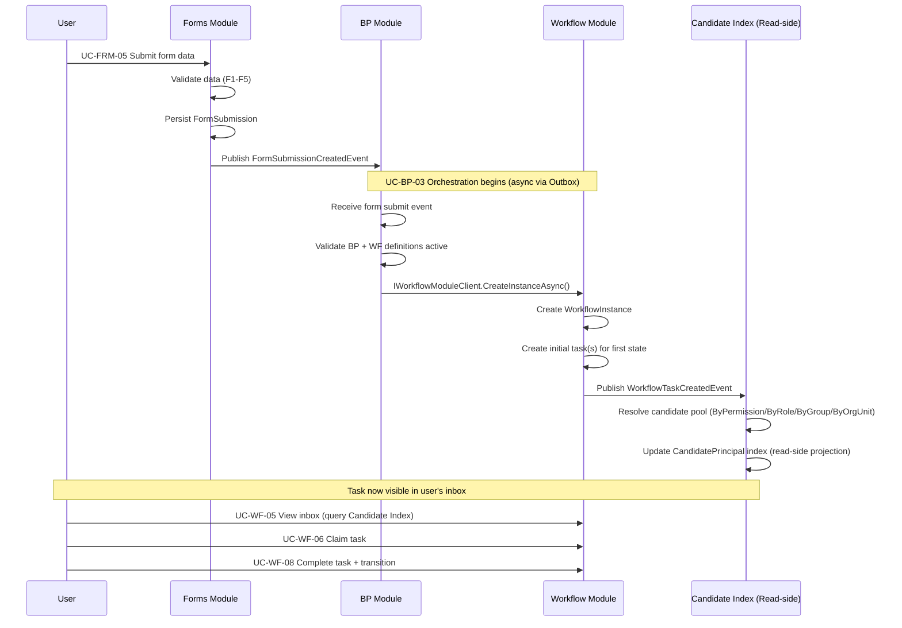

# Use Cases — Forms & Business Process Modules

Phần này chi tiết hóa các yêu cầu chức năng của Forms Module (form designer + runtime) và Business Process Module (BP orchestration) qua 10 use case Cockburn fully-dressed. Forms định nghĩa form schema, rendering, submission; BusinessProcess tạo "process definition" ghép Form + Workflow.

---

## Table of Contents

**Form Designer & Template Management (Admin UCs):**
1. UC-FRM-01 — Thiết kế Form Template (drag-drop fields)
2. UC-FRM-02 — Lưu Form Graph (atomic, handle orphan fields)
3. UC-FRM-03 — Publish Form Template (validate + activate)

**Form Runtime (User/System UCs):**
4. UC-FRM-04 — Render Runtime Form (read schema + permission scopes)
5. UC-FRM-05 — Submit Form Data (validation + persist)
6. UC-FRM-06 — Edit Form Data In-Flight (update before task complete)

**Business Process Definition & Orchestration (Admin UCs):**
7. UC-BP-01 — Tạo Business Process Definition (gắn Form + Workflow)
8. UC-BP-02 — Cập nhật Form-Map Binding (re-bind form fields → workflow variables)
9. UC-BP-03 — Khởi tạo BP Instance (creates Workflow Instance via form submit)
10. UC-BP-04 — Xem BP Status (composite Form data + Workflow state)

---

## UC-FRM-01: Thiết kế Form Template (Design Schema Draft)

- **Goal in context:** Admin tạo form template mới bằng drag-drop editor, tạo fields + sections + validations, nhưng chưa activate.
- **Module:** Forms
- **Actor (primary):** Quản trị viên hệ thống (Form Administrator)
- **Stakeholders & interests:**
  - **Admin:** Visual form design, save draft trước publish
  - **Business:** Form capture business data aligned với workflow variables
  - **Compliance:** Form schema + audit trail ghi lại toàn bộ field definitions
- **Scope:** FormTemplatesController.Create() + FormTemplatesExtController (designer endpoints)
- **Level:** User-goal
- **Priority:** P1
- **Linked FR:** FR-FORM-01 (Form template design)
- **Trigger:** Admin click "Create new form" tại Settings → Form Templates

### Preconditions
- Admin có permission `Form.Template.Manage`
- Tenant tồn tại và admin thuộc tenant đó
- Form template tên chưa được sử dụng trong tenant

### Main Success Scenario
1. Admin gửi POST `/api/v1/forms/templates` với payload:
   ```json
   {
     "name": "Approval Request Form",
     "description": "Employee request form",
     "status": "Draft",
     "isPublished": false
   }
   ```
2. System tạo FormTemplate record (status=Draft, version=1)
3. System return form template ID (Guid) + empty fields list
4. Admin thêm form sections: POST `/api/v1/forms/templates/{id}/sections`
   - Personal Info, Justification, Attachment
5. Admin thêm form fields per section:
   - Section=Personal: Name (text), Email (email), Department (select)
   - Section=Justification: Reason (textarea), Budget (number)
   - Section=Attachment: File (file upload, optional)
6. Admin configure field properties (required/optional, default value, regex pattern)
7. System ghi audit log: `FormTemplateCreatedEvent` (template_id, field_count)
8. System trả về HTTP 200 + template object với draft status
9. Admin có thể tiếp tục add fields (UC-FRM-02) hoặc publish draft

### Extensions
- **1a. Form template tên đã tồn tại:**
  - System trả về HTTP 409 Conflict + message "Form name already exists in this tenant"
  - Admin phải chọn tên khác
  
- **4a. Invalid section structure:**
  - System trả về HTTP 400 "Section validation failed"
  - Admin fix + retry

### Postconditions
- **Success:** FormTemplate created in draft state, zero fields initially, ready for field addition
- **Failure:** HTTP 400/409, no template created

### Special Requirements / NFR refs
- **Security:**
  - Admin role check: Permission `Form.Template.Manage`
  - Tenant isolation: Form scoped to tenant_id
  - Audit: Create event logged
  
- **Performance:**
  - Create template: <100ms
  - Add section: <50ms per section

### Endpoint(s)
- `POST /api/v1/forms/templates` — FormTemplatesController.Create()
- `POST /api/v1/forms/templates/{id}/sections` — FormTemplatesExtController (custom action)

### Permission(s)
- `Form.Template.Manage` (admin-only)

### Source code refs
- **Controller:** `src/modules/forms/AqtCoreFW.Forms.Presentation/Controllers/FormTemplatesController.cs`
- **Handler:** `src/modules/forms/AqtCoreFW.Forms.Application/Commands/CreateFormTemplate/CreateFormTemplateCommandHandler.cs`
- **Entity:** `src/modules/forms/AqtCoreFW.Forms.Domain/Entities/FormTemplate.cs` (Name, Status, Version, IsPublished)
- **Audit:** `src/modules/forms/AqtCoreFW.Forms.Domain/Events/FormTemplateCreatedEvent.cs`

---

## UC-FRM-02: Lưu Form Graph (Save Fields + Sections + Validations)

- **Goal in context:** Admin define complete form structure (all sections/fields/validations) trong một atomic save operation. Handle orphan field/section removal.
- **Module:** Forms
- **Actor (primary):** Quản trị viên hệ thống (Form Administrator)
- **Stakeholders & interests:**
  - **Admin:** Save complex form schema atomically, validate field binding
  - **Forms:** Remove orphaned fields/sections when not in payload (must cleanup FK records)
  - **Compliance:** Form graph immutable once published (new edits = new version)
- **Scope:** FormTemplatesController + form graph validation engine
- **Level:** User-goal
- **Priority:** P1
- **Linked FR:** FR-FORM-02 (Form graph persistence), FR-FORM-03 (Graph validation)
- **Trigger:** Admin complete form design + click "Save graph"

### Preconditions
- FormTemplate exists in draft state (IsPublished=false)
- Graph contains ≥1 section and ≥1 field
- All field types valid (text, email, number, select, file, textarea, etc.)

### Main Success Scenario
1. Admin gửi POST `/api/v1/forms/templates/{id}/save-graph` với payload:
   ```json
   {
     "sections": [
       { "id": "sec-1", "name": "Personal Info", "displayOrder": 1 },
       { "id": "sec-2", "name": "Justification", "displayOrder": 2 }
     ],
     "fields": [
       {
         "id": "fld-1",
         "sectionId": "sec-1",
         "name": "FullName",
         "label": "Full Name",
         "type": "text",
         "isRequired": true,
         "displayOrder": 1
       },
       {
         "id": "fld-2",
         "sectionId": "sec-2",
         "name": "Reason",
         "label": "Reason for Request",
         "type": "textarea",
         "isRequired": true,
         "displayOrder": 1
       }
     ],
     "validations": [
       { "fieldId": "fld-1", "rule": "maxLength", "value": 100 },
       { "fieldId": "fld-2", "rule": "minLength", "value": 10 }
     ]
   }
   ```
2. System validate graph:
   - **V1:** All sections referenced in fields exist?
   - **V2:** All field types valid?
   - **V3:** All validation rules applicable to field type?
   - **V4:** Field names unique per section?
3. **[Validation OK]:** System atomically persist:
   - Insert new sections/fields/validations
   - **DELETE orphaned fields/sections** (exist in DB but NOT in new payload)
     - Uses `ExecuteDeleteAsync` with Unchanged∪Deleted filter for cascade cleanup (memory anchor 260524-A/B/C)
   - Single SaveChanges() call
4. System update FormTemplate.ModifiedAt timestamp
5. System ghi audit log: `FormGraphSavedEvent` (template_id, section_count, field_count)
6. System trả về HTTP 200 + graph summary

### Extensions
- **2a. Validation fails V1 (dangling section reference):**
  - System trả về HTTP 422 Unprocessable + error detail
  - Admin must delete field or add section
  
- **2b. Validation fails V4 (duplicate field names):**
  - System trả về HTTP 422 "Field names must be unique within section"
  - Admin must rename

- **3a. Concurrent edit (another admin modifying same template):**
  - Orphan DELETE race: If section/field removed by concurrent edit, raw-SQL ExecuteDeleteAsync path handles idempotently
  - POST operation succeeds; orphan records cleaned atomically

### Postconditions
- **Success:** Form graph persisted atomically, orphan fields deleted, ready for publish
- **Failure:** HTTP 422, no graph update

### Special Requirements / NFR refs
- **Orphan-Delete Contract (CRITICAL — memory 260524-A):**
  - Fields/sections in database but NOT in new payload MUST be deleted after SaveChanges
  - Implementation: SaveDefinitionGraph handler uses ExecuteDeleteAsync + Unchanged∪Deleted union (raw-SQL path)
  - Reason: EF Core 10 batch sorter cannot reorder DELETE-before-INSERT same-table ops → use raw-SQL bypass
  - **QA Test:** Remove field from payload → verify DB DELETE after save → run concurrent edit race test
  
- **Validation (V1-V4):**
  - V1 closure: All field-referenced section IDs exist in sections list?
  - V2 field types: Check against FormFieldType enum
  - V3 validation rules: Regex must apply to text fields; min/max to numeric; required to all types
  - V4 uniqueness: Field.Name unique per Section.Id (not global)
  
- **Security:**
  - Admin role check: Permission `Form.Template.Manage`
  - Tenant isolation: Form scoped to tenant_id
  - Audit: Save + all validation errors logged
  
- **Performance:**
  - Graph validation (V1-V4): <300ms for typical form (<30 fields)
  - Atomic persist: single SaveChanges() call
  - Orphan DELETE: raw-SQL ExecuteDeleteAsync, <50ms per 100 orphans

### Endpoint(s)
- `POST /api/v1/forms/templates/{id}/save-graph` — FormTemplatesController.SaveGraph() [custom]

### Permission(s)
- `Form.Template.Manage` (admin-only)

### Source code refs
- **Controller:** `src/modules/forms/AqtCoreFW.Forms.Presentation/Controllers/FormTemplatesController.cs`
- **Handler:** `src/modules/forms/AqtCoreFW.Forms.Application/Commands/SaveDefinitionGraph/SaveDefinitionGraphCommandHandler.cs`
- **Entity:** `src/modules/forms/AqtCoreFW.Forms.Domain/Entities/FormSection.cs`, `FormField.cs`, `FormValidation.cs`

---

## UC-FRM-03: Publish Form Template (Validate + Activate)

- **Goal in context:** Admin publish (activate) saved form template so runtime instances can render it. Triggers final validation + version lock.
- **Module:** Forms
- **Actor (primary):** Quản trị viên hệ thống (Form Administrator)
- **Stakeholders & interests:**
  - **Admin:** Release new form version to production
  - **Users:** New form submissions use published template
  - **Compliance:** Published templates immutable (new edits = new version)
- **Scope:** FormTemplatesController
- **Level:** User-goal
- **Priority:** P1
- **Linked FR:** FR-FORM-03 (Publish validation + activation)
- **Trigger:** Admin review form graph + click "Publish template"

### Preconditions
- FormTemplate in draft state (IsPublished=false)
- Form graph already saved (UC-FRM-02 completed)
- No other version of this template already published (OR version incremented)

### Main Success Scenario
1. Admin gửi POST `/api/v1/forms/templates/{id}/publish`
2. System re-validate graph (V1-V4 check again, fail-safe before publish)
3. **[Validation fails]:** Trả về HTTP 422, prevent publish
4. **[Validation OK]:** System set IsPublished=true, Status=Active
5. System create immutable schema snapshot (FormTemplateVersion record)
6. System lock template: future edits require version increment
7. System ghi audit log: `FormTemplatePublishedEvent` (template_id, version)
8. System trả về HTTP 200 + template object (isPublished=true)

### Extensions
- **2a. Graph validation fails at publish time:**
  - Trả về HTTP 422 "Cannot publish: validation errors exist"
  - Admin must fix (UC-FRM-02) + re-attempt publish

### Postconditions
- **Success:** Template published, IsPublished=true, immutable until new version
- **Failure:** HTTP 422, template remains draft

### Special Requirements / NFR refs
- **Version semantics:**
  - Published template = immutable snapshot (Version=1)
  - New edit cycle = Version=2
  - In-flight form data continues with snapshot version (no retroactive schema change)
  
- **Security:**
  - Admin role check: Permission `Form.Template.Manage`
  - Audit: Publish event logged

### Endpoint(s)
- `POST /api/v1/forms/templates/{id}/publish` — FormTemplatesController.Publish()

### Permission(s)
- `Form.Template.Manage` (admin-only)

### Source code refs
- **Handler:** `src/modules/forms/AqtCoreFW.Forms.Application/Commands/PublishFormTemplate/PublishFormTemplateCommandHandler.cs`

---

## UC-FRM-04: Render Runtime Form (Read Schema + Permission Scopes)

- **Goal in context:** System fetch published form template + resolve field-level permissions for current user, then render runtime form for form submission.
- **Module:** Forms
- **Actor (primary):** End-user (form filler), System (rendering context)
- **Stakeholders & interests:**
  - **User:** See form with proper fields + validation rules displayed
  - **Forms:** Deliver schema + permission scopes
  - **Security:** Hide admin-only fields, enforce read-only scopes per role
- **Scope:** PublicFormsController (read-side)
- **Level:** Subfunction (part of UC-FRM-05 workflow)
- **Priority:** P2
- **Linked FR:** FR-FORM-04 (Form rendering)
- **Trigger:** User click "Open form" or system auto-render form before UC-FRM-05

### Preconditions
- FormTemplate published (IsPublished=true)
- Current user has permission to view (scoped by tenant + role)
- Form context available (e.g., from Workflow task)

### Main Success Scenario
1. User/System issue GET `/api/v1/forms/public/{id}/schema` with tenant context
2. System fetch published FormTemplate + sections/fields/validations
3. System resolve field-level permissions (admin-only → hide or read-only)
4. System return schema JSON:
   ```json
   {
     "templateId": "uuid",
     "sections": [
       {
         "id": "sec-1",
         "name": "Personal",
         "fields": [
           { "id": "fld-1", "name": "FullName", "type": "text", "required": true, "scope": "editable" },
           { "id": "fld-2", "name": "Email", "type": "email", "required": false, "scope": "read-only" }
         ]
       }
     ]
   }
   ```
5. FE render form using returned schema

### Postconditions
- **Success:** FE receives schema, can render form with proper field scopes
- **Failure:** HTTP 404 (template not found), HTTP 403 (access denied)

### Special Requirements / NFR refs
- **Field-level permission scoping:**
  - Admin-only field → User with permission sees editable; else hidden
  - Read-only field → rendered disabled
  - Effective permission check via `IEffectivePermissionService` (memory 260524-G warning: may escalate privilege if using direct-only roles)
  
- **Security:**
  - Tenant isolation: scoped by tenant_id from user context
  - Audit: Read events NOT logged (high volume)

### Endpoint(s)
- `GET /api/v1/forms/public/{id}/schema` — PublicFormsController.GetSchema()

### Permission(s)
- No explicit permission check; scoped by tenant + role effective-permission
- `Form.View` implied

---

## UC-FRM-05: Submit Form Data (Validation + Persist)

- **Goal in context:** User submit completed form (all required fields + validations pass), system persist form submission + trigger workflow instance creation (if linked to BP).
- **Module:** Forms
- **Actor (primary):** End-user (form filler)
- **Stakeholders & interests:**
  - **User:** Submit form data, receive confirmation
  - **Forms:** Validate + persist submission (FormSubmission entity)
  - **Workflow:** Trigger new workflow instance if form linked to BusinessProcess (UC-BP-03)
  - **Compliance:** Input validation prevent XSS/injection
- **Scope:** FormSubmissionsController.Submit()
- **Level:** User-goal
- **Priority:** P1
- **Linked FR:** FR-FORM-05 (Form submission), FR-BP-03 (BP instance creation)
- **Trigger:** User complete form + click "Submit"

### Preconditions
- Form template published (IsPublished=true)
- User has permission to submit
- Form context available (standalone or linked to Workflow task)

### Main Success Scenario
1. User submit form data via POST `/api/v1/forms/submissions` with payload:
   ```json
   {
     "templateId": "uuid",
     "businessProcessId": "uuid (optional)",
     "workflowInstanceId": "uuid (optional, if task-bound)",
     "data": {
       "FullName": "John Doe",
       "Email": "john@example.com",
       "Reason": "Need approval for budget reallocation"
     }
   }
   ```
2. System validate form data:
   - **F1:** Required fields all present?
   - **F2:** Field types match (string, email, number)?
   - **F3:** Regex pattern validation (if defined)?
   - **F4:** File upload virus scan (if file field — ClamAV integration)?
   - **F5:** Input XSS/SQL injection sanitization?
3. **[Validation fails]:** Trả về HTTP 422 + detailed field errors
4. **[Validation OK]:** System persist FormSubmission record:
   - SubmissionId (Guid), TemplateId, UserId, SubmittedAt, DataJson (encrypted if PII)
5. System ghi audit log: `FormSubmissionCreatedEvent` (submission_id, template_id)
6. **[IF linked to BP]:** Trigger UC-BP-03 via IBusinessProcessModuleClient:
   - POST `/api/v1/business-processes/{bpId}/trigger-instance` with formSubmissionId
   - BP handler creates Workflow Instance + initial task
7. System trả về HTTP 200 + submission confirmation (submission_id, workflow_instance_id if created)

### Extensions
- **2a. Validation fails F4 (malicious file):**
  - ClamAV detects virus → reject file
  - Trả về HTTP 422 "File failed security scan"
  - User must replace file
  
- **2b. Validation fails F5 (XSS/injection detected):**
  - System sanitize input OR reject with message "Invalid characters detected"
  - Log security incident

- **6a. BP trigger fails (workflow definition not active):**
  - System log error but allow form submission persist
  - User notified: "Form submitted; process workflow inactive" (graceful degrade)

### Postconditions
- **Success:** FormSubmission persisted, workflow instance created (if BP-linked), user notified
- **Failure:** HTTP 422, no submission persisted

### Special Requirements / NFR refs
- **Input Validation (F1-F5):**
  - F1 required: per field isRequired=true
  - F2 type coercion: text, email, number, select options
  - F3 regex: if FormValidation.rule=regex, apply pattern
  - F4 file-upload: MinIO + ClamAV pre-store (fail-closed)
  - F5 sanitization: remove script tags, SQL comment sequences (OWASP input validation)
  
- **PII Encryption:**
  - Email, phone, ID number fields marked PII → encrypt at rest (SQL Always Encrypted)
  - DataJson stored encrypted in FormSubmission.DataJson column
  
- **Security:**
  - User identity: from JWT claims (sub)
  - Cross-site submission: CSRF token validate
  - Audit: Submit + validation errors logged
  - Rate-limit: max 10 submissions/min per user (prevent spam)
  
- **Performance:**
  - Validate form data: <200ms
  - Persist + publish event: <500ms

### Endpoint(s)
- `POST /api/v1/forms/submissions` — FormSubmissionsController.Create()

### Permission(s)
- Implicit: User authenticated (sub claim present)
- `Form.Submit` (scoped to tenant)

### Source code refs
- **Controller:** `src/modules/forms/AqtCoreFW.Forms.Presentation/Controllers/FormSubmissionsController.cs`
- **Handler:** `src/modules/forms/AqtCoreFW.Forms.Application/Commands/SubmitForm/SubmitFormCommandHandler.cs`
- **Entity:** `src/modules/forms/AqtCoreFW.Forms.Domain/Entities/FormSubmission.cs`

---

## UC-FRM-06: Edit Form Data In-Flight (Update Before Task Complete)

- **Goal in context:** User edit form data after initial submission but before workflow task marked complete, persist changes + maintain audit trail.
- **Module:** Forms
- **Actor (primary):** End-user (task assignee)
- **Stakeholders & interests:**
  - **User:** Correct typos/missing data before approval
  - **Forms:** Persist updated submission
  - **Compliance:** Audit trail record all edits + timestamps
- **Scope:** FormSubmissionsExtController (custom action)
- **Level:** User-goal
- **Priority:** P2
- **Linked FR:** FR-FORM-06 (Form update in-flight)
- **Trigger:** User click "Edit" from form context while task pending

### Preconditions
- FormSubmission exists and not yet finalized
- Workflow task (if linked) still in progress (state != Completed)
- User is original submitter OR has task assignment

### Main Success Scenario
1. User issue PUT `/api/v1/forms/submissions/{id}` with updated data:
   ```json
   {
     "data": {
       "FullName": "John Doe Jr.",
       "Email": "john.jr@example.com"
     },
     "ifMatch": "base64-rowversion-etag"
   }
   ```
2. System validate ETag (RowVersion) — optimistic concurrency
3. **[ETag mismatch]:** Trả về HTTP 412 Precondition Failed
4. **[ETag OK]:** Re-validate form data (F1-F5 gates as UC-FRM-05)
5. **[Validation fails]:** Trả về HTTP 422
6. **[Validation OK]:** System persist updated FormSubmission:
   - Merge new data into existing DataJson
   - Increment RowVersion (ETag)
   - Update ModifiedAt timestamp
   - Single SaveChanges()
7. System ghi audit log: `FormSubmissionUpdatedEvent` (submission_id, delta fields)
8. System trả về HTTP 200 + updated submission + new RowVersion

### Extensions
- **3a. User no longer has edit permission (task completed):**
  - Trả về HTTP 403 "Submission finalized, cannot edit"

### Postconditions
- **Success:** FormSubmission updated atomically, audit trail recorded
- **Failure:** HTTP 412/422/403, no update

### Special Requirements / NFR refs
- **Optimistic Concurrency (ETag/RowVersion):**
  - Each update increments RowVersion
  - Client must provide If-Match header with current ETag
  - Simultaneous edits (two users) → second edit gets 412, must refresh + retry
  
- **Audit Trail:**
  - FormSubmissionUpdatedEvent log which fields changed + old/new values
  - Queryable via UC-BP-04 (view BP status incl. form update history)
  
- **Security:**
  - User verify: JWT sub claim must match submission.UserId OR task assignee
  - Audit: Update event logged with user identity

### Endpoint(s)
- `PUT /api/v1/forms/submissions/{id}` — FormSubmissionsExtController.Update()

### Permission(s)
- `Form.Submit` (must be task owner or original submitter)

---

## UC-BP-01: Tạo Business Process Definition (Design + Link Form + Workflow)

- **Goal in context:** Admin create business process definition by linking existing (or new) Form template + Workflow definition, define form-map binding (field → workflow variable).
- **Module:** BusinessProcess
- **Actor (primary):** Quản trị viên hệ thống (BP Administrator)
- **Stakeholders & interests:**
  - **Admin:** Bundle Form + Workflow into a single process definition
  - **Forms:** Form schema reference (immutable once linked)
  - **Workflow:** Workflow definition reference + task assignment rules
  - **Compliance:** BP graph audit trail + versioning
- **Scope:** BusinessProcessesController.Create()
- **Level:** User-goal
- **Priority:** P1
- **Linked FR:** FR-BP-01 (BP definition creation)
- **Trigger:** Admin click "Create new business process" tại Settings → Business Processes

### Preconditions
- Admin có permission `BusinessProcess.Manage`
- FormTemplate published (IsPublished=true)
- WorkflowDefinition published (IsActive=true)
- Tenant tồn tại

### Main Success Scenario
1. Admin gửi POST `/api/v1/business-processes` với payload:
   ```json
   {
     "name": "Employee Request Approval",
     "description": "Complete process to request + approve",
     "formTemplateId": "uuid",
     "workflowDefinitionId": "uuid",
     "isActive": false
   }
   ```
2. System create BusinessProcessDefinition record:
   - BP_ID (Guid), Name, FormTemplateId, WorkflowDefinitionId, Status=Draft
   - Empty FormMap initially
3. System ghi audit log: `BusinessProcessDefinitionCreatedEvent`
4. System trả về HTTP 200 + BP definition object
5. Admin proceed to UC-BP-02 (configure form-map binding)

### Extensions
- **1a. Form template not published:**
  - Trả về HTTP 400 "Form template must be published"
  
- **1b. Workflow definition not active:**
  - Trả về HTTP 400 "Workflow definition must be active"

### Postconditions
- **Success:** BP definition created in draft, ready for form-map binding
- **Failure:** HTTP 400, no BP created

### Special Requirements / NFR refs
- **Security:**
  - Admin role check: Permission `BusinessProcess.Manage`
  - Tenant isolation: BP scoped to tenant_id
  - Audit: Create event logged

### Endpoint(s)
- `POST /api/v1/business-processes` — BusinessProcessesController.Create()

### Permission(s)
- `BusinessProcess.Manage` (admin-only)

### Source code refs
- **Controller:** `src/modules/businessprocess/AqtCoreFW.BusinessProcess.Presentation/Controllers/BusinessProcessesController.cs`
- **Handler:** `src/modules/businessprocess/AqtCoreFW.BusinessProcess.Application/Commands/CreateBusinessProcess/CreateBusinessProcessCommandHandler.cs`
- **Entity:** `src/modules/businessprocess/AqtCoreFW.BusinessProcess.Domain/Entities/BusinessProcessDefinition.cs`

---

## UC-BP-02: Cập nhật Form-Map Binding (Re-bind Form Fields ↔ Workflow Variables)

- **Goal in context:** Admin define/update form-map: which form fields → which workflow variables for state-forms and transition-forms. Atomic replace-all semantics with orphan-field cleanup.
- **Module:** BusinessProcess
- **Actor (primary):** Quản trị viên hệ thống (BP Administrator)
- **Stakeholders & interests:**
  - **Admin:** Map form fields to workflow data dictionary
  - **Forms:** Validate field references exist in template
  - **Workflow:** Validate state/transition IDs exist in workflow definition
  - **Compliance:** Form-map immutable once BP activated (new edits = new version)
- **Scope:** BusinessProcessesController + form-map validator
- **Level:** User-goal
- **Priority:** P1
- **Linked FR:** FR-BP-02 (Form-map binding), T3-BP-FORMMAP-BACKFILL (shipped v2.137p107)
- **Trigger:** Admin complete form+workflow setup + click "Configure form bindings"

### Preconditions
- BusinessProcessDefinition exists in draft state (IsActive=false)
- FormTemplate + WorkflowDefinition published/active
- Workflow states + transitions already defined

### Main Success Scenario
1. Admin gửi POST `/api/v1/business-processes/{id}/form-maps/replace` với payload:
   ```json
   {
     "stateForms": [
       {
         "workflowStateId": 123,
         "formTemplateId": "uuid",
         "displayOrder": 1
       }
     ],
     "transitionForms": [
       {
         "workflowTransitionId": 456,
         "formTemplateId": "uuid",
         "displayOrder": 1
       }
     ],
     "fieldMappings": [
       {
         "stateId": 123,
         "workflowVariableName": "ApproverComments",
         "formFieldName": "ReviewNotes"
       }
     ],
     "ifMatch": "base64-rowversion"
   }
   ```
2. System validate:
   - **M1:** All workflow state/transition IDs exist in BP's workflow?
   - **M2:** All form field names exist in form template?
   - **M3:** State/transition FK references valid?
3. **[Validation fails]:** Trả về HTTP 422 + error detail
4. **[Validation OK]:** System atomically replace-all:
   - ClearStateForms (delete old state-form records)
   - ClearTransitionForms (delete old transition-form records)
   - Insert new state-form + transition-form records
   - Cleanup orphaned field-map records (raw-SQL + Unchanged∪Deleted filter per memory 260524-A)
5. System ghi audit log: `FormMapReplacedEvent` (bp_id, state_form_count, transition_form_count)
6. System trả về HTTP 200 + form-map summary

### Extensions
- **2a. Workflow state ID doesn't exist in definition:**
  - Trả về HTTP 422 "State ID {id} not found in workflow definition"
  
- **2b. Form field name invalid:**
  - Trả về HTTP 422 "Field '{name}' not found in form template"

- **4a. Concurrent edit (another admin updating same BP):**
  - Form-map orphan DELETE race: ExecuteDeleteAsync handles idempotently
  - POST succeeds atomically; old mappings cleaned

### Postconditions
- **Success:** Form-map binding persisted atomically, orphans deleted
- **Failure:** HTTP 422, no form-map update

### Special Requirements / NFR refs
- **Orphan-Field Cleanup (CRITICAL — memory 260524-A):**
  - FormMap records exist in DB but NOT in new payload MUST be deleted
  - Implementation: ReplaceFormMapsCommandHandler uses ExecuteDeleteAsync + Unchanged∪Deleted (raw-SQL)
  - Reason: EF Core 10 batch sorter limitation → raw-SQL bypass
  - **QA Test:** Remove state-form from payload → verify DB DELETE after replace → race-test concurrent edits
  
- **Form-Map JSON Structure:**
  ```
  BusinessProcessDefinition
  ├── FormTemplateId
  ├── WorkflowDefinitionId
  └── FormMaps (children)
      ├── StateForm[] (state_id → form_id)
      └── TransitionForm[] (transition_id → form_id)
  ```
  
- **Validation (M1-M3):**
  - M1 state/transition closure: IWorkflowModuleClient.GetDefinitionStructureAsync() returns canonical state/transition IDs
  - M2 field existence: grep FormTemplate.Sections[*].Fields[*].Name
  - M3 FK integrity: validate before INSERT (ReplaceFormMapsCommandHandler Step 5 + Step 7)
  
- **Security:**
  - Admin role check: Permission `BusinessProcess.Manage`
  - Tenant isolation: Pattern-A strict tenant guard pre-DB (memory 260524-B/C1)
  - ETag required: If-Match header mandatory → 412 on mismatch (D-B-3)
  - Audit: Replace event + all validation errors logged
  
- **Performance:**
  - Validation (M1-M3): <500ms for typical BP (<20 states)
  - Atomic replace: single SaveChanges() call
  - Orphan DELETE: <50ms per 100 orphan records

### Endpoint(s)
- `POST /api/v1/business-processes/{id}/form-maps/replace` — BusinessProcessesController.ReplaceFormMaps()

### Permission(s)
- `BusinessProcess.Manage` (admin-only)

### Source code refs
- **Controller:** `src/modules/businessprocess/AqtCoreFW.BusinessProcess.Presentation/Controllers/BusinessProcessesController.cs`
- **Handler:** `src/modules/businessprocess/AqtCoreFW.BusinessProcess.Application/Commands/ReplaceFormMaps/ReplaceFormMapsCommandHandler.cs`
- **Entity:** `src/modules/businessprocess/AqtCoreFW.BusinessProcess.Domain/Entities/BusinessProcessFormMap.cs`

---

## UC-BP-03: Khởi tạo BP Instance (Create Workflow Instance via Form Submit)

- **Goal in context:** System trigger new BP instance when form submitted (UC-FRM-05 links to BP). Create Workflow Instance + initial task, resolve candidate pool for first state.
- **Module:** BusinessProcess ↔ Forms ↔ Workflow (orchestration)
- **Actor (primary):** System (event handler triggered by form submission)
- **Stakeholders & interests:**
  - **Forms:** Submit form → emit event
  - **BP:** Receive submit event → create workflow instance
  - **Workflow:** Create instance + task pool
  - **Users:** Workflow task appears in inbox for claiming
- **Scope:** Business process instance creation handler + workflow integration
- **Level:** Subfunction (triggered by UC-FRM-05)
- **Priority:** P1
- **Linked FR:** FR-BP-03 (BP instance creation)
- **Trigger:** FormSubmissionCreatedEvent published (UC-FRM-05 step 5)

### Preconditions
- FormSubmission persisted with BP context (UC-FRM-05)
- BusinessProcessDefinition published and active
- WorkflowDefinition active + has initial state with task assignments

### Main Success Scenario
1. **[Event triggered]** FormSubmissionCreatedEvent published with businessProcessId
2. System's ExecuteBPInstanceFromFormSubmissionHandler handles event:
   ```
   Receive: FormSubmissionCreatedEvent { submissionId, bpId, formData, userId }
   ```
3. System validate BP is active + linked workflow active
4. System create Workflow Instance via IWorkflowModuleClient.CreateInstanceAsync():
   ```
   POST /api/v1/workflow/instances with:
   {
     "definitionId": "{bpId's workflow definition}",
     "referenceKey": "{submissionId}",
     "initialData": {formData mapped to workflow variables via form-map},
     "createdBy": "{userId}"
   }
   ```
5. Workflow module creates WorkflowInstance + initial task(s) for first state
6. System ghi audit log: `BusinessProcessInstanceCreatedEvent` (bp_instance_id, workflow_instance_id)
7. **[Task created]** Workflow candidate index resolves eligible task claimers (UC-WF-05 logic)
8. User(s) with eligible permission/role see task in inbox + can claim (UC-WF-06)

### Mermaid Flow Diagram (UC-BP-03 Orchestration)



### Extensions
- **3a. BP or Workflow definition inactive:**
  - Handler log warning + abort (graceful degrade)
  - User notified: form submitted but workflow inactive
  
- **5a. Workflow instance creation fails (invalid initial state):**
  - Log error, retry via Outbox handler (max retries 3)
  - Alert ops on persistent failure

### Postconditions
- **Success:** WorkflowInstance created + initial task(s) in candidate pool
- **Failure:** Event retried via Outbox mechanism; user notified if repeated failure

### Special Requirements / NFR refs
- **Form-Map Application:**
  - Form submission data transformed to workflow variables via form-map (state-form binding)
  - Example: form field "ReviewNotes" → workflow variable "ApproverComments"
  - Null/missing fields handled gracefully (optional workflow variables)
  
- **Cross-module Contract:**
  - IBusinessProcessModuleClient (BE) exported from BP module
  - IWorkflowModuleClient (BE) exported from Workflow module
  - No circular dependency: Forms → BP → Workflow (DAG)
  
- **Async Event Handling (Outbox Pattern):**
  - Form submit persists + publishes event in single TX
  - Outbox consumer picks up event → hands to BP handler
  - Max retries 3 + DLQ (dead-letter) on permanent failure
  - Ensures exactly-once semantics (even if handler crashes mid-call)
  
- **Security:**
  - CreatedBy = JWT sub (user identity) from form submission
  - Tenant isolation: form + BP + workflow all scoped to same tenant
  - Audit: Instance creation event logged
  
- **Performance:**
  - Form submit + event publish: <500ms (synchronous)
  - Workflow instance creation: <1s (async via Outbox)
  - Candidate index update: <500ms (async via MassTransit subscriber)

### Endpoint(s)
- **Async handler:** (no HTTP endpoint; triggered by event)
- **Cross-module client:** `IBusinessProcessModuleClient.CreateWorkflowInstanceAsync()`

### Permission(s)
- (No explicit permission; triggered by prior user action in UC-FRM-05)

### Source code refs
- **Event Handler:** `src/modules/businessprocess/AqtCoreFW.BusinessProcess.Application/Events/ExecuteBPInstanceFromFormSubmissionHandler.cs` (consumer pattern)
- **Module Client:** `src/modules/businessprocess/AqtCoreFW.SharedKernel.Contracts/Clients/IBusinessProcessModuleClient.cs`

---

## UC-BP-04: Xem BP Status (Form Data + Workflow State Composite)

- **Goal in context:** User/Admin query complete BP instance status: form submission data + workflow state + task assignments + audit trail.
- **Module:** BusinessProcess (read-side aggregation)
- **Actor (primary):** End-user, Admin
- **Stakeholders & interests:**
  - **User:** Track form + workflow progress in single view
  - **Admin:** Monitor BP instances, audit trail
  - **Compliance:** Immutable audit log of form edits + task transitions
- **Scope:** BusinessProcessesController.GetInstanceStatus() [read-side query]
- **Level:** User-goal
- **Priority:** P2
- **Linked FR:** FR-BP-04 (BP status query)
- **Trigger:** User click "View status" from BP instance context

### Preconditions
- BP instance exists (created via UC-BP-03)
- User has permission to view (scoped by tenant + role)
- Workflow instance accessible (same tenant)

### Main Success Scenario
1. User/System issue GET `/api/v1/business-processes/{bpInstanceId}`
2. System query (Dapper read-side):
   - Load BusinessProcessInstance + linked FormSubmission + WorkflowInstance
   - Aggregate task list (current + completed tasks)
   - Aggregate form edit history (UC-FRM-06 updates + timestamps)
3. System return composite status object:
   ```json
   {
     "bpInstanceId": "uuid",
     "formData": {
       "submissionId": "uuid",
       "submittedAt": "2026-05-25T10:30:00Z",
       "data": { "FullName": "John Doe", "Email": "john@example.com" },
       "edits": [
         { "timestamp": "2026-05-25T11:00:00Z", "field": "Email", "oldValue": "john@old.com", "newValue": "john@example.com" }
       ]
     },
     "workflowState": {
       "instanceId": "uuid",
       "currentState": "Approved",
       "tasks": [
         { "id": "uuid", "state": "InReview", "assignee": "Alice", "claimedAt": "2026-05-25T10:35:00Z", "completedAt": "2026-05-25T11:20:00Z" },
         { "id": "uuid", "state": "Approved", "assignee": "Bob", "claimedAt": "2026-05-25T11:21:00Z", "completedAt": null }
       ]
     }
   }
   ```
4. System trả về HTTP 200 + status object

### Extensions
- **1a. BP instance not found:**
  - Trả về HTTP 404 "BP instance not found"
  
- **1b. User access denied:**
  - Trả về HTTP 403 "Access denied"

### Postconditions
- **Success:** User receives aggregated form + workflow status
- **Failure:** HTTP 404/403, no data returned

### Special Requirements / NFR refs
- **Read-side Aggregation (CQRS pattern):**
  - Query via Dapper (direct SQL); no state tracking
  - Denormalized view: form data + workflow tasks + edits joined
  - Cache-friendly: result same for 5+ minutes (stale-OK for status view)
  
- **Audit Trail:**
  - FormSubmissionUpdatedEvent history (all edits via UC-FRM-06)
  - WorkflowTaskCompletedEvent history (all task transitions)
  - Immutable once logged
  
- **Security:**
  - User identity: from JWT sub
  - Scoped by tenant + role (effective permission check)
  - Sensitive fields (email, phone) masked if user lacks view permission
  - Audit: Read event NOT logged (high volume)
  
- **Performance:**
  - Dapper query (INNER JOINs): <100ms
  - Aggregation: <50ms
  - Total response: <200ms

### Endpoint(s)
- `GET /api/v1/business-processes/{bpInstanceId}` — BusinessProcessesController.GetInstanceStatus()

### Permission(s)
- Implicit: User authenticated + scoped to BP's tenant
- `Form.View` + `Workflow.View` (combined)

### Source code refs
- **Controller:** `src/modules/businessprocess/AqtCoreFW.BusinessProcess.Presentation/Controllers/BusinessProcessesController.cs`
- **Query Handler:** (Dapper-based; no MediatR handler, direct SQL)
- **View Model:** `src/modules/businessprocess/AqtCoreFW.BusinessProcess.Application/Queries/GetBPInstanceStatus/BPInstanceStatusDto.cs`

---

## Cross-Module Contracts & Glossary

### Form-Map JSON Structure
```
BusinessProcessDefinition
├── FormTemplateId: Guid (immutable reference)
├── WorkflowDefinitionId: Guid (immutable reference)
├── FormMaps: List<FormMap>
│   ├── StateForm[] (state_id → form_id for state entry)
│   └── TransitionForm[] (transition_id → form_id for approval screen)
```

### Orphan-Delete Postcondition (UC-FRM-02, UC-BP-02)
Fields/sections/form-maps not in new payload MUST be atomically deleted via raw-SQL ExecuteDeleteAsync + Unchanged∪Deleted filter union (EF Core 10 workaround for batch sorter limitation). Postcondition verifiable: DB contains zero orphan records post-SaveChanges.

### Fail-Closed Invariant (UC-FRM-02, UC-BP-02)
Form-map updates MUST include orphan-delete logic before supporting BP instance creation (UC-BP-03). If orphan-delete deferred: feature-flag SaveDefinitionGraph / ReplaceFormMaps until cleanup logic ready.

---

## Summary

| UC | Title | Module | Persona | Effort |
|----|-------|--------|---------|--------|
| UC-FRM-01 | Design Form Template | Forms | Admin | 30min |
| UC-FRM-02 | Save Form Graph | Forms | Admin | 45min |
| UC-FRM-03 | Publish Form Template | Forms | Admin | 20min |
| UC-FRM-04 | Render Runtime Form | Forms | User/System | 20min |
| UC-FRM-05 | Submit Form Data | Forms | User | 40min |
| UC-FRM-06 | Edit Form In-Flight | Forms | User | 30min |
| UC-BP-01 | Create BP Definition | BP | Admin | 25min |
| UC-BP-02 | Configure Form-Map | BP | Admin | 50min |
| UC-BP-03 | Trigger BP Instance | BP | System | 35min |
| UC-BP-04 | View BP Status | BP | User/Admin | 25min |

---

**Snapshot Commit:** `a593d719` | **Version:** v2.137p113 | **Date:** 2026-05-25
