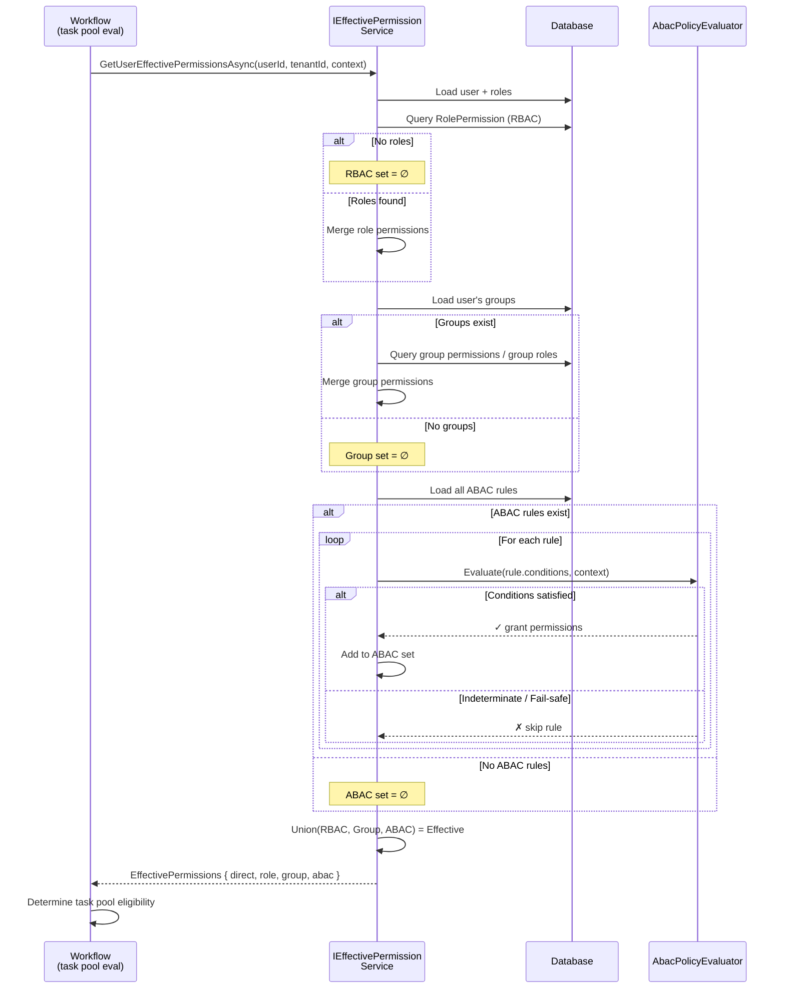

# Use Cases — Identity Module (Advanced)

Phần này chi tiết hóa yêu cầu chức năng nâng cao của Identity module qua 11 use case Cockburn fully-dressed. Các UC này bao gồm: ABAC (Attribute-Based Access Control), SoD (Separation of Duties), Delegation, Access Review, Digital Signature, JIT Provisioning, Session Management, và External Identity Federation.

---

## Table of Contents

**Core UCs (Xem uc-identity-core.md):** UC-IDN-01 đến UC-IDN-13

**Advanced UCs (File này):**
1. UC-IDN-A01 — Định nghĩa quy tắc ABAC
2. UC-IDN-A02 — Đánh giá Effective Permission (RBAC ∪ ABAC ∪ Group)
3. UC-IDN-A03 — Định nghĩa quy tắc Separation of Duties (SoD)
4. UC-IDN-A04 — Phát hiện + phòng chặn SoD violation
5. UC-IDN-A05 — Ủy quyền tạm thời (Delegation)
6. UC-IDN-A06 — Thu hồi ủy quyền
7. UC-IDN-A07 — Quản trị phiên (Session management + force logout)
8. UC-IDN-A08 — Ký số tài liệu (Digital Signature stub)
9. UC-IDN-A09 — Liên kết External Identity (Federated accounts)
10. UC-IDN-A10 — Cấu hình JIT Provisioning (Just-In-Time user creation)
11. UC-IDN-A11 — Chu kỳ Access Review định kỳ

---

## UC-IDN-A01: Định nghĩa quy tắc ABAC

- **Goal in context:** Admin định nghĩa quy tắc ABAC (Attribute-Based Access Control) để cấp quyền dựa trên thuộc tính (department, classification, amount threshold, v.v.) thay vì chỉ vai trò.
- **Module:** Identity
- **Actor (primary):** Quản trị viên (TenantAdmin)
- **Stakeholders & interests:**
  - **Admin:** Fine-grained access control, dynamic policy
  - **Compliance:** Attribute-based decisions auditable
- **Scope:** Identity Module — AbacRulesAdminController
- **Level:** User-goal
- **Priority:** P1
- **Linked FR:** FR-IDN-10 (Attribute-Based Access Control)
- **Trigger:** Admin click "Create ABAC Rule" in advanced security settings

### Preconditions
- Admin authenticated + has `IDN_ABAC_RULES_MANAGE` permission
- Rule name not duplicate

### Main Success Scenario
1. FE display "Create ABAC Rule" form (name, description, attributes, conditions, effect)
2. Admin set: name="ApproveHighValue", description="Approve only if amount ≤ $10k and department = Finance"
3. Admin define attributes: `{ "user.department": "Finance", "document.amount": { "$lte": 10000 } }`
4. Admin set effect="ALLOW"
5. FE gửi POST `/api/v1/admin/abac-rules` với structured rule DTO
6. System validate rule syntax (attributes, operators, values)
7. System create AbacPolicyRule entity (Id=GUID, TenantId, Name, Attributes JSON, Effect, CreatedDate)
8. System ghi audit log: `AbacRuleCreatedEvent` (rule_id, creator_id)
9. System trả về HTTP 201 Created
10. FE show success + redirect rule list

### Extensions
- **6a. Invalid rule syntax:**
  - Trả HTTP 400 "Invalid attribute expression"

### Postconditions
- **Success:** ABAC rule created, effective on next evaluation (UC-IDN-A02)
- **Failure:** Not created, error returned

### Special Requirements / NFR refs
- **Security:**
  - Only TENANT_ADMIN can create ABAC rules
  - Audit: rule creation, modification, deletion
  
- **Performance:**
  - Create: <200ms

### Endpoint(s)
- `POST /api/v1/admin/abac-rules` — AbacRulesAdminController.CreateAbacRule()

### Permission(s)
- Require: `IDN_ABAC_RULES_MANAGE`

### Source code refs
- **Controller:** `src/modules/identity/AqtCoreFW.Identity.Presentation/Controllers/AbacRulesAdminController.cs`
- **Handler:** `src/modules/identity/AqtCoreFW.Identity.Application/Commands/CreateAbacRuleCommandHandler.cs`
- **Entity:** `src/modules/identity/AqtCoreFW.Identity.Domain/Entities/AbacPolicyRule.cs`

---

## UC-IDN-A02: Đánh giá Effective Permission (RBAC ∪ ABAC ∪ Group)

- **Goal in context:** System evaluate toàn bộ quyền hiệu lực của user bằng cách merge RBAC (roles) + ABAC (attribute rules) + Group-based permissions, trả về permission set cuối cùng cho workflow task pool evaluation.
- **Module:** Identity (query), referenced by Workflow (for task eligibility)
- **Actor (primary):** System (internal evaluation, not user-initiated)
- **Stakeholders & interests:**
  - **System:** Accurate permission evaluation for task assignment
  - **Compliance:** Documented permission decision audit trail
- **Scope:** Identity Module — Query service, called by Workflow module
- **Level:** Subfunction
- **Priority:** P0 (blocking Workflow UC)
- **Linked FR:** FR-IDN-09 (Access Rights Visibility), FR-IDN-10 (ABAC), FR-WF-04 (Candidate Pool Evaluation)
- **Trigger:** Workflow task pool evaluation (internal call) or user request UC-IDN-13

### Preconditions
- User exists (IsActive=true)
- RBAC roles assigned to user
- ABAC rules defined in tenant (optional)
- Group memberships assigned to user (optional)
- Context attributes available (e.g., document metadata, current user's department)

### Main Success Scenario
1. **[Internal Workflow call]:** `IEffectivePermissionService.GetUserEffectivePermissionsAsync(userId, tenantId, context?)`
2. System load user + roles + groups
3. **[RBAC phase]:** Merge all permissions from user's roles (direct role → RolePermission)
4. **[Group phase]:** Merge all permissions from user's groups (group → GroupPermission if exists, or via group's roles)
5. **[ABAC phase]:** For each ABAC rule:
   - Evaluate rule conditions against context attributes (user attributes + resource attributes)
   - If conditions satisfied: add rule's granted permissions
   - If conditions not satisfied: skip
6. **[Combine]:** Union all permission sets (RBAC ∪ Group ∪ ABAC-conditional)
7. System return `EffectivePermissions { directPermissions, rolePermissions, groupPermissions, abacPermissions }`
8. **[For workflow task pool]:** Workflow queries `GetUserEligiblePermissions(userId)` → system returns permission-based eligibility
9. **[For user profile]** (UC-IDN-13): Return full breakdown + human-readable explanation

### Extensions
- **5a. ABAC condition uses missing attribute:**
  - Skip rule (fail-safe: don't grant if condition indeterminate)
  - Log warning (observational, not error)
  
- **3a. User has no roles:**
  - RBAC phase yields empty set (proceed to Group + ABAC)

### Postconditions
- **Success:** Effective permissions calculated, returned to caller
- **Failure:** Service error, return error to caller

### Special Requirements / NFR refs
- **Security:**
  - ABAC evaluation fail-safe (skip indeterminate rules, don't grant)
  - Context validation (prevent attribute injection)
  - Audit: Permission evaluation for high-risk actions (task claim, approval)
  
- **Performance:**
  - Evaluate ≤10 ABAC rules per call: <500ms
  - Cache result (context-dependent, ≤5min TTL if no context delta)

### Endpoint(s)
- `GET /api/v1/me/permissions` — MeController.GetEffectivePermissions() (calls this service)
- **Internal:** `IEffectivePermissionService.GetUserEffectivePermissionsAsync()`

### Permission(s)
- Require: Authenticated (internal service, no explicit permission check)

### Source code refs
- **Service:** `src/modules/identity/AqtCoreFW.Identity.Application/Services/IEffectivePermissionService.cs`
- **Implementation:** `src/modules/identity/AqtCoreFW.Identity.Infrastructure/Services/EffectivePermissionService.cs`
- **Handler:** `src/modules/identity/AqtCoreFW.Identity.Application/Queries/GetUserEffectivePermissionsQueryHandler.cs`
- **ABAC Evaluator:** `src/modules/identity/AqtCoreFW.Identity.Infrastructure/Services/AbacPolicyEvaluator.cs`

---

## UC-IDN-A03: Định nghĩa quy tắc Separation of Duties (SoD)

- **Goal in context:** Admin định nghĩa quy tắc SoD để ngăn chặn user holding mutually exclusive roles (e.g., không thể là Approver + Auditor cùng lúc).
- **Module:** Identity
- **Actor (primary):** Quản trị viên (TenantAdmin, Auditor)
- **Stakeholders & interests:**
  - **Admin:** Enforce segregation of duties compliance
  - **Compliance:** Detect + prevent fraud (approver ≠ auditor)
- **Scope:** Identity Module — SodRulesAdminController
- **Level:** User-goal
- **Priority:** P1
- **Linked FR:** FR-IDN-11 (Separation of Duties)
- **Trigger:** Admin click "Create SoD Rule" in compliance settings

### Preconditions
- Admin authenticated + has `IDN_SOD_RULES_MANAGE` permission
- Rule name unique in tenant

### Main Success Scenario
1. FE display "Create SoD Rule" form (name, conflictingRoles multiselect, allowBoth checkbox)
2. Admin select: conflictingRoles=[BTC_DEPT_DIRECTOR, BTC_AUDITOR], allowBoth=false
3. Admin enter description: "Department director cannot simultaneously audit own department"
4. FE gửi POST `/api/v1/admin/sod-rules` với `{ "name": "...", "roleIds": [...], "allowBoth": false, "reason": "..." }`
5. System validate role IDs exist
6. System create SodRule entity (Id=GUID, TenantId, ConflictingRoles JSON array, AllowBoth boolean, CreatedDate)
7. System ghi audit log: `SodRuleCreatedEvent` (rule_id, creator_id, roles)
8. System trả về HTTP 201 Created
9. FE show success + rule list

### Extensions
- **5a. Invalid role ID:**
  - Trả HTTP 400

### Postconditions
- **Success:** SoD rule created, enforced on next role assignment (UC-IDN-A04)
- **Failure:** Not created, error returned

### Special Requirements / NFR refs
- **Security:**
  - Only admin can create SoD rules
  - Audit: rule creation + modification
  
- **Performance:**
  - Create: <200ms

### Endpoint(s)
- `POST /api/v1/admin/sod-rules` — SodRulesAdminController.CreateSodRule()

### Permission(s)
- Require: `IDN_SOD_RULES_MANAGE`

### Source code refs
- **Controller:** `src/modules/identity/AqtCoreFW.Identity.Presentation/Controllers/SodRulesAdminController.cs`
- **Handler:** `src/modules/identity/AqtCoreFW.Identity.Application/Commands/CreateSodRuleCommandHandler.cs`
- **Entity:** `src/modules/identity/AqtCoreFW.Identity.Domain/Entities/SodRule.cs`

---

## UC-IDN-A04: Phát hiện + phòng chặn SoD violation

- **Goal in context:** When admin assigns role to user, system checks SoD rules + prevents assignment if conflict detected.
- **Module:** Identity
- **Actor (primary):** Quản trị viên (TenantAdmin) performing UC-IDN-10 (role assignment)
- **Stakeholders & interests:**
  - **Admin:** Prevented from accidental SoD breach
  - **Compliance:** SoD enforcement audit trail
- **Scope:** Identity Module — integrated into UC-IDN-10 role assignment
- **Level:** Subfunction (UC-IDN-10 extension)
- **Priority:** P1
- **Linked FR:** FR-IDN-11 (Separation of Duties)
- **Trigger:** Admin attempt to assign role (UC-IDN-10 step 3)

### Preconditions
- UC-IDN-10 preconditions met
- SoD rules exist in tenant (UC-IDN-A03)
- User has at least one conflicting role already

### Main Success Scenario
1. Admin perform UC-IDN-10 step 1-3 (select role to assign)
2. System fetch user's current roles
3. System evaluate SoD rules against (current_roles + proposed_role)
4. **[No conflict]:** Proceed with UC-IDN-10 steps 4-10 (assign role)
5. **[Conflict detected]:** 
   - System abort assignment
   - System return HTTP 409 Conflict + error message "Cannot assign role: Conflicts with existing role BTC_AUDITOR (per SoD rule: Director ≠ Auditor)"
   - System ghi audit log: `SodViolationDetectedEvent` (user_id, proposed_role, conflicting_role, rule_id)
6. FE show conflict dialog with option "View SoD Rule" or "Cancel"

### Extensions
- **6a. User click "View SoD Rule":**
  - FE display rule details + rationale

### Postconditions
- **Success:** Conflict prevented, assignment aborted, audit log ghi
- **Failure:** N/A (system either assigns or prevents, no failure state)

### Special Requirements / NFR refs
- **Security:**
  - SoD enforcement blocking (not just warning)
  - Audit: all SoD violation attempts
  - Admin cannot override (design choice: prevent privilege escalation)
  
- **Performance:**
  - Evaluate SoD rules: <100ms

### Endpoint(s)
- N/A (integrated into UC-IDN-10 POST `/api/v1/admin/users/{userId}/roles`)

### Permission(s)
- Require: `IDN_ROLE_UPDATE`

### Source code refs
- **Service:** `src/modules/identity/AqtCoreFW.Identity.Application/Services/ISodValidationService.cs`
- **Integration:** Called from `AssignRoleCommandHandler.cs` pre-assignment validation
- **Audit:** `SodViolationDetectedEvent.cs`

---

## UC-IDN-A05: Ủy quyền tạm thời (Delegation)

- **Goal in context:** User với quyền approve (e.g., project manager) tạm thời ủy quyền công việc của mình cho người khác trong khi vắng mặt.
- **Module:** Identity
- **Actor (primary):** Nhân viên chính phủ (user with approval role) — Delegator
- **Stakeholders & interests:**
  - **Delegator:** Delegate approval authority temporarily
  - **Delegatee:** Receive authority, perform tasks
  - **Compliance:** Audit delegation + scope (permission list, date range)
- **Scope:** Identity Module — DelegationController
- **Level:** User-goal
- **Priority:** P1
- **Linked FR:** FR-IDN-12 (Delegation)
- **Trigger:** Delegator click "Create Delegation" in dashboard

### Preconditions
- Delegator authenticated + has approver permission(s) to delegate
- Delegatee exists + IsActive=true
- Delegation date range valid (start < end, end in future)

### Main Success Scenario
1. FE display "Create Delegation" form (delegatee select, permission list multiselect, startDate, endDate, reason)
2. Delegator select delegatee (department colleague)
3. Delegator select permissions to delegate: [IDN_TASK_APPROVE, FORM_DATA_APPROVE]
4. Delegator set dateRange: 2026-06-01 to 2026-06-30 (1 month absence)
5. FE gửi POST `/api/v1/delegations` với `{ "delegateeId": "...", "permissionCodes": [...], "startDate": "...", "endDate": "...", "reason": "..." }`
6. System validate delegatee exists + IsActive
7. System validate delegator has all permissions to delegate (check effective permissions)
8. System validate dateRange
9. System create Delegation entity (Id=GUID, DelegatorId, DelegateeId, PermissionCodes JSON, StartDate, EndDate, CreatedDate)
10. System ghi audit log: `DelegationCreatedEvent` (delegator_id, delegatee_id, permissions, date_range)
11. System trả về HTTP 201 Created
12. FE show success + send notification to delegatee: "You have been delegated permissions from [Delegator Name] until [EndDate]"

### Extensions
- **7a. Delegator doesn't have permission to delegate:**
  - Trả HTTP 403 "You don't have permission to delegate [permission]"

### Postconditions
- **Success:** Delegation created, delegatee notified, audit log ghi
- **Failure:** Not created, error returned, audit log ghi

### Special Requirements / NFR refs
- **Security:**
  - Delegation scoped to permission list (not all permissions)
  - Date range enforced (auto-expire after endDate)
  - Audit: delegator, delegatee, permission list, date range
  - Notifications to both parties
  
- **Performance:**
  - Create: <200ms

### Endpoint(s)
- `POST /api/v1/delegations` — DelegationController.CreateDelegation()

### Permission(s)
- Require: Authenticated (scoped to self as delegator)

### Source code refs
- **Controller:** `src/modules/identity/AqtCoreFW.Identity.Presentation/Controllers/DelegationController.cs`
- **Handler:** `src/modules/identity/AqtCoreFW.Identity.Application/Commands/CreateDelegationCommandHandler.cs`
- **Entity:** `src/modules/identity/AqtCoreFW.Identity.Domain/Entities/Delegation.cs`

---

## UC-IDN-A06: Thu hồi ủy quyền

- **Goal in context:** Delegator hoặc admin revoke delegation trước khi hết hạn, nếu needed.
- **Module:** Identity
- **Actor (primary):** Delegator (primary) hoặc TenantAdmin (secondary)
- **Stakeholders & interests:**
  - **Delegator:** Regain authority
  - **Admin:** Audit revocation
- **Scope:** Identity Module — DelegationController
- **Level:** User-goal
- **Priority:** P1
- **Linked FR:** FR-IDN-12 (Delegation)
- **Trigger:** Delegator click "Revoke" on delegation detail page

### Preconditions
- Delegation exists + IsActive (endDate not yet reached)
- User is delegator OR TenantAdmin

### Main Success Scenario
1. Delegator view delegation detail
2. Delegator click "Revoke Delegation"
3. FE gửi DELETE `/api/v1/delegations/{delegationId}`
4. System validate delegation exists + not expired
5. System validate user is delegator OR admin
6. System delete delegation (soft delete: IsActive=false, RevokedDate=now, RevokedBy=user_id)
7. System ghi audit log: `DelegationRevokedEvent` (delegator_id, delegatee_id, revokedBy)
8. System notify delegatee: "Delegation from [Delegator] revoked"
9. System trả về HTTP 204 No Content
10. FE show success

### Extensions
- **5a. User is neither delegator nor admin:**
  - Trả HTTP 403 "Not authorized to revoke"

### Postconditions
- **Success:** Delegation revoked, delegatee notified, audit log ghi
- **Failure:** Not revoked, error returned

### Special Requirements / NFR refs
- **Security:**
  - Only delegator or admin can revoke
  - Audit: who revoked, timestamp
  
- **Performance:**
  - Revoke: <200ms

### Endpoint(s)
- `DELETE /api/v1/delegations/{delegationId}` — DelegationController.RevokeDelegation()

### Permission(s)
- Require: Authenticated (delegator) or `IDN_SESSION_TERMINATE` (admin)

### Source code refs
- **Controller:** `src/modules/identity/AqtCoreFW.Identity.Presentation/Controllers/DelegationController.cs`
- **Handler:** `src/modules/identity/AqtCoreFW.Identity.Application/Commands/RevokeDelegationCommandHandler.cs`

---

## UC-IDN-A07: Quản trị phiên (Session Management + Force Logout)

- **Goal in context:** Admin view active sessions + force logout specific user (e.g., security incident, lock-out malicious session).
- **Module:** Identity
- **Actor (primary):** Quản trị viên (TenantAdmin, SecurityAdmin)
- **Stakeholders & interests:**
  - **Admin:** Terminate malicious/compromised sessions
  - **Compliance:** Audit session termination
- **Scope:** Identity Module — SessionAdminController
- **Level:** User-goal
- **Priority:** P1
- **Linked FR:** FR-IDN-04 (Session Management)
- **Trigger:** Admin click "Sessions" in admin dashboard

### Preconditions
- Admin authenticated + has `IDN_SESSION_TERMINATE` permission
- Session exists in DB (SessionToken table)

### Main Success Scenario
1. FE gửi GET `/api/v1/admin/sessions` (optional filters: userId, createdAfter, onlyActive)
2. System query SessionToken table (status=active, not expired)
3. System return paginated list with: SessionId, UserId, UserName, LoginTime, LastActivityTime, IpAddress, UserAgent, Status
4. Admin find suspicious session (e.g., IP from different country)
5. Admin click "Revoke" on session row
6. FE gửi DELETE `/api/v1/admin/sessions/{sessionId}`
7. System validate session exists
8. System update SessionToken.Status=revoked, RevokedDate=now, RevokedBy=admin_id
9. System add session to blocklist cache (Redis, <30 min for JWT grace period)
10. System send notification to user (optional): "Your session was terminated by admin"
11. System ghi audit log: `SessionTerminatedEvent` (session_id, user_id, reason: admin_revoke)
12. System trả về HTTP 204 No Content
13. **[Next API call with revoked token]:** System validate token against blocklist → reject 401 Unauthorized

### Extensions
- **10a. User offline:**
  - Session force-revoked, next login allowed

### Postconditions
- **Success:** Session revoked, blocklist updated, audit log ghi, user informed
- **Failure:** Session not revoked, error returned

### Special Requirements / NFR refs
- **Security:**
  - Only admin can revoke sessions
  - Session blocklist time-limited (prevent cache bloat)
  - Audit: session revocation + admin identity
  
- **Performance:**
  - List sessions: <500ms
  - Revoke: <100ms

### Endpoint(s)
- `GET /api/v1/admin/sessions` — SessionAdminController.ListActiveSessions()
- `DELETE /api/v1/admin/sessions/{sessionId}` — SessionAdminController.RevokeSession()

### Permission(s)
- Require: `IDN_SESSION_TERMINATE`

### Source code refs
- **Controller:** `src/modules/identity/AqtCoreFW.Identity.Presentation/Controllers/SessionAdminController.cs`
- **Handler:** `src/modules/identity/AqtCoreFW.Identity.Application/Commands/RevokeSessionCommandHandler.cs`
- **Entity:** `src/modules/identity/AqtCoreFW.Identity.Domain/Entities/SessionToken.cs`

---

## UC-IDN-A08: Ký số tài liệu (Digital Signature stub)

- **Goal in context:** User digitally sign document (stub implementation: signature provider abstraction, not full PKI). Used for workflow approval audit trail.
- **Module:** Identity
- **Actor (primary):** Nhân viên chính phủ (approver) — End user
- **Stakeholders & interests:**
  - **User:** Cryptographically sign document
  - **Compliance:** Non-repudiation (NĐ68 Digital Signatures)
- **Scope:** Identity Module — DigitalSignatureController
- **Level:** User-goal
- **Priority:** P2 (advanced, stub implementation)
- **Linked FR:** FR-IDN-13 (Digital Signatures)
- **Trigger:** User click "Sign Digitally" during workflow approval

### Preconditions
- User authenticated + has `IDN_SIGNATURE_CONFIG` permission (for config) or user has approval permission (for signing)
- Document + signature provider configured

### Main Success Scenario
1. **[Admin config phase, UC-IDN-A08 setup step 1]:** Admin click "Configure Digital Signature Providers"
2. FE gửi POST `/api/v1/admin/signature-providers` với provider config (e.g., provider: "smartcard", thumbprint: "...")
3. System create SignatureProviderConfig entity
4. System ghi audit log: `SignatureProviderConfiguredEvent`
5. System trả về HTTP 201 Created
6. **[User signing phase, UC-IDN-A08 step 1-main]:** User initiate approval, click "Sign"
7. FE gửi POST `/api/v1/signature/sign` với `{ "documentId": "...", "providerId": "..." }`
8. System fetch document (hash it)
9. System call signature provider (smartcard reader, cloud HSM, etc.) — abstract call via ISignatureProvider interface
10. Provider return signature (bytes)
11. System create DigitalSignature entity (DocumentId, UserId, SignatureBytes, ProviderId, SignedDate, Thumbprint)
12. System ghi audit log: `DocumentSignedEvent` (user_id, document_id, provider, timestamp)
13. System trả về HTTP 200 OK + signature metadata
14. FE display "Document signed by [User Name] at [Time]"

### Extensions
- **9a. Signature provider unavailable:**
  - Trả HTTP 503 "Signature provider unavailable"

### Postconditions
- **Success:** Signature stored, audit log ghi, workflow can proceed
- **Failure:** Signature not created, error returned

### Special Requirements / NFR refs
- **Security:**
  - Provider abstraction (interface-based, allows multiple providers)
  - Signature validation (verify signature against document hash)
  - Audit: signer identity, timestamp, provider
  - Note: Full PKI (certificate management) deferred Phase 2+
  
- **Performance:**
  - Signature creation: depends on provider (typically <2s for smartcard, <500ms for cloud HSM)

### Endpoint(s)
- `POST /api/v1/signature/sign` — DigitalSignatureController.SignDocument()
- `POST /api/v1/admin/signature-providers` — DigitalSignatureController.ConfigureProvider() (admin)

### Permission(s)
- Sign: Authenticated user (approval permission implicit)
- Config: `IDN_SIGNATURE_CONFIG`

### Source code refs
- **Controller:** `src/modules/identity/AqtCoreFW.Identity.Presentation/Controllers/DigitalSignatureController.cs`
- **Handler:** `src/modules/identity/AqtCoreFW.Identity.Application/Commands/SignDocumentCommandHandler.cs`
- **Interface:** `src/modules/identity/AqtCoreFW.Identity.Domain/Services/ISignatureProvider.cs` (abstraction)
- **Entity:** `src/modules/identity/AqtCoreFW.Identity.Domain/Entities/DigitalSignature.cs`, `SignatureProviderConfig.cs`

---

## UC-IDN-A09: Liên kết External Identity (Federated Accounts)

- **Goal in context:** User link một external identity (Google, Azure, VNeID account) tới local account để enable federated SSO.
- **Module:** Identity
- **Actor (primary):** Nhân viên chính phủ (End user)
- **Stakeholders & interests:**
  - **User:** Link multiple identities for SSO convenience
  - **Admin:** Verify external identity ownership
- **Scope:** Identity Module — ExternalIdentitiesController
- **Level:** User-goal
- **Priority:** P2
- **Linked FR:** FR-IDN-02 (OIDC/Federation)
- **Trigger:** User click "Link Account" in profile settings

### Preconditions
- User authenticated (logged in locally)
- External identity not already linked to another local account in tenant

### Main Success Scenario
1. FE display "Link External Account" dialog (provider select: Google, Azure, VNeID)
2. User select provider + click "Link"
3. FE redirect to OIDC authorize (same as UC-IDN-02, but with `redirect_uri=/profile/link-external-callback`)
4. User authenticate at external IdP
5. IdP callback with authorization code
6. System exchange code → id_token (same as UC-IDN-02)
7. System extract `sub` + email from id_token
8. System check no other local user has this external identity
9. System create ExternalIdentity entity (ApplicationUserId=current_user_id, Provider, Subject, Email, LinkedDate)
10. System ghi audit log: `ExternalIdentityLinkedEvent` (user_id, provider, email)
11. System trả về HTTP 200 OK
12. FE show success + list linked accounts

### Extensions
- **8a. External identity already linked to different user:**
  - Trả HTTP 409 "This account is already linked to another user"

### Postconditions
- **Success:** ExternalIdentity created, user can now login via UC-IDN-02
- **Failure:** Not linked, error returned, audit log ghi

### Special Requirements / NFR refs
- **Security:**
  - Verify email ownership (token-based, same as password reset UC-IDN-06)
  - Audit: link + unlink events
  
- **Performance:**
  - Link operation: same as UC-IDN-02 callback (depends on IdP latency)

### Endpoint(s)
- `GET /api/v1/external-identities/link-authorize` — ExternalIdentitiesController.BeginLink()
- `GET /api/v1/external-identities/link-callback` — ExternalIdentitiesController.CompleteLink()

### Permission(s)
- Require: Authenticated user (scoped to self)

### Source code refs
- **Controller:** `src/modules/identity/AqtCoreFW.Identity.Presentation/Controllers/ExternalIdentitiesController.cs`
- **Handler:** `src/modules/identity/AqtCoreFW.Identity.Application/Commands/LinkExternalIdentityCommandHandler.cs`
- **Entity:** `src/modules/identity/AqtCoreFW.Identity.Domain/Entities/ExternalIdentity.cs`

---

## UC-IDN-A10: Cấu hình JIT Provisioning (Just-In-Time User Creation)

- **Goal in context:** Admin enable JIT (Just-In-Time) provisioning so users from trusted OIDC provider are auto-created on first login without manual admin creation.
- **Module:** Identity
- **Actor (primary):** Quản trị viên (TenantAdmin)
- **Stakeholders & interests:**
  - **Admin:** Reduce manual user provisioning overhead
  - **Compliance:** Audit auto-created users
- **Scope:** Identity Module — JitProviderConfigsController
- **Level:** User-goal
- **Priority:** P2
- **Linked FR:** FR-IDN-02 (OIDC/Federation)
- **Trigger:** Admin click "Configure JIT" in advanced settings

### Preconditions
- Admin authenticated + has `IDN_JIT_CONFIG` permission
- OIDC provider configured (UC-IDN-02)

### Main Success Scenario
1. FE display "Configure JIT Provisioning" form (provider select, email domain allowlist, auto-activate checkbox, default roles)
2. Admin select provider=Azure AD
3. Admin set emailDomainAllowlist=["@btc.gov.vn"] (only corporate domain)
4. Admin set autoActivate=true
5. Admin select default roles: [BTC_STAFF, TENANT_USER]
6. Admin set idTokenAttributeMapping: { "givenName": "first_name", "surname": "last_name", "email": "email" }
7. FE gửi POST `/api/v1/admin/jit-providers` với config
8. System validate provider exists + email domain format
9. System create JitProviderConfig entity (ProviderId, EmailDomainAllowlist, AutoActivate, DefaultRoleIds, AttributeMapping JSON)
10. System ghi audit log: `JitProviderConfiguredEvent` (config_id, provider, domain_allowlist)
11. System trả về HTTP 201 Created
12. FE show success
13. **[At runtime, UC-IDN-02 OIDC callback]:** When user from configured provider callback:
    - System check email domain in allowlist
    - If match: auto-create user (ApplicationUser, IsActive=autoActivate, roles=DefaultRoles)
    - If not match: reject with 403 "Domain not authorized"
    - Audit: `UserAutoCreatedEvent` (email, provider, jit_config_id)

### Extensions
- **8a. Invalid email domain format:**
  - Trả HTTP 400

### Postconditions
- **Success:** JIT config created, auto-creation enabled for matched domain users
- **Failure:** Config not created, error returned

### Special Requirements / NFR refs
- **Security:**
  - Domain allowlist enforcement (prevent unauthorized domain users)
  - Audit: auto-created users (for compliance review)
  - DefaultRoles should be minimal (TENANT_USER only, not TENANT_ADMIN)
  
- **Performance:**
  - Config create: <200ms
  - Runtime user creation: <500ms (included in UC-IDN-02 callback)

### Endpoint(s)
- `POST /api/v1/admin/jit-providers` — JitProviderConfigsController.CreateJitConfig()

### Permission(s)
- Require: `IDN_JIT_CONFIG`

### Source code refs
- **Controller:** `src/modules/identity/AqtCoreFW.Identity.Presentation/Controllers/JitProviderConfigsController.cs`
- **Handler:** `src/modules/identity/AqtCoreFW.Identity.Application/Commands/CreateJitProviderConfigCommandHandler.cs`
- **Entity:** `src/modules/identity/AqtCoreFW.Identity.Domain/Entities/JitProviderConfig.cs`
- **Runtime integration:** `AccountLoginCommandHandler` + `OidcCallbackCommandHandler` (auto-create logic)

---

## UC-IDN-A11: Chu kỳ Access Review định kỳ

- **Goal in context:** System trigger periodic (quarterly) access review cycle: certifiers review user access + approve/revoke. Compliance mandate (NĐ85, NĐ53).
- **Module:** Identity
- **Actor (primary):** Department Director (Certifier), TenantAdmin (Coordinator)
- **Stakeholders & interests:**
  - **Certifier:** Review + approve subordinate access
  - **Compliance:** Documented access review per regulatory requirement
- **Scope:** Identity Module — AccessReviewController
- **Level:** User-goal
- **Priority:** P1
- **Linked FR:** FR-IDN-14 (Periodic Access Review)
- **Trigger:** System scheduled job (Hangfire cron, quarterly)

### Preconditions
- Access review cycle configuration exists (schedule: quarterly, reviewers: DeptDirector level)
- Users + roles exist

### Main Success Scenario
1. **[System trigger, scheduled job]:** AccessReviewCycleJob fires on 2026-04-01 (Q2 start)
2. System query users by department
3. System assign reviewer=DeptDirector for each department
4. System create AccessReviewCycle entity (CycleId=GUID, StartDate, EndDate=90 days, Status=pending, ReviewerAssignments)
5. System send email to reviewers: "Please review user access by [DueDate]. Review link: /access-review/[CycleId]"
6. System ghi audit log: `AccessReviewCycleCreatedEvent` (cycle_id, reviewer_count)
7. **[Reviewer action]:** Reviewer access FE `/access-review/[CycleId]`
8. FE gửi GET `/api/v1/access-review?cycleId=...`
9. System return reviewer's assigned users + current roles/permissions
10. Reviewer review each user:
    - User A: "Approved" (access still valid)
    - User B: "Revoke IDN_USER_CREATE" (excessive privilege)
    - User C: "Revoke BTC_AUDITOR" (role change needed)
11. Reviewer click "Submit Review"
12. FE gửi POST `/api/v1/access-review/[CycleId]/submit` dengan decisions
13. System persist decisions (AccessReviewDecision table: userId, reviewerId, decision: APPROVE/REVOKE/MODIFY, permissionsChanged)
14. System apply decisions:
    - For REVOKE decisions: remove roles/permissions from user
    - For MODIFY: adjust permission set
15. System send confirmation email: "Access review completed. Changes: ..."
16. System ghi audit log: `AccessReviewApprovedEvent` (cycle_id, reviewer_id, decisions_count)
17. System mark cycle Status=completed
18. **[Audit trail]:** Quarterly compliance report includes access review cycle + decisions

### Extensions
- **11a. Reviewer disagrees with system assignment:**
  - Reviewer can reassign (to another director) via "Reassign Reviewer"
  
- **14a. User contests decision:**
  - Appeal flow (separate UC, not detailed here)

### Postconditions
- **Success:** Cycle completed, decisions applied, audit log ghi, report generated
- **Failure:** Cycle ongoing, partial decisions apply (no rollback if some users fail)

### Special Requirements / NFR refs
- **Security:**
  - Reviewer authorization check (only assigned reviewer can review)
  - Decisions immutable (audit trail)
  - Audit: cycle creation, reviewer actions, permission changes
  
- **Performance:**
  - Load review page: <1s (paginated if many users)
  - Submit decisions: <500ms

### Endpoint(s)
- `GET /api/v1/access-review?cycleId=...` — AccessReviewController.GetAccessReviewCycle()
- `POST /api/v1/access-review/{cycleId}/approve` — AccessReviewController.SubmitAccessReviewDecisions()

### Permission(s)
- Require: Authenticated + assigned as reviewer (or TenantAdmin override)

### Source code refs
- **Controller:** `src/modules/identity/AqtCoreFW.Identity.Presentation/Controllers/AccessReviewController.cs`
- **Handler:** `src/modules/identity/AqtCoreFW.Identity.Application/Commands/SubmitAccessReviewCommandHandler.cs`
- **Job:** `src/modules/identity/AqtCoreFW.Identity.Infrastructure/Jobs/AccessReviewCycleJob.cs`
- **Entity:** `src/modules/identity/AqtCoreFW.Identity.Domain/Entities/AccessReviewCycle.cs`, `AccessReviewDecision.cs`

---

## Mermaid Diagram

### Diagram: UC-IDN-A02 Effective Permission Evaluation Flow

---

## Cross-References

- **Core UCs:** `docs/srs/use-cases/uc-identity-core.md` — UC-IDN-01 to UC-IDN-13 (prerequisites for advanced UCs)
- **SRS Overview:** `docs/srs/srs-overview.md` — Definitions of RBAC, ABAC, SoD, JWT, MFA, Delegation, RTBF
- **Authorization Reference:** `docs/reference/authorization-module-gov-reference.md` — ABAC attribute syntax, SoD enforcement patterns
- **Workflow UCs:** `docs/srs/use-cases/uc-workflow.md` (Phase 04) — References UC-IDN-A02 for task pool eligibility evaluation
- **Compliance Mapping:** `docs/compliance-evidence-checklist.md` — NĐ85 audit trail, NĐ68 digital signature, NĐ53 access review

---

**Total UCs in this file:** 11
**Total lines:** ~680 (under 800 limit ✓)
**File pair status:** uc-identity-core.md (13 UCs) + uc-identity-advanced.md (11 UCs) = **24 Identity UCs total**
**Phase 03 Completion:** DONE ✓ Ready for Phase 04 (Workflow UCs)
