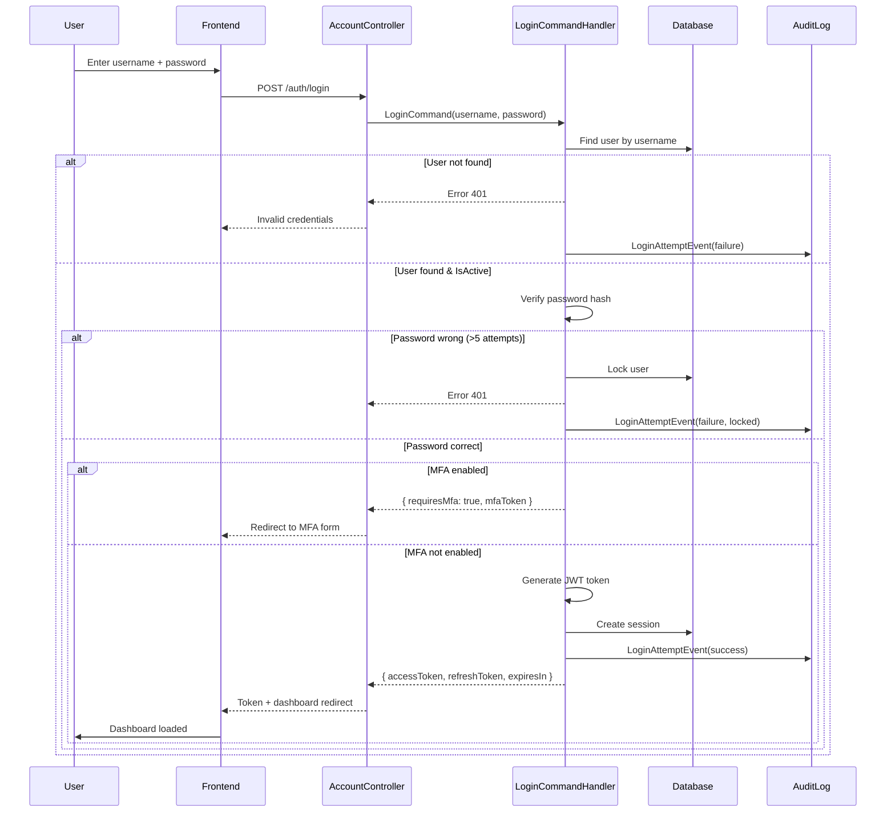
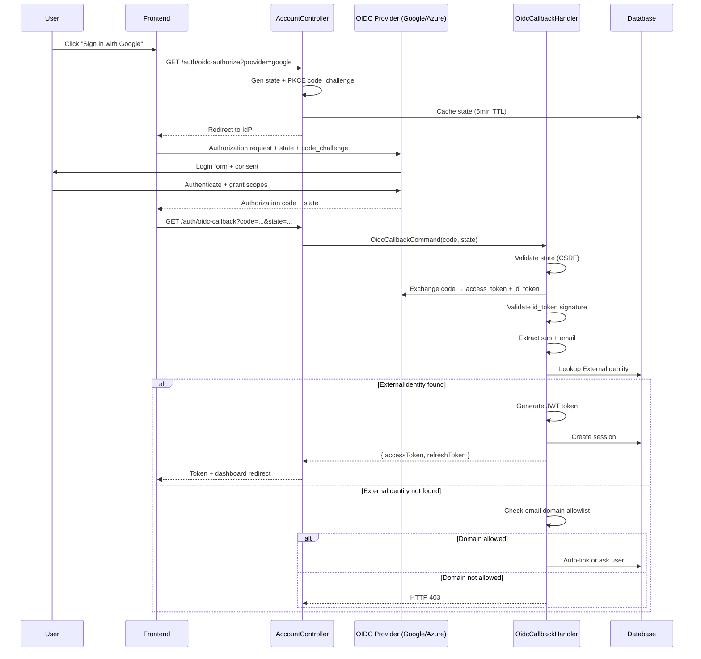

# Use Cases — Identity Module (Core)

Phần này chi tiết hóa yêu cầu chức năng cốt lõi của Identity module qua 13 use case Cockburn fully-dressed. Các UC này bao gồm: xác thực, MFA, quản lý người dùng, quản lý vai trò + nhóm, và tự dịch vụ.

---

## Table of Contents

**Core UCs (File này):**
1. UC-IDN-01 — Đăng nhập bằng mật khẩu (Local)
2. UC-IDN-02 — Đăng nhập OIDC (Google/Azure/VNeID)
3. UC-IDN-03 — Bật xác thực đa yếu tố (MFA)
4. UC-IDN-04 — Xác minh MFA challenge
5. UC-IDN-05 — Đổi mật khẩu (tự dịch vụ)
6. UC-IDN-06 — Khôi phục mật khẩu (quên mật khẩu)
7. UC-IDN-07 — Quản trị viên tạo người dùng
8. UC-IDN-08 — Quản trị viên cập nhật người dùng
9. UC-IDN-09 — Quản trị viên vô hiệu hóa người dùng
10. UC-IDN-10 — Gán vai trò cho người dùng
11. UC-IDN-11 — Tạo nhóm + gán thành viên
12. UC-IDN-12 — Cấp permission cho vai trò
13. UC-IDN-13 — Xem thông tin cá nhân + effective permissions

**Advanced UCs (Xem uc-identity-advanced.md):** UC-IDN-A01 đến A11

---

## UC-IDN-01: Đăng nhập bằng mật khẩu (Local)

- **Goal in context:** Người dùng xác thực bằng username + mật khẩu để lấy JWT token và bắt đầu phiên làm việc.
- **Module:** Identity
- **Actor (primary):** Nhân viên chính phủ (Cán bộ, Chuyên viên, v.v.)
- **Stakeholders & interests:**
  - **Người dùng:** Truy cập hệ thống an toàn, được ghi lại audit log
  - **Admin:** Phát hiện đăng nhập bất thường, enforce MFA/lockout policy
  - **Tuân thủ:** Log tất cả attempt (thành công/thất bại), NĐ85 audit trail
- **Scope:** Identity Module — Account Controller
- **Level:** User-goal
- **Priority:** P0
- **Linked FR:** FR-IDN-01 (User Authentication), FR-IDN-04 (Session Management)
- **Trigger:** Người dùng nhập username + password vào login form (FE hoặc Postman)

### Preconditions
- Người dùng tồn tại (IsActive=true) và thuộc tenant đang xử lý
- Mật khẩu được hash sử dụng ASP.NET Identity (bcrypt/PBKDF2)
- IP đăng nhập không bị blacklist (rate-limit check)

### Main Success Scenario
1. Người dùng gửi POST `/api/v1/auth/login` với `{ "username": "...", "password": "...", "tenantId": "..." }`
2. System kiểm tra người dùng tồn tại + IsActive=true
3. System validate mật khẩu (VerifyHashedPassword)
4. **[MFA active & required]:** System trả về `{ "requiresMfa": true, "mfaToken": "temp-jwt" }` → đi UC-IDN-04
5. **[No MFA]:** System tạo JWT token (claims: `sub`, `tenant_id`, `roles`, `dept_code`)
6. System ghi audit log: `LoginAttemptEvent` (success, IP, device)
7. System trả về `{ "accessToken": "jwt...", "refreshToken": "...", "expiresIn": 3600 }`
8. Client lưu token vào localStorage + xét Authorization header
9. Người dùng được redirect tới dashboard

### Extensions
- **2a. Người dùng không tồn tại:**
  - System trả về HTTP 401 Unauthorized + generic message "Invalid credentials"
  - Ghi audit log: `LoginAttemptEvent` (failure, reason: user_not_found)
  
- **3a. Mật khẩu sai:**
  - Increment `LoginFailureCount` trên user
  - Nếu `LoginFailureCount > 5`: Lock user (IsLocked=true) → Send unlock email
  - Trả về HTTP 401 + ghi audit log (failure, reason: invalid_password)
  
- **3b. Mật khẩu hết hạn (ngày reset-password):**
  - Trả về HTTP 403 Forbidden + flag `requiresPasswordChange: true`
  - Client redirect tới change-password form (UC-IDN-05)
  
- **2b. User bị lock (IsLocked=true):**
  - Trả về HTTP 403 + message "Account locked. Please contact admin."
  - Ghi audit log (failure, reason: account_locked)

### Postconditions
- **Success:** JWT token phát hành, audit log ghi, phiên (session) tạo trong DB
- **Failure:** HTTP 401/403, audit log ghi, không có token phát hành

### Special Requirements / NFR refs
- **Security:**
  - Rate-limit: max 5 attempt/minute/IP (DDOS mitigation)
  - Password hash: bcrypt/PBKDF2, không log plaintext
  - JWT exp: 1h (access token); 30d (refresh token)
  - Audit: Login attempt (success/failure) → `AuditLog` table
  
- **Performance:**
  - Lookup user + password verify: <100ms
  - JWT generation: <50ms
  - Total endpoint p95: <500ms

### Endpoint(s)
- `POST /api/v1/auth/login` — AccountController.Login()

### Permission(s)
- Công khai (unauthenticated endpoint); không cần permission

### Source code refs
- **Controller:** `src/modules/identity/AqtCoreFW.Identity.Presentation/Controllers/AccountController.cs` → Login action
- **Handler:** `src/modules/identity/AqtCoreFW.Identity.Application/Commands/Login/AccountLoginCommandHandler.cs`
- **Entity:** `src/modules/identity/AqtCoreFW.Identity.Domain/Entities/ApplicationUser.cs` (PasswordHash, LoginFailureCount, IsLocked, LastLoginDate)
- **Audit:** `src/modules/audit/AqtCoreFW.Audit.Domain/Events/LoginAttemptEvent.cs`

---

## UC-IDN-02: Đăng nhập OIDC (Google/Azure AD/VNeID)

- **Goal in context:** Người dùng xác thực qua nhà cung cấp bên thứ 3 (Google, Azure AD, VNeID) để lấy token mà không cần quản lý mật khẩu cục bộ.
- **Module:** Identity
- **Actor (primary):** Nhân viên chính phủ (dùng corporate account Google / Azure / VNeID)
- **Stakeholders & interests:**
  - **Người dùng:** SSO tiện lợi, không cần nhớ mật khẩu bổ sung
  - **Admin:** Tập trung quản lý identity ở IdP, reduce local credential burden
  - **Compliance:** NĐ59 support VNeID federation
- **Scope:** Identity Module — AccountController + OpenIddict integration
- **Level:** User-goal
- **Priority:** P1
- **Linked FR:** FR-IDN-02 (OIDC/Federation)
- **Trigger:** Người dùng nhấp "Sign in with Google / Azure / VNeID"

### Preconditions
- OIDC provider được cấu hình trong tenant settings (`OidcProviders` table)
- Client application đã đăng ký callback URL tại IdP
- Người dùng tồn tại trong tenant + có `ExternalIdentity` record linking email/sub

### Main Success Scenario
1. FE redirect tới `/api/v1/auth/oidc-authorize?provider=google&redirect_uri=...`
2. System gen state + PKCE code_challenge, lưu session cache (5 min TTL)
3. System redirect tới IdP (Google/Azure/VNeID) authorization endpoint
4. **[User login at IdP]:** Người dùng nhập credentials/biometric tại IdP
5. **[User consent]:** Người dùng confirm scope (email, name, profile)
6. IdP callback tới `/api/v1/auth/oidc-callback?code=...&state=...`
7. System validate state + exchange code → access token + id_token (JWT)
8. System extract subject (`sub`) + email từ id_token
9. System lookup user qua `ExternalIdentity` (provider, sub)
10. **[User found]:** Update last login, gen JWT token (step 5 UC-IDN-01), trả về token + redirect dashboard
11. **[User not found]:** Trả về form "Link account" hoặc auto-create (per tenant policy)

### Extensions
- **6a. State mismatch (CSRF):**
  - Reject callback, trả về HTTP 400 + message "Invalid state"
  - Ghi audit log (failure, reason: csrf_detected)
  
- **8a. External identity không tìm thấy:**
  - Check email domain allowlist (nếu tenant chỉ cho phép corporate domain)
  - Nếu domain OK: auto-link hoặc ask user choose link account (UC này assume auto-link per policy)
  - Nếu domain not OK: trả về HTTP 403 "Domain not authorized"

### Postconditions
- **Success:** User linked, JWT issued, session created, audit log ghi
- **Failure:** OAuth flow fail, no token, audit log ghi

### Special Requirements / NFR refs
- **Security:**
  - PKCE (code_challenge_method=S256) bắt buộc
  - State validation CORS-aware
  - id_token signature verify (public key từ IdP JWKS endpoint)
  - Audit: OIDC callback (success/failure, provider, sub)
  
- **Performance:**
  - Token exchange: <2s (IdP network latency)
  - Local JWT gen: <100ms
  - Total flow p95: <5s (mostly IdP latency)

### Endpoint(s)
- `GET /api/v1/auth/oidc-authorize` — AccountController.OidcAuthorize()
- `GET /api/v1/auth/oidc-callback` — AccountController.OidcCallback()

### Permission(s)
- Công khai (unauthenticated)

### Source code refs
- **Controller:** `src/modules/identity/AqtCoreFW.Identity.Presentation/Controllers/AccountController.cs`
- **Handler:** `src/modules/identity/AqtCoreFW.Identity.Application/Commands/Oidc*CommandHandler.cs`
- **Entity:** `src/modules/identity/AqtCoreFW.Identity.Domain/Entities/ExternalIdentity.cs` (Provider, Subject, Email, LinkedAt)
- **Config:** `src/modules/identity/AqtCoreFW.Identity.Domain/Entities/OidcProviderConfig.cs` (ClientId, ClientSecret, AuthorityUrl)

---

## UC-IDN-03: Bật xác thực đa yếu tố (MFA)

- **Goal in context:** Người dùng bật bảo vệ 2FA (TOTP hoặc SMS) trên tài khoản để tăng cường bảo mật.
- **Module:** Identity
- **Actor (primary):** Nhân viên chính phủ (End user)
- **Stakeholders & interests:**
  - **Người dùng:** Bảo vệ tài khoản khỏi phishing
  - **Admin:** Enforce MFA cho high-risk role (TENANT_ADMIN, AUDITOR)
  - **Compliance:** NĐ85 multi-factor auth requirement
- **Scope:** Identity Module — MeController, MfaController
- **Level:** User-goal
- **Priority:** P1
- **Linked FR:** FR-IDN-03 (Multi-Factor Authentication)
- **Trigger:** Người dùng click "Enable 2FA" trong settings

### Preconditions
- Người dùng đã authenticated (JWT token hợp lệ)
- MFA chưa được bật trên tài khoản (MfaEnabled=false)
- SMS/TOTP provider được cấu hình trong tenant

### Main Success Scenario
1. FE gửi GET `/api/v1/me/mfa/setup?method=totp` (hoặc `sms`)
2. System tạo TOTP secret (base32 encoding, 32-byte random) hoặc gen temporary SMS code
3. System trả về `{ "secret": "JBSWY3DPEBLW64TMMQ======", "qrCode": "data:image/png;...", "backupCodes": [...] }`
4. FE display QR code, user scan bằng authenticator app (Google Authenticator, Microsoft Authenticator)
5. FE display backup codes (8 codes, mỗi 8-char alphanumeric) → user save offline
6. FE gửi POST `/api/v1/me/mfa/confirm` với `{ "method": "totp", "verificationCode": "123456", "backupCodesAcknowledged": true }`
7. System validate verification code (TOTP = HMAC(secret, time_step), tolerance ±1 step)
8. System enable MFA: MfaEnabled=true, MfaMethod='totp', MfaSecret=encrypted
9. System save backup codes (hashed) → `MfaBackupCode` table
10. System ghi audit log: `MfaEnforcedEvent` (user_id, method)
11. System trả về HTTP 200 OK + message "2FA enabled"
12. FE redirect tới dashboard hoặc settings confirmation

### Extensions
- **7a. Verification code sai:**
  - Increment attempt counter; nếu >5 failed: reject setup, ghi audit log (reason: mfa_setup_failed)
  
- **6b. TOTP out-of-sync (user clock drifted):**
  - System tolerates ±1 TOTP step (30s each) → ±90s window
  - Nếu verification fail: User ask to resync device time, retry
  
- **6c. User lose backup codes:**
  - After enable: User can re-generate backup codes via "View backup codes" endpoint
  - Old codes invalidated

### Postconditions
- **Success:** MFA enabled, backup codes saved, audit log ghi, user informed
- **Failure:** Setup aborted, MFA remains disabled, audit log ghi

### Special Requirements / NFR refs
- **Security:**
  - TOTP secret never logged (encrypted in DB)
  - Backup codes hashed (bcrypt)
  - Verification tolerance: ±1 step (±30s for TOTP)
  - Rate-limit setup: max 3 attempts/5min
  
- **Performance:**
  - QR code gen: <500ms
  - Verification: <100ms

### Endpoint(s)
- `GET /api/v1/me/mfa/setup` — MeController.GetMfaSetup()
- `POST /api/v1/me/mfa/confirm` — MeController.ConfirmMfa()

### Permission(s)
- Require: Authenticated user (scoped to caller)

### Source code refs
- **Controller:** `src/modules/identity/AqtCoreFW.Identity.Presentation/Controllers/MeController.cs`
- **Handler:** `src/modules/identity/AqtCoreFW.Identity.Application/Commands/EnableMfaCommandHandler.cs`
- **Entity:** `src/modules/identity/AqtCoreFW.Identity.Domain/Entities/ApplicationUser.cs` (MfaEnabled, MfaMethod, MfaSecret)
- **Backup:** `src/modules/identity/AqtCoreFW.Identity.Domain/Entities/MfaBackupCode.cs`

---

## UC-IDN-04: Xác minh MFA challenge

- **Goal in context:** Người dùng nhập TOTP/SMS code để hoàn tất xác thực 2FA trong quá trình login.
- **Module:** Identity
- **Actor (primary):** Nhân viên chính phủ (End user qua TOTP device)
- **Stakeholders & interests:**
  - **Người dùng:** Truy cập tài khoản bảo vệ MFA
  - **Admin:** Audit tất cả MFA challenge (success/failure)
- **Scope:** Identity Module — AccountController
- **Level:** Subfunction (triggered from UC-IDN-01 step 4)
- **Priority:** P1
- **Linked FR:** FR-IDN-03 (Multi-Factor Authentication)
- **Trigger:** Login returned `requiresMfa: true` (UC-IDN-01 extension)

### Preconditions
- User completed step 1-3 của UC-IDN-01 (password verified)
- Temporary MFA token (`mfaToken`) phát hành từ UC-IDN-01 (short-lived, <5 min)
- User có TOTP device cập nhật

### Main Success Scenario
1. FE display "Enter 6-digit code from authenticator" form
2. User input 6-digit TOTP code + click "Verify"
3. FE gửi POST `/api/v1/auth/mfa-verify` với `{ "mfaToken": "...", "code": "123456" }`
4. System validate mfaToken signature + expiry (JWT validation)
5. System extract user_id từ mfaToken
6. System validate TOTP code (HMAC check, ±1 step tolerance)
7. **[Code valid]:** System gen full JWT token (access + refresh), clear mfaToken
8. System reset LoginFailureCount = 0
9. System ghi audit log: `MfaVerificationEvent` (success, user_id)
10. System trả về `{ "accessToken": "jwt...", "refreshToken": "...", "expiresIn": 3600 }`
11. FE save token, redirect dashboard

### Extensions
- **6a. TOTP code sai:**
  - Increment MfaFailureCount
  - Nếu >3 failed: Lock user (IsLocked=true), clear mfaToken
  - Trả về HTTP 401 "Invalid code"
  - Audit log: MfaVerificationEvent (failure, reason: invalid_code)
  
- **4a. mfaToken expired:**
  - Trả về HTTP 401 "MFA token expired, please re-login"
  - User restart UC-IDN-01
  
- **6b. Backup code provided (if TOTP device lost):**
  - Accept backup code (format: 8-char, hashed check)
  - Invalidate backup code after use (one-time use)
  - Audit log mark backup_code_used
  
- **6c. User click "I don't have code":**
  - Option: Send one-time SMS code to registered phone (2nd MFA method)
  - Or: Require admin unlock + password reset flow

### Postconditions
- **Success:** JWT token phát hành, full session established, audit log ghi
- **Failure:** No token, mfaToken either clear (if expired) or extended (if still valid), audit log ghi

### Special Requirements / NFR refs
- **Security:**
  - mfaToken exp: 5 min (short-lived, prevents token replay)
  - TOTP tolerance ±30s
  - Backup code one-time use + hashed storage
  - Rate-limit: max 10 attempts per mfaToken
  
- **Performance:**
  - Code validation: <100ms
  - JWT gen: <50ms

### Endpoint(s)
- `POST /api/v1/auth/mfa-verify` — AccountController.VerifyMfa()

### Permission(s)
- N/A (unauthenticated, only mfaToken required)

### Source code refs
- **Controller:** `src/modules/identity/AqtCoreFW.Identity.Presentation/Controllers/AccountController.cs`
- **Handler:** `src/modules/identity/AqtCoreFW.Identity.Application/Commands/VerifyMfaCommandHandler.cs`
- **TOTP Validation:** `src/modules/identity/AqtCoreFW.Identity.Infrastructure/Services/TotpService.cs`

---

## UC-IDN-05: Đổi mật khẩu (tự dịch vụ)

- **Goal in context:** Người dùng thay đổi mật khẩu hiện tại của mình thành mật khẩu mới.
- **Module:** Identity
- **Actor (primary):** Nhân viên chính phủ (End user)
- **Stakeholders & interests:**
  - **Người dùng:** Bảo vệ tài khoản bằng mật khẩu mới
  - **Admin:** Enforce password complexity policy
  - **Compliance:** Audit password change event
- **Scope:** Identity Module — MeController
- **Level:** User-goal
- **Priority:** P1
- **Linked FR:** FR-IDN-05 (Credential Management)
- **Trigger:** Người dùng click "Change password" hoặc redirect từ UC-IDN-01 (expired password extension)

### Preconditions
- Người dùng authenticated (JWT token hợp lệ)
- Mật khẩu hiện tại chưa hết hạn (hoặc hết hạn → buộc change)

### Main Success Scenario
1. FE display form "Current Password" + "New Password" + "Confirm Password"
2. User nhập current password + new password (confirm)
3. FE gửi POST `/api/v1/me/password/change` với `{ "currentPassword": "...", "newPassword": "...", "confirmPassword": "..." }`
4. System validate currentPassword (verify hash)
5. System validate newPassword complexity (min 8 chars, uppercase, digit, special char per policy)
6. System check newPassword không duplicate recent N passwords (prevent reuse, N=5)
7. System hash newPassword + update ApplicationUser.PasswordHash
8. System reset PasswordChangedDate = now, PasswordExpiryDate = now + 90 days
9. System reset LoginFailureCount = 0
10. System ghi audit log: `CredentialChangedEvent` (user_id, type: password_change)
11. System trả về HTTP 200 OK
12. FE redirect dashboard với toast "Password changed successfully"

### Extensions
- **4a. Current password sai:**
  - Increment attempt counter; nếu >3: Lock user
  - Trả về HTTP 401 "Current password incorrect"
  
- **5a. New password fails complexity:**
  - Trả về HTTP 400 + error message "Password must contain uppercase, digit, special character" + requirements list
  
- **6a. New password in recent history:**
  - Trả về HTTP 400 "Cannot reuse recent password"

### Postconditions
- **Success:** Password hash updated, expiry extended, audit log ghi, user informed
- **Failure:** Password unchanged, audit log ghi

### Special Requirements / NFR refs
- **Security:**
  - Complexity: min 8 chars, ≥1 uppercase, ≥1 digit, ≥1 special char
  - No reuse: last 5 passwords checked
  - Rate-limit: max 3 attempts/5min per user
  - Audit: Log all password change (reason: self-service / forced / admin-reset)
  
- **Performance:**
  - Password hash verify + new hash: <200ms

### Endpoint(s)
- `POST /api/v1/me/password/change` — MeController.ChangePassword()

### Permission(s)
- Require: Authenticated user (scoped to self)

### Source code refs
- **Controller:** `src/modules/identity/AqtCoreFW.Identity.Presentation/Controllers/MeController.cs`
- **Handler:** `src/modules/identity/AqtCoreFW.Identity.Application/Commands/ChangePasswordCommandHandler.cs`
- **Policy:** `src/modules/identity/AqtCoreFW.Identity.Domain/ValueObjects/PasswordPolicy.cs`

---

## UC-IDN-06: Khôi phục mật khẩu (quên mật khẩu)

- **Goal in context:** Người dùng quên mật khẩu, nhận email reset + set mật khẩu mới qua link an toàn.
- **Module:** Identity
- **Actor (primary):** Nhân viên chính phủ (End user, not logged in)
- **Stakeholders & interests:**
  - **Người dùng:** Recover access to account
  - **Admin:** Audit password reset attempt
  - **Compliance:** Verify email ownership (token-based)
- **Scope:** Identity Module — AccountController
- **Level:** User-goal
- **Priority:** P1
- **Linked FR:** FR-IDN-05 (Credential Management)
- **Trigger:** User click "Forgot password" on login page

### Preconditions
- User not authenticated
- Email address exists in system (linked to user)
- Email service (SMTP) configured

### Main Success Scenario
1. FE display "Forgot Password" form (email input only)
2. User enter email address
3. FE gửi POST `/api/v1/auth/password-reset-request` với `{ "email": "..." }`
4. System lookup user by email; nếu không tìm thấy → trả 200 OK (generic message, no user enumeration)
5. **[User found]:** System gen reset token (JWT, exp: 15 min, claim: `email`, `purpose: password_reset`)
6. System send email với link: `https://app/reset-password?token=...`
7. System ghi audit log: `PasswordResetRequestEvent` (email, token_gen_time)
8. System trả về HTTP 200 OK + message "Check email for reset link"
9. **[User click link]:** FE display "New Password" form
10. FE gửi POST `/api/v1/auth/password-reset-confirm` với `{ "token": "...", "newPassword": "..." }`
11. System validate token (JWT signature, expiry, purpose claim)
12. System extract email từ token
13. System validate newPassword complexity
14. System hash newPassword, update user.PasswordHash
15. System invalidate reset token (add to blacklist cache)
16. System reset PasswordExpiryDate = now + 90 days
17. System ghi audit log: `CredentialChangedEvent` (email, type: password_reset)
18. System trả về HTTP 200 OK
19. FE redirect login form với message "Password reset successful"

### Extensions
- **4a. Email not found:**
  - Trả HTTP 200 OK + generic message (prevent user enumeration)
  - Audit log: `PasswordResetRequestEvent` (email, result: user_not_found)
  
- **11a. Token invalid / expired:**
  - Trả HTTP 401 "Reset link expired, please request new one"
  - Audit log: `PasswordResetConfirmEvent` (result: token_invalid)
  
- **13a. New password fails complexity:**
  - Trả HTTP 400 + complexity error
  
- **6a. Email service unavailable:**
  - Retry queue with exponential backoff (Hangfire job)
  - Audit log email send failure

### Postconditions
- **Success:** Password reset, token invalidated, audit log ghi, email sent
- **Failure:** No action, audit log ghi, generic message to prevent enumeration

### Special Requirements / NFR refs
- **Security:**
  - Reset token exp: 15 min
  - One-time use (blacklist after confirm)
  - Email verification (token in URL, not email body)
  - Prevent user enumeration (generic 200 response)
  - Rate-limit: max 3 reset requests per email/hour
  - Audit: All reset request + confirm attempt
  
- **Performance:**
  - Token gen/validation: <100ms
  - Email send: async (Hangfire), <5s queueing

### Endpoint(s)
- `POST /api/v1/auth/password-reset-request` — AccountController.RequestPasswordReset()
- `POST /api/v1/auth/password-reset-confirm` — AccountController.ConfirmPasswordReset()

### Permission(s)
- Công khai (unauthenticated)

### Source code refs
- **Controller:** `src/modules/identity/AqtCoreFW.Identity.Presentation/Controllers/AccountController.cs`
- **Handlers:** `*PasswordResetCommandHandler.cs`
- **Token Service:** `src/modules/identity/AqtCoreFW.Identity.Infrastructure/Services/ResetTokenService.cs`

---

## UC-IDN-07: Quản trị viên tạo người dùng

- **Goal in context:** Admin tạo tài khoản người dùng mới, gán role ban đầu, gửi welcome email.
- **Module:** Identity
- **Actor (primary):** Quản trị viên (TenantAdmin, DeptDirector)
- **Stakeholders & interests:**
  - **Admin:** Bulk user provisioning
  - **Người dùng mới:** Receive welcome email with temp password
  - **Compliance:** Audit user creation
- **Scope:** Identity Module — UsersAdminController
- **Level:** User-goal
- **Priority:** P1
- **Linked FR:** FR-IDN-06 (User Management)
- **Trigger:** Admin click "Create User" button in admin dashboard

### Preconditions
- Admin authenticated + has `IDN_USER_CREATE` permission
- Email not already registered in tenant
- Required fields: firstName, lastName, email

### Main Success Scenario
1. FE display "Create User" form (firstName, lastName, email, initialRoles, orgUnit)
2. Admin fill form + click "Create"
3. FE gửi POST `/api/v1/admin/users` với `{ "firstName": "...", "lastName": "...", "email": "...", "roleIds": [...], "orgUnitId": "..." }`
4. System validate email format + uniqueness in tenant
5. System gen temp password (16-char random, entropy >128 bits)
6. System hash temp password
7. System create ApplicationUser entity (Id=GUID, TenantId, Email, PasswordHash, IsActive=true, PasswordChangedDate=null → force change)
8. System assign initial roles (RolePermission join table)
9. System assign to OrgUnit (UserOrgUnitAssignment)
10. System send welcome email: "Welcome to AqtCoreFW. Temp password: ..." + reset link
11. System ghi audit log: `UserCreatedEvent` (email, createdBy: admin_id, roles)
12. System trả về HTTP 201 Created + `{ "userId": "...", "email": "..." }`
13. FE show success message + redirect user list

### Extensions
- **4a. Email already registered:**
  - Trả HTTP 409 Conflict "Email already exists"
  
- **10a. Email service fails:**
  - Retry queue (Hangfire), continue user creation
  - Audit log email send failure
  - UI message: "User created but welcome email pending retry"

### Postconditions
- **Success:** User created, roles assigned, email sent, audit log ghi
- **Failure:** User not created, error returned, audit log ghi

### Special Requirements / NFR refs
- **Security:**
  - Temp password not logged
  - Force password change on first login (PasswordChangedDate=null check in UC-IDN-01)
  - Only TENANT_ADMIN or DEPT_DIRECTOR can create users
  - Audit: creator identity, roles assigned
  
- **Performance:**
  - User creation: <200ms
  - Email send: async <5s queueing

### Endpoint(s)
- `POST /api/v1/admin/users` — UsersAdminController.CreateUser()

### Permission(s)
- Require: `IDN_USER_CREATE`

### Source code refs
- **Controller:** `src/modules/identity/AqtCoreFW.Identity.Presentation/Controllers/UsersAdminController.cs`
- **Handler:** `src/modules/identity/AqtCoreFW.Identity.Application/Commands/CreateUserCommandHandler.cs`
- **Entity:** `src/modules/identity/AqtCoreFW.Identity.Domain/Entities/ApplicationUser.cs`

---

## UC-IDN-08: Quản trị viên cập nhật người dùng

- **Goal in context:** Admin cập nhật thông tin người dùng (email, tên, active status).
- **Module:** Identity
- **Actor (primary):** Quản trị viên (TenantAdmin, DeptDirector)
- **Stakeholders & interests:**
  - **Admin:** Maintain user records (name changes, org unit reassign)
  - **Compliance:** Audit user data changes
- **Scope:** Identity Module — UsersAdminController
- **Level:** User-goal
- **Priority:** P1
- **Linked FR:** FR-IDN-06 (User Management)
- **Trigger:** Admin click "Edit" on user detail page

### Preconditions
- Admin authenticated + has `IDN_USER_UPDATE` permission
- User exists (not deleted) + belongs to same tenant

### Main Success Scenario
1. FE display user form (firstName, lastName, email, orgUnit, isActive, roles read-only)
2. Admin modify fields + click "Update"
3. FE gửi PUT `/api/v1/admin/users/{userId}` với updated payload (optimistic concurrency: include RowVersion)
4. System validate input + check email uniqueness (if changed)
5. System compare RowVersion (optimistic lock): nếu mismatch → 409 Conflict
6. System update user fields (FirstName, LastName, Email, IsActive)
7. System assign new OrgUnit (if changed)
8. System increment RowVersion (EF Core concurrency)
9. System ghi audit log: `UserUpdatedEvent` (user_id, changes: [field→value pairs])
10. System trả về HTTP 200 OK + updated user DTO
11. FE refresh form + show success message

### Extensions
- **4a. Email already exists (different user):**
  - Trả HTTP 409 "Email already in use"
  
- **5a. RowVersion mismatch (concurrent edit):**
  - Trả HTTP 409 Conflict + message "User was modified by another admin, please refresh"
  - FE reload + retry

### Postconditions
- **Success:** User updated, audit log ghi, RowVersion incremented
- **Failure:** No change, error returned, audit log ghi

### Special Requirements / NFR refs
- **Security:**
  - Optimistic concurrency via RowVersion (prevent lost updates)
  - Admin cannot directly change password (must use password reset flow)
  - Audit changes (field-level tracking)
  
- **Performance:**
  - Update: <200ms

### Endpoint(s)
- `PUT /api/v1/admin/users/{userId}` — UsersAdminController.UpdateUser()

### Permission(s)
- Require: `IDN_USER_UPDATE`

### Source code refs
- **Controller:** `src/modules/identity/AqtCoreFW.Identity.Presentation/Controllers/UsersAdminController.cs`
- **Handler:** `src/modules/identity/AqtCoreFW.Identity.Application/Commands/UpdateUserCommandHandler.cs`

---

## UC-IDN-09: Quản trị viên vô hiệu hóa người dùng

- **Goal in context:** Admin deactivate user account (soft delete) để ngăn login + revoke access.
- **Module:** Identity
- **Actor (primary):** Quản trị viên (TenantAdmin)
- **Stakeholders & interests:**
  - **Admin:** Terminate employee access
  - **Compliance:** Audit user deactivation (offboarding)
- **Scope:** Identity Module — UsersAdminController
- **Level:** User-goal
- **Priority:** P1
- **Linked FR:** FR-IDN-06 (User Management)
- **Trigger:** Admin click "Deactivate" on user detail page

### Preconditions
- Admin authenticated + has `IDN_USER_DELETE` permission (deactivate ≈ soft delete)
- User exists + IsActive=true
- User not current admin (prevent self-lockout)

### Main Success Scenario
1. FE display confirmation dialog "Deactivate user? They will be unable to login."
2. Admin click "Yes, deactivate"
3. FE gửi DELETE `/api/v1/admin/users/{userId}`
4. System validate user exists + IsActive=true
5. System check not self (Admin.Id != userId)
6. System set IsActive=false, DeactivatedDate=now, DeactivatedBy=admin_id
7. System end all active sessions (delete or mark expired in SessionToken table)
8. System send deactivation email to user (informational)
9. System ghi audit log: `UserDeactivatedEvent` (user_id, deactivatedBy, reason)
10. System trả về HTTP 204 No Content
11. FE remove from list + show success message

### Extensions
- **5a. User is self (current admin):**
  - Trả HTTP 403 "Cannot deactivate own account"
  
- **6a. User has active workflow tasks (assigned):**
  - Warning in dialog: "User has 5 pending tasks. These will be unassigned."
  - Proceed with warning acknowledged (UC this ignore; separate UC for task reassignment)

### Postconditions
- **Success:** IsActive=false, sessions cleared, audit log ghi, user informed
- **Failure:** No change, error returned

### Special Requirements / NFR refs
- **Security:**
  - Self-deactivation prevented
  - Soft delete only (data not purged; RTBF separate flow in UC-IDN-A12)
  - Audit: deactivator, timestamp, reason
  
- **Performance:**
  - Deactivate + session cleanup: <500ms

### Endpoint(s)
- `DELETE /api/v1/admin/users/{userId}` — UsersAdminController.DeleteUser()

### Permission(s)
- Require: `IDN_USER_DELETE`

### Source code refs
- **Controller:** `src/modules/identity/AqtCoreFW.Identity.Presentation/Controllers/UsersAdminController.cs`
- **Handler:** `src/modules/identity/AqtCoreFW.Identity.Application/Commands/DeleteUserCommandHandler.cs`

---

## UC-IDN-10: Gán vai trò cho người dùng

- **Goal in context:** Admin assign role(s) to user, grant permissions via role hierarchy.
- **Module:** Identity
- **Actor (primary):** Quản trị viên (TenantAdmin)
- **Stakeholders & interests:**
  - **Admin:** Grant user authority via role
  - **Compliance:** Audit role assignment (access control event)
- **Scope:** Identity Module — UsersAdminController / RolesAdminController
- **Level:** Subfunction
- **Priority:** P1
- **Linked FR:** FR-IDN-07 (Role-Based Access Control)
- **Trigger:** Admin click "Assign Role" in user detail page

### Preconditions
- Admin authenticated + has `IDN_ROLE_UPDATE` permission (equivalent to role assign)
- User exists + IsActive=true
- Role exists + not already assigned to user

### Main Success Scenario
1. FE display role multiselect (checkboxes: BTC_MINISTER, BTC_DEPT_DIRECTOR, ...)
2. Admin check role(s) + click "Assign"
3. FE gửi POST `/api/v1/admin/users/{userId}/roles` với `{ "roleIds": [...] }`
4. System validate roles exist in tenant
5. System validate no SoD conflict (UC-IDN-A04 advanced — assume passes for now)
6. System create RolePermission join rows (user ← RolePermission → role)
7. System ghi audit log: `RoleAssignedEvent` (user_id, role_ids)
8. System trả về HTTP 201 Created
9. FE refresh role list + show success message
10. **[Next login]:** User's JWT claims include new roles

### Extensions
- **5a. SoD conflict detected:**
  - Trả HTTP 409 "Cannot assign role: conflicts with existing role (Role A ∩ Role B mutually exclusive)"
  - Audit log: `SodViolationDetectedEvent`
  
- **4a. Role not found:**
  - Trả HTTP 404

### Postconditions
- **Success:** RolePermission created, audit log ghi, effective permissions updated on next login
- **Failure:** No assignment, error returned, audit log ghi

### Special Requirements / NFR refs
- **Security:**
  - Check SoD rules before assign
  - Audit role assignment (access control event)
  
- **Performance:**
  - Assign: <200ms

### Endpoint(s)
- `POST /api/v1/admin/users/{userId}/roles` — UsersAdminController.AssignRoles()

### Permission(s)
- Require: `IDN_ROLE_UPDATE` or `IDN_USER_UPDATE`

### Source code refs
- **Controller:** `src/modules/identity/AqtCoreFW.Identity.Presentation/Controllers/UsersAdminController.cs` (or RolesAdminController)
- **Handler:** `src/modules/identity/AqtCoreFW.Identity.Application/Commands/AssignRoleCommandHandler.cs`

---

## UC-IDN-11: Tạo nhóm + gán thành viên

- **Goal in context:** Admin tạo user group (department, team) + add users to group để facilitate task pooling + permission delegation.
- **Module:** Identity
- **Actor (primary):** Quản trị viên (TenantAdmin, DeptDirector)
- **Stakeholders & interests:**
  - **Admin:** Organize users by department/team
  - **Compliance:** Audit group creation + membership changes
- **Scope:** Identity Module — GroupsAdminController
- **Level:** User-goal
- **Priority:** P1
- **Linked FR:** FR-IDN-08 (Group Management)
- **Trigger:** Admin click "Create Group" in Groups page

### Preconditions
- Admin authenticated + has `IDN_GROUP_CREATE` permission
- Group name not already exist in tenant

### Main Success Scenario
1. FE display "Create Group" form (name, description, activeMembers checkboxes)
2. Admin fill form + select members + click "Create"
3. FE gửi POST `/api/v1/admin/groups` với `{ "name": "...", "description": "...", "memberIds": [...] }`
4. System validate group name uniqueness in tenant
5. System create ApplicationUserGroup entity (Id=GUID, TenantId, Name, Description, CreatedDate)
6. System add members (UserGroupMembership join table, IsActive=true)
7. System ghi audit log: `GroupCreatedEvent` (group_id, creator_id, memberCount)
8. System trả về HTTP 201 Created + group DTO
9. FE refresh group list + show success message

### Extensions
- **4a. Group name duplicate:**
  - Trả HTTP 409 "Group already exists"
  
- **5a. Invalid member IDs:**
  - Trả HTTP 400 "One or more members not found"

### Postconditions
- **Success:** Group created, members added, audit log ghi
- **Failure:** No creation, error returned, audit log ghi

### Special Requirements / NFR refs
- **Security:**
  - Only `IDN_GROUP_CREATE` can create
  - Audit: creator, members added
  
- **Performance:**
  - Create + add members: <300ms

### Endpoint(s)
- `POST /api/v1/admin/groups` — GroupsAdminController.CreateGroup()
- `POST /api/v1/admin/groups/{groupId}/members` — GroupsAdminController.AddMembers() (separate or same?)

### Permission(s)
- Require: `IDN_GROUP_CREATE`

### Source code refs
- **Controller:** `src/modules/identity/AqtCoreFW.Identity.Presentation/Controllers/GroupsAdminController.cs`
- **Handler:** `src/modules/identity/AqtCoreFW.Identity.Application/Commands/CreateUserGroupCommandHandler.cs`
- **Entity:** `src/modules/identity/AqtCoreFW.Identity.Domain/Entities/ApplicationUserGroup.cs`

---

## UC-IDN-12: Cấp permission cho vai trò

- **Goal in context:** Admin assign permission(s) to role, grant fine-grained capabilities.
- **Module:** Identity
- **Actor (primary):** Quản trị viên (TenantAdmin)
- **Stakeholders & interests:**
  - **Admin:** Fine-tune role capabilities
  - **Compliance:** Audit permission assignment
- **Scope:** Identity Module — RolesAdminController
- **Level:** Subfunction
- **Priority:** P1
- **Linked FR:** FR-IDN-07 (Role-Based Access Control)
- **Trigger:** Admin click "Manage Permissions" on role detail page

### Preconditions
- Admin authenticated + has `IDN_PERMISSION_MANAGE` permission
- Role exists (system or custom) in tenant

### Main Success Scenario
1. FE display role + permission grid (checkboxes: IDN_USER_CREATE, IDN_USER_UPDATE, IDN_GROUP_CREATE, ...)
2. Admin check permission(s) + click "Save"
3. FE gửi POST `/api/v1/admin/roles/{roleId}/permissions` với `{ "permissionCodes": [...] }`
4. System validate permissions exist
5. System delete old RolePermission rows (or upsert)
6. System create new RolePermission rows (role ← RolePermission → permission)
7. System ghi audit log: `RolePermissionsChangedEvent` (role_id, permission_codes_added, permission_codes_removed)
8. System trả về HTTP 200 OK
9. FE refresh permission grid + show success message
10. **[Next login]:** Users with this role get updated JWT claims

### Extensions
- **4a. Permission code not found:**
  - Trả HTTP 400 "Unknown permission code"

### Postconditions
- **Success:** RolePermission rows updated, audit log ghi
- **Failure:** No change, error returned, audit log ghi

### Special Requirements / NFR refs
- **Security:**
  - Only TENANT_ADMIN can manage permissions
  - Audit: permission changes, datetime
  
- **Performance:**
  - Update: <300ms

### Endpoint(s)
- `POST /api/v1/admin/roles/{roleId}/permissions` — RolesAdminController.UpdateRolePermissions()

### Permission(s)
- Require: `IDN_PERMISSION_MANAGE`

### Source code refs
- **Controller:** `src/modules/identity/AqtCoreFW.Identity.Presentation/Controllers/RolesAdminController.cs`
- **Handler:** `src/modules/identity/AqtCoreFW.Identity.Application/Commands/SyncRolePermissionsCommandHandler.cs`

---

## UC-IDN-13: Xem thông tin cá nhân + Effective Permissions

- **Goal in context:** Người dùng xem thông tin profile cá nhân + danh sách quyền hiệu lực (merge RBAC + ABAC + Group).
- **Module:** Identity
- **Actor (primary):** Nhân viên chính phủ (End user)
- **Stakeholders & interests:**
  - **Người dùng:** Understand own access rights
  - **Admin:** Verify permission grants (troubleshooting)
  - **Compliance:** Audit access rights visibility
- **Scope:** Identity Module — MeController
- **Level:** User-goal
- **Priority:** P1
- **Linked FR:** FR-IDN-09 (Access Rights Visibility)
- **Trigger:** User click "Profile" or "My Permissions" menu

### Preconditions
- User authenticated (JWT token hợp lệ)

### Main Success Scenario
1. FE gửi GET `/api/v1/me`
2. System fetch ApplicationUser (Id, Email, FirstName, LastName, Roles, Groups, OrgUnit, LastLoginDate)
3. System enrich with cross-module calls: department name (via IOrgUnitModuleClient), direct manager (via same)
4. System trả về HTTP 200 + user profile DTO
5. FE display: Name, Email, Department, OrgUnit, LastLogin
6. User click "View Permissions" tab
7. FE gửi GET `/api/v1/me/permissions`
8. System call `IEffectivePermissionService.GetUserEffectivePermissionsAsync(userId, tenantId)`
   - Merge: direct user permissions (none usually) ∪ role-based permissions (from all roles) ∪ group-based permissions (from all groups) ∪ ABAC rules evaluation
9. System return `{ "directPermissions": [...], "rolesPermissions": {...}, "groupPermissions": {...}, "abacConditions": [...], "effectivePermissions": [...] }` (structured for transparency)
10. FE display permission tree (by category: User Admin, Role Admin, Workflow, etc.)
11. FE display ABAC conditions that apply (if any, e.g., "Can approve only if amount ≤ $10k")

### Extensions
- **8a. User no ABAC rules apply:**
  - Omit abacConditions array

### Postconditions
- **Success:** Profile + permissions displayed
- **Failure:** User not found (should not happen if auth valid), error 401

### Special Requirements / NFR refs
- **Security:**
  - User can only view own profile (scoped to JWT.sub)
  - Permissions returned are effective (final merged result)
  - Audit: Query of self permissions (optional, low-risk)
  
- **Performance:**
  - Profile fetch: <100ms
  - Effective permissions calc: <500ms (may require ABAC eval across multiple rules)

### Endpoint(s)
- `GET /api/v1/me` — MeController.GetMe()
- `GET /api/v1/me/permissions` — MeController.GetEffectivePermissions()

### Permission(s)
- N/A (publicly accessible to authenticated user on self)

### Source code refs
- **Controller:** `src/modules/identity/AqtCoreFW.Identity.Presentation/Controllers/MeController.cs`
- **Handlers:** `GetMeQueryHandler.cs`, `GetEffectivePermissionsQueryHandler.cs`
- **Service:** `src/modules/identity/AqtCoreFW.Identity.Application/Services/IEffectivePermissionService.cs` (merges RBAC ∪ ABAC ∪ Group)

---

## Mermaid Diagrams

### Diagram 1: UC-IDN-01 Login Flow (Password)

### Diagram 2: UC-IDN-02 OIDC Login Flow

---

## Cross-References

- **SRS Overview Glossary:** `docs/srs/srs-overview.md` — Definitions of Tenant, MFA, OIDC, JWT, RBAC
- **Advanced Use Cases:** `docs/srs/use-cases/uc-identity-advanced.md` — UC-IDN-A02 (Effective Permission Eval), UC-IDN-A04 (SoD), UC-IDN-A05 (Delegation)
- **Authorization Reference:** `docs/reference/authorization-module-gov-reference.md` — Detailed RBAC/ABAC semantics
- **Compliance Mapping:** `docs/compliance-evidence-checklist.md` — NĐ85 audit trail, Law 91 password policy

---

**Total UCs in this file:** 13
**Total lines:** ~650 (under 800 limit ✓)
**Status:** Ready for Phase 04 (Workflow UC) which references UC-IDN-13 effective permissions
