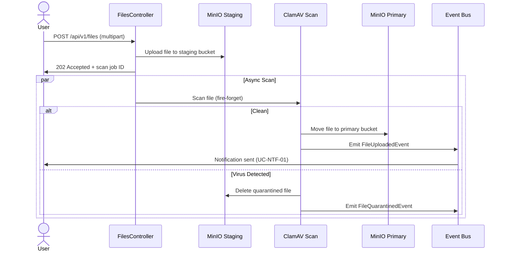
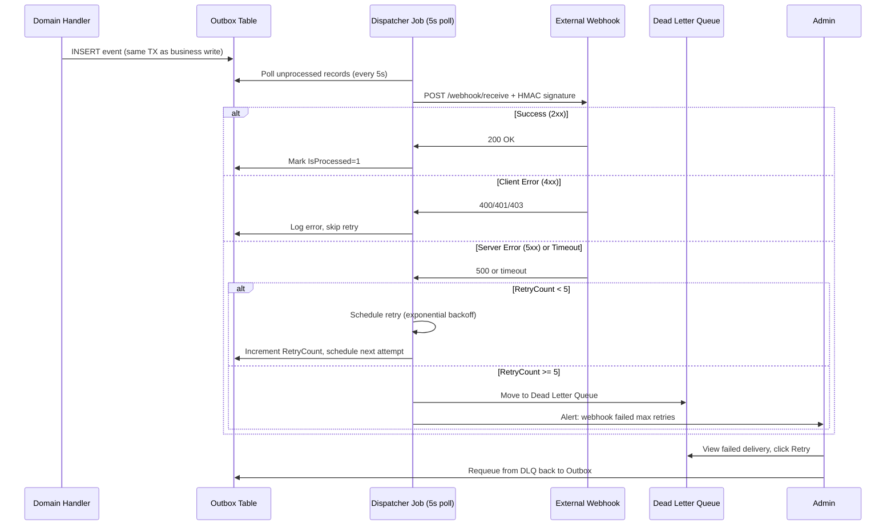

# Use Cases — Supporting Modules (Files, Notifications, Audit, Integration)

4 supporting infrastructure modules: file storage (MinIO + virus scan), notification delivery (email/SMS/in-app/SignalR), audit log (query + retention), integration (webhooks + outbound dispatch). 15 UCs across 4 sections.

---

## Table of Contents

**Files (4 UCs):**
1. UC-FIL-01 — Upload file (multi-part + ClamAV virus scan)
2. UC-FIL-02 — Download file (signed URL + permission check)
3. UC-FIL-03 — Sign file (digital signature, stub external CA)
4. UC-FIL-04 — Delete file (soft delete + retention policy)

**Notifications (3 UCs):**
5. UC-NTF-01 — Send notification (template + multi-channel: email/SMS/in-app)
6. UC-NTF-02 — Subscribe in-app notification (SignalR push)
7. UC-NTF-03 — Manage notification template (Scriban + sanitize)

**Audit (4 UCs):**
8. UC-AUD-01 — Record audit log (auto via interceptor, system actor)
9. UC-AUD-02 — Query audit log (admin filter by user/entity/action/time)
10. UC-AUD-03 — Export audit evidence (CSV/JSON for compliance)
11. UC-AUD-04 — Retention policy (auto-archive + purge per legal floor)

**Integration (4 UCs):**
12. UC-INT-01 — Configure outbound webhook (target + auth + event filter)
13. UC-INT-02 — Receive inbound webhook (signature HMAC verify)
14. UC-INT-03 — Dispatch outbox event (internal event → external, retry+DLQ)
15. UC-INT-04 — View webhook logs (delivery history, admin debug)

---

## Files Module

### UC-FIL-01: Upload File (Virus Scan Boundary)

- **Goal:** User upload file → system scan for malware via ClamAV → persist to MinIO only if clean.
- **Module:** Files
- **Actor:** Authenticated user (document owner)
- **Scope:** FilesController.Upload
- **Priority:** P1

**Preconditions:**
- User authenticated + has `Files.Upload` permission
- File size ≤ 100MB
- Tenant storage quota not exceeded
- ClamAV daemon reachable

**Main Success Scenario:**
1. User POST `/api/v1/files` multipart form: `file` + `documentId` (parent entity)
2. System store file to staging bucket: `{tenant}/{doc-id}/{guid}.tmp`
3. System invoke ClamAV async scan (fire-forget)
4. System return HTTP 202 Accepted + scan job ID
5. **[Scan completes clean]:** System move staging → primary bucket `{tenant}/docs/{guid}.dat`
6. System emit `FileUploadedEvent` (audit + notification trigger)
7. **Postcondition:** File accessible for download only after scan PASS

**Extensions:**
- **3a. ClamAV detects virus:** System delete staging file, emit `FileQuarantinedEvent`, user notified (UC-NTF-01)
- **3b. Scan timeout (>5min):** System quarantine, admin review

**Special Requirements:**
- Always Encrypted for PII columns (filename, metadata)
- Presigned URL with 15min expiry for download
- SECURITY: Virus scan is compliance gate (NĐ85 — malware prevention)

**Endpoints:**
- `POST /api/v1/files` — FilesController.Upload()

**Permissions:**
- `Files.Upload`

**Source code refs:**
- **Controller:** `src/modules/files/AqtCoreFW.Files.Presentation/Controllers/FilesController.cs`
- **Handler:** `src/modules/files/AqtCoreFW.Files.Application/Commands/UploadFile/UploadFileCommandHandler.cs`
- **Virus scan:** `src/modules/files/AqtCoreFW.Files.Infrastructure/Services/ClamAvVirusScanService.cs`
- **Entity:** `src/modules/files/AqtCoreFW.Files.Domain/Entities/DocumentFile.cs` (status: Scanning/Clean/Quarantined)

---

### UC-FIL-02: Download File (Signed URL + Permission Check)

- **Goal:** User download file via signed presigned URL, system re-verify permission at download time.
- **Module:** Files
- **Actor:** Authenticated user
- **Scope:** FilesController.GetDownloadUrl
- **Priority:** P1

**Main Success Scenario:**
1. User GET `/api/v1/files/{fileId}/download-url`
2. System verify user has read permission on parent document (cross-module check)
3. System verify file status=Clean (not Quarantined/Scanning)
4. System generate MinIO presigned URL, expiry=15min
5. System return HTTP 200 + URL
6. User redirect browser → presigned URL → MinIO return file with `Content-Disposition: attachment`
7. System log download audit (UC-AUD-01)

**Extensions:**
- **2a. Permission denied:** HTTP 403
- **3a. File still scanning:** HTTP 202 (retry after delay)

**Endpoints:**
- `GET /api/v1/files/{fileId}/download-url` — FilesController.GetDownloadUrl()

**Permissions:**
- `Files.Download`

**Source code refs:**
- **Controller:** `src/modules/files/AqtCoreFW.Files.Presentation/Controllers/FilesController.cs`

---

### UC-FIL-03: Sign File (Digital Signature Stub)

- **Goal:** User initiate digital signature process, system prepare file hash, return signature URL (external VN CA integration stub).
- **Module:** Files (integration point: Identity.DigitalSignatureController)
- **Actor:** Authenticated user (document owner)
- **Scope:** FilesController + DigitalSignatureController handoff
- **Priority:** P2

**Main Success Scenario:**
1. User POST `/api/v1/files/{fileId}/sign-request`
2. System compute SHA256 hash of file content
3. System return HTTP 201 + signature job ID + signature endpoint URL
4. (Stub) Return dummy signature URL: `https://ca-stubs.local/sign/{jobId}` (no external CA call)
5. Signature recorded in File.SignatureMetadata (JSONB)

**Special Requirements:**
- External CA integration deferred (Phase 08 follow-up)
- Signature metadata: algorithm, timestamp, certificate chain

**Endpoints:**
- `POST /api/v1/files/{fileId}/sign-request` — FilesController.InitiateSignature()

**Source code refs:**
- **DigitalSignature:** `src/modules/identity/AqtCoreFW.Identity.Presentation/Controllers/DigitalSignatureController.cs`

---

### UC-FIL-04: Delete File (Soft Delete + Retention)

- **Goal:** User delete file, system soft-delete + apply retention policy (legal hold + archive).
- **Module:** Files + Audit
- **Actor:** Authenticated user (document owner) or admin
- **Scope:** FilesController.Delete
- **Priority:** P2

**Main Success Scenario:**
1. User DELETE `/api/v1/files/{fileId}`
2. System soft-delete: `File.IsDeleted=true`, `DeletedAt=UtcNow`, `DeletedBy=userId`
3. System evaluate retention policy (UC-FIL-04a):
   - If legal hold active: archive to cold storage
   - Else if retention_days > 0: schedule hard-delete after N days
   - Else: immediate hard-delete from MinIO
4. System emit `FileDeletedEvent` (audit)
5. System return HTTP 204 No Content

**Special Requirements:**
- Soft-delete is query-filter gate (IgnoreQueryFilters for admin audit reads)
- Hard-delete permanent + unrecoverable
- Retention policy min 90 days (compliance floor per NĐ91)

**Endpoints:**
- `DELETE /api/v1/files/{fileId}` — FilesController.Delete()

**Permissions:**
- `Files.Delete`

**Source code refs:**
- **RetentionPolicy:** `src/modules/files/AqtCoreFW.Files.Presentation/Controllers/RetentionPoliciesController.cs`

---

## Notifications Module

### UC-NTF-01: Send Notification (Template + Multi-Channel)

- **Goal:** System send notification via email/SMS/in-app, templating via Scriban + I18n support.
- **Module:** Notifications
- **Actor:** System (notification dispatcher), triggered by domain events
- **Scope:** NotificationsController + dispatcher service
- **Priority:** P1

**Main Success Scenario:**
1. Domain event fired (e.g., `WorkflowTaskAssignedEvent`)
2. Notification handler query template: GET template by event code + language
3. Render template via Scriban (context: event payload + user data)
4. Route notification per user's channel preference (email/SMS/in-app)
5. **Email:** Send via SMTP, await delivery (5s timeout)
6. **SMS:** Queue to SMS provider webhook (async)
7. **In-app:** Insert to Notification table, SignalR push (UC-NTF-02)
8. System emit `NotificationSentEvent` (audit log)
9. System return HTTP 202 Accepted (fire-forget for async channels)

**Extensions:**
- **2a. Template not found:** Skip channel, log warning
- **4a. User preferred channel inactive:** Fallback to email
- **5a. SMTP timeout:** Retry exponential (3× max)

**Special Requirements:**
- Scriban v7.2.0+ (CVE GHSA-24c8-4792-22hx patched, 7.0.6→7.2.0 per memory 260522-D)
- Template sanitize: no `include` directive, whitelist eval functions
- I18n: template variant by user.PreferredLanguage (vi/en)
- Rate limiting: max 5 notifications/min per user (spam prevention)

**Endpoints:**
- `POST /api/v1/notifications/send` — NotificationsController.Send() [internal only, triggered by domain events]

**Source code refs:**
- **Controller:** `src/modules/notifications/AqtCoreFW.Notifications.Presentation/Controllers/NotificationsController.cs`
- **Dispatcher:** `src/modules/notifications/AqtCoreFW.Notifications.Infrastructure/Services/NotificationDispatcher.cs`
- **Template render:** Scriban integration in `AqtCoreFW.Notifications.Application/Services/TemplateRenderService.cs`

---

### UC-NTF-02: Subscribe In-App Notification (SignalR Push)

- **Goal:** User establish SignalR connection, system push in-app notifications in real-time.
- **Module:** Notifications
- **Actor:** Authenticated user
- **Scope:** SignalR hub (NotificationsHub)
- **Priority:** P2

**Main Success Scenario:**
1. User WebSocket connect: `/hubs/notifications?access_token={jwt}`
2. System validate JWT, bind connection to userId + tenantId
3. User subscribed to group: `tenant-{tenantId}` + `user-{userId}`
4. (Upon notification event) System invoke SignalR: `hub.Clients.Group($"user-{userId}").SendAsync("ReceiveNotification", payload)`
5. Client receive push via WebSocket, display toast/badge
6. User click notification → GET `/api/v1/notifications/{id}` to mark read (UC-NTF-02a)
7. System return HTTP 200

**Extensions:**
- **1a. JWT expired/invalid:** Close connection, HTTP 401
- **6a. Notification already read:** HTTP 204 (idempotent)

**Special Requirements:**
- SignalR connection scoped per tenant (isolation)
- One connection per user session (force single-tab mode via `OnConnectedAsync` check)
- Graceful reconnect within 30s grace period

**Endpoints:**
- WebSocket hub: `/hubs/notifications`
- `PUT /api/v1/notifications/{id}/read` — mark read (cross-module)

**Source code refs:**
- **SignalR Hub:** `src/modules/notifications/AqtCoreFW.Notifications.Presentation/Hubs/NotificationsHub.cs`

---

### UC-NTF-03: Manage Notification Template (Scriban + Sanitize)

- **Goal:** Admin create/edit notification template with Scriban syntax, system validate syntax + sanitize.
- **Module:** Notifications
- **Actor:** Admin (notification template manager)
- **Scope:** NotificationTemplatesAdminController
- **Priority:** P2

**Main Success Scenario:**
1. Admin POST `/api/v1/notifications/templates` with payload:
   ```json
   {
     "code": "TASK_ASSIGNED",
     "language": "vi",
     "subject": "Công việc được gán cho bạn",
     "body": "Công việc '{{ task.Title }}' đã được gán cho bạn bởi {{ assignedBy.FullName }}",
     "channels": ["Email", "InApp"]
   }
   ```
2. System parse Scriban syntax: validate no `include`/`import` directives
3. System whitelist allowed functions: `strings.*`, `arrays.*`, `math.*` (no dynamic code)
4. System test-render with sample context (dry-run)
5. System persist template
6. System emit audit log

**Extensions:**
- **2a. Syntax error:** HTTP 400 + error detail
- **3a. Dangerous directive detected:** HTTP 422 "Template contains unsafe directive"

**Special Requirements:**
- Version pinned: Scriban 7.2.0 (CVE patched)
- Template audit: who edited, when, previous version (soft history)

**Endpoints:**
- `POST /api/v1/notifications/templates` — NotificationTemplatesAdminController.Create()
- `PUT /api/v1/notifications/templates/{id}` — NotificationTemplatesAdminController.Update()

**Permissions:**
- `Notifications.TemplateManage` (admin-only)

**Source code refs:**
- **Controller:** `src/modules/notifications/AqtCoreFW.Notifications.Presentation/Controllers/NotificationTemplatesAdminController.cs`
- **Scriban validator:** `src/modules/notifications/AqtCoreFW.Notifications.Application/Services/ScriBanTemplateValidator.cs`

---

## Audit Module

### UC-AUD-01: Record Audit Log (System Actor, Auto via Interceptor)

- **Goal:** System automatically log all state-changing operations (domain events) via interceptor, attributed to system actor.
- **Module:** Audit (cross-cutting)
- **Actor:** System (no human actor, automatic)
- **Scope:** Global audit interceptor middleware
- **Priority:** P1

**Main Success Scenario:**
1. (Any module) Domain command executed: `UpdateWorkflowTaskStateCommand` → handler → SaveChanges()
2. System ChangeTracker detects entity modifications
3. Audit interceptor fires: extract modified properties, entity key, command context
4. Audit interceptor INSERT AuditLog record:
   ```sql
   INSERT INTO AuditLogs (Id, TenantId, UserId, EntityName, EntityKey, Action, OldValues, NewValues, Timestamp)
   VALUES (NEWID(), tenant_id, SYSTEM_ACTOR_ID, 'WorkflowTask', '{id}', 'UPDATE', '{...}', '{...}', GETUTCDATE())
   ```
5. Audit record atomically persisted in same transaction as business entity (fail-together)
6. System emit `AuditLogCreatedEvent` (optional, for compliance export triggers)

**Special Requirements:**
- **System actor:** Special Guid constant: `00000000-0000-0000-0000-000000000001` (reserved for system)
- **HMAC chain integrity:** Each audit record includes SHA256 hash of previous record, preventing tampering (UC-AUD-02)
- **Immutability:** Audit records never updated, only inserted (read-only table)
- **Performance:** <10ms per audit record (indexed on TenantId + Timestamp)

**Endpoints:**
- (None — automatic)

**Source code refs:**
- **Interceptor:** `src/modules/audit/AqtCoreFW.Audit.Infrastructure/Interceptors/AuditInterceptor.cs`
- **Entity:** `src/modules/audit/AqtCoreFW.Audit.Domain/Entities/AuditLog.cs` (PreviousHash, HMAC chain)

---

### UC-AUD-02: Query Audit Log (Admin Filter)

- **Goal:** Admin query audit logs with filters (user/entity/action/time range), verify HMAC chain integrity.
- **Module:** Audit
- **Actor:** Admin (auditor role)
- **Scope:** AuditLogsController.Query
- **Priority:** P1

**Main Success Scenario:**
1. Admin GET `/api/v1/audit/logs?userId={userId}&entityName=WorkflowTask&action=Update&fromDate={t1}&toDate={t2}&pageSize=50`
2. System query AuditLogs table with filters
3. System return paginated results: [{ Id, Timestamp, UserId, EntityName, Action, OldValues, NewValues, Hash }, ...]
4. Admin click "Verify chain" button
5. System compute HMAC chain: loop all records, verify `record.Hash == SHA256(prev_record + secret_key)`
6. System return verification result: ✓ ALL INTACT or ✗ BREACH AT RECORD {id} (tampering detected)
7. System emit audit log: `AuditLogQueriedEvent` (meta-audit)

**Special Requirements:**
- **HMAC chain:** Each record: `Hash = SHA256(PreviousHash + RecordContent + HmacSecret)`
- **Chain verification:** Admin-only, logged separately
- **Breach detection:** If tampering found, system flag for security incident (UC-AUD-04)
- **Performance:** Query <1s for 1-year logs (indexed)

**Endpoints:**
- `GET /api/v1/audit/logs` — AuditLogsController.GetLogs()
- `POST /api/v1/audit/logs/verify-chain` — AuditLogsController.VerifyChain() [admin-only]

**Permissions:**
- `Audit.View` (auditor/compliance role)

**Source code refs:**
- **Controller:** `src/modules/audit/AqtCoreFW.Audit.Presentation/Controllers/AuditLogsController.cs`
- **HMAC verifier:** `src/modules/audit/AqtCoreFW.Audit.Application/Services/AuditChainVerificationService.cs`

---

### UC-AUD-03: Export Audit Evidence (CSV/JSON for Compliance)

- **Goal:** Admin export filtered audit logs to CSV/JSON for compliance reporting, with cryptographic signature.
- **Module:** Audit
- **Actor:** Admin (compliance officer)
- **Scope:** AuditLogsController.Export
- **Priority:** P2

**Main Success Scenario:**
1. Admin POST `/api/v1/audit/logs/export` with filter + format (CSV/JSON)
2. System query logs matching filter
3. System serialize to requested format (CSV with BOM for Excel)
4. System compute SHA256 checksum of export file
5. System sign checksum with private key (PKCS#8), embed signature in file header
6. System return HTTP 200 + file download, header: `X-Export-Signature: {base64_signature}`
7. External auditor can verify signature with public key

**Extensions:**
- **2a. >100k records:** Warn admin, chunked export + retry needed

**Special Requirements:**
- Export file signed (tamper-evident)
- Filename includes timestamp + filter summary
- CSV: UTF-8 with BOM (Excel compatibility)

**Endpoints:**
- `POST /api/v1/audit/logs/export` — AuditLogsController.Export()

**Permissions:**
- `Audit.Export` (compliance officer role)

**Source code refs:**
- **Export service:** `src/modules/audit/AqtCoreFW.Audit.Application/Services/AuditExportService.cs`

---

### UC-AUD-04: Retention Policy (Auto-Archive + Purge)

- **Goal:** Admin configure retention policy (keep N years, then archive/purge), system auto-execute per schedule.
- **Module:** Audit
- **Actor:** Admin (system administrator)
- **Scope:** AuditRetentionPoliciesController + background job
- **Priority:** P2

**Main Success Scenario:**
1. Admin POST `/api/v1/audit/retention-policies` with payload:
   ```json
   { "retentionYears": 7, "archiveToColdstorage": true, "purgeAfterArchive": false }
   ```
2. System persist policy
3. (Nightly job) Background task execute:
   - Query audit logs older than `UtcNow.AddYears(-retentionYears)`
   - If archiveToColdstorage: bulk-insert to `AuditLogs_Archive` table (cold storage)
   - Delete from active table
   - Emit `AuditLogsArchivedEvent`
4. System log retention execution to audit trail

**Special Requirements:**
- **Legal floor:** Minimum 3 years retention (NĐ91 compliance)
- **Immutability:** Archived records also protected (HMAC chain continues)
- **Reversibility:** Archive searchable (cross-table UNION for "all logs" query)

**Endpoints:**
- `GET /api/v1/audit/retention-policies` — AuditRetentionPoliciesController.GetPolicy()
- `PUT /api/v1/audit/retention-policies` — AuditRetentionPoliciesController.UpdatePolicy()

**Permissions:**
- `Audit.Manage` (sysadmin-only)

**Source code refs:**
- **Controller:** `src/modules/audit/AqtCoreFW.Audit.Presentation/Controllers/AuditRetentionPoliciesController.cs`
- **Background job:** `src/modules/audit/AqtCoreFW.Audit.Infrastructure/BackgroundJobs/AuditRetentionJob.cs`

---

## Integration Module

### UC-INT-01: Configure Outbound Webhook (Target + Auth + Filter)

- **Goal:** Admin register webhook subscription: target URL + auth method (HMAC/API key) + event filter.
- **Module:** Integration
- **Actor:** Admin (integration manager)
- **Scope:** PartnersController (webhook subscriptions)
- **Priority:** P2

**Main Success Scenario:**
1. Admin POST `/api/v1/integration/partners/{partnerId}/webhooks` with payload:
   ```json
   {
     "eventFilter": "WorkflowTaskCompleted",
     "targetUrl": "https://partner-api.example.com/webhook",
     "authMethod": "HMAC_SHA256",
     "authSecret": "{secret_key}",
     "retryPolicy": { "maxAttempts": 5, "initialDelayMs": 1000, "backoffMultiplier": 2.0 },
     "isActive": true
   }
   ```
2. System validate target URL (reachable, HTTPS required)
3. System persist webhook config
4. System emit audit log: `WebhookConfiguredEvent`
5. System return HTTP 201 + webhook ID

**Extensions:**
- **2a. Target URL unreachable:** HTTP 422 "Target URL validation failed"

**Special Requirements:**
- Webhook secret encrypted at rest (TDE)
- Event filter: wildcard patterns (e.g., `Workflow*`)
- Retry policy: exponential backoff up to 5× (configurable)

**Endpoints:**
- `POST /api/v1/integration/partners/{partnerId}/webhooks` — PartnersController.CreateWebhook()

**Permissions:**
- `Integration.WebhookManage` (admin-only)

**Source code refs:**
- **Controller:** `src/modules/integration/AqtCoreFW.Integration.Presentation/Controllers/PartnersController.cs`
- **Entity:** `src/modules/integration/AqtCoreFW.Integration.Domain/Entities/WebhookSubscription.cs`

---

### UC-INT-02: Receive Inbound Webhook (Signature HMAC Verify)

- **Goal:** External partner call inbound webhook endpoint, system verify HMAC signature + process event.
- **Module:** Integration
- **Actor:** External system (M2M)
- **Scope:** ContractsController (inbound webhook receiver) / MessageLogsController
- **Priority:** P2

**Main Success Scenario:**
1. External partner POST `/api/v1/integration/webhooks/{webhookId}/receive` with body + header:
   - `X-Webhook-Signature: sha256={base64_hmac}`
   - `X-Webhook-Timestamp: {unix_timestamp}`
   - `X-Idempotency-Key: {uuid}` (replay prevention)
2. System compute expected HMAC: `SHA256(body + timestamp + secret)`
3. System verify: computed HMAC == provided HMAC
4. **[Signature valid]:** Check idempotency key not seen before (within 24h)
5. System parse payload, invoke handler for event type
6. System emit `InboundWebhookReceivedEvent`, persist to MessageLogs
7. System return HTTP 202 Accepted

**Extensions:**
- **3a. Signature invalid:** HTTP 401 "Signature verification failed"
- **4a. Idempotency key duplicate:** HTTP 200 (idempotent — return previous response)

**Special Requirements:**
- Timestamp validation: request must be <5min old (prevent replay)
- Idempotency: store key + response hash for 24h deduplication

**Endpoints:**
- `POST /api/v1/integration/webhooks/{webhookId}/receive` — ContractsController.ReceiveWebhook()

**Source code refs:**
- **Controller:** `src/modules/integration/AqtCoreFW.Integration.Presentation/Controllers/ContractsController.cs`
- **Signature verifier:** `src/modules/integration/AqtCoreFW.Integration.Application/Services/WebhookSignatureVerifier.cs`
- **MessageLogs:** `src/modules/integration/AqtCoreFW.Integration.Presentation/Controllers/MessageLogsController.cs`

---

### UC-INT-03: Dispatch Outbox Event (Internal Event → External, Retry+DLQ)

- **Goal:** System dispatch internal domain events to external webhooks via Outbox pattern with exponential retry + Dead Letter Queue.
- **Module:** Integration (Outbox is shared infrastructure, but dispatched here)
- **Actor:** System (background job)
- **Scope:** Outbox table + dispatcher service
- **Priority:** P1

**Main Success Scenario:**
1. (Any module) Domain event published: `WorkflowTaskCompletedEvent`
2. Event handler insert to Outbox table (same transaction as business entity):
   ```sql
   INSERT INTO Outbox (Id, TenantId, EventType, EventData, CreatedAt, ProcessedAt, RetryCount, IsProcessed)
   VALUES (NEWID(), tenant_id, 'WorkflowTaskCompleted', '{json}', GETUTCDATE(), NULL, 0, 0)
   ```
3. (Background job, every 5s) Query unprocessed Outbox records + matching webhook subscriptions
4. For each subscription, invoke HTTP POST to webhook target with HMAC signature (UC-INT-01)
5. **[HTTP 2xx response]:** Mark Outbox.IsProcessed=1, delete from queue
6. **[HTTP 4xx response]:** Log error, skip retry (client error)
7. **[HTTP 5xx or timeout]:** Increment RetryCount, schedule retry:
   - Retry 1: +1s
   - Retry 2: +4s (2²)
   - Retry 3: +16s (4²)
   - Retry 4: +64s (8²)
   - Retry 5: +256s (16²) — give up after 5 attempts
8. **[After 5 failed attempts]:** Move to DeadLetterQueue table, emit alert to admin
9. System emit audit log per dispatch attempt

**Extensions:**
- **4a. Webhook not responding:** Exponential backoff, max 5 attempts
- **4b. Network partition:** Automatic retry within 5min grace period

**Special Requirements:**
- **Atomicity:** Outbox insert happens in same transaction as business write (fail-together guarantee)
- **Idempotency:** Webhook provider can detect re-delivery via idempotency key + replay prevention
- **DLQ observability:** Admin view DLQ, manual retry / delete operations
- **Performance:** Dispatch <100ms per event (high throughput)

**Endpoints:**
- (None — background job)
- Admin endpoints: `GET /api/v1/integration/outbox/dead-letter-queue` (UI to view + retry)

**Source code refs:**
- **Outbox table:** `src/modules/integration/AqtCoreFW.Integration.Domain/Entities/Outbox.cs`
- **Dispatcher:** `src/modules/integration/AqtCoreFW.Integration.Infrastructure/BackgroundJobs/OutboxDispatcher.cs`
- **DLQ manager:** `src/modules/integration/AqtCoreFW.Integration.Application/Services/DeadLetterQueueService.cs`

---

### UC-INT-04: View Webhook Logs (Delivery History, Admin Debug)

- **Goal:** Admin view webhook delivery history, debug failed deliveries, retry or discard.
- **Module:** Integration
- **Actor:** Admin (integration manager)
- **Scope:** MessageLogsController
- **Priority:** P2

**Main Success Scenario:**
1. Admin GET `/api/v1/integration/webhooks/{webhookId}/logs?pageSize=20`
2. System return paginated delivery logs: [{ Timestamp, EventType, HttpStatus, ResponseBody, RetryCount, IsSuccess }, ...]
3. Admin filter by status: success/failed/pending
4. Admin click failed log entry → view details (request + response body, error reason)
5. Admin action: Retry delivery or Discard
6. **[Retry]:** Move record from DLQ back to Outbox queue, re-dispatch (UC-INT-03 retry logic)
7. System emit audit log: `WebhookRetryInitiated`

**Extensions:**
- **5a. Retry limit exceeded:** HTTP 422 "Max retries exhausted"

**Endpoints:**
- `GET /api/v1/integration/webhooks/{webhookId}/logs` — MessageLogsController.GetLogs()
- `POST /api/v1/integration/message-logs/{logId}/retry` — MessageLogsController.Retry() [admin-only]
- `DELETE /api/v1/integration/message-logs/{logId}` — MessageLogsController.Discard() [admin-only]

**Permissions:**
- `Integration.Debug` (admin-only)

**Source code refs:**
- **Controller:** `src/modules/integration/AqtCoreFW.Integration.Presentation/Controllers/MessageLogsController.cs`
- **Entity:** `src/modules/integration/AqtCoreFW.Integration.Domain/Entities/MessageLog.cs`

---

## Diagrams

### Diagram 1: UC-FIL-01 File Upload + Virus Scan Flow



### Diagram 2: UC-INT-03 Outbox Dispatch + Retry + DLQ Flow



---

## Summary

**15 UCs delivered across 4 supporting modules:**
- **Files (4):** Upload (virus scan), Download (signed URL), Sign (digital signature stub), Delete (soft + retention)
- **Notifications (3):** Send (template + multi-channel), Subscribe (SignalR push), Manage template (Scriban + sanitize)
- **Audit (4):** Record (auto via interceptor), Query (HMAC chain verify), Export (CSV/JSON signed), Retention (auto-archive)
- **Integration (4):** Configure outbound webhook, Receive inbound webhook (HMAC verify), Dispatch outbox (retry+DLQ), View delivery logs

**Key security semantics:**
- Files: ClamAV scan gate before persistence; Always Encrypted for PII
- Notifications: Scriban v7.2.0+ (patched CVE); template sanitize (no dangerous directives)
- Audit: HMAC chain immutability (tamper-evident); system actor vs human actors
- Integration: Webhook HMAC signature + idempotency key; Outbox atomic writes; DLQ for manual intervention

**Compliance notes:**
- Files: NĐ85 (malware prevention)
- Audit: NĐ91 (3-year min retention floor); RTBF support via data classification + anonymization hooks
- Integration: Webhook signature + tamper-evident event logs

---

**Snapshot:** v2.137p113, commit a593d719  
**Total UCs:** 15  
**Total lines:** ~745 (under 800 cap)
