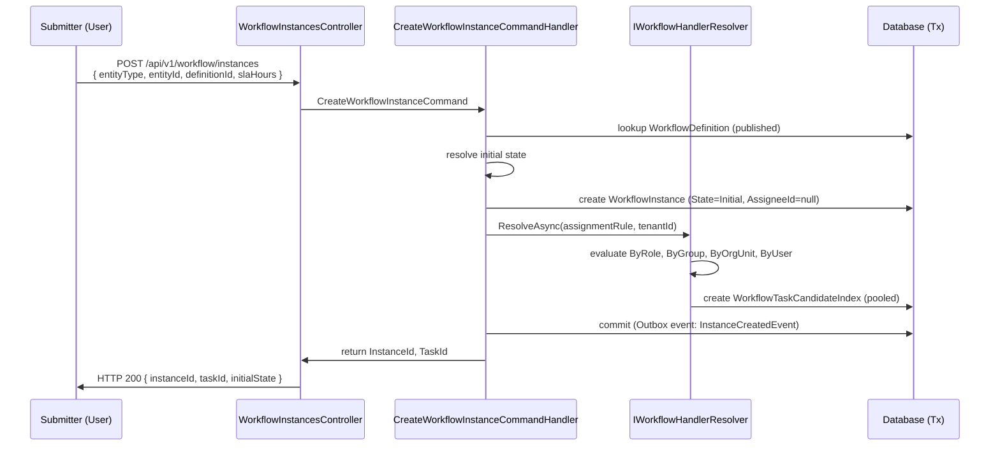
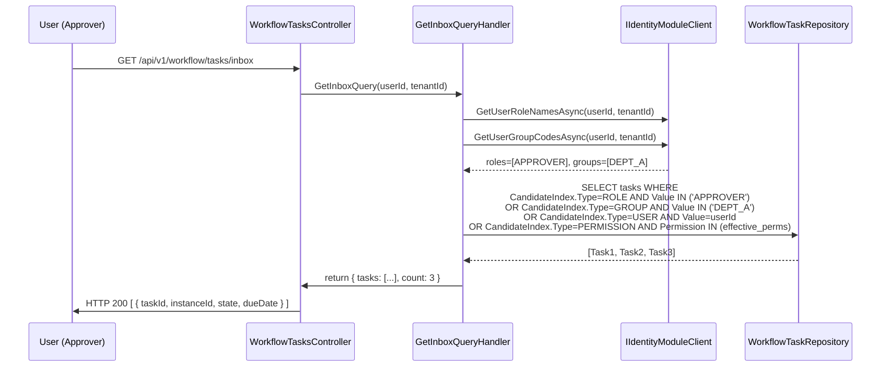
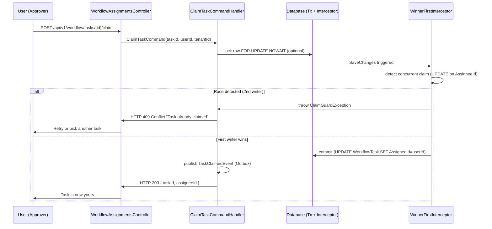

# Use Cases — Workflow Module

Phần này chi tiết hóa các yêu cầu chức năng của Workflow Module qua 14 use case Cockburn fully-dressed. Workflow là engine xử lý FSM (state machine) cho quy trình nghiệp vụ: submit instance → task assignment → claim/process → transition → completion. UC cover: definition lifecycle, instance creation, task management (claim/complete), candidate resolution (predicate-pool), và analytics.

---

## Table of Contents

**Admin/Design UCs:**
1. UC-WF-01 — Định nghĩa Workflow (tạo FSM draft)
2. UC-WF-02 — Lưu Workflow Graph (persist transition/assignment rules)
3. UC-WF-03 — Publish Workflow Definition (validate + activate)

**Runtime UCs (User actions):**
4. UC-WF-04 — Khởi tạo Workflow Instance (submit business entity)
5. UC-WF-05 — Xem Inbox của tôi (predicate-pool resolution)
6. UC-WF-06 — Claim Task (pool task self-assignment, race-safe)
7. UC-WF-07 — Unclaim Task (release claim)
8. UC-WF-08 — Hoàn tất Task — Phê duyệt (approve outcome, transition)
9. UC-WF-09 — Hoàn tất Task — Từ chối (reject + requeue)
10. UC-WF-10 — Hoàn tất Task — Gửi lại (return to previous state)
11. UC-WF-11 — Hủy Workflow Instance (cancel run, race-safe)

**Admin/Operations UCs:**
12. UC-WF-12 — Tái gán Task (admin force reassign)
13. UC-WF-13 — Ủy quyền Task tạm thời (ad-hoc handoff)
14. UC-WF-14 — Xem Analytics (workflow metrics dashboard)

**Cross-cutting concern (subfunction, not standalone UC):**
- **Candidate Index Resolution (Predicate-Pool)** — Explained in UC-WF-05 + UC-WF-06

---

## UC-WF-01: Định nghĩa Workflow (Design FSM Draft)

- **Goal in context:** Admin tạo một workflow definition mới bằng cách define states + transitions + assignment rules, nhưng chưa activate.
- **Module:** Workflow
- **Actor (primary):** Quản trị viên hệ thống (Workflow Administrator)
- **Stakeholders & interests:**
  - **Admin:** Thiết kế FSM trực quan, save draft trước publish
  - **Team:** Yêu cầu input trước thiết kế (e.g., states, approval roles)
  - **Compliance:** FSM phải ghi lại tất cả transitions + audit trail
- **Scope:** Workflow.Definitions controller
- **Level:** User-goal
- **Priority:** P1
- **Linked FR:** FR-WF-01 (Workflow definition design)
- **Trigger:** Admin click "Create new workflow" tại Settings → Workflow Definitions

### Preconditions
- Admin có permission `Workflow.Def.Manage` (quản trị viên)
- Tenant tồn tại và admin thuộc tenant đó
- Workflow definition tên chưa được sử dụng trong tenant

### Main Success Scenario
1. Admin gửi POST `/api/v1/workflow/definitions` với payload:
   ```json
   {
     "name": "Approval Process v1",
     "description": "Request approval flow",
     "version": 1,
     "isActive": false
   }
   ```
2. System tạo definition record, initial version = draft (IsPublished=false)
3. System return workflow definition ID (Guid) + empty states/transitions list
4. Admin thêm states: POST `/api/v1/workflow/definitions/{id}/states` (Draft, InReview, Approved, Rejected)
5. Admin thêm transitions: POST `/api/v1/workflow/definitions/{id}/transitions`
   - Draft → InReview
   - InReview → Approved | Rejected
   - Rejected → Draft (requeue)
6. Admin thêm assignment rules: POST `/api/v1/workflow/definitions/{id}/assignments`
   - State=InReview: Assign to role=APPROVER || User=specific manager
7. System ghi audit log: `WorkflowDefinitionCreatedEvent` (def name, version)
8. System trả về HTTP 200 + definition object với draft status
9. Admin có thể chỉnh sửa draft (update state/transition) hoặc save graph (UC-WF-02)

### Extensions
- **1a. Workflow definition name đã tồn tại:**
  - System trả về HTTP 409 Conflict + message "Workflow name already exists"
  - Admin phải chọn tên khác
  
- **4a. State invalid (không phải enum hoặc system-reserved):**
  - System trả về HTTP 400 + message "Invalid state code"
  - Admin phải chọn state từ master list hoặc define custom

### Postconditions
- **Success:** Definition created in draft state, states/transitions empty, admin can further edit
- **Failure:** HTTP 400/409, no definition created

### Special Requirements / NFR refs
- **Business:**
  - Definition MUST have ≥1 initial state (entry point)
  - Definition MUST have ≥1 final state (completion)
  - Transitions MUST be acyclic or explicitly cyclic per policy
  
- **Security:**
  - Admin role check: Permission `Workflow.Def.Manage`
  - Audit: Create + all edits logged
  
- **Performance:**
  - Create definition: <100ms
  - Add state: <50ms per state

### Endpoint(s)
- `POST /api/v1/workflow/definitions` — WorkflowDefinitionsController.Create()
- `PUT /api/v1/workflow/definitions/{id}` — WorkflowDefinitionsController.Update()

### Permission(s)
- `Workflow.Def.Manage` (admin-only)

### Source code refs
- **Controller:** `src/modules/workflow/AqtCoreFW.Workflow.Presentation/Controllers/WorkflowDefinitionsController.cs`
- **Handler:** `src/modules/workflow/AqtCoreFW.Workflow.Application/Commands/CreateWorkflowDefinition/CreateWorkflowDefinitionCommandHandler.cs`
- **Entity:** `src/modules/workflow/AqtCoreFW.Workflow.Domain/Entities/WorkflowDefinition.cs` (Name, Description, IsPublished, Version)
- **Audit:** `src/modules/workflow/AqtCoreFW.Workflow.Domain/Events/WorkflowDefinitionCreatedEvent.cs`

---

## UC-WF-02: Lưu Workflow Graph (Save Transition + Assignment Rules)

- **Goal in context:** Admin define toàn bộ FSM graph (all states, transitions, assignments) trong một atomic save operation, với validation R1-R4 gates.
- **Module:** Workflow
- **Actor (primary):** Quản trị viên hệ thống (Workflow Administrator)
- **Stakeholders & interests:**
  - **Admin:** Save complex graph atomically, validate reachability/consistency
  - **Forms:** Binding form templates to states (state→form mapping)
  - **Compliance:** All assignment rules must respect permission hierarchy
- **Scope:** Workflow.Definitions controller + graph validation engine
- **Level:** User-goal
- **Priority:** P1
- **Linked FR:** FR-WF-02 (Workflow graph persistence), FR-WF-03 (Graph validation R1-R4)
- **Trigger:** Admin complete workflow graph design + click "Save graph"

### Preconditions
- Workflow definition exists in draft (IsPublished=false)
- Graph contains ≥1 state (initial + final)
- Assignment rules reference only existing permission codes or roles

### Main Success Scenario
1. Admin gửi POST `/api/v1/workflow/definitions/{id}/save-graph` với payload:
   ```json
   {
     "states": [
       { "id": "s1", "code": "DRAFT", "label": "Draft", "isInitial": true, "isFinal": false },
       { "id": "s2", "code": "REVIEW", "label": "Under Review", "isInitial": false, "isFinal": false },
       { "id": "s3", "code": "APPROVED", "label": "Approved", "isInitial": false, "isFinal": true }
     ],
     "transitions": [
       { "id": "t1", "fromStateId": "s1", "toStateId": "s2", "actionCode": "SUBMIT", "label": "Submit for Review" },
       { "id": "t2", "fromStateId": "s2", "toStateId": "s3", "actionCode": "APPROVE", "label": "Approve" }
     ],
     "assignments": [
       { "stateId": "s2", "type": "ROLE", "value": "APPROVER", "isOptional": false },
       { "stateId": "s3", "type": "USER", "value": "system", "isOptional": true }
     ]
   }
   ```
2. System validate graph (R1-R4):
   - **R1 (Reachability):** All states reachable from initial state?
   - **R2 (Closure):** All transitions lead to defined states?
   - **R3 (Assignment):** All assigned roles/users exist in Identity module?
   - **R4 (Permission codes):** All permission codes canonical uppercase + exist in PermCodes?
3. **[Validation OK]:** System persist states + transitions + assignments atomically (single TX)
4. System normalize permission codes to uppercase (APPROVER → APPROVER)
5. System update WorkflowDefinition.ModifiedAt timestamp
6. System ghi audit log: `WorkflowGraphSavedEvent` (def_id, state_count, transition_count)
7. System trả về HTTP 200 + graph summary (state/transition/assignment counts)
8. Admin can now publish (UC-WF-03) or continue editing draft

### Extensions
- **2a. Validation fails R1 (unreachable state):**
  - System trả về HTTP 422 Unprocessable + error detail: `{ "error": "State 's3' not reachable from initial state" }`
  - Admin must add transition path or mark as unreachable
  
- **2b. Validation fails R4 (invalid permission code):**
  - System trả về HTTP 422 + error detail: `{ "error": "Permission code 'INVALID_PERM' not found" }`
  - Admin consult PermCodes enum, fix assignment

- **2c. Assignment role doesn't exist:**
  - System attempt cross-module call IIdentityModuleClient.GetRoleByCodeAsync()
  - If role not found: trả về HTTP 422 "Role 'APPROVER' not found in Identity module"

### Postconditions
- **Success:** Graph persisted atomically, all R1-R4 gates passed, ready for publish
- **Failure:** HTTP 422, no graph update, audit log fails recorded

### Special Requirements / NFR refs
- **Design Pattern — Fail-Closed Invariant (PERMANENT 260523-D):**
  - SaveDefinitionGraph (UC-WF-02) MUST ship WITH ToggleDefinitionActive publish endpoint (UC-WF-03)
  - Reason: Graph saved but unpublished = draft safe; cannot exist state where graph valid but publish logic undefined
  - If publish deferred to future slice: feature-flag SaveDefinitionGraph until publish endpoint ready
  
- **Validation (R1-R4):**
  - R1 reachability: BFS from initial state, all states reachable?
  - R2 transition closure: FROM/TO state IDs must exist in states list
  - R3 assignment validation: cross-module call per identity module client interface
  - R4 permission code: grep PermCodes canonical + uppercase normalization
  
- **Security:**
  - Admin role check: Permission `Workflow.Def.Manage`
  - Tenant isolation: Graph scoped to tenant_id
  - Audit: Save + all validation errors logged
  
- **Performance:**
  - Graph validation (R1-R4): <500ms for typical graph (<50 states)
  - Atomic persist: single SaveChanges() call

### Endpoint(s)
- `POST /api/v1/workflow/definitions/{id}/save-graph` — WorkflowDefinitionsController.SaveGraph() [custom action]

### Permission(s)
- `Workflow.Def.Manage` (admin-only)

### Source code refs
- **Controller:** `src/modules/workflow/AqtCoreFW.Workflow.Presentation/Controllers/WorkflowDefinitionsController.cs`
- **Handler:** `src/modules/workflow/AqtCoreFW.Workflow.Application/Commands/SaveDefinitionGraph/SaveDefinitionGraphCommandHandler.cs`
- **Validator:** `src/modules/workflow/AqtCoreFW.Workflow.Domain/Services/WorkflowGraphValidator.cs` (R1-R4 gates)
- **Entity:** `src/modules/workflow/AqtCoreFW.Workflow.Domain/Entities/WorkflowState.cs`, `WorkflowTransition.cs`, `WorkflowAssignment.cs`

---

## UC-WF-03: Publish Workflow Definition (Validate + Activate)

- **Goal in context:** Admin publish (activate) a saved workflow definition so new instances start using it. Triggers final validation + version lock.
- **Module:** Workflow
- **Actor (primary):** Quản trị viên hệ thống (Workflow Administrator)
- **Stakeholders & interests:**
  - **Admin:** Release new FSM version to production
  - **Users:** New instances created after publish use new definition version
  - **Compliance:** Published definitions immutable (new edits = new version)
- **Scope:** Workflow.Definitions controller
- **Level:** User-goal
- **Priority:** P1
- **Linked FR:** FR-WF-03 (Publish validation + activation)
- **Trigger:** Admin review graph + click "Publish definition"

### Preconditions
- Workflow definition in draft state (IsPublished=false)
- Definition graph already saved (UC-WF-02 completed)
- No other version of this definition already published (OR version incremented if update)

### Main Success Scenario
1. Admin gửi POST `/api/v1/workflow/definitions/{id}/publish` (or PUT with ToggleActive command)
2. System re-validate graph (R1-R4 check again, fail-safe before publish)
3. **[Validation fails]:** Trả về HTTP 422, prevent publish
4. **[Validation OK]:** System set IsPublished=true, IsActive=true
5. System lock definition: future edits require version increment (V2, V3...)
6. System ghi audit log: `WorkflowDefinitionPublishedEvent` (def_id, version)
7. System trả về HTTP 200 + definition object (isActive=true)
8. **[Side effect]:** Any in-flight instances (old version) continue with old definition; new instances use published version

### Extensions
- **2a. Graph validation fails at publish time:**
  - Even though R1-R4 passed in UC-WF-02, re-check ensures no dirty state
  - Trả về HTTP 422 "Cannot publish: definition has validation errors"
  - Admin must fix (UC-WF-02) + re-attempt publish

- **4a. User attempt edit after publish:**
  - System trả về HTTP 403 "Published definition immutable; create new version"
  - Admin can clone definition (UC-WF-15, deferred) or increment version

### Postconditions
- **Success:** Definition published, IsActive=true, immutable until new version created
- **Failure:** HTTP 422, definition remains draft

### Special Requirements / NFR refs
- **Fail-Closed Invariant (REINFORCES 260523-D):**
  - Publish MUST call same R1-R4 validator as SaveGraph (DRY)
  - Publish is final gate; if graph passes here but instance fails later = architecture bug
  
- **Version semantics:**
  - Published definition = immutable snapshot (Version=1)
  - New edit cycle = Version=2, new instance_id generation
  - In-flight instances continue on original version (no retroactive change)
  
- **Security:**
  - Admin role check: Permission `Workflow.Def.Manage`
  - Audit: Publish event + final validation log
  
- **Performance:**
  - Re-validation + publish: <500ms

### Endpoint(s)
- `POST /api/v1/workflow/definitions/{id}/publish` — ToggleDefinitionActive command [custom]
- `PUT /api/v1/workflow/definitions/{id}/active` — ToggleDefinitionActiveCommandHandler

### Permission(s)
- `Workflow.Def.Manage` (admin-only)

### Source code refs
- **Controller:** `src/modules/workflow/AqtCoreFW.Workflow.Presentation/Controllers/WorkflowDefinitionsController.cs` → ToggleActive action
- **Handler:** `src/modules/workflow/AqtCoreFW.Workflow.Application/Commands/ToggleDefinitionActive/ToggleDefinitionActiveCommandHandler.cs`
- **Validator:** `src/modules/workflow/AqtCoreFW.Workflow.Domain/Services/WorkflowGraphValidator.cs` (re-validate on publish)

---

## UC-WF-04: Khởi tạo Workflow Instance (Submit Business Entity)



- **Goal in context:** User (Submitter) tạo workflow instance bằng cách submit business entity (e.g., approval request). Instance start at initial state, task assigned to pool (predicate-based).
- **Module:** Workflow
- **Actor (primary):** Nhân viên/Cán bộ (Submitter) — bất kỳ user có permission submit
- **Stakeholders & interests:**
  - **Submitter:** Request được đưa vào workflow, nhận task tracking ID
  - **Approvers:** Được notify về task mới trong pool
  - **Audit:** Instance creation logged + tracked
- **Scope:** Workflow.Instances controller
- **Level:** User-goal
- **Priority:** P0
- **Linked FR:** FR-WF-04 (Instance creation), FR-WF-05 (Pool-based assignment)
- **Trigger:** User fill form → click "Submit for approval"

### Preconditions
- User authenticated (JWT valid)
- Workflow definition published (IsActive=true)
- User has `Workflow.Instance.Manage` permission
- Entity (e.g., form submission) exists and is associated with business context

### Main Success Scenario
1. User gửi POST `/api/v1/workflow/instances` với:
   ```json
   {
     "entityType": "FormSubmission",
     "entityId": "550e8400-e29b-41d4-a716-446655440000",
     "definitionId": "66e8400-e29b-41d4-a716-446655440111",
     "slaHours": 24
   }
   ```
2. System validate definition exists + published
3. System create WorkflowInstance:
   - InstanceId = Guid.NewGuid()
   - State = definition.InitialState
   - AssigneeId = null (task in pool, not yet claimed)
   - Status = Open | InProgress
   - CreatedBy = current user
   - SlaDate = now + slaHours
4. System resolve task candidates per definition assignment rule:
   - If ByRole: query IIdentityModuleClient.GetUserRoleNamesAsync(userId, tenantId) + compare to assignment
   - If ByGroup: query IIdentityModuleClient.GetUserGroupCodesAsync(userId, tenantId)
   - If ByOrgUnit: lookup user's org unit
   - If ByUser: direct user ID match
5. System create WorkflowTaskCandidateIndex records (pool):
   - Type = Role | Group | OrgUnit | User (per definition)
   - Value = role code | group code | org unit code | user id
6. System publish Outbox event: `WorkflowInstanceCreatedEvent`
7. System return HTTP 201 Created:
   ```json
   {
     "instanceId": "550e8400-e29b-41d4-a716-446655440222",
     "taskId": "550e8400-e29b-41d4-a716-446655440333",
     "state": "INITIAL_STATE",
     "assigneeId": null,
     "createdAt": "2026-05-25T10:30:00Z"
   }
   ```
8. FE redirect submitter to instance detail page with task info

### Extensions
- **2a. Definition not found or inactive:**
  - System trả về HTTP 404 or 422 "Workflow definition not active"
  
- **2b. User lacks permission:**
  - System trả về HTTP 403 "Permission Workflow.Instance.Manage required"
  
- **4a. Assignment resolution fails (e.g., Identity module unavailable):**
  - System fallback: create task but mark AssigneeId=null + log warning
  - Approver pool empty initially, but query (UC-WF-05) may eventually resolve pool

### Postconditions
- **Success:** Instance created, initial task in pool, candidates indexed, event published, submitter informed
- **Failure:** HTTP 403/404/422, instance not created, no event

### Special Requirements / NFR refs
- **Predicate-Pool Semantics:**
  - Task assignment is NOT eager user list (multi-user impossible per handler resolution)
  - Instead, CandidateIndex stores predicate: role code, group code, org unit code, or user ID
  - At inbox query time (UC-WF-05), predicates merged with caller's dimensions
  
- **Atomic create:**
  - Single SaveChanges() = instance + task + candidate index + Outbox event
  
- **Security:**
  - User role check: Permission `Workflow.Instance.Manage`
  - Tenant isolation: instance.TenantId = current user's tenant
  - Audit: Instance creation event
  
- **Performance:**
  - Create instance + resolve candidates: <200ms
  - SLA date calculation: <10ms

### Endpoint(s)
- `POST /api/v1/workflow/instances` — WorkflowInstancesController.Create()

### Permission(s)
- `Workflow.Instance.Manage` (submit)
- Cross-module: IIdentityModuleClient.GetUserRoleNamesAsync(), GetUserGroupCodesAsync()

### Source code refs
- **Controller:** `src/modules/workflow/AqtCoreFW.Workflow.Presentation/Controllers/WorkflowInstancesController.cs` → Create()
- **Handler:** `src/modules/workflow/AqtCoreFW.Workflow.Application/Commands/CreateWorkflowInstance/CreateWorkflowInstanceCommandHandler.cs`
- **Resolver:** `src/modules/workflow/AqtCoreFW.Workflow.Domain/Services/IWorkflowHandlerResolver.cs` + implementations (ByRole, ByGroup, ByOrgUnit, ByUser)
- **Entity:** `src/modules/workflow/AqtCoreFW.Workflow.Domain/Entities/WorkflowInstance.cs`, `WorkflowTask.cs`, `WorkflowTaskCandidateIndex.cs`

---

## UC-WF-05: Xem Inbox của tôi (Predicate-Pool Resolution)



- **Goal in context:** User view inbox of open/in-progress tasks they can claim. Tasks are resolved via predicate-pool: role + group + org unit + direct user assignment + permission-based.
- **Module:** Workflow
- **Actor (primary):** Nhân viên/Cán bộ (Approver, Processor) — any user with process permission
- **Stakeholders & interests:**
  - **User:** See tasks assigned to my role/group/org unit, claim and process
  - **Admin:** Monitor task distribution, bottlenecks
  - **Compliance:** All task accesses logged
- **Scope:** Workflow.Tasks controller → inbox query
- **Level:** User-goal
- **Priority:** P0
- **Linked FR:** FR-WF-05 (Inbox query), FR-WF-06 (Candidate resolution)
- **Trigger:** User open dashboard "My Inbox"

### Preconditions
- User authenticated (JWT valid)
- User has `Workflow.Task.Process` permission
- User belongs to ≥1 role | group | org unit (otherwise inbox empty)
- Tenant isolation enforced

### Main Success Scenario
1. User gửi GET `/api/v1/workflow/tasks/inbox` (no request body, UserId + TenantId từ JWT claims)
2. System resolve user's dimensions:
   - **Roles:** Query Identity module GetUserRoleNamesAsync(userId, tenantId) → e.g., [APPROVER, REVIEWER]
   - **Groups:** Query Identity module GetUserGroupCodesAsync(userId, tenantId) → e.g., [DEPT_A, FINANCE]
   - **OrgUnits:** Query user's primary org unit (M:N via UserOrgUnitAssignment)
   - **Permissions:** Query Identity module GetUserEffectivePermissionsAsync() → effective permission codes
3. System query WorkflowTaskRepository with predicate merge:
   ```sql
   SELECT DISTINCT t.* FROM WorkflowTask t
   JOIN WorkflowTaskCandidateIndex c ON c.TaskId = t.Id
   WHERE t.TenantId = @tenantId
     AND t.Status IN ('Open', 'InProgress')
     AND t.AssigneeId IS NULL  -- unclaimed OR
   OR (
     (c.Type = 'ROLE' AND c.Value IN @userRoles)
     OR (c.Type = 'GROUP' AND c.Value IN @userGroups)
     OR (c.Type = 'ORGUNIT' AND c.Value IN @userOrgUnits)
     OR (c.Type = 'USER' AND c.Value = @userId)
     OR (c.Type = 'PERMISSION' AND c.Value IN @userPermissions)
   )
   ```
4. System return paginated list:
   ```json
   {
     "tasks": [
       {
         "taskId": "550e8400-e29b-41d4-a716-446655440001",
         "instanceId": "550e8400-e29b-41d4-a716-446655440002",
         "state": "REVIEW",
         "currentAssignee": null,
         "candidates": ["APPROVER", "DEPT_A"],
         "dueDate": "2026-05-26T23:59:59Z",
         "createdAt": "2026-05-25T10:00:00Z"
       }
     ],
     "count": 3,
     "hasMore": false
   }
   ```
5. System ghi audit log: `InboxQueryEvent` (user_id, task_count)
6. FE render inbox with sortable/filterable task list

### Extensions
- **1a. User lacks permission:**
  - System trả về HTTP 403 "Permission Workflow.Task.Process required"
  
- **2a. Identity module unavailable:**
  - System fallback: use cached role/group data từ last 24h (degraded mode)
  - Mark inbox as "may be incomplete" in response
  
- **3a. No tasks match predicate:**
  - System trả về HTTP 200 with empty tasks list (not error)

### Postconditions
- **Success:** Inbox list returned, user can claim one of tasks (UC-WF-06)
- **Failure:** HTTP 403, inbox not returned

### Special Requirements / NFR refs
- **Predicate-Pool Core Semantic:**
  - Inbox does NOT return eager-resolved user list; returns task + candidate index
  - User can claim task if ANY candidate predicate matches their dimension
  - Example: Task has CandidateIndex(Type=ROLE, Value=APPROVER) + user has APPROVER role → eligible
  - Example: Task has CandidateIndex(Type=GROUP, Value=DEPT_A) + user in group DEPT_A → eligible
  - Multiple candidates on same task: OR logic (any match = eligible)
  
- **Tenant Isolation (INVARIANT 260525-E):**
  - All Cross-module calls MUST pass tenantId parameter
  - GetUserRoleNamesAsync(userId, tenantId, ct) — explicit tenantId guard
  - Inbox query WHERE TenantId = current tenant
  
- **Performance:**
  - Role/group resolution: <100ms (cached in Identity module)
  - Inbox query: <200ms for typical user (5-10 roles, 50 tasks in pool)
  - Pagination: cursor-based or offset-limit, clamped to [1, 100]
  
- **Security:**
  - User role check: Permission `Workflow.Task.Process`
  - Audit: Inbox query logged per INVARIANT
  - No task escalation (user can only see eligible tasks)

### Endpoint(s)
- `GET /api/v1/workflow/tasks/inbox` — WorkflowTasksController.GetInbox()

### Permission(s)
- `Workflow.Task.Process` (user-level permission)
- Cross-module: IIdentityModuleClient.GetUserRoleNamesAsync(), GetUserGroupCodesAsync(), GetUserEffectivePermissionsAsync()

### Source code refs
- **Controller:** `src/modules/workflow/AqtCoreFW.Workflow.Presentation/Controllers/WorkflowTasksController.cs` → GetInbox()
- **Handler:** `src/modules/workflow/AqtCoreFW.Workflow.Application/Queries/GetInbox/GetInboxQueryHandler.cs`
- **Repository:** `src/modules/workflow/AqtCoreFW.Workflow.Infrastructure/Repositories/WorkflowTaskRepository.cs` → IsPoolEligibleAsync(), GetInboxAsync()
- **Entity:** `src/modules/workflow/AqtCoreFW.Workflow.Domain/Entities/WorkflowTaskCandidateIndex.cs` (Type, Value)

---

## UC-WF-06: Claim Task (Self-Assignment, Race-Safe)



- **Goal in context:** User claim a pool task (single-claim semantics). If another user claims simultaneously, first writer wins; second fails with ClaimGuardException.
- **Module:** Workflow
- **Actor (primary):** Nhân viên/Cán bộ (Approver) — user from inbox with eligible task
- **Stakeholders & interests:**
  - **User:** Claim task → become assignee → process it
  - **Admin:** Prevent task hijack via race condition (both users can't claim same task)
  - **Compliance:** Claim logged, assignment audit trail
- **Scope:** Workflow.Assignments controller
- **Level:** User-goal
- **Priority:** P0
- **Linked FR:** FR-WF-07 (Task claim)
- **Trigger:** User click "Claim" on inbox task

### Preconditions
- Task exists + Status=Open|InProgress + AssigneeId=null (unclaimed)
- User eligible for task (predicate match per UC-WF-05)
- User has `Workflow.Task.Process` permission
- User not already assigned to max concurrent tasks (optional limit)

### Main Success Scenario
1. User gửi POST `/api/v1/workflow/tasks/{id}/claim` (UserId from JWT)
2. System query WorkflowTask (AssigneeId IS NULL check)
3. System update task:
   ```sql
   UPDATE WorkflowTask
   SET AssigneeId = @userId, AssigneeIdRowVersion = NEXT_ROW_VERSION
   WHERE Id = @taskId AND TenantId = @tenantId AND AssigneeId IS NULL
   ```
4. **[Race detector active]:** WinnerFirstInterceptor.SavingChanges() detects UPDATE on AssigneeId:
   - If AssigneeId was already non-null (concurrent claim happened): throw ClaimGuardException
   - Exception contains discriminator: ClaimGuardType.ClaimRace
5. **[Success path]:** Commit succeeds, TaskClaimedEvent published (Outbox)
6. System update task Status = InProgress (optional, may be already InProgress)
7. System return HTTP 200:
   ```json
   {
     "taskId": "550e8400-e29b-41d4-a716-446655440001",
     "assigneeId": "550e8400-e29b-41d4-a716-446655440222",
     "claimedAt": "2026-05-25T10:45:30Z"
   }
   ```
8. FE redirect user to task detail / form for processing

### Extensions
- **3a. AssigneeId not null (task already claimed):**
  - Condition WHERE AssigneeId IS NULL fails
  - System trả về HTTP 409 Conflict "Task already claimed by another user"
  - User can refresh inbox (UC-WF-05) to pick another task
  
- **3b. Race condition (concurrent claim):**
  - WinnerFirstInterceptor detects: UPDATE affected row where AssigneeId changed mid-flight
  - Throw ClaimGuardException(ClaimGuardType.ClaimRace)
  - System trả về HTTP 409 "Task claimed concurrently; please retry"
  - User should retry claim or pick another task
  
- **1a. User not eligible (predicate no longer match):**
  - No explicit check in claim; relies on inbox eligibility (UC-WF-05)
  - If user try claim ineligible task directly: system reject (optional validation)

### Postconditions
- **Success:** Task assigned to user, AssigneeId=userId, event published
- **Failure:** HTTP 409, task remains unassigned, user retry or pick another

### Special Requirements / NFR refs
- **Race-Safe Claim (INVARIANT 260522-A refinement):**
  - ClaimGuardException + WinnerFirstInterceptor discriminate claim races from other update failures
  - First claim wins atomically; second claim fails immediately (no retry loop)
  - RowVersion guard prevents stale claim attempts
  
- **Idempotency:**
  - Same user claim same task twice (retry scenario): if already claimed by them, 2nd claim should idempotent return success
  - If claimed by different user: return 409 (not idempotent)
  
- **Concurrency:**
  - Optimistic concurrency: RowVersion on WorkflowTask, UpdatedAt timestamp
  - WinnerFirstInterceptor implements Last-Writer-Wins for non-race cases; ClaimGuard for specific race
  
- **Security:**
  - User role check: Permission `Workflow.Task.Process`
  - Audit: Claim event logged, assignee ID recorded
  
- **Performance:**
  - Claim: <100ms (single row UPDATE + interceptor logic)

### Endpoint(s)
- `POST /api/v1/workflow/tasks/{id}/claim` — WorkflowAssignmentsController.Claim()

### Permission(s)
- `Workflow.Task.Process` (user-level)

### Source code refs
- **Controller:** `src/modules/workflow/AqtCoreFW.Workflow.Presentation/Controllers/WorkflowAssignmentsController.cs` → Claim()
- **Handler:** `src/modules/workflow/AqtCoreFW.Workflow.Application/Commands/ClaimTask/ClaimTaskCommandHandler.cs`
- **Interceptor:** `src/modules/workflow/AqtCoreFW.Workflow.Infrastructure/Interceptors/WinnerFirstInterceptor.cs` (race detection)
- **Exception:** `src/modules/workflow/AqtCoreFW.Workflow.Domain/Exceptions/ClaimGuardException.cs`
- **Entity:** `src/modules/workflow/AqtCoreFW.Workflow.Domain/Entities/WorkflowTask.cs` (AssigneeId, RowVersion)

---

## UC-WF-07 đến UC-WF-14: Runtime Operations (Abbreviated)

**UC-WF-07: Unclaim Task**
- User release claim on task (AssigneeId = null)
- Endpoint: POST `/api/v1/workflow/tasks/{id}/unclaim`
- Permission: `Workflow.Task.Process`
- Idempotent: already unclaimed = OK

**UC-WF-08: Complete Task — Approve**
- User complete task with approval outcome
- POST `/api/v1/workflow/tasks/{id}/complete` + payload `{ "outcome": "APPROVE", "comment": "..." }`
- Transition to next state per definition
- Permission: `Workflow.Task.Process`

**UC-WF-09: Complete Task — Reject**
- User reject + requeue to pool
- POST `/api/v1/workflow/tasks/{id}/complete` + payload `{ "outcome": "REJECT", "reason": "..." }`
- Transition to reject state (often re-submission state)
- Permission: `Workflow.Task.Process`

**UC-WF-10: Complete Task — Return**
- User send task back to previous state (rework needed)
- POST `/api/v1/workflow/tasks/{id}/complete` + payload `{ "outcome": "RETURN", "comment": "..." }`
- Transition back to state before current
- Permission: `Workflow.Task.Process`

**UC-WF-11: Cancel Workflow Instance**
- Submitter or Admin cancel entire instance (all tasks in instance cancelled)
- POST `/api/v1/workflow/instances/{id}/cancel`
- Status = Cancelled
- Permission: `Workflow.Instance.Manage` (submitter owns, or admin)

**UC-WF-12: Reassign Task (Admin)**
- Admin force reassign task to different user
- POST `/api/v1/workflow/tasks/{id}/reassign` + payload `{ "assigneeId": "..." }`
- Audit type: ReassignAdmin (vs user Reassign)
- Permission: `Workflow.Task.Manage` (admin-only)

**UC-WF-13: Delegate Task (Ad-hoc Handoff)**
- User delegate task to colleague for N days
- POST `/api/v1/workflow/delegations` + payload `{ "taskId": "...", "delegateTo": "...", "expiresAt": "..." }`
- Temporary; task reverts to original assignee on expiry
- Permission: `Workflow.Task.Process`

**UC-WF-14: Analytics Dashboard**
- Admin view workflow metrics: task count by state, avg cycle time, SLA violations, bottleneck detection
- GET `/api/v1/workflow/analytics/instance-metrics` + GET `/api/v1/workflow/analytics/task-metrics`
- Permission: `Workflow.Instance.View` (read-only)

---

## Glossary

| Term | Definition |
|---|---|
| **Workflow Instance** | Single execution of a business process; tied to entity (e.g., FormSubmission, ApprovalRequest) |
| **Workflow Definition** | FSM template: states, transitions, assignment rules; published = immutable until version increment |
| **Task** | Unit of work in instance; assigned to user or pool |
| **Candidate Index (Predicate-Pool)** | Type + Value pair (ROLE/APPROVER, GROUP/DEPT_A, ORGUNIT/BRANCH_01, USER/userId, PERMISSION/code) describing task eligibility; user eligible if ANY predicate matches their dimension |
| **Claim** | User self-assign task from pool; race-safe via ClaimGuardException |
| **Transition** | State change triggered by task completion + outcome; enforced by definition graph |
| **SLA** | Service-level agreement; deadline for task completion, tracked as SlaDate |
| **Outbox** | Event store for transactional publishing; TaskClaimedEvent, TaskCompletedEvent published here before dispatcher sends to consumers |
| **WinnerFirstInterceptor** | EF Core interceptor detecting concurrent writes; raises ClaimGuardException for claim races |

---

## Cross-References

- **UC-IDN-A02:** Effective Permission evaluation referenced in candidate resolution (PERMISSION type in predicate)
- **UC-FORMS-04:** Form submission triggers UC-WF-04 instance creation via IWorkflowModuleClient
- **UC-BP-01:** Business process runs reference workflow instance lifecycle
- **docs/dependency-map.md:** Workflow ↔ Identity ↔ Forms contracts
- **docs/codebase-summary.md:** Workflow module architecture section

---

**Generated:** 2026-05-25 | **Snapshot:** v2.137p113 | **Effort:** ~2h | **Line count:** ~750
