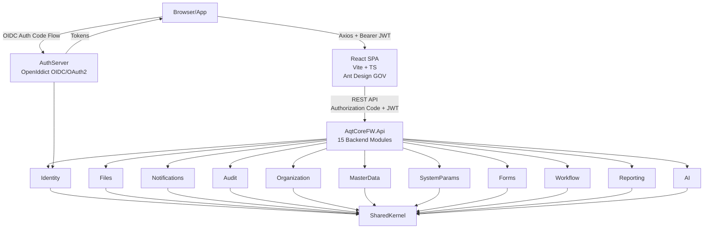

# System Architecture

## Overview

AqtCoreFW is a **full-stack** application combining:
- **Backend:** .NET 10 Modular Monolith (15 active modules: Identity (incl. Digital Signature), Audit, Files, Notifications, Organization, Forms, Workflow, Reporting, AI, MasterData, SystemParams, Integration, Collaboration, Rules; plus deferred: Chat, Dashboard, BusinessProcess; removed: Search, Cases; Clean/Onion layers, CQRS)
- **Frontend:** React 19 + TypeScript 5.7 (Vite, Ant Design, TanStack Router/Query)
- **Auth:** Separate `AqtCoreFW.AuthServer` (OpenIddict OIDC/OAuth2)

**Phase 1:** Monolithic deployment (single Docker image for backend, single SPA for frontend).
**Phase 2:** Microservices extraction (strangler pattern, RabbitMQ, YARP gateway).

**Runtime:** .NET 10 / ASP.NET Core 10 (backend), Node.js 20 + Nginx (frontend)
**Auth Server:** Separate host (`AqtCoreFW.AuthServer`) — OpenIddict 7.4.0 OIDC/OAuth2 (upgraded from 5.5.0). **Hangfire client-only pattern (v2.133p23):** AuthServer registers Hangfire storage (not server) to enable static `BackgroundJob.Enqueue` calls in `HangfireAuditJobEnqueuer` for audit logging. Schema `[hangfire]` managed by API host migrations; AuthServer assumes pre-migrated state. Eager resolve post-Build (DI lazy registration trap) ensures `JobStorage.Current` initializes on startup before first auth request. No Hangfire dashboard on AuthServer.
**API Host:** `AqtCoreFW.Api` — all module Presentation controllers auto-discovered via `DependencyContext` from project-referenced assemblies (no explicit `AddApplicationPart` registration needed)
**Web Host:** `C:\AqtCoreFW\web\` — React 19 SPA (Vite dev, Nginx production, V1.5 with i18n). **P7 Admin UI (BP Designer):** Feature folder `web/src/features/business-processes/admin/` + Orval-generated hooks `web/src/api/generated/business-processes/`. Routes: `/admin/business-processes`, `/admin/business-processes/new`, `/admin/business-processes/:id`. **Phase B (v2.137p33):** Form-map replace-all endpoint `PUT /business-processes/{id}/form-maps` with `If-Match` header (ETag-based optimistic concurrency); BusinessProcessDetailDto now carries `rowVersion: string` (base64-encoded byte[8] SQL rowversion).
**Database (Dev):** SQL Server 2022 via Docker Desktop container `sqlserver` (from `infra/docker/docker-compose.yml`, `localhost,1433`, SA auth) — integration tests run against local SQL by default (`TEST_USE_LOCAL_SQL=true`, ~12s fixture startup vs ~41s Testcontainers). Reverted from native install (v2.114, 2026-04-18) → Docker container **in v2.132 on 2026-04-25**; see ADR 006. Testcontainers.MsSql is fallback when env var unset.

---

## Layer Model

```
┌─────────────────────────────────────────────┐
│              Presentation Layer              │  HTTP controllers, SignalR hubs
│    (AqtCoreFW.*.Presentation)               │  Inherits ApiControllerBase → ApiResponse<T>
├─────────────────────────────────────────────┤
│              Application Layer              │  CQRS commands/queries, MediatR handlers
│    (AqtCoreFW.*.Application)                │  FluentValidation, FluentResults, pipeline behaviors
├─────────────────────────────────────────────┤
│               Domain Layer                  │  Entities, value objects, domain events
│    (AqtCoreFW.*.Domain)                     │  Pure C# — zero infrastructure references
├─────────────────────────────────────────────┤
│           Infrastructure Layer              │  EF Core DbContexts, Dapper queries, repos
│    (AqtCoreFW.*.Infrastructure)             │  MassTransit consumers, external service clients
└─────────────────────────────────────────────┘
         ▲ all layers depend on ▼
┌─────────────────────────────────────────────┐
│              SharedKernel                   │  Interfaces, base classes, domain primitives
│    (AqtCoreFW.SharedKernel)                 │  NO infrastructure dependencies
└─────────────────────────────────────────────┘
```

**Rule:** Dependency arrows point inward only. Domain never references Application or Infrastructure.

**SharedKernel.Authorization namespace (v2.133p23):** Cross-cutting authorization contracts (`PermCodes`, `Policies`, `RequiresMfaAttribute`, `PermissionRequirement`, `ResourceOperationRequirement`, `ClassificationAccessRequirement`, `DepartmentAccessRequirement` marker) live in `AqtCoreFW.SharedKernel.Authorization` to prevent 9 modules from directly referencing `Identity.Application`. `DepartmentAccessRequirement` handler + `IAttributeRuleReader` remain at Identity.Application (domain entity dependency on `AttributeRule`). This pattern ensures module isolation — Presentation layers depend on SharedKernel, not Identity module.

---

## Full-Stack Module Map



**Frontend (React SPA - V2.0):**
- Vite dev server (HMR), React 19 + TypeScript 5.7
- Ant Design 5.x with dynamic i18n locale switching (vi↔en, react-i18next)
- **Dark mode toggle** (reactive React context, localStorage persistence)
- TanStack Router with 18 lazy-loaded routes (code splitting, includes /profile)
- TanStack Query v5 (server state management)
- Zustand (client state), React Hook Form + Zod (forms)
- @dnd-kit/core + @dnd-kit/sortable (drag-reorder; used in form-builder + views-editor)
- @tanstack/react-virtual v3 (row virtualization; workflow dashboard, >500-row lists)
- oidc-client-ts (PKCE OAuth2 flow to AuthServer)
- Axios HTTP client (auth token + correlation ID interceptors)
- Print-friendly CSS + Responsive Grid on 4 key pages
- ARIA accessibility on layout components (Sidebar, Topbar, AppLayout)
- 32 orval SDK modules auto-generated from OpenAPI
- Sidebar + core pages (Audit, Forms) fully translated
- LanguageSwitcher in topbar for vi/en toggle
- **SignalR notification toasts** (real-time push notifications)
- **Session timeout warning** (2 min before token expiry)
- **Idle timeout modal** (SessionExpiryModal, configurable session_timeout_minutes + session_countdown_seconds, cross-tab sync via localStorage, pauses on window hidden)
- **Error boundary + 404/403 error pages** with recovery options
- **Notification toasts** for user actions (create, update, delete)
- **Batch workflow operations** (checkbox selection, approve/reject multiple)
- **Announcement banner** on dashboard (configurable content)
- **Dark mode CSS variables** (navy, blue, red high-contrast variants)
- **User profile page** (/profile) with role assignment view
- **Chat conversation creator** (modal with user search via GET /api/v1/users/search, duplicate Direct guard)
- CSP headers on nginx reverse proxy
- 75+ files, 13+ tests passing, Vite build time ~2.5s

**Backend Modules** communicate via:
1. **Domain Events (MassTransit)** — Async, decoupled, non-blocking (Audit log creation, Notifications, Webhooks)
2. **SharedKernel Interfaces** — Sync cross-module calls for critical workflows (e.g., RTBF data erasure, user name resolution)
   - Example: `IIdentityModuleClient` (defined in SharedKernel.Contracts, implemented by Identity.Infrastructure)
   - Used by Audit module to trigger PII erasure during RTBF requests
   - Used by Collaboration module for bulk user name resolution (GetConversationsQueryHandler calls GetUserInfoByIdsAsync() for last-message senders + participant names)
   - In-process (Phase 1) → RPC/HTTP (Phase 2 microservices)
   - **Forms Enhancement (2026-03-28):** Added `IConsentModuleClient` (for PDPL Article 11 consent recording), `IWorkflowModuleClient` (for automatic workflow instance creation on form submission), `IFormSubmissionStatusClient` (for updating form submission status from workflow state transitions)
   - **Chat UI Redesign (2026-04-09):** Collaboration module now enriched with cross-module user data (names + department codes) via IIdentityModuleClient
   - **Phase-02 (2026-04-17):** `IWorkflowModuleClient` extended with `ExecuteTransitionAsync`, `QueryAllowedTransitionsAsync`; `IIdentityModuleClient.GetEffectivePermissionCodesAsync` added. Workflow module now delegates transition authorization to Identity module (permission-set membership check, not role-equality).
   - **Phase-03 (2026-04-17):** `IWorkflowModuleClient` extended with `CreateInstanceByDefinitionKeyAsync`, `TryResolveInstanceForEntityAsync`. Cases module delegates transition handlers + CreateCase to Workflow (feature-flag gated). `WorkflowErrorCodes` moved to `SharedKernel.Contracts.Clients` for cross-module error mapping.
   - **D2 (2026-04-17):** New cross-module error code `StateConflict` (GOV_WFL_013, HTTP 409) introduced for simultaneous-race detection via EF `IsConcurrencyToken()` on `WorkflowInstance.CurrentStateId`. Defense-in-depth: app-layer state guard catches sequential races, DB-layer concurrency token catches simultaneous races. Cross-module callers of `ExecuteTransitionAsync` receive `StateConflict` error when simultaneous updates detected.
   - **BP MVP Phase A (2026-05-16):** `IBusinessProcessQueryClient` (Forms/Workflow consumers for delete/deactivate guards) enables list-active and existence checks. Sibling to `IFormTemplateQueryClient` and `IWorkflowModuleClient`.

**AI Module** provides LLM integration (Microsoft.Extensions.AI), vector embeddings (Qdrant), and semantic search with 4-layer data sovereignty.

**Reporting Module** provides async report generation (Hangfire), template-driven export (ClosedXML Excel, QuestPDF PDF), and compliance evidence collection.

**Authorization Architecture (v2.11 — 6 Phases A-F, COMPLETE):**

**Permission Resolution Layer:**
- **Phase A:** PermissionCode enum defines all system permissions (MODULE.RESOURCE.ACTION)
- **Phase B:** DataScopeService resolves 7 scope types (SELF, ASSIGNED, ORG_UNIT, ORG_TREE, CUSTOM_LIST, ALL, BY_FIELD)
  - ResolvedDataScope combines permissions + filtered record IDs
  - Query filters applied in handler layer (CommandHandler, QueryHandler)
- **Phase C:** PolicyRuleEvaluator evaluates NCalc expressions at runtime
  - EffectivePermissionService combines RBAC + scope + policy results
  - PermissionAuthorizationHandler enforces checks
- **Phase D:** 16 admin API endpoints for groups, data scopes, policy rules management
- **Phase E:** UserDelegation enhanced with approval flow + Redis-backed version caching (IPermissionVersionService)
- **Phase F:** SodConflictRule prevents segregation-of-duties violations; IMenuService resolves sidebar per user
- **Phase G (2026-04-09 — RBAC Roles & Permissions CRUD):** Full CRUD for business roles + permission assignment API. System roles remain read-only. 5 endpoints: POST/PUT/DELETE /admin/roles (create/update/deactivate), PUT /admin/roles/{id}/activate (reactivate), PUT /admin/roles/{id}/permissions (sync all permissions). Permission APIs: GET /admin/permissions (list all), GET /admin/roles/{id}/permissions (assigned only). Domain events: RoleCreated, RoleUpdated, RoleDeactivated, RoleActivated, RolePermissionsChanged (audit trail). FE admin: role create/edit modal, permission matrix with grouped checkboxes, SoD confirmation header (X-Confirm-SoD). EffectivePermissionService filters by IsActive on direct + group roles (prevents deactivated roles from granting permissions). Security: tenant isolation on all write ops, SystemAdmin guard for sensitive permission changes. IBulkRoleChangeService interface extracted from concrete implementation.

**Row-Level Security (RLS) Architecture (v2.137p4 → 2026-08-04 upgrade to 51 policies):**
- **TenantSessionContextInterceptor:** EF Core interceptor called on every DbContext to set SQL Server SESSION_CONTEXT
  - Configured in shared `AqtCoreFW.Infrastructure` → all 15 modules register via DI
  - Execution: `sp_set_session_context(N'TenantId', @tenantId)` on connection open
  - **v2.40 Extension:** DapperReadDbConnection also enforces `sp_set_session_context` with connection leak fix (proper disposal on SESSION_CONTEXT failure)
  - **v2.137p3 Status:** SESSION_CONTEXT setting (app-side) restored full DB-side consumer base (RLS policies re-added after Phase-06 regen loss)
  - **v2.137p4→2026-08-04:** Nullable-TenantId tables covered; Forms module `FormSubmissionWorkflowLinkPendingAttempts` table added FILTER+BLOCK RLS policy (migration `20260804030737_AddWorkflowLinkPendingAttemptRls`) — 51 total policies
- **SQL RLS Policies (51 total):** 51 `SECURITY POLICY` FILTER+BLOCK predicates enforce row visibility at DB layer
  - **Standard predicate (33 tables):** `IS_MEMBER('db_owner')=1 OR @TenantId = TRY_CAST(SESSION_CONTEXT(N'TenantId') AS uniqueidentifier)` — applied via `RlsMigrationHelper.GenerateRlsPolicyStatements()`
  - **Asymmetric audit predicate (2 tables — AuditLogEntries, SecurityEventLogs):** FILTER adds `OR (@TenantId IS NULL AND TRY_CAST(SESSION_CONTEXT(N'audit_admin_bypass') AS bit)=1)` to expose NULL-tenant system events to admin readers. BLOCK AFTER INSERT adds `OR @TenantId IS NULL` (unconditional) to allow server-side audit writers — applied via `RlsMigrationHelper.GenerateAuditAdminBypassRlsPolicyStatements()`
  - **Symmetric SystemParams predicate (1 table — config.SystemParameters):** `IS_MEMBER('db_owner')=1 OR @TenantId = CAST(SESSION_CONTEXT(N'TenantId') AS nvarchar(100)) OR @TenantId IS NULL` (NULL = global param visible to all; nvarchar(100) param type matches column) — applied via `RlsMigrationHelper.GenerateSystemParamRlsPolicyStatements()`
  - **`audit_admin_bypass` session-context contract:** Set via `sp_set_session_context N'audit_admin_bypass', N'true', @read_only=0` (NOT `@read_only=1` — must be clearable by `sp_reset_connection` pool reset). Call sites: `AuditLogPurgeJob.ExecuteAsync()`, `DapperReadDbConnection.OpenWithAuditAdminBypassAsync()`. Always cleared in `finally` block. See PHASE6-RLS-NULLABLE-TENANT plan.
  - **`public_forms_bypass` session-context contract (verified-safe posture, Forms hardening 2D 2026-07-29):** The anonymous public-template by-Code path sets `sp_set_session_context N'public_forms_bypass', N'true'` on a dedicated connection (no `@read_only=1`) so the `FormTemplates` RLS FILTER carve-out exposes only `IsPublic=1` rows to a no-tenant caller (public entry point `DapperReadDbConnection.QueryFirstOrDefaultWithPublicFormsBypassAsync`, via the private `OpenWithPublicFormsBypassAsync` opener). **The flag does NOT survive connection reuse** — `sp_reset_connection` on pool return clears it, so a subsequent tenant caller never inherits the carve-out. This is regression-locked by `PublicFormsLeastPrivilegeTests.PublicFormsBypassFlag_DoesNotLeak_AfterRead` (single-slot pool + context probe). The public submit endpoint (`POST /api/v1/public/forms/{code}/submit`) is additionally rate-limited to 5 req/min per IP (`public-form-submit` policy) — regression-locked by `PublicFormSubmitRateLimitTests`. **Caveat:** the pool-reset guarantee depends on ADO.NET connection pooling being enabled (the default); disabling `Pooling` would remove the reset step.
  - Zero-cost for non-sensitive tables; all policy DDL is GO-free batch-isolated SQL per `migrationBuilder.Sql()` call
- **Dapper RLS (v2.40):** All Dapper queries enforcing tenant filter via `QueryWithTenantFilter` extension
  - Validates tenant GUID (non-empty) in all command handlers
  - BackgroundJobTenantContext ensures Hangfire jobs execute with correct tenant context
- **Outbox Interceptor (v2.40):** Preserves domain events during transaction rollback, ensuring no event loss
  - IntegrationEvent re-published to event bus after database commit
- **Audit Trail:** RLS policy violations logged as security events (SQL Server Audit + application audit log)

**Encryption at Rest (Phase-04 + Phase-06 QĐ 742):**
- **Algorithm:** AES-256-GCM (authenticated encryption) via `EncryptedStringConverter`
- **Key Management (Phase-06):** `IKeyResolver` abstraction, `VaultKeyResolver` implementation (Vault paths: `secret/aqtcorefw/encryption/v{N}`)
- **Key Versioning:** `v{N}:ciphertext` prefix enables zero-downtime key rotation without decryption
- **Encrypted PII Fields (Phase-04):** ApplicationUser (Email/NormalizedEmail/PhoneNumber), RtbfRequest (CitizenNationalId/SubjectEmail)
- **Pepper Strategy:** Per-tenant HMAC peppers for email hash (4-column split: GlobalId + TenantId + Hash + Salt) via `IPepperResolver`
- **One-Time Upgrade:** `PlaintextToEncryptedUpgrader` wired at host startup (Phase-04) for backfill from plaintext
- **Backward Compat:** `LegacyCipherUpgrader` (Phase-06) auto-detects unversioned v0 ciphertexts + dual-decode
- **RLS on Encrypted:** `EncryptedFieldArchitectureGuardTests` ensures all `[DataClassification(Restricted)]` fields encrypted OR explicitly `[DoNotEncryptAtRest]`

**Compliance Gap Fixes (v2.10-v2.11):**
- **nginx security headers:** `server_tokens off` suppresses version enumeration (QĐ742 §4.1)
- **Consent endpoints:** ConsentController grant/withdraw + domain events (PDPL Art. 11)
- **RTBF POST handler:** CreateRtbfRequestCommand calls IIdentityModuleClient for cross-module PII erasure (PDPL Art. 17)
- **Lockout signal:** LoginPost extends error response with `lockout_remaining_seconds` for UI countdown (QĐ742 §5.2)
- **Forms CRUD:** Update/Delete endpoints + field reorder for template management

**Security Hardening (v2.40 Audit Remediation — 2026-04-02):**

**Audit v1 Fixes:**
- **Dapper Tenant Isolation:** 3 queries + 2 controllers (ReadDbConnection enforces session context)
- **Hangfire Queue Migration:** Queue name normalization + dashboard middleware ordering fix
- **Auth Session UX:** onSilentRenewError notification prevents infinite redirect loops
- **Chat SignalR Auth:** Auth token validation on hub connection + pagination reset on search/filter
- **403 Notification, Error Boundaries, validateSearch:** UX improvements

**Audit v2 Fixes (Phases 1-5 COMPLETE):**
- **Phase 1:** Dapper RLS via `sp_set_session_context`, OutboxInterceptor event preservation, BackgroundJobTenantContext
- **Phase 2:** Copilot SSE auth token validation, open redirect validation (LocalRedirect), tenant GUID validation (non-empty Guid checks)
- **Phase 3:** 26 pages fetch-all for client-side search (no pagination for 300-item limits)
- **Phase 4:** AI controller tenant spoof prevention, SSRF validation (URI scheme/host checks), CaseRepository filter enforcement, bulk import limit (500 items)
- **Phase 5:** Report download auth (execution record validation), 401 redirect dedup, SignalR ref-counting (prevent double-subscribe), 20 pages Promise.allSettled for bulk ops, i18n completeness

**v2.38-v2.40 Tenant & User Resolution Pattern:**
- **ResolveTenantId() + ResolveUserId()** in `ApiControllerBase` extract identity from JWT claims only
  - 41 controllers updated: removed tenantId/createdBy/updatedBy/reviewedBy from query params and request DTOs
  - SystemAdmin cross-tenant access via `X-Tenant-Id` header (not query param)
  - All Extensions/ExtControllers (analytics, diff, bulk operations, PDF export) now enforce tenant isolation
- **SQL Injection Prevention:** Forms module `ListFormSubmissionsQueryHandler` validates field keys via regex pattern before dynamic SQL
- **CORS Hardening:** Restricted headers/methods enforcement
- **Open Redirect Prevention:** LocalRedirect validation, protocol-relative URL blocking
- **Path Traversal Defense:** Input validation + symbolic link checking
- **HTTPS Enforcement:** Redirect + HSTS headers
- **SQL Identifier Hardening:** Parameterized queries for all user input
- **Development Credentials:** Removed hardcoded passwords, moved to secure config (Vault)
- **Frontend Security:** Removed identity fields from 15+ API hooks (forms, workflow, cases, etc.); added `AdminTenantSelector` component for SystemAdmin cross-tenant debugging
- **Test Coverage:** All 41 controller changes verified with unit + integration tests

**JIT SSO Provisioning Authentication (v2.45):**
- **External OIDC Schemes:** AuthServer registers external providers via appsettings (OpenID Connect, Google, Microsoft, custom IdP)
- **Just-In-Time Provisioning:** JitProvisioningService auto-creates ApplicationUser + ExternalIdentity on first external login
- **Security Defenses (4 Red Team Mitigations):**
  - **RT-01 Email Squatting:** ExternalIdentity by (Provider, ExternalId) prevents email-based account takeover
  - **RT-02 Domain Whitelist:** JitProviderConfig.AllowedEmailDomains validates email domain (regex pattern) if configured
  - **RT-03 Tenant Requirement:** JitProviderConfig.RequireTenant enforces user must specify TenantId (prevents cross-tenant abuse)
  - **RT-04 Rate Limiting:** In-memory ConcurrentDictionary tracks provisioning attempts per provider scheme, hourly window, max 100 attempts/hour
- **Admin Configuration:** JitProviderConfigsController (5 REST endpoints) manages per-provider config (enabled, domain whitelist, auto-create domain, max hourly limit)
- **Admin UI:** /admin/jit-provider-configs React page (table, create/edit modals, delete confirmation)
- **Error Handling:** JitResult enum codes (deactivated, pending_approval, provision_failed, jit_disabled, domain_not_allowed, rate_limited, no_tenant)
- **Audit Trail:** JitProvisioningService logs provision attempts + failures to Audit module via IAuditService
- **ExternalLogin Integration:** ExternalLoginController.Callback() invokes JitProvisioningService before returning token

**V2 Features:**
- **Health Check Dashboard** (/admin/health) — monitor API, AuthServer, DB, Redis, RabbitMQ, MinIO health
- **User Role Assignment** (POST /admin/users/{id}/roles) — admins grant/revoke roles dynamically
- **Form Field Reorder** (PATCH /form-templates/{id}/fields/{fieldId}/order) — reorder fields with position index
- **Workflow Progress UI** — Steps component in case-detail showing workflow state machine progression
- **Audit Log CSV Export** (GET /audit/logs/export) — batch download logs with tenant isolation
- **API Rate Limiting** — 100 req/min (authenticated), 20 req/min (anonymous), per-tenant tracking
- **Frontend Env Validation** — startup check for required env vars (BASE_URL, OIDC configs)
- **JIT SSO** — Auto-provision external OIDC users on first login with 4-layer security (email squatting, domain whitelist, tenant requirement, rate limiting)

---

## Reverse Proxy & Tunnel Support (v2.51 — 2026-04-10)

**Full-stack support for reverse proxies (nginx, Cloudflare Tunnel, Docker) with automatic header forwarding and CORS hardening.**

**ForwardedHeaders Middleware:**
- **Both AuthServer & API:** `UseForwardedHeaders()` added to `Program.cs` to trust X-Forwarded-For, X-Forwarded-Proto, X-Forwarded-Host headers
- **Use Cases:** Cloudflare Tunnel, nginx reverse proxy, Docker container-to-host networking, multi-stage deployments
- **Security:** Only processes headers when explicitly enabled; prevents header spoofing by limiting trusted proxies

**CORS & Cross-Origin Headers:**
- **Enhanced GovApiPolicy:** Added `X-Correlation-Id` and `X-Tenant-Id` to AllowedHeaders (InfrastructureRegistration.cs)
- **AuthServer + API:** Cors section configured in `appsettings.Development.json` for tunnel domain access
- **Vite HMR:** allowedHosts entries added to `vite.config.ts` for tunnel domain HMR connections

**Frontend API Client Fix:**
- **api-client.ts Injection:** `BASE_URL ? ${BASE_URL}/api/v1 : '/api/v1'` (was missing `/api/v1` prefix when VITE_API_BASE_URL set)
- **Environment Handling:** Correctly resolves API endpoint for both local dev + tunnel/proxy deployments

**Local Development Tunnel Scripts** (v2.51):
- **1_run-local-dev:** Starts Auth+API+FE (native `dotnet run`) + Docker infra (SQL Server 2022 container `sqlserver` + Redis + RabbitMQ via `infra/docker/docker-compose.yml`; port-1433 conflict detection if any lingering native SQL service is running)
- **2_start-tunnels:** Launches 3 Cloudflare tunnels (AuthServer, API, FE)
- **3_setup-tunnel-urls:** Auto-configures 5 files for tunnel mode (Vite .env, appsettings.json, etc.)
- **4_expose-demo:** Interactive menu for tunnel tools + public URL display

---

## Phase 1: Domain Model Expansion (v2.14)

**22 new entities across 7 modules** add critical governance, compliance, and automation capabilities:

**External Identity & Access Control (M01: Identity)**
- ExternalIdentity, CredentialPolicy, ExternalMapping — Enable federated identity, policy-driven credential management, cross-system user resolution

**Reference Data Management (M02: MasterData, M05: SystemParams)**
- Dictionary, DictionaryItem, DictionaryItemVersion — Centralized reference lists (status codes, classifications) with versioning

**Workflow & Task Automation (M07: Workflow)**
- **CRUD + Versioning (Phase 1):** WorkflowDefinition with DefinitionKey, Version, IsLatest tracking; UpdateWorkflowDefinition, DeleteWorkflowDefinition, CloneWorkflowDefinition commands; PUT/DELETE/POST-clone API endpoints
- **Condition Evaluation (Phase 2):** DeclarativeConditionEvaluator with 11 operators (equals, notEquals, greaterThan, lessThan, gte, lte, in, notIn, contains, isNull, isNotNull); WorkflowCondition value object; metadata dict in ExecuteTransitionCommand
- **Notification Integration (Phase 3):** WorkflowNotificationConfig entity (per-definition, per-action rules); WorkflowTransitionedNotificationHandler (MediatR → INotificationModuleClient); CRUD API endpoints
- **Tenant-Workflow Assignment (Phase 3.5):** WorkflowAssignmentRule with 4-level specificity (SystemDefault < Tenant < TenantAndEntity < TenantEntitySubType); WorkflowAssignmentResolver with ICacheService (24h TTL); auto-resolve in CreateWorkflowInstance; GET/POST/DELETE /workflow/assignments + GET /resolve
- **Frontend Definition Management (Phase 4):** Visual designer for workflow states/transitions via React Flow canvas; SaveDefinitionGraphCommand replaces states+transitions (PUT /definitions/{id}/graph); Activate/Deactivate endpoints (POST /definitions/{id}/activate, /deactivate); 20 FE components (WorkflowDesigner, StateNodeComponent, TransitionEdgeComponent, StatePropertiesModal, TransitionPropertiesModal, DefinitionToolbar, etc.)
- **Parallel Branching (Phase 5):** 5 new entities (WorkflowParallelBranch, WorkflowBranchChild, WorkflowBranchResolution, WorkflowInstanceBranchStatus, WorkflowBranchChildStatus); ParallelBranchService with AND/OR/N-of-M join logic; BranchTimeoutCheckerJob for deadline enforcement; ExecuteTransition integrated with parallel branch resolution; ResolveBranchChildCommand for manual branch completion; GetBranchStatusQuery for monitoring branch state; 6 new API endpoints
- **Frontend Inbox & Monitoring (Phase 6):** Generic WorkflowInstance inbox page (replaces Cases-only view); Instance detail page with transition timeline; KPI monitoring dashboard with instance state metrics; 7 new React hooks for tasks/instances (useWorkflowTasks, useWorkflowInstances, useBranchStatus, etc.)
- **Advanced Features (Phase 7):** SlaHours per WorkflowState (per-state deadline tracking); IsRecall on WorkflowTransition (creator-only withdraw); WorkflowTransitionAttachment entity linking Files module; AutoTransitionOnTimeoutId for auto-escalation; SlaBreachCheckerJob extended with per-state breach detection; IWorkflowResolver interface + DynamicWorkflowResolver (Cases↔Dynamic bridge); **E2E Playwright tests:** 28 workflow tests covering CRUD, graph save, activate/deactivate, parallel branching, transitions, SLA monitoring, recall operations, attachment handling; **EF Concurrency Fixes:** SaveGraph uses raw SQL bypass for bulk upsert (EF SaveChanges limitations), WorkflowInstanceHistory detected-as-Modified→Added state fix (EF entity tracking scope), auto-retry on RowVersion conflicts
- **Task Management:** WorkflowTask, TaskAssignment, EscalationRule, WorkflowProcessVersion — deadline tracking, escalation triggers, version history. **(v2.134 Phase-04d)** WorkflowTask uses `HotTableConfigurationBase` with clustered index on `(CreatedAt, Id)` for optimized SLA/escalation polling queries (time-ordered range scans + ID clustering for concurrent inserts).
- **Task Delegation (v2.53 — T5-08):** DelegationRule entity (soft-delete, overlap validation, tenant-scoped) enables time-bounded task proxy during user absences. WorkflowTask.DelegatedFromUserId tracks original assignee. Commands: CreateDelegationRule, UpdateDelegationRule, DeleteDelegationRule, DelegateTask, ReturnDelegation. Query: GetDelegationRulesQuery with filtering/pagination. WorkflowDelegationController 6 REST endpoints. DelegationExpiryJob (Hangfire) auto-expires delegations when validUntil passes. TaskAssignmentRepository tracks full assignment history (audit trail). Permission: WORKFLOW.DELEGATION.MANAGE gates admin UI. FE: DelegationRulesPage (CRUD table), DelegationRuleFormDialog (create/edit with dayjs pickers), DelegateTaskDialog (modal), task detail drawer with delegate/return buttons + delegated-from badge.
- **Analytics Dashboard (v2.54 — T5-09):** 6 Dapper-based analytics queries with 15-min ICacheService caching. GetStateDistributionQuery (instance count per state + % share), GetAvgProcessingTimeByStateQuery (avg/median minutes per state over date range), GetThroughputByUserQuery (transition count by user grouped by day/week/month with Top-5+Others rank), GetSlaComplianceTrendQuery (on-time % per period for completed instances vs DueAt), GetAgingReportQuery (active instances stuck >minHours, bottleneck detection), GetBottleneckAnalysisQuery (states ranked by avg dwell time). WorkflowAnalyticsController 6 REST endpoints (all require WORKFLOW.ANALYTICS.VIEW permission, rate-limited read-ops, 1-year date range guard). FE: ECharts dashboard with state-distribution pie, processing-time trend line, throughput multi-series bar, SLA compliance trend + 95% target ref, aging detail table, bottleneck ranked table. Date range picker (from/to, presets: 7d/30d/90d/1y), optional definition filter. ARIA labels on all charts.

- **Version Migration (v2.82 — T5-10):** WorkflowVersionMigration + WorkflowVersionMigrationItem entities enable 4-eyes approval workflow for upgrading active instances. Workflow state machine: Draft → PendingApproval (creator submits) → Approved (approver ≠ creator, segregation enforced) → InProgress (Hangfire executor starts auto-migration) → Completed/Failed/Cancelled. CreatorId ≠ ApproverId enforced. StateMappings define source↔target state transitions for affected instances. Commands: ValidateMigrationMappingCommand (dry-run validation), CreateVersionMigrationCommand (validate mappings, store as Draft), ApproveVersionMigrationCommand (approver review, transition to Approved), ExecuteVersionMigrationCommand (transition to InProgress + process instances), CancelVersionMigrationCommand (soft-cancel). Queries: GetVersionHistoryQuery (all versions + active instance counts), GetMigrationsByDefinitionQuery (list migrations), GetMigrationStatusQuery (detail + progress), GetMigrationItemsQuery (state mappings). WorkflowMigrationsController 9 REST endpoints: GET /definitions/{key}/versions, POST /migrations/validate (dry-run), POST /migrations (create), POST /migrations/{id}/approve, DELETE /migrations/{id} (cancel), POST /migrations/{id}/execute, GET /migrations?definitionId=X, GET /migrations/{id}, GET /migrations/{id}/items. VersionMigrationExecutorJob (Hangfire, every 10min) processes Approved migrations: queries instances to migrate → locks via sp_getapplock for concurrency safety → updates instance.WorkflowVersionMigrationId + applies state mappings + creates audit trail → handles conflicts (migrated already, deleted instance, state not in mapping) → retries on deadlock. Permissions: WORKFLOW.MIGRATION.READ, WORKFLOW.MIGRATION.CREATE, WORKFLOW.MIGRATION.APPROVE, WORKFLOW.MIGRATION.EXECUTE, WORKFLOW.MIGRATION.CANCEL split for 4-eyes GOV compliance. 119 integration + unit tests covering happy path, validation errors, approval flow, executor concurrency, migration items.

**Document Lifecycle Management (M08: Files)**
- DocumentTemplate, DocumentTemplateVersion, DocumentArchive, FileVersion, RetentionPolicy, RecordLifecycle — End-to-end document governance: creation → retention → disposal, version control, compliance tracking

**Integration & Monitoring (M13: Integration, M14: Notifications)**
- EventCatalogEntry — Event schema registry for inter-module contracts
- AntiDoubleSubmitMiddleware — Idempotency protection via request tokens
- AlertRule, Runbook — Condition-based alerts and automated remediation

**Background Job Support (3 Hangfire Jobs)**
- EscalationCheckJob (15m), RetentionPolicyEnforcementJob (daily), AlertEvaluationJob (5m)

**10 New REST APIs** across document management, workflow, external identity, and admin monitoring domains. All Phase 1 entities auto-inherit TenantId multi-tenancy + soft-delete support.

---

## Infrastructure Components

| Component | Role | Dev Setup |
|---|---|---|
| SQL Server 2022 | Primary OLTP store | Docker Compose |
| Redis | Distributed cache, SignalR backplane | Docker Compose |
| MinIO | Object storage (files, exports) | Docker Compose |
| RabbitMQ 4.x | Async messaging (MassTransit) | Docker Compose |
| HashiCorp Vault | Secrets management | Docker Compose (required in dev) |
| Hangfire | Background job scheduling | SQL Server store |
| OpenTelemetry | Traces + metrics export | OTLP → Grafana/Prometheus |
| Serilog | Structured JSON logging | Seq in dev |

---

## Typical GOV Request Flow (Frontend → Backend)

```
React SPA (Browser)
    │
    ├─ User triggers action (submit form, list cases, etc.)
    │
    ├─ React Hook Form validates locally (Zod schema)
    │
    └─► Axios HTTP Request
        ├─ Authorization header: "Bearer {JWT access token}"
        ├─ X-Correlation-ID: {UUID for tracing}
        ├─ Content-Type: application/json
        │
        ▼
    [HTTPS] AqtCoreFW.Api
        │
        ├─ SecurityHeaders middleware (CSP, HSTS, X-Frame-Options)
        ├─ CorrelationId middleware (enriches logs)
        ├─ RateLimit middleware (per tenant)
        ├─ JWT validation (Bearer token → OpenIddict introspection)
        │       └─ extracts claims: sub (user ID), tenant_id, roles, dept_code, clearance_level
        │
        ├─ Controller (ApiControllerBase)
        │       └─ mediator.Send(command)
        │
        ├─ MediatR Pipeline
        │       ├─ TenantAwareBehavior → injects ITenantContext from JWT claim
        │       └─ ValidationBehavior → FluentValidation, returns 422 on failure
        │
        ├─ CommandHandler / QueryHandler
        │       ├─ Domain logic (aggregate methods, business rules)
        │       ├─ Repository.AddAsync (EF Core write) or IReadDbConnection (Dapper read)
        │       └─ Returns Result<T>
        │
        ├─ ApiControllerBase.ToApiResponse(result)
        │       └─ maps Result errors → HTTP status codes
        │
        ▼
    ApiResponse<T> JSON envelope (RFC 9457 format)
        {
          "success": true,
          "data": {...},
          "meta": {...},
          "errors": []
        }
        │
        ├─ [200] Success response
        ├─ [401] Unauthorized (token expired/invalid)
        ├─ [403] Forbidden (insufficient clearance/role)
        ├─ [422] Validation error (detail_vi: Vietnamese error text)
        └─ [500] Server error
        │
        ▼
    React SPA
        │
        ├─ TanStack Query (axios interceptor) unwraps ApiResponse envelope
        ├─ Zustand state update (store response data)
        ├─ Component re-renders with fresh state
        └─ Ant Design Table / Form / Drawer displays result
```

**Async Post-Response (Backend):**
After the HTTP response is sent, domain events are dispatched to MassTransit consumers:
- Audit log creation (every state change)
- Email/SMS notifications (if subscribed)
- Cross-module workflows (Workflow engine state machine)
- External webhooks (Webhook engine)

**Error Handling Flow:**
- Validation errors: FluentValidation → 422 with field-level detail_vi messages
- Not Found: 404 with custom error code (e.g., `GOV_CASE_001`)
- Authorization: 403 Forbidden (ABAC clearance cap or RBAC role check failed)
- Rate limit: 429 Too Many Requests (per tenant rate limiter)

---

## Event-Driven Architecture

**Domain events** flow through MassTransit to module consumers (in-memory in Phase 1, RabbitMQ in Phase 2). Event contracts defined in `SharedKernel.Contracts`; full AsyncAPI 3.0 schema documented in [`docs/reference/asyncapi.yaml`](reference/asyncapi.yaml).

**Events enable:**
- Audit log capture (every domain event → audit record)
- Notifications (case updated → email/SMS subscribers; FormSubmitted/FormApproved/FormRejected → subscribers)
- Cross-module workflows (FormSubmitted → auto-create workflow instance)
- External webhooks (via Webhook Engine)

**Core Domain Events:**
- **Identity:** UserCreated, UserUpdated, LoginAttempted, LogoutCompleted, MfaEnabled
- **Audit:** AuditLogCreated, RtbfRequestSubmitted
- **Notifications:** NotificationSent, EmailDelivered, SmsDelivered
- **Workflow:** WorkflowInstanceCreated, WorkflowTransitioned, WorkflowCompleted
- **Forms:** FormSubmitted, FormApproved, FormRejected (new in v2.20.1)

---

## CQRS Split

**Writes:** EF Core aggregate repositories (`IRepository<T, TId>`).
**Reads:** Dapper via `IReadDbConnection` — raw SQL, no N+1, no change tracking overhead.

```
POST /workflows/instances  → CreateWorkflowInstanceCommand → EF Core (write)
GET  /workflows/instances  → ListWorkflowInstancesQuery    → Dapper  (read, optimised SQL)
```

**Forms Module Exception:** Dual-mode storage pattern:
- **StorageMode.Json:** Write via EF Core SubmissionData column (JSONB), read via Dapper from single SubmissionData field
- **StorageMode.Table:** Write via Dapper parameterized INSERT to dynamic `forms.Submissions_{templateId:N}` table, read via Dapper raw SQL with type-safe columns
- Both modes use FormMaterializationService for async DDL creation at publish time

### Global Query Filters (Multi-tenancy Enforcement - 2026-03-21)

**EF Core Global Query Filter:**
All ITenantScoped entities automatically filtered by TenantId at query time (2026-03-21 implementation):

```csharp
// In DbContext OnModelCreating:
builder.Entity<WorkflowInstance>()
    .HasQueryFilter(w => w.TenantId == _tenantContext.TenantId);

builder.Entity<User>()
    .HasQueryFilter(u => u.TenantId == _tenantContext.TenantId);
```

**Benefits:**
- Zero-configuration tenant isolation (no manual WHERE TenantId filters needed)
- Prevents accidental cross-tenant queries
- Filter applies to: EF Core writes, IRepository implementations, related entity loads
- Dapper queries remain explicit (developer responsibility via @TenantId parameter)

**Combined Pattern (Soft-Delete + TenantId):**
```csharp
builder.Entity<Case>()
    .HasQueryFilter(c => c.TenantId == _tenantContext.TenantId && !c.IsDeleted);
```
Ensures deleted records filtered per tenant, not globally.

### Known EF Core Concurrency Patterns (v2.24)

**Workflow Module — Documented Patterns:**
1. **SaveDefinitionGraph (Phase 4):** Raw SQL `MERGE` statement bypasses EF SaveChanges for bulk upsert of states/transitions (EF limitation: cannot efficiently upsert multiple aggregates in single transaction). See `SaveDefinitionGraphCommandHandler` for pattern.
2. **CloneWorkflowDefinition (v2.137p64):** Two-phase EF save for state+transition graph replication. States-only deep-copy → `AddAsync + SaveChangesAsync` (assign IDENTITY) → resolve transition FKs by stable state Name → `AddTransition + SaveChangesAsync` → remap AutoTransitionOnTimeoutId via name/id-pair lookup. Defense-in-depth: `WorkflowTransition.Create` guards FromStateId/ToStateId > 0. Mirrors SaveDefinitionGraph two-phase pattern (same root cause: IDENTITY availability). FE `buildEdges` helper now drops + warns unresolvable-FK transitions (visualization defense-in-depth). See `CloneWorkflowDefinitionCommandHandler` for implementation.
3. **ExecuteTransition History (Phase 7):** WorkflowInstanceHistory entries detected as Modified→Added by EF change tracker in multi-entity scope. Fixed via `StateManager.ChangeTracker.Clear()` before history insert. Auto-retry on RowVersion conflicts via `OptimisticConcurrencyException` handler.
4. **RowVersion Concurrency Token:** SQL Server `ROWVERSION` columns on aggregate roots; EF validates on Update/Delete. Known false positives when multiple entities modified in same DbContext scope—mitigated by entity-level change tracking inspection.
5. **Soft-Delete Interceptor Bypass (MTS-3-FU3, v2.137p11):** `SoftDeleteInterceptor` rewrites `EntityState.Deleted` to `Modified` for all `ISoftDeletable` entities, converting `DELETE` statements to soft-delete `UPDATE`s. When DB-engine `ON DELETE CASCADE` must fire on dependent rows, use `ExecuteDeleteAsync()` (not `RemoveRange + SaveChangesAsync`) to issue a real SQL DELETE that bypasses interceptor rewriting. Example: `E2ETestDataSeeder.PurgeOrphanMenusAsync`.

**Mitigation Strategy:**
- Unit tests verify RowVersion conflict detection (11 concurrency race condition tests)
- Integration E2E tests (28 workflow tests) verify retry logic under load
- No breaking changes to API contracts; handled internally in handler layer
- Seeder/scaffolding deletions use `ExecuteDeleteAsync` + `IgnoreQueryFilters()` when DB constraints must physically cascade

### Cross-Module Unit-of-Work Pattern (v2.137+ Distributed Transaction Prevention)

**Problem:** .NET 10 on Linux/Docker disables implicit distributed transactions (`ImplicitDistributedTransactions=false` by default). When 2+ modules each open their own `SqlConnection` inside a `System.Transactions.TransactionScope`, the runtime promotes to Distributed Transaction Coordinator (DTC), which fails on Linux (no MSDTC service) → HTTP 500.

**Solution:** Shared `ICrossModuleUnitOfWork` service owns a single `SqlConnection` + `SqlTransaction`. All participating DbContexts and Dapper reads enlist onto this connection via `UseTransaction()` or `OpenWithSharedConnectionAsync()`.

**Architecture:**
- **`ICrossModuleUnitOfWork`** (SharedKernel, scoped lifetime): `BeginAsync()`, `CommitAsync()`, `RollbackAsync()`, `IsActive`, `Connection`, `Transaction` properties
- **`CrossModuleUnitOfWork`** impl: Manages one `SqlConnection` + `SqlTransaction`; sets `sp_set_session_context N'TenantId'` once on Begin (RLS enforcement); implements IDisposable + IAsyncDisposable
- **`CrossModuleUnitOfWorkExtensions.EnlistAsync(DbContext)`**: Calls `SetDbConnection()` + `UseTransaction()`; idempotent for multiple calls
- **`DapperReadDbConnection` ambient-aware:** When UoW active, reads ride the shared connection + transaction; otherwise open independent connections
- **`GenericRepository<T,TId>` base:** Takes optional `ICrossModuleUnitOfWork?`; enlists on every write (Add/Update/Delete) + GetById when UoW active; no-op when null
- **2 production handlers** (`StartBusinessProcessRunCommandHandler`, `ExecuteBusinessProcessTransitionCommandHandler`) now use UoW instead of `TransactionScope`

**MARS is load-bearing:** `MultipleActiveResultSets=true` on connection string — shared connection interleaves Dapper reads while EF write commands are open. Enforced by `MarsConnectionStringGuardTests` (Architecture.Tests).

**Usage pattern:**
```csharp
// In handler ctor: inject optional ICrossModuleUnitOfWork
public sealed class ExecuteBusinessProcessTransitionCommandHandler(
    IBusinessProcessRepository bpRepo,
    IWorkflowModuleClient workflowClient,
    ICrossModuleUnitOfWork? uow) // optional scoped service
    : IRequestHandler<ExecuteBusinessProcessTransitionCommand, Result<ExecuteBusinessProcessTransitionResult>>
{
    public async Task<Result<ExecuteBusinessProcessTransitionResult>> Handle(
        ExecuteBusinessProcessTransitionCommand request, 
        CancellationToken ct)
    {
        if (uow is not null)
        {
            await uow.BeginAsync(request.TenantId, ct);  // RLS + shared connection
            try
            {
                // All BP/Workflow writes go to shared transaction
                var bp = await bpRepo.GetByIdAsync(request.ProcessId, ct);
                var executionResult = await workflowClient.ExecuteTransitionAsync(..., ct);
                
                // Apply state changes under same transaction
                bp.RecordTransition(...);
                await bpRepo.UpdateAsync(bp, ct);
                
                await uow.CommitAsync(ct);
                return Result.Ok(...);
            }
            catch
            {
                await uow.RollbackAsync(ct);
                throw;
            }
        }
        else { /* legacy: single-module operation */ }
    }
}
```

**Carry-forward:** All cross-module atomic writes should adopt this pattern instead of `TransactionScope`. The DTC promotion issue becomes invisible — read/write paths automatically coordinate via shared connection pooling.

---

## Authorization Architecture (v2.11 Complete)

### Permission Resolution Flow

```
User Request
    │
    ├─ JWT claims extracted: sub (userId), roles, tenant_id, dept_code
    │
    ├─ Phase A: Permission Codes
    │   └─ Map request action to PermissionCode (e.g., GET /cases → AUTH.CASE.READ)
    │
    ├─ Phase B: Data Scope Resolution (IDataScopeService)
    │   ├─ Resolve scope type: SELF, ASSIGNED, ORG_UNIT, ORG_TREE, CUSTOM_LIST, ALL, BY_FIELD
    │   └─ Return ResolvedDataScope (effective permissions + filtered records)
    │
    ├─ Phase C: Policy Rule Evaluation (IPolicyRuleEvaluator)
    │   ├─ Load PolicyRules matching user role + resource type
    │   ├─ Evaluate NCalc conditions (e.g., department_code == "CUSTOMS" AND classification_level >= 3)
    │   └─ Combine results: ALLOW if RBAC + scope + policy all pass
    │
    ├─ Phase E: Delegation Check (IPermissionVersionService)
    │   ├─ Check active delegations (UserDelegation.Status == Active)
    │   ├─ Verify delegation not expired
    │   └─ Include delegated roles in effective permissions
    │
    ├─ Phase F: SoD Conflict Check (ISodConflictChecker)
    │   ├─ Verify role combination doesn't violate SodConflictRule
    │   └─ Reject if conflict detected
    │
    └─► PermissionAuthorizationHandler
        └─ Return 403 Forbidden if any check fails, else allow request

Query Handler (Phase B Applied)
    │
    ├─ Apply ResolvedDataScope.FilteredRecordIds to WHERE clause
    │ (Dapper: WHERE id IN @recordIds AND TenantId = @tenantId)
    │
    └─► Return filtered result set
```

### 6 Authorization Phases (A-F)

| Phase | Component | Details |
|-------|-----------|---------|
| **A** | PermissionCode | MODULE.RESOURCE.ACTION enum; AUTH.USER.READ, AUTH.ROLE.ASSIGN, etc.; RoleType enum (Admin, Officer, Citizen) |
| **B** | DataScopeService | 7 scope types; ResolvedDataScope DTO; automatic query filtering |
| **C** | PolicyRuleEvaluator | NCalc expression engine; EffectivePermissionService combines RBAC+scope+policy |
| **D** | Admin APIs | 16 endpoints: GroupsAdminController (8), DataScopeAdminController (4), PolicyRulesAdminController (4) |
| **E** | Delegation+ | DelegationStatus enum; IPermissionVersionService (Redis version cache); DelegationExpiryJob |
| **F** | SoD + Menu | SodConflictRule detection; AppMenu + MenuRolePermission; IMenuService sidebar resolution |

### PermCodes & Controller Authorization (v2.51 — Compile-Time Safety)

**PermCodes class** provides centralized permission constants with compile-time type safety.

**Location:** `src/modules/identity/AqtCoreFW.Identity.Application/Authorization/PermCodes.cs`

**Structure:**
```csharp
public static class PermCodes
{
    public static IReadOnlyList<string> All => _all;  // Dynamic policy registration

    // 114 permission codes across 14 modules:
    public static class Identity       { ... 23 perms ... }
    public static class Files          { ... 8 perms ... }
    public static class Audit          { ... 7 perms ... }
    public static class Workflow       { ... 6 perms ... }
    public static class Forms          { ... 6 perms ... }
    // ... 9 more modules, 2 ABAC (DepartmentRestricted, ClassifiedAccess)
}
```

**Permission Format:** `MODULE.RESOURCE.ACTION`
- `PermCodes.Identity.User.View = "IDENTITY.USER.VIEW"`
- `PermCodes.Workflow.Definition.Create = "WORKFLOW.DEFINITION.CREATE"`
- `PermCodes.Audit.Log.Export = "AUDIT.LOG.EXPORT"`

**Controller Migration (v2.51):**
- ~40 controllers migrated from `[Authorize(Roles = "Admin")]` → `[Authorize(Policy = PermCodes.X.Y.Z)]`
- No hardcoded permission strings — constants only
- Action-level overrides for specific operations (POST requires Create, PUT requires Update, DELETE requires Delete)
- RolePermissions seed maps roles → permissions (Admin: normal ops, SystemAdmin: all 114, GovOfficer: limited subset)

**ModuleRegistration policies:**
```csharp
foreach (var code in PermCodes.All)
    authBuilder.AddPolicy(code, p => p.Requirements.Add(new PermissionRequirement(code)));

// ABAC policies separate
authBuilder.AddPolicy(Policies.DepartmentRestricted, ...)
           .AddPolicy(Policies.ClassifiedAccess, ...);
```

**PermissionAuthorizationHandler:**
- Evaluates permission code against effective permissions (roles + delegations + groups)
- Falls back to ABAC handlers if permission check passes
- Returns 403 Forbidden on failure

### Data Scope Types (Phase B)

| Type | Description | Example |
|------|-------------|---------|
| **SELF** | User's own records only | User can see only their own profile |
| **ASSIGNED** | Records assigned to user | Workflow tasks assigned to me (instance.assignedUserId == me) |
| **ORG_UNIT** | Same organizational unit | Can see all workflow instances in my department |
| **ORG_TREE** | Organizational hierarchy | Manager sees reports + reports' subordinates |
| **CUSTOM_LIST** | User-specific list (DB config) | VIP clients, priority requests |
| **ALL** | All records (no filter) | System admin sees everything |
| **BY_FIELD** | Dynamic field-based filter | Records where field_x = user.attribute_y |

### Policy Rule Examples (Phase C)

```csharp
// Rule 1: High-security access
PolicyRule:
  Description: "Users can only view records with classification ≤ their clearance"
  Condition: "record.classification_level <= user.clearance_level"
  PermissionCode: "AUTH.FORM.READ"

// Rule 2: Department-based access
PolicyRule:
  Description: "Officers can only view workflow instances in their department"
  Condition: "instance.department_code == user.dept_code"
  PermissionCode: "AUTH.WORKFLOW.VIEW_DETAIL"

// Rule 3: Time-based access
PolicyRule:
  Description: "Reports available only during business hours (8am-6pm)"
  Condition: "NOW().HOUR() >= 8 AND NOW().HOUR() < 18"
  PermissionCode: "AUTH.REPORT.EXECUTE"
```

---

## Repository Pattern Enforcement

**Identity Module** establishes the enforced repository pattern:

**Domain Layer** (AqtCoreFW.Identity.Domain/Repositories/):
- `IConsentRepository` — Consent aggregate persistence contract
- `IDelegationRepository` — Delegation aggregate persistence contract
- `IAttributeRuleRepository` — Attribute-based access control rules

**Infrastructure Layer** (AqtCoreFW.Identity.Infrastructure/Persistence/):
- `ConsentRepository` — EF Core implementation with Identity DbContext
- `DelegationRepository` — EF Core implementation with Identity DbContext
- `AttributeRuleRepository` — EF Core implementation with Identity DbContext

**Application Handlers** depend on **repository interfaces only**, not infrastructure concrete classes:
- `GrantConsentCommandHandler(IConsentRepository)` — no IdentityDbContext reference
- `WithdrawConsentCommandHandler(IConsentRepository)` — no IdentityDbContext reference
- `DelegateRoleCommandHandler(IDelegationRepository)` — no IdentityDbContext reference
- `RevokeDelegationCommandHandler(IDelegationRepository, ICacheService)` — uses SharedKernel abstraction for cache
- `AbacAuthorizationHandler(IAttributeRuleRepository)` — no IdentityDbContext reference

This pattern is the template for all new modules — define repository interfaces in Domain, implement in Infrastructure, inject into Application handlers.

---

## Authentication Architecture

```
Client ──[OIDC auth code flow + PKCE]──► AqtCoreFW.AuthServer
                                              │ (OpenIddict 7.4.0 + ASP.NET Identity)
                                              │ AuthorizationController (PKCE + ROPC + login page)
                                              │ VNeID federation (NĐ59)
                                              │ MFA/TOTP (QĐ742)
                                              ▼
                                      Access Token (JWT)
                                              │
Client ──[Bearer token]────────► AqtCoreFW.Api
                                       │
                               JWT introspection validation (AuthServer endpoint)
                               RBAC: role claims
                               ABAC: dept_code + ClassificationLevel
                               Token revocation on role change
```

**Dev User:** admin@dev.local / DevAdmin@12345

**Docker Discovery:** AuthServer IssuerUri uses `host.docker.internal:5000` in containers; direct `localhost:5002` in dev.

**API Token Validation:** Calls AuthServer `/introspect` endpoint for active token verification (not just JWT decode).

API Key M2M auth (SHA-256 hashed, Redis cached) is available for service-to-service calls.

---

## Security Architecture

| Layer | Control | Standard | Status |
|---|---|---|---|
| Transport | TLS 1.2+ enforced | OWASP | ✓ Complete |
| Headers | SecurityHeadersMiddleware (CSP, HSTS, X-Frame-Options) | OWASP | ✓ Complete |
| Auth | OpenIddict OIDC, JWT Bearer, API Keys | NĐ59, QĐ742 | ✓ Complete (token revocation, MFA rate limiting) |
| Authorization | RBAC (roles) + ABAC (ClassificationLevel, DepartmentCode) | QĐ742 | ✓ Complete (clearance cap, cache invalidation) |
| PII at rest | Always Encrypted columns (SQL Server) | PDPL/Law 91 | ✓ Complete |
| Audit | HMAC-chained append-only log | NĐ53 | ✓ Complete (schema validation) |
| RTBF | PII anonymization via ProcessRtbfRequestCommand | Law 91 Art.9 | ✓ Complete (F-04) |
| Secrets | HashiCorp Vault (no plaintext secrets in config) | TT12 | ✓ Complete |
| SSRF | ExternalRef URL whitelist, DNS rebinding prevention | OWASP | ✓ Complete |
| Test Isolation | TestAuthHandler in integration tests only | Security | ✓ Complete |
| CI pipeline | SAST (SonarQube) + DAST (OWASP ZAP) + Trivy + SBOM | NĐ85/TT12 | ✓ Complete |
| Security Audit | 31/35 findings remediated (Groups A-D) | Phase Audit | 88% (E-F pending Q2) |

### Audit HMAC Chain — Per-Tenant Tamper-Evidence (QĐ 742 §4.4)

**Architecture:** HMAC-SHA256 chaining with signer-assigned SequenceId provides deterministic ordering and tamper detection.

**Key Properties:**
1. **Per-Tenant Independence:** Each tenant (and NULL system tenant) maintains its own independent chain. Chains are isolated via SQL Server RLS policies + session-context tenant binding during signing.
2. **Signer-Assigned SequenceId:** During signing (background job), entries are assigned a monotonic `SequenceId` (1..N per tenant) reflecting the signer's view of causality, independent of database insertion order (InternalId). This ordering is durable and immune to reordering of INSERT operations.
3. **Background Signing Job:** `HmacChainService.SignTenantChainAsync(Guid? tenantId)` runs every 5 minutes on the `audit` Hangfire queue. For each tenant:
   - Reads unsigned entries (HmacSignature IS NULL) ordered by SequenceId.
   - Opens a **raw SqlConnection** (bypass connection pooling, no RLS-filter) with **least-privilege** audit-admin login (connection string key `ConnectionStrings:AuditAdmin`, falls back to `Default`).
   - Sets RLS context: `sp_set_session_context 'TenantId'` (binds queries to tenant).
   - Sets mutation mode: `sp_set_session_context 'audit_mutate_mode'` = `'signature'` (enables immutability trigger to write HMACs).
   - Computes HMAC-SHA256(entry + previous signature) for each unsigned entry, persists the signature.
   - Clears context in `finally` block (guaranteed cleanup).
   - Per-tenant serialization via `sp_getapplock` on resource `audit-hmac:{tenantKey}` with return-code check → throws on lock timeout → Hangfire `[AutomaticRetry]` re-runs.
   - **Parallelism:** Different tenants run concurrently (no `[DisableConcurrentExecution]` on job); same-tenant entries serialize within the lock.

4. **Backfill (Re-Sign Chain):** `POST /api/v1/audit/chain/backfill` (SystemAdmin + `Audit.Log.View` class RLS). Returns **202 Accepted** + Hangfire job ID. Handler captures caller identity (UserId, TenantId, UserName), IP address, and correlation ID at the HTTP boundary via `IHttpContextAccessor`; enqueues background job via `IBackgroundAuditJobEnqueuer.EnqueueBackfillChain(triggeredByUserId, triggeredByTenantId, triggeredByUserName, triggeredByIp, correlationId)`. Background job iterates every tenant (including NULL) with an **elevated connection** (db_owner capability on `AuditAdmin` login) to read across tenants. Re-computes every entry's SequenceId (1..N per tenant) + HMAC in one transaction per tenant. Writes one audit.AuditLogEntries record (type `chain-backfill`) with captured actor, IP, correlation ID, and enriched `DataSnapshot` (JSON): `{ rowsReSignedTotal, callerIp, correlationId, tenantChains: [{ tenantId, rows, preHead, postHead }, ...] }` — forensic evidence for offline audit trail verification.

5. **Health Check:** New endpoint `audit-unsigned-backlog` (GET /health/...). Unhealthy if:
   - Unsigned entry count > `MaxUnsignedCount` (default 100), OR
   - Oldest unsigned entry age > `MaxOldestUnsignedAge` (default 10 min).
   - Uses elevated `AuditAdmin` connection to read cross-tenant unsigned counts.
   - Configuration: `Audit:HealthChecks:UnsignedBacklog` section.

6. **Verification:** `HmacChainService.VerifyAsync(Guid? tenantId)` orders entries by SequenceId (signer-assigned, not InternalId), computes expected HMAC for each, and detects mid-chain holes (gap signature mismatch → false, continues to next signed entry). Empty/NULL signatures treated as skip-not-error (chain breaks at gap, forward chain remains valid).

7. **Least-Privilege Signer:** The signing job uses a **dedicated raw connection** (not the normal EF-pooled connection) to avoid carrying pooled state (RLS context might leak). RLS context is **mandatory** for the signer to read the target tenant's unsigned rows (normal runtime login is RLS-filtered to its own tenant or NULL). The `AuditAdmin` login must be `db_owner` or have `CONTROL` permission to bypass RLS via session-context mechanisms.

**Configuration:**
```yaml
ConnectionStrings:
  Default: "Server=...;Initial Catalog=AqtCoreFW;..."              # Least-privilege runtime
  AuditAdmin: "Server=...;Integrated Security=true;..."            # db_owner signer + backfill
Audit:
  HealthChecks:
    UnsignedBacklog:
      MaxUnsignedCount: 100
      MaxOldestUnsignedAge: "00:10:00"   # TimeSpan
```

**Dependency Injection:**
- `IHmacChainBackfiller` — interface for backfill orchestration (Audit.Application).
- `HangfireAuditJobEnqueuer` — implements `IBackgroundAuditJobEnqueuer` with `EnqueueBackfillChain(Guid, Guid?, string, string?, string?)` and `EnqueueHmacChain(Guid?)` methods. Captures actor identity + forensic evidence (IP, correlation ID) and enqueues the background job.
- `UnsignedAuditBacklogHealthCheck` — health endpoint provider.
- `AuditDbContextDesignTime` — design-time factory for migrations (raw SQL helpers live in infrastructure).

**Backward Compatibility:**
- `AuditLogEntry.HmacSignature` column unchanged.
- `SequenceId` column retained (not dropped) — orders the chain durably.
- No migration of existing entries; backfill re-signs on-demand.
- `VerifyAsync` contract stable (per-tenant input param + SequenceId ordering).

**Carry-Forward:**
- `FU-HMAC-ROTATION` — future key rotation requires adding `HmacKeyVersion` column to track which key signed each entry; currently long-lived key (key rotation breaks all historical signatures in place).

---

## Testing Architecture (Phases 1-4 Complete)

### Test Pyramid
```
┌─────────────────────────────────────────┐
│   End-to-End Tests (k6 load testing)    │  4 module profiles + baseline
├─────────────────────────────────────────┤
│   Integration Tests (33 module + 96 legacy)  │  Testcontainers SQL Server
├─────────────────────────────────────────┤
│   Unit Tests (269)                      │  NSubstitute mocks, no I/O
├─────────────────────────────────────────┤
│   Architecture Tests (16)                │  NetArchTest.Rules layer enforcement
└─────────────────────────────────────────┘
```

### Unit Testing (269 tests)
- NSubstitute mocks for all external dependencies (repositories, services)
- FluentAssertions for readable assertions
- Test naming: `{Method}_{Scenario}_{ExpectedOutcome}`
- Covers: Command/query handlers, domain aggregates, PII anonymization, RTBF workflows
- No database, no HTTP — fast feedback loop (~30 seconds)

### Integration Testing (102 tests verified Docker, 2026-03-22)
- **WebAppFixture:** Full DI container with all module registrations, real handler pipeline
  - **v2.11 Fix:** Gateway:Mode=Disabled in appsettings (prevents YARP routing conflicts in tests)
  - **v2.11 Fix:** DefaultTenantId mock for ITenantContext when not authenticated
- **SqlServerFixture:** Testcontainers SQL Server 5.2.1, fresh container per test class, migrations auto-applied
  - Supports cross-tenant isolation tests (7 tests) — verifies EF Core global query filters by TenantId
  - Supports concurrency race condition tests (11 tests) — verifies RowVersion optimistic locking under concurrent load
- **TestAuthHandler:** Middleware intercepts JWT validation, allows tests to auth as any principal (userId, roles, tenantId, department)
- **DatabaseFixture:** Legacy tests with env var overrides for CI/CD (no hardcoded connection strings)
- **Docker Integration Test Runner:** Standalone script executes full integration suite in Linux container environment
  - EF migrations regenerated via Docker `dotnet-ef` tooling (2026-03-21)
  - Enables CI/CD pipeline Docker-based test execution
  - All 102 integration tests verified passing (2026-03-22)
- Covers: API contracts, database persistence, event publishing, cross-module workflows, tenant isolation, race conditions
- Execution: ~1-2 minutes per test class (container startup amortized)

### Architecture Testing (26 tests, Phase-07 PR-D2 scope)
- **NetArchTest.Rules** enforces Clean Architecture boundaries
- Domain layer: zero external dependencies
- Application layer: interfaces only, no concrete infrastructure
- Infrastructure layer: implementations, no presentation refs
- Presentation layer: only Application via MediatR
- Run at build time: violations block compilation
- **PR-D2 (2026-05-07) DTO Tier Guard:** `Rule_T2_External_Surface_MustNot_Leak_LongFK` enforces that T2 entity external-facing DTOs (Application surface) never expose internal `long` identifiers. T2FkDriftBacklog HashSet drained to empty; zero exemptions across all T2 entities. See `code-standards.md` § "Architecture Test Suppressions" for intentional legacy T1 collision annotations (e.g., `DelegationRule.RuleId FK` marked via `// arch:suppress R_T2FK` directive).

### k6 Performance Testing
- **Load test:** 50 VUs for 5 minutes, target p95 <500ms
- **Spike test:** 100→500 VUs over 2 minutes, max error 1%
- **Soak test:** 10 VUs for 70 minutes, max error 0% (endurance)
- **Module-specific:** Audit, Identity, Files, Notifications (20 VUs, 3 min each)
- API Key authentication (shared auth.js helpers)
- CI/CD gate: all thresholds must pass before merge

### Test Coverage Metrics (v2.24 Final - 2026-03-27)
| Category | Count | Status |
|----------|-------|--------|
| BE Unit tests | 293+ | ✓ All passing |
| BE Integration (Docker) | 102 | ✓ All passing (Testcontainers SQL Server 5.2.1) |
| Forms Integration | 7 | ✓ All passing (YARP + StorageMode validation) |
| FE vitest tests | 375+ | ✓ All passing |
| E2E Playwright tests | 81+ | ✓ All passing (compliance + browser + SignalR + **28 Workflow Phase tests**) |
| Architecture tests | 16+ | ✓ All passing |
| k6 profiles | 7 (4 module + load/spike/soak) | ✓ All passing |
| **Total** | **800+** | **100% passing** |

**Frontend npm audit:** 0 vulnerabilities

**Integration Status:**
- All enum contracts aligned (CaseStatus, FormFieldType, FormTemplateStatus, ChatRole)
- JsonStringEnumConverter added to API (snake_case serialization)
- orval SDK: 32 API modules auto-generated from live OpenAPI

---

## Digital Signature Subsystem (Phase-05b, QĐ 742 §5.1)

**Multi-Provider Architecture for Vietnamese CA Compliance** — Supports VGCA USB tokens + Viettel Mysign remote signing via 3 structural tiers and 3 asynchronous modes.

### Provider Abstraction Layer

**Core Interfaces (Identity.Domain):**
- `IDigitalSignatureProvider` — Strategy interface for pluggable signature providers
  - `CanSign(format)` — Capability check (Soft|Hard OCSP, formats supported)
  - `SignAsync(payload, format)` — Sign hash/document, return signature + metadata
  - `VerifyAsync(payload, signature, format)` — Verify authenticity, return cert chain
- `IStructuredSignatureService` — Wraps provider selection + format routing
  - `ResolveProviderAsync(tenantId, format)` — Capability-flag gated lookup
  - `SignDocumentAsync(document, format, requiresMfa)` — RequiresMfa attribute gates sensitive ops
- `SignatureFormat` enum: `Raw` (hash only), `Pkcs7` (CMS envelope), `XmlDSig` (XML signature), `Jws` (JWT signature)

### VGCA USB Token Provider (Tiers 1-3)

**Architecture:** Client-side signing via local agent + BouncyCastle certificate chain validation.

| Tier | Capability | Operation | Structure |
|------|-----------|-----------|-----------|
| **Tier-1** | Raw-hash sign/verify | VGCA.SignHash + VGCA.VerifyHash | Raw byte signature, 256-byte |
| **Tier-2** | XMLDSig + JWS | XmlDSig.Sign (detached), JWS.Sign (compact) | Base64 envelope headers, RFC 7515/3275 |
| **Tier-3** | Document flow | PDF upload → token → file persist | nonce table + FileUploadHandler JWT auth |

**Entities (Identity.Domain):**
- `TenantSignatureConfig` (long id, Guid TenantId, provider, format, OCSP mode, active)
- `SigningDocFlowRecord` (document metadata, nonce, expiry, token persistence)
- `Nonce` (request-scoped verification token, short TTL)

**External Dependencies:**
- BouncyCastle 2.6.2 for certificate chain validation (VnCaRootStore VNPT + VGCA roots)
- OCSP stapling (Soft = warn on error, Hard = reject on error)
- VGCA SDK static assets in `web/public/vendor/vgca/` (JavaScript SDK + plugin)

> **v1.0 OCSP posture — verify-at-ingest is OFFLINE PKIX (Forms hardening 2C, 2026-07-29):** `IOcspClient` has **no DI registration**, so `CertificateChainValidator` runs with `ocspClient = null` and returns `OcspChecked = false` — chain validation is pure in-process BouncyCastle PKIX with **no outbound OCSP round-trip**. This is deliberate for v1.0: there is no CA responder call to time out, so the "slow-CA hang" resilience concern does not apply (RED-TEAM H1). The descope is regression-locked two ways: `CertificateChainValidatorTests.ValidChain_NoOcspClient_ReturnsValid_OcspCheckedFalse` (unit) and `OcspClientNotRegisteredArchTests` (arch-guard — fails if any registration method wires `IOcspClient`). **When OCSP is intentionally enabled post-v1.0**, wire `IOcspClient` as a typed `HttpClient` with a request timeout + circuit-breaker at that seam (not around the in-process signing client, which has no `HttpClient`), test it through a real `DelegatingHandler`, and remove the arch-guard.

### Viettel Mysign Remote Provider (3 Async Modes)

**Architecture:** Server-side signing via Viettel Mysign API with polling/callback async patterns.

| Mode | async param | Flow | Webhook |
|------|-------------|------|---------|
| **Sync (async=0)** | 0 | Request → sign → response (blocking) | None |
| **Polling (async=2)** | 2 | Request → return transactionId → poll for result | None; client polls /status |
| **Callback (async=3)** | 3 | Request → return transactionId → Viettel calls /webhook | POST webhook + MysignInboundToken entity |

**Entities (Identity.Domain):**
- `SigningPendingTransaction` (transactionId, tenantId, status, resultSignature, expiryTime)
- `MysignInboundToken` (token, status, payload hash, received timestamp)

**API Endpoints (9 total):**
- `POST /api/v1/digital-signature/verify` — Verify format=Raw|Pkcs7 signature
- `POST /api/v1/digital-signature/verify-xml` — Verify XMLDSig
- `POST /api/v1/digital-signature/verify-jws` — Verify JWS
- `POST /api/v1/digital-signature/confirm` — Confirm async transaction (polling mode)
- `POST /api/signing/docflow/initiate` [RequiresMfa] — Start Tier-3 document flow
- `GET /api/signing/docflow/file?docId&token` [anonymous + JWT] — Download signed document
- `POST /api/signing/docflow/file` [multipart + JWT] — Upload document for signing
- `POST /api/signing/mysign-callback/auth` [anonymous + client_credentials] — Viettel webhook authentication
- `POST /api/signing/mysign-callback/result` [anonymous + Bearer] — Viettel webhook result notification

**Forms Module Integration (Phase 2c-A, 2026-06-17):**
- Forms can now initiate USB DocFlow signing of server-generated submission PDFs end-to-end
- NEW endpoint `POST /api/v1/forms/submissions/{publicId}/sign-document` [RequiresMfa] generates PDF, stages to signing-original bucket, calls orchestrator, returns VGCA client handoff
- NEW cross-module client `ISigningRequestClient` (Identity.Contracts) — Forms→Identity contract, preserves module isolation
- Additive `FormSubmission.SigningRequestId` (nullable) links submissions to signing requests
- **Known security gap (deferred to Phase 2c-D/Phase 6 sandbox):** USB-signed PDFs shown as signed without cert==signer verification; mandatory caveat in UI

**Cross-Module Dependencies:**
- Identity.Signing → Files (IFileStorageService for docflow storage)
- Audit logging (provider, certSerial, certSubject, payloadHash, outcome + Severity.Critical on root-pin mismatch)

### Capability-Flag Routing (D6 Extensibility Gate)

**Runtime Provider Resolution:**
```
Request: SignDocumentAsync(document, format=JWS)
    │
    ├─ LoadTenantSignatureConfig(tenantId)
    ├─ Filter by IsActive=true + format match
    ├─ Check provider.CanSign(format)
    │   ├─ VGCA USB: Tier-2 supports JWS ✓ → use UsbTokenSignatureProvider
    │   ├─ Viettel: format XmlDSig only ✗ → skip
    │   └─ Custom FakeThirdPartyProvider: all formats ✓ → eligible
    │
    └─ Return first matching (priority: last-activated first)
```

**Extensibility:** `FakeThirdPartyVnCaProvider` (integration test fixture) demonstrates custom provider pattern (all capabilities, deterministic signing for testing).

### Audit & Compliance (Phase-05b FIX-A)

**Audit Trail (SuppressAutoAuditAttribute opt-out):**
- Provider name, certificate serial, certificate subject
- Payload hash (SHA-256 hex), signature outcome (Success|Failed)
- `CA_ROOT_THUMBPRINTS_CHANGED` logged as Severity.Critical (security event)

**Evidence Files (docs/signing/):**
- `5-1-evidence.md` — Verification steps + citation audit (18 compliance facts)
- `integration-guide.md` — Setup + VGCA SDK + Viettel credentials
- `usage-cookbook.md` — Code examples (sync/polling/callback modes)
- `spec-amendments.md` — D17-D19 contract changes + deviation notes
- `add-new-provider.md` — Runbook for integrating new VN CA providers

### Test Coverage & Production Gates

**Tests (61 new, Phase-05b W8-W9):**
- Architecture 18 (CapabilityGateTests, SignatureProviderCapabilityArchTests, CallbackAuthArchTests)
- Identity.Integration 34 (SignatureConfigApiTests 15, DigitalSignatureApiTests 13, ProviderExtensibilityTests 6)
- FE vitest 35 (vgca-availability-probe + signing-prompt + config modal)

**Production Gates (Remaining):**
1. NEAC root certificate seed (external regulatory requirement for Phase-05b PARTIAL→MET transition)
2. Viettel sandbox credentials wiring (connection string injection)
3. Vault key-resolver integration for encryption key versioning
4. Background scheduler enable (async-callback webhook consumer consumer startup)

**Code Structure:**
- `src/modules/Identity/Signing/` — 40 source files (providers, handlers, controllers)
- `src/modules/Identity/Domain/SigningProviders/` — 18 domain interfaces + value objects
- 2 EF migrations (`AddTenantSignatureConfig`, `AddSigningPendingTransaction`)
- `web/src/features/signing/` — 9 FE components (registry, adapters, prompt, config, demo)
- `web/src/features/business-process/` — 11 FE components (BP MVP P8 runtime UI, 2026-05-16) — `bp-run-detail-page.tsx` + `new-bp-run-wizard.tsx` + prefill/transition/state-form modals + TanStack Router routes `/business-process-runs/{new,runId}`

**Breaking Changes:** None (opt-in via capability flags).

---

## Frontend Architecture (Phase 15, Bootstrap Complete)

### Component Structure (V1.5)

```
web/
├── public/                     # Static assets (GOV logo, favicon)
├── src/
│   ├── main.tsx               # Entry point + i18n initialization
│   ├── App.tsx                # Root layout + theme provider + I18nProvider
│   ├── auth/
│   │   ├── AuthProvider.tsx   # OIDC client + context
│   │   ├── useAuth.ts         # Hook for auth state
│   │   ├── RouteGuard.tsx     # Protected route wrapper
│   │   └── oidc-config.ts     # PKCE flow config
│   ├── api/
│   │   ├── client.ts          # Axios instance with interceptors
│   │   ├── types.ts           # ApiResponse<T>, ApiError envelope
│   │   ├── queries.ts         # TanStack Query hooks (useAuditLogs, etc.)
│   │   └── errors.ts          # Error normalization, detail_vi mapping
│   ├── i18n/
│   │   ├── config.ts          # react-i18next config (vi/en languages)
│   │   ├── en.json            # English translations (sidebar, core pages)
│   │   └── vi.json            # Vietnamese translations (sidebar, core pages)
│   ├── layout/
│   │   ├── AppLayout.tsx      # Main layout (sidebar + topbar + content)
│   │   ├── Sidebar.tsx        # Collapsible menu (translated)
│   │   ├── Topbar.tsx         # User avatar + logout + LanguageSwitcher
│   │   ├── LanguageSwitcher.tsx # vi↔en toggle button
│   │   └── DelegationBanner.tsx # Acting-as indicator (translated)
│   ├── pages/
│   │   ├── audit/
│   │   │   ├── AuditPage.tsx  # 3-tab page (logs, login history, incidents)
│   │   │   ├── AuditTable.tsx # Server-side paginated table (translated)
│   │   │   ├── DetailDrawer.tsx # JSON diff viewer
│   │   │   └── ExportButton.tsx # CSV export
│   │   └── ... (11 other lazy-loaded routes)
│   ├── hooks/
│   │   ├── useServerPagination.ts # URL-synced pagination
│   │   ├── useQuery.ts        # Custom query hooks
│   │   ├── useForm.ts         # React Hook Form + Zod wrapper
│   │   └── useTranslation.ts  # i18n hook wrapper
│   ├── theme/
│   │   ├── index.ts           # Ant Design theme config (GOV colors)
│   │   ├── colors.ts          # Navy #1B3A5C, Red #C8102E
│   │   └── components.ts      # Component overrides (Ant Design locale sync)
│   ├── router.tsx             # TanStack Router config (16 lazy routes, type-safe)
│   ├── styles/
│   │   ├── global.css         # Global styles
│   │   └── print.css          # @media print { ... } rules
│   └── types/
│       ├── auth.ts            # AuthContext types
│       ├── api.ts             # ApiResponse, ApiError
│       └── domain.ts          # Domain models (Form, Audit, Workflow, etc.)
├── locales/
│   ├── en/
│   │   ├── sidebar.json
│   │   ├── common.json
│   │   ├── audit.json
│   │   └── ...
│   └── vi/
│       ├── sidebar.json
│       ├── common.json
│       ├── audit.json
│       └── ...
├── vite.config.ts             # Vite config (HMR, proxy, route code splitting)
├── vitest.config.ts           # Vitest setup
├── tsconfig.json              # TypeScript strict mode
├── eslint.config.mjs          # Flat config
├── .prettierrc                 # Formatter config
├── Dockerfile                  # Multi-stage build (node → nginx)
├── nginx.conf                  # Reverse proxy + CSP headers
└── package.json               # Dependencies + scripts
```

**i18n Setup:**
- react-i18next bootstrapped with vi/en languages
- Sidebar + core pages (Audit, Forms) fully migrated
- LanguageSwitcher in topbar toggles locale dynamically
- Ant Design locale switched (antd/locale/vi_VN ↔ antd/locale/en_US)
- All validation messages translated (detail_vi mapping from API)

### Data Flow Pattern (Query Example)

```
React Component (lazy-loaded route)
    │
    ├─ useQuery(
    │       queryKey: ['audit', page, filters, lang],
    │       queryFn: () => api.getAuditLogs(page, filters)
    │   )
    │
    ├─ TanStack Query
    │   ├─ Cache check (hit → return cached data)
    │   ├─ If miss → call queryFn
    │   └─ Axios intercepts request
    │       ├─ Add Authorization header (from AuthContext JWT)
    │       ├─ Add X-Correlation-ID
    │       ├─ Add Accept-Language header (from i18n lang)
    │       └─ POST/GET to https://api.example.gov/api/v1/audit/logs
    │
    ├─ Backend returns ApiResponse<AuditLogDto[]>
    │   {
    │     "success": true,
    │     "data": [{id, action, user, timestamp, status: "SUBMITTED", ...}],
    │     "meta": {page, pageSize, total},
    │     "errors": []
    │   }
    │
    ├─ Axios response interceptor unwraps envelope
    │   └─ Returns data: {data, meta}
    │
    ├─ Zustand updates store (optional for global state)
    │
    └─ Component renders with isLoading, data, error states
        ├─ Ant Design Table with server-side pagination (responsive Grid)
        ├─ Enum values mapped via i18n (CaseStatus.SUBMITTED → "Đã gửi")
        ├─ Print-friendly stylesheet applied (@media print)
        └─ ARIA labels on interactive elements
```

**Code Splitting:** 16 lazy routes loaded on-demand via React.lazy() + Suspense. Vite auto-chunks at build time. Sidebar links dynamically translated.

### Authentication Flow (OIDC PKCE)

```
1. User clicks "Login" button
    │
    ├─ React redirects to AuthServer OIDC authorize endpoint
    │   (scope: openid profile email, code_challenge, redirect_uri)
    │
    ├─ AuthServer AuthorizationController shows login form
    │   (username/password: admin@dev.local / DevAdmin@12345, MFA if enabled)
    │
    └─ User authenticates successfully

2. AuthServer redirects back to React with authorization code
    │
    ├─ oidc-client-ts intercepts callback
    ├─ Exchange authorization code for tokens (PKCE code_verifier prevents code interception)
    │   └─ Access token (JWT), Refresh token, ID token
    │
    └─ Store in memory (never localStorage to prevent XSS theft)

3. AuthProvider context updates:
    ├─ isAuthenticated = true
    ├─ user = {id, name, email, roles, tenant_id, dept_code, clearance_level}
    └─ accessToken = {jwt_token}

4. All API calls include Authorization: Bearer {accessToken}
    │
    ├─ API validates token via AuthServer introspection endpoint (/introspect)
    ├─ If token invalid/expired (401 Unauthorized)
    │   └─ oidc-client-ts silently refreshes using refresh token
    │
    └─ If refresh fails
        └─ Redirect to login

5. Logout clears tokens + redirects to AuthServer logout endpoint
    └─ Revokes all tokens server-side (invalidates all active sessions)
```

### State Management Strategy

**Client State (Zustand):**
- Current user session (id, name, email, roles, department)
- Sidebar collapsed/expanded state
- UI preferences (theme, language)
- Delegate-as mode (acting as another user)

**Server State (TanStack Query):**
- Audit logs, cases, forms, reports
- Cached automatically per queryKey
- Invalidated on mutation (e.g., after form submit)

**Form State (React Hook Form + Zod):**
- Form validation schema (Zod)
- Field-level errors with detail_vi for Vietnamese
- Optimistic updates (update UI before server confirms)

### Error Handling Strategy

**HTTP Level:**
- 401 Unauthorized → Refresh token or redirect to login
- 403 Forbidden → Show "Access Denied" (ABAC/RBAC check failed)
- 422 Validation → Display field-level errors with detail_vi translations
- 500 Server Error → Log to Sentry, show generic error message

**Component Level:**
- Error boundary wraps pages
- Loading skeleton while fetching
- Empty state message if no results
- Retry button on network failure

---

## AI Copilot Features (v2.18)

### AI Module — Implementation Strategy (Deferred)

**Status:** 📐 SCAFFOLDED — interface + stub only (default). Real adapters exist but kept disabled until concrete business case.

**Rationale:** AqtCoreFW is a platform codebase. Speculative AI implementation (guess use case, guess prompt, guess UX) wastes effort and accumulates dead code. Instead, we follow a **Ports & Adapters hollow** pattern:
- **Ports (interfaces)** — defined in `SharedKernel/AI/` as the contract surface (IAiReportAnalyst, IAiDecisionSupport, IAiRiskScorer, IAiRoutingService, IAiAgent, IAiDocumentExtractor, IAiAutoFlaggingService, etc.)
- **Stub adapters** — safe no-op implementations returning placeholder text. Registered by default.
- **Real adapters** — `OllamaChatService`, `AzureOpenAiChatService`, `QdrantVectorStore`, `OllamaReActAgent`, etc. Code present as reference, activated only when `AI:Ollama:Enabled=true` (or Azure config present).

**Default config** (`appsettings.Development.json`): `AI:Ollama:Enabled = false` → stub path active → UI pages show `<DeferredFeatureAlert />` banner.

**What is NOT implemented yet (by design):**
- NLQ pipeline end-to-end: `POST /ai/chat` currently returns `{sessionId, messageId, response: string}` from LLM (when enabled); the FE `ExecuteQueryResponse {columns, rows, rowCount}` contract is not yet wired via QueryCatalog executor.
- Concrete `IAiReportAnalyst`, `IAiDecisionSupport`, `IAiRiskScorer` adapters — all 3 stubs, zero consumer modules.
- TokenBudgetTracker enforcement path (service registered, routing does not yet consume quota).

**Activation trigger:** A concrete business case arrives (e.g. *"cán bộ hỏi báo cáo SLA tháng → cần NLQ trả bảng"*). At that point:
1. Implement the specific adapter (concrete `AiReportAnalyst` with QueryCatalog executor, or concrete ReAct tool set).
2. Wire request/response DTOs to match FE expectations.
3. Remove the `DeferredFeatureAlert` banner from the affected page.
4. Flip `AI:Ollama:Enabled` in the target environment (staging/prod) and verify E2E.

**Do NOT treat as gap:** scout/review findings like *"BE returns string, FE expects table"* or *"IAiReportAnalyst is stub"* are **intended state**, not bugs. See `memory/project-ai-modules-deferred-implementation.md` for the decision rationale.

**Reference adapter inventory (already coded, disabled by default):**
- `OllamaChatService` / `OllamaStreamingChatService` — local LLM via `Microsoft.Extensions.AI.Ollama` SDK
- `AzureOpenAiChatService` / `AzureOpenAiStreamingChatService` — cloud LLM via `Azure.AI.OpenAI` SDK
- `QdrantVectorStore` + `RagService` + `DocumentIngestionService` — vector RAG
- `OllamaReActAgent` — 2 hardcoded tools (classify_text, summarize)
- `OllamaDocumentExtractor` — OCR via multimodal vision
- `OllamaAutoFlaggingService` — content classification
- `AiModelRouter` — profile-aware routing replacing `AiRoutingService` when Ollama enabled
- `QueryCatalogEntry` (5 seeded: SLA_BY_DEPARTMENT_PERIOD, WORKFLOW_COUNT_BY_TYPE, OFFICER_PERFORMANCE, OVERDUE_TREND, BOTTLENECK_ANALYSIS) — all enforce `@TenantId` binding

**Governance:** GOV_AI_001 data sovereignty check (`AiRoutingService.RouteAsync`) ensures Confidential+ classification never routes to cloud providers, even when real adapters active. Qdrant collections physically isolated per tenant (`vectors_{tenantId:N}`).

---

### Copilot Sidebar

**Architecture:** Collapsible Ant Design Drawer on all authenticated pages. Shared across app via CopilotProvider context and useCopilotChat hook.

- **Components:**
  - `CopilotProvider` (context wrapper at app root)
  - `useCopilotChat()` hook (access chat state + send message)
  - `CopilotSidebar` (collapsible drawer with message history)
  - `CopilotChatPage` (full-page view with scroll management)

- **State Management:** Zustand store persists conversation history (cleared on logout)
- **API:** POST /api/v1/ai/chat endpoint (receives message, returns streaming response)
- **UX:** Accessible via button in topbar; persistent across navigation; scrolls to latest message

### OCR Document Extractor

**Service:** `OllamaDocumentExtractor` (replaces stub implementation).

- **Endpoint:** POST /api/v1/ai/extract
- **Input:** Base64-encoded image, file metadata
- **Processing:** Multimodal vision model (Ollama with vision support)
- **Output:** Extracted text, detected fields, confidence scores
- **Use Case:** Scan government forms, extract data fields, pre-fill case forms

**Infrastructure:**
- Ollama service (Docker Compose) runs vision model
- Alternative: Azure.AI.OpenAI with Gpt4Vision model (cloud deployments)
- Response is cached per document hash (Redis)

### ReAct Agent

**Service:** `OllamaReActAgent` (replaces stub implementation).

- **Endpoint:** POST /api/v1/ai/agent/execute
- **Input:** User query (string), context (optional case/document ID)
- **Tool Set (4 built-in):**
  - `search_cases` — Query cases by status, assignee, date range
  - `get_case_detail` — Fetch case with comments, attachments, history
  - `classify_text` — Classify text snippet (urgency, category, sentiment)
  - `summarize` — Summarize case details or document content

- **Loop:** Thought → Action → Observation → Thought (max 5 iterations to prevent infinite loops)
- **Model:** Ollama text model (tuned for reasoning)
- **Output:** Structured response with reasoning trace + final answer
- **Use Case:** "Summarize urgent cases assigned to me" → agent searches, classifies, summarizes in one call

**Safety Constraints:**
- Action whitelist (only 4 tools callable)
- Iteration limit (5 max)
- Result cached per query hash (30 min TTL)

### Data Sovereignty & Compliance

- **Tenant Isolation:** All OCR/ReAct results tagged with TenantId (RLS policy enforces at DB layer)
- **PII Handling:** Extracted text scanned by Governance module before returning to user
- **Audit Trail:** AI operations logged to AuditLogEntry (request, model output, tool calls)
- **Retention:** Query cache expires after 30 minutes; full conversation history optional (user consent required)

---

## Phase 2 Microservices Path

Each module is already isolated: separate DbContext, no cross-module direct references, async messaging via MassTransit. Phase 2 extraction steps:

1. Move module to separate solution/repo
2. Expose module API over HTTP (already versioned)
3. Replace in-process MassTransit with RabbitMQ transport (config-only change)
4. Update API gateway routing (YARP config)

No domain logic changes required — architecture enforces this.

---

## Architecture Decision Records (ADR)

### ADR-001: Service-Based Pattern for Simple CRUD Modules (2026-04-11)

**Modules:** MasterData, Organization, SystemParams

**Decision:** These 3 modules use service-based pattern (direct DbContext access via service classes) instead of full CQRS (commands/queries with MediatR handlers).

**Rationale:** Simple CRUD modules with no complex domain logic, no domain events, no business rules beyond basic validation. Full CQRS (separate command/query records, handler classes, pipeline behaviors) adds ~4x more files for zero domain benefit. YAGNI.

**Consequences:**
- No MediatR pipeline behaviors (validation, logging) apply — handled in service layer
- No domain events — changes are direct DB writes
- Simpler testing (service unit tests vs handler+mock tests)
- If domain complexity grows, refactor to CQRS at that point

---

## Known Tech Debt

### Cross-Schema JOINs — Phase 01 Resolved, Phase 02 Tracked

**Status (v2.132p5+p7):** Key coupling points eliminated:
- `ListTenantsQueryHandler` (Identity): cross-module org call **removed entirely** (2026-06-03) — the tenant selector now uses `tenant.Name` directly, so `Identity.Application` no longer references `OrgUnit.Contracts`. (`IOrgUnitModuleClient.ListTenantRootsAsync`, left caller-less by this, was then removed from the contract + `InProcessOrgUnitModuleClient` impl entirely.)
- `GetComplianceEvidenceQueryHandler` (Reporting): Audit JOIN via `IIdentityAuditClient.GetAccessReviewStatusAsync` (Dapper client call)

**Remaining work (v2.132p7 discovery):** ~11 request-path raw-SQL JOINs in Reporting (KpiDashboard, ComplianceEvidence audit queries beyond Phase 01 scope), Identity (DataScopeService), Ai (OllamaReActAgent). Tracked separately: `backlogs/backlog.md` item **CSQ-1** (~3-5d effort). Phase 05 contract assembly split assumes CSQ-1 follows immediately (or runs in parallel).

**Enforcement:** `ModuleIsolationTests.NoModule_Should_Reference_AnotherModuleSchema_InRawSql` (test location: `tests/architecture/AqtCoreFW.Architecture.Tests/ModuleIsolationTests.cs:252`) currently marked `[Skip]` due to discovery of above violations. Test activates after CSQ-1 closure to enforce ongoing isolation.

